Forest Cover Loss Alerts
========================
*Monitor forest cover loss alerts in an area of interest, period after period*

.. labels-ok: Apps; Map; Forest Cover Loss Alerts

**Forest Cover Loss Alerts** is a SEPAL app for monitoring forest cover loss in an area of interest (AOI). The app:

-   downloads the Global Land Analysis and Discovery (GLAD) alerts GLAD-L and GLAD-S2 and the Radar for Detecting Deforestation (RADD) alerts from Google Earth Engine (GEE), and your own alert sources if you have them;
-   aligns them on one grid;
-   groups touching alert pixels into alerts, each listing every source that flagged it; and
-   lets you review the alerts one by one on *before* and *after* satellite images.

For each alert, confirm or reject it, answer your own questions about it, and redraw its polygon by hand or with two neural-network models. The review can be split among several evaluators. The results come out as GeoPackage files, comma-separated values (CSV) tables, Word reports and animated GIF images.

This article is for forest-monitoring analysts who use SEPAL. It describes each step of the app, in the order of use, and ends with a worked example.

.. _defo-workflow:

Workflow at a glance
--------------------

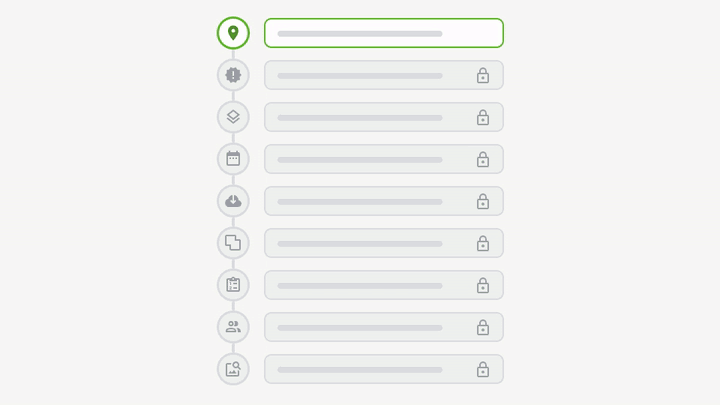

The steps of the **Workflow** panel are numbered. The other tools open from the left rail (see `The app window <defo-window_>`_).

.. list-table::
    :header-rows: 1
    :widths: 10 30 60

    *   -   Step
        -   Subsection
        -   Purpose
    *   -   –
        -   `Project <defo-project_>`_
        -   Create, open, import or delete a project, the folder that holds all your work.
    *   -   1
        -   `Area of interest <defo-aoi_>`_
        -   Choose the area to monitor.
    *   -   2
        -   `Alert sources <defo-alerts_>`_
        -   Choose the alert datasets to download.
    *   -   3
        -   `Optional layers <defo-layers_>`_
        -   Add reference layers to judge the alerts by.
    *   -   4
        -   `Monitoring period <defo-period_>`_
        -   Set the dates of a monitoring round.
    *   -   5
        -   `Download & harmonize <defo-prepare_>`_
        -   Download the sources of the period onto one grid.
    *   -   6
        -   `Integrate & vectorize <defo-integrate_>`_
        -   Combine the sources into an alert set, one polygon per alert.
    *   -   7
        -   `Questionnaire <defo-questionnaire_>`_
        -   Write the questions asked for every alert, and choose the report template.
    *   -   8
        -   `Evaluation <defo-evaluation_>`_
        -   Review alone, or split the alerts among evaluators.
    *   -   –
        -   `Analysis <defo-analysis_>`_
        -   Review each alert on before and after images.
    *   -   –
        -   `Overview <defo-overview_>`_
        -   View the figures of an alert set.
    *   -   –
        -   `Export <defo-export_>`_
        -   Export the files of one alert, or the alerts of a whole set.

For a worked example from start to finish, see `Use case: alert review in Madre de Dios, Peru <defo-use-case_>`_.

.. _defo-setup:

Set up
------

Requirements:

-   a SEPAL account;
-   a GEE account connected to SEPAL; and
-   for the *Planet* images of the Analysis timeline, access to the Planet NICFI (Norway's International Climate and Forest Initiative) tropical mosaics in GEE.

To start the app, go to the SEPAL **Apps** dashboard and select **Forest Cover Loss Alerts**.

The app runs in your SEPAL session and keeps your projects in your SEPAL home, under ``module_results/deforestation_alerts/``.

.. note::

    The launching process can take several minutes.

.. _defo-window:

The app window
^^^^^^^^^^^^^^

The map fills the window. The **Workflow** panel on the right side holds the numbered steps. A narrow rail of icons runs down the left side.

To use the left rail:

-   Hover over an icon to view its name.
-   Select the arrow on the edge of the rail to expand it and show the names. Select its pin to keep it expanded. An expanded rail that is not pinned folds back when you click on the map.

.. note::

    While a dialog is open, the rail does not respond. Close the dialog with its cross first.

From top to bottom, the rail holds:

-   **Map**: shows the map with no dialog over it;
-   **About**: a short description of the app (the sources it downloads, how the alerts are reviewed and exported, and where your projects are saved);
-   **Project**: opens the `Project <defo-project_>`_ dialog;
-   **Analysis**: opens the `Analysis <defo-analysis_>`_ screen; and
-   **Overview**: opens the `Overview <defo-overview_>`_ dialog.

At the bottom of the rail are three links to the app's GitHub repository (its source code, its documentation and a form to report a bug), then two buttons:

-   The theme button switches, at each click, between the dark theme (moon icon), the light theme (sun icon) and an automatic theme that follows your system's setting.
-   The language selector shows the code of the current language. Select it to choose English, Spanish, French or Portuguese. The app's labels change at once. At first, the app follows the browser's language when it is one of these four, and English otherwise.

The browser remembers the theme and the language for the next session.

.. _defo-project:

Project
-------

All work happens inside a *project*: one AOI, its alert sources, its monitoring periods and every alert set built from them. A project is a folder in your SEPAL home. The app saves it automatically after every change: there is no **Save** button.

Use the **Project** dialog to create, open, import, copy and delete projects. It opens by itself when the app starts. Afterwards, select **Project** in the left rail.

When no project is open
^^^^^^^^^^^^^^^^^^^^^^^

.. shot: project-empty | The Project dialog right after the app starts, with no project open: folder icon, "No project open" heading, the three buttons New project / Manage projects (n) / Import. Crop to the dialog.

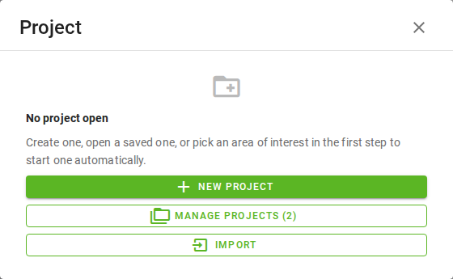

The dialog reads **No project open** and offers three buttons:

.. list-table::
    :header-rows: 1
    :widths: 25 75

    *   -   Button
        -   Description
    *   -   **New project**
        -   Asks for a name and creates an empty project.
    *   -   **Manage projects**
        -   Lists the projects saved in your SEPAL folder, to open or delete one. The button shows how many there are and is disabled while there are none.
    *   -   **Import**
        -   Imports a review package made by a colleague (see `Import a review package <defo-project-import_>`_).

.. tip::

    Creating a project first is not required. Go straight to the `AOI <defo-aoi_>`_ step and select an area: the app creates a project named after the area and today's date (e.g. ``PER_Madre_De_Dios_20261019``).

When a project is open
^^^^^^^^^^^^^^^^^^^^^^

.. shot: project-open | The Project dialog with the demo project open: project name in bold with the green "saved" chip, the summary line "PER_Madre_De_Dios · 3 sources · 1 period · 1 alert set", the "Saved … ago" line, and the buttons New project / Manage / Import / Duplicate. Crop to the dialog.

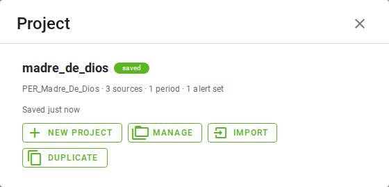

The dialog shows:

-   the project's name with a chip: **saved** once the project is on disk, or **save failed** in red when the last automatic save did not work (a line below gives the reason; the changes are still in the app, so fix the cause, usually a full disk, before closing the browser tab);
-   a summary: the AOI (or "no AOI yet") and the number of sources, periods and alert sets; and
-   when the project was last saved (e.g. "Saved 3 minutes ago").

Its buttons are **New project**, **Manage**, **Import** and **Duplicate**.

.. _defo-project-create:

Create a project
^^^^^^^^^^^^^^^^

.. shot: project-new | The "New project" name form open over the Project dialog, with "Madre de Dios 2026" typed in the Project name field and the Create button enabled. Crop to the form.

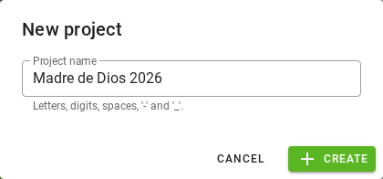

To create a project:

1.  Select **New project**.
2.  Enter a name in the **Project name** field.
3.  Select **Create** (or press **Enter**).

The **Project name** accepts letters, digits, spaces, hyphens (``-``) and underscores (``_``) only. It must not be empty and must differ from every project folder already in your SEPAL folder (ignoring upper and lower case).

The name is checked while you type. If it matches a saved project, the form offers a link such as **Open Madre de Dios 2026 instead**.

The new project opens on the `AOI <defo-aoi_>`_ step, always the first step of the workflow.

Open, search and delete projects
^^^^^^^^^^^^^^^^^^^^^^^^^^^^^^^^

.. shot: project-manage | The "Manage projects" dialog with three saved projects listed, the demo project selected and marked with the outlined "open" chip, each row showing its count chips (sources, periods, alert sets) and "modified … ago", the Search projects field empty, the Open button enabled. Crop to the dialog.

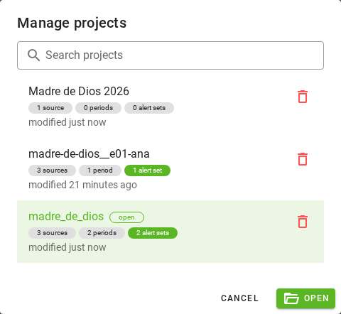

**Manage** (or **Manage projects** when nothing is open) lists every saved project with:

-   small chips for its number of sources, periods and alert sets (the alert-set chip is coloured when the project has results to review);
-   when it was last changed (e.g. "modified 2 days ago"); and
-   an **open** chip on the project that is open now.

To open a project:

1.  Enter text in the **Search projects** field to keep only the projects whose name contains it.
2.  Select a project.
3.  Select **Open**.

To delete a project:

1.  Select the red bin icon on its row. The confirmation dialog shows the size of the project folder.
2.  Enter the project's name exactly in the confirmation field.
3.  Select **Delete**.

.. attention::

    Deleting removes the whole project folder: downloads, alert sets, reviews and reports. It cannot be undone.

    -   Deleting the open project closes it first.
    -   A project cannot be deleted while a task (a download, an **Integrate & vectorize** run or a review save) is still writing into it. Wait for the task to end.

.. _defo-project-duplicate:

Duplicate a project
^^^^^^^^^^^^^^^^^^^

**Duplicate** copies the open project under a new name. The copy keeps the AOI, sources, masks, layers and grid, the look-back and the report template, without periods or alert sets. The copy opens on its AOI step.

Use it to:

-   start a new monitoring round from the same setup; or
-   monitor another area once the AOI of a project is locked (see `Area of interest <defo-aoi_>`_).

.. note::

    The questionnaire's questions are not copied: the copy starts with the default questions. Add your own again in its `Questionnaire <defo-questionnaire_>`_ step.

**Duplicate** is not offered for a review copy.

.. _defo-project-import:

Import a review package
^^^^^^^^^^^^^^^^^^^^^^^

When a project's creator splits the alerts among several evaluators (see `Evaluation <defo-evaluation_>`_), each evaluator receives a *review package*: one .zip file.

To work on a review package:

1.  Copy the .zip file into your SEPAL folder.
2.  In the **Project** dialog, select **Import**.
3.  In the **Import a review package** dialog, select the file in **Review package (.zip)**. The import starts as soon as the file is selected.

The package becomes a new project, a *review copy*, named after the original project and the evaluator (e.g. ``madre-de-dios__e01-ana``). It opens directly on the `Analysis <defo-analysis_>`_ screen, filtered to the alerts assigned to that evaluator. In a review copy the setup steps are locked, and a banner reads: "Review copy for (evaluator), from (project). Setup is locked."

If the same package was already imported, the **Already imported** dialog offers two options:

-   **Open existing copy**: opens the existing copy, with its reviews; or
-   **Import as new copy**: imports the package again as a separate project. The existing copy is never overwritten.

.. important::

    A *reviewed copy* (the file an evaluator sends back) cannot be imported here. The project's creator merges it in the `Evaluation <defo-evaluation_>`_ step of the original project.

Where the files are
^^^^^^^^^^^^^^^^^^^

Each project is a folder named after the project, under ``module_results/deforestation_alerts/`` in your SEPAL home:

.. list-table::
    :header-rows: 1
    :widths: 30 70

    *   -   Inside the project folder
        -   Content
    *   -   ``project.json``
        -   The project's settings and history. The app writes it on every save.
    *   -   ``aoi.geojson``
        -   The AOI, when it is a drawn shape, a vector file or a point file. An administrative area or a GEE asset is read from GEE instead.
    *   -   ``masks/``
        -   The masks of `Download & harmonize <defo-prepare_>`_, aligned on the project's grid.
    *   -   ``imagery/``
        -   The index of satellite scenes used on the Analysis screen.
    *   -   ``periods/<start>_<end>/``
        -   One folder per monitoring period: ``raw/`` downloads, ``harmonized/`` rasters, and ``sets/`` with one folder per alert set.

.. note::

    Leave these files alone while the app is running. Use the app's `export <defo-export_>`_ tools to take results out.

.. _defo-aoi:

Area of interest
----------------

.. labels-ok: AOI selection method; Country/Province; Admin level 1; Admin level 2; Vector file; Drawn shapes; Point file; GEE Asset name; Select AOI; Select an AOI name; Select an asset; column; value; Use all features; Table file; id; latitude; longitude; Column; Value

The AOI is the area the project monitors:

-   every alert download is cut to it;
-   the coverage of each alert source is measured over it; and
-   the project's grid is built around it.

Open the **AOI** step, the first step of the **Workflow** panel. The step is always available, even with no project open.

.. shot: aoi-admin | The AOI step in the Workflow panel with AOI selection method = Admin level 1, Country/Province = Peru, Admin level 1 = "Madre De Dios" (as the list spells it), after Select AOI was pressed: the Madre de Dios outline is drawn on the main map, zoomed to it. Crop to the panel plus the map.

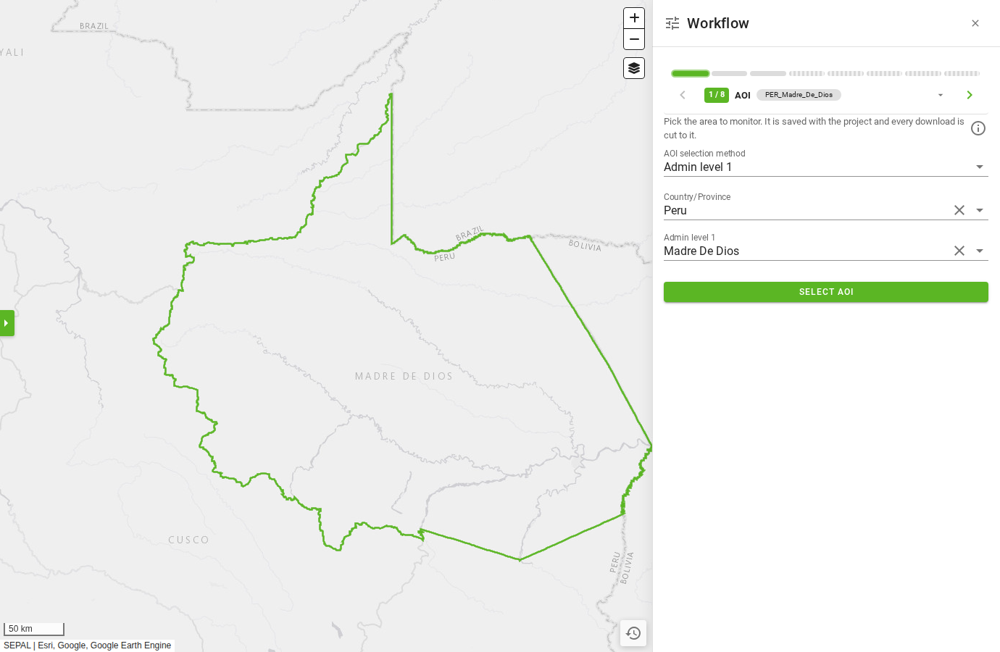

Select the area
^^^^^^^^^^^^^^^

To select the AOI:

1.  Choose a method in the **AOI selection method** dropdown menu.
2.  Fill out its fields.
3.  Select **Select AOI**.

The area is drawn on the map and saved with the project at once.

.. shot: aoi-methods | The AOI step with the AOI selection method dropdown open, showing the two groups (Administrative definitions, Custom geometries) and the methods down to Drawn shapes (the list scrolls for the rest). Crop to the panel.

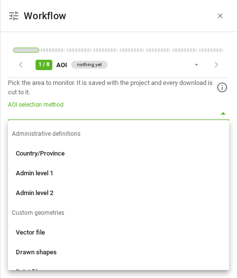

.. list-table::
    :header-rows: 1
    :widths: 20 40 40

    *   -   Method
        -   Input
        -   Notes
    *   -   **Country/Province**
        -   A country.
        -   Administrative boundaries come from the Food and Agriculture Organization of the United Nations (FAO) Global Administrative Unit Layers (GAUL) dataset.
    *   -   **Admin level 1**
        -   A country, then a first-level unit (a region, state or department).
        -   Each list fills in once the level above is chosen.
    *   -   **Admin level 2**
        -   A country, a first-level unit, then a second-level unit (a province or district).
        -
    *   -   **Vector file**
        -   A .shp, .geojson, .gpkg or .kml file in your SEPAL folder.
        -   Keep every feature, or choose a **column** and a **value** to keep only the matching features.
    *   -   **Drawn shapes**
        -   Shapes drawn on the map with the drawing tools that appear, and an optional name in **Select an AOI name**.
        -   All the drawn shapes together form the AOI. Without a name, it is called ``drawn_`` plus the date and time.
    *   -   **Point file**
        -   A .csv or .txt table with an **id**, a **latitude** and a **longitude** column.
        -   Builds the AOI from points. Points have no surface, so prefer a method that gives polygons for monitoring.
    *   -   **GEE Asset name**
        -   A GEE table (feature collection) or image you can read, chosen in **Select an asset** or pasted as its full ID.
        -   For a table, keep only the features whose **Column** has a given **Value**.

When the selection is done, the app confirms: "AOI saved: (name)". The **Workflow** panel shows the AOI's name under the step, and the `Alerts <defo-alerts_>`_ and `Optional layers <defo-layers_>`_ steps unlock.

.. tip::

    A national AOI works, but everything after it (downloads, the grid, vectorization) grows with the area. Start with a province or a district while learning the app.

What happens when an area is selected
^^^^^^^^^^^^^^^^^^^^^^^^^^^^^^^^^^^^^

When an area is selected:

-   If no project is open, a project is created and named after the AOI and today's date (e.g. ``PER_Madre_De_Dios_20261019``). An administrative area is named after the country's ISO code and the unit's name.
-   The coverage of every alert source over the new area is checked once and saved in the project. The `Alerts <defo-alerts_>`_ step shows it.
-   If the project already had a different AOI, every download, harmonized raster and mask made for the old area is deleted, because they were cut to it. The project's grid is reset, so that it is built again around the new area.

When the AOI is locked
^^^^^^^^^^^^^^^^^^^^^^

Once the project has an alert set, its AOI cannot change: a new area would invalidate every download and every alert footprint. The step then shows "This project already has alert sets, so its AOI is locked. Duplicate the project (Project dialog) to monitor another area." and the selector is disabled.

To monitor another area with the same sources, masks, layers and grid, select **Duplicate** in the `Project <defo-project-duplicate_>`_ dialog, then select the new area in the copy.

In a review copy (see `Import a review package <defo-project-import_>`_), the step shows only the AOI's name: the area is the one chosen by the project's creator.

.. important::

    The AOI cannot change while a task is writing into the project (a download or an **Integrate & vectorize** run). The app displays: "A job is writing into this project; change the AOI once it has finished." Wait for the task to end, then select the area again.

.. _defo-alerts:

Alert sources
-------------

An *alert source* is a dataset of forest-loss alerts. Each alert pixel is *confirmed* (high confidence) or *probable* (low confidence) and carries the day it was first detected.

The **Alerts** step lists the sources the project monitors and how much of the AOI each one covers. Every source is downloaded for every period, cut to the AOI and to the period's search window.

Open the **Alerts** step of the **Workflow** panel. It unlocks once the project has an `AOI <defo-aoi_>`_.

.. shot: alerts-list | The Alerts step of the demo project with three sources listed (GLAD-L, RADD, GLAD-S2), each with its green "covers the AOI" (or orange partial) coverage chip, the grey note line "predefined · first → last" under each row, the RADD info note, and the map / delete icons on the right. Crop to the Workflow panel.

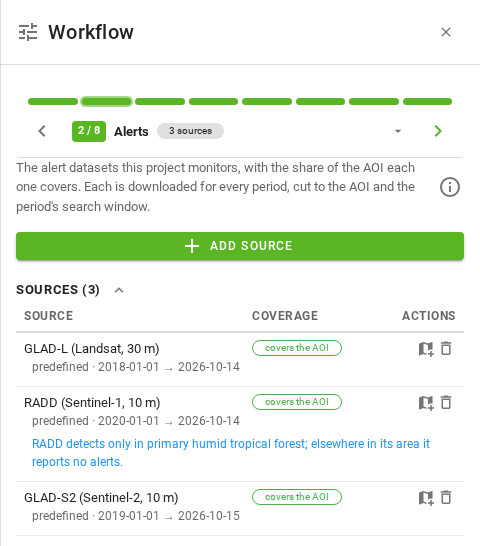

The source list
^^^^^^^^^^^^^^^

Each row of **Sources** shows:

.. list-table::
    :header-rows: 1
    :widths: 20 80

    *   -   Part of the row
        -   Description
    *   -   **Source**
        -   The source's name, then a note with its kind (**predefined**, or "custom · format") and the first and last dates of data found over the AOI.
    *   -   **Coverage**
        -   The share of the AOI inside the source's footprint: **covers the AOI** (green), "covers 62% of the AOI" (orange: the rest of the AOI gets no alerts from it), **does not cover the AOI**, **checking coverage…** while the check runs, or **coverage not checked** when it has not run or has failed.
    *   -   Map icon
        -   Shows the source on the map: the alerts of the active period's search window, or every date the source holds over the AOI when there is no period yet. A GeoTIFF source is shown only once it is harmonized.
    *   -   Pencil icon
        -   Edits a custom source (see below).
    *   -   Bin icon
        -   Removes the source, with its downloads and harmonized files.

The coverage is checked once, when the AOI is chosen, and saved in the project. If the check failed (e.g. GEE was not reachable), a **Check again** button appears under the list.

Add a source
^^^^^^^^^^^^

Select **Add source** to open the **Add an alert source** dialog, then choose the **Source type**:

-   **Predefined**: one of the catalogue sources; or
-   **Custom (0 of 6)**: your own GEE image, image collection or GeoTIFF. The count shows how many of the six custom slots are in use.

A project holds at most three predefined and six custom sources.

Predefined sources
""""""""""""""""""

.. shot: alerts-add-predefined | The "Add an alert source" dialog with Source type = Predefined and the Predefined source list open, showing each source followed by its coverage (e.g. "GLAD-S2 (Sentinel-2, 10 m) — covers the AOI"). Use a project where only GLAD-L is added so RADD and GLAD-S2 are still offered. Crop to the dialog.

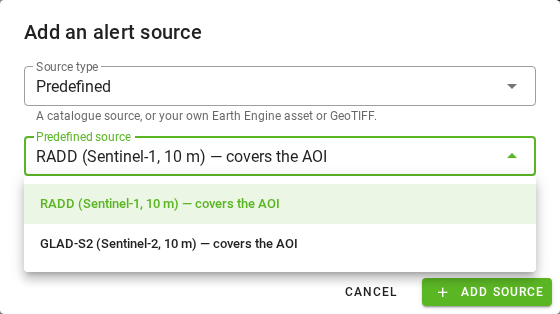

Choose a source in the **Predefined source** dropdown menu, then select **Add source**. Each entry shows its coverage of the AOI. A source that does not cover the AOI at all is listed as disabled, with the reason.

.. list-table::
    :header-rows: 1
    :widths: 25 30 45

    *   -   Source
        -   Sensor and pixel size
        -   Coverage
    *   -   **GLAD-L (Landsat, 30 m)**
        -   Landsat, about 30 m.
        -   The land of its four regional tiles (Asia, Africa, Central and South America), between about 35°S and 35°N.
    *   -   **RADD (Sentinel-1, 10 m)**
        -   Sentinel-1 radar, 10 m. Sees through clouds.
        -   The humid tropics of Africa, Southeast Asia, and Central and South America. It detects only in primary humid tropical forest; elsewhere in its area, it reports no alerts.
    *   -   **GLAD-S2 (Sentinel-2, 10 m)**
        -   Sentinel-2, 10 m.
        -   90°W–30°W, 20°S–20°N.

When every predefined source is in the project, the dialog reads: "Every predefined source is already in this project."

Custom sources
""""""""""""""

.. shot: alerts-add-custom | The "Add an alert source" dialog with Source type = Custom (0 of 6), Raster source = Earth Engine asset, an image asset id filled in, the Name suggested from it, Alert format = RADD with its help line, Alert band and Date band filled in. Crop to the dialog.

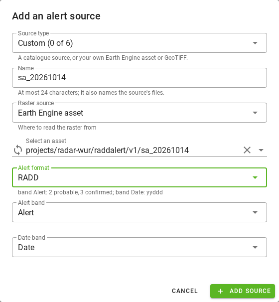

A custom source reads your own alert raster through one of four format presets.

.. list-table::
    :header-rows: 1
    :widths: 20 40 40

    *   -   Field
        -   Description
        -   Default and limits
    *   -   **Name**
        -   The source's name in lists, legends and file names.
        -   Suggested from the asset or file name. At most 24 characters, at least one letter or digit, unique in the project. GLAD-L, RADD and GLAD-S2 are reserved.
    *   -   **Raster source**
        -   Where the raster is read from: **Earth Engine asset** or **GeoTIFF in my SEPAL folder**.
        -   **Earth Engine asset**.
    *   -   Asset or **GeoTIFF**
        -   The GEE image or image collection, or the .tif file.
        -   An image collection is used whole, the newest image on top. For a collection of weekly snapshots (like RADD's own), give the latest image's ID instead. The GeoTIFF needs a coordinate reference system.
    *   -   **Alert format**
        -   How the bands are read (see below).
        -   Suggested from the band names when the app recognizes them.
    *   -   **Alert band**
        -   The band holding the alert class.
        -   Only for **RADD**, **SEPAL CCDC alerts** and **SEPAL PyEO alerts**.
    *   -   **Date band**
        -   The band holding the detection date.
        -   Always required.
    *   -   **Date encoding**
        -   How the date is written.
        -   Only for **Date only**: **yymm (year and month; the alert is dated on the 1st)**, **yyddd (year and day of year)**, **yyyyddd (year and day of year)** or **decimal year**.

The four formats:

.. list-table::
    :header-rows: 1
    :widths: 25 75

    *   -   Alert format
        -   How a pixel becomes an alert
    *   -   **RADD**
        -   Alert band: 2 is probable, 3 is confirmed. Date band in ``yyddd``.
    *   -   **SEPAL CCDC alerts**
        -   Continuous Change Detection and Classification (CCDC) outputs. ``detection_count``: one or two detections are probable, three or more are confirmed. ``first_detection_date`` in fractional years.
    *   -   **SEPAL PyEO alerts**
        -   Outputs of the Python for Earth Observation (PyEO) change detection, read like CCDC. ``total_changes``: one or two changes are probable, three or more are confirmed. ``first_change_date_above_threshold`` in fractional years.
    *   -   **Date only**
        -   One date band in the chosen encoding. Every dated pixel is a confirmed alert.

When **Add source** is selected, the app checks the raster: the bands exist and are numeric, the dates can be read and the source covers the AOI. A problem is shown in red inside the dialog, which stays open for corrections. While the check runs, the button reads **Cancel** and stops it.

Edit a custom source
""""""""""""""""""""

Select the pencil icon to reopen the form, titled with the source's name. The name is fixed; the raster, format and bands can change.

Once an alert set uses the source, it can no longer be edited: delete it and add a new one.

Remove a source
^^^^^^^^^^^^^^^

Select the bin icon, then confirm. The source's downloads and harmonized files are deleted. Alert sets that already used it keep their alerts and show as out of date.

Common messages
^^^^^^^^^^^^^^^

"This source does not cover the AOI."
    The raster's footprint misses the area: check the asset or the AOI.

"A mapped band is missing." or "A mapped band is not numeric."
    Choose other bands or another format.

"This CCDC asset stores its dates as Julian days or Unix time …"
    Only CCDC outputs dated in fractional years are supported.

"A job is writing into this project; …"
    Sources cannot change during a download or an **Integrate & vectorize** run. Wait for it to end.

.. _defo-layers:

Optional layers
---------------

Visualization layers support the review of the alerts: a land-cover map, a forest baseline, a recent mosaic. They never change the alerts. A layer can be shown on the main map and, with **Show in Analysis** selected, on the two maps of the `Analysis <defo-analysis_>`_ screen.

Open the **Optional layers** step of the **Workflow** panel. It unlocks once the project has an `AOI <defo-aoi_>`_.

The step is optional: skip it and come back at any time. Once the project has a `monitoring period <defo-period_>`_, the **Workflow** panel counts the step as done even without a layer, and its badge reads "none" instead of "nothing yet".

.. shot: layers-list | The Optional layers step of the demo project with its one layer listed: name, kind chip, the green "in Analysis" chip, the grey summary note under it, and the map / edit / delete icons; the layer switched on, so it shows on the main map with its legend. Crop to the Workflow panel plus the visible part of the map.

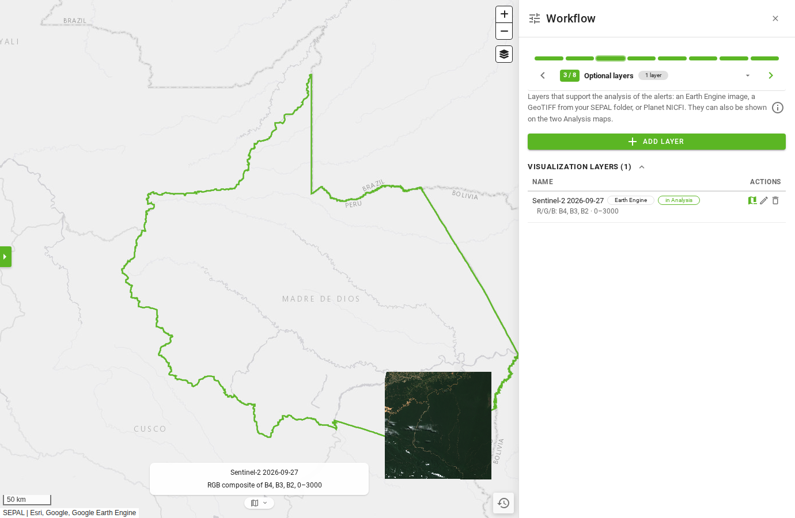

The layer list
^^^^^^^^^^^^^^

Each row of **Visualization layers** shows:

-   the layer's **Name**;
-   a chip with its kind (**Earth Engine**, **GeoTIFF** or **Planet NICFI**);
-   an **in Analysis** chip when it is shown on the Analysis maps; and
-   a note with its bands and value range (or its month, for Planet NICFI).

The icons on the right side of each row:

-   the map icon shows the layer on the main map, with its legend;
-   the pencil icon opens it for editing (**Edit layer** *name*); and
-   the bin icon deletes it. The layer is removed from the project; its file or asset is not touched.

Add a layer
^^^^^^^^^^^

Select **Add layer** to open the **Add a visualization layer** dialog. Choose the **Kind** first: the other fields depend on it.

Earth Engine image and GeoTIFF
""""""""""""""""""""""""""""""

.. shot: layers-add-rgb | The "Add a visualization layer" dialog with Kind = Earth Engine, an optical image asset filled in, Three bands (RGB) switched on, the band roles Red / Green / Blue / NIR / SWIR filled in automatically, Combination = False-colour infrared, the Red/Green/Blue band fields set by it, Min and Max filled in, Show in Analysis ticked. Crop to the dialog.

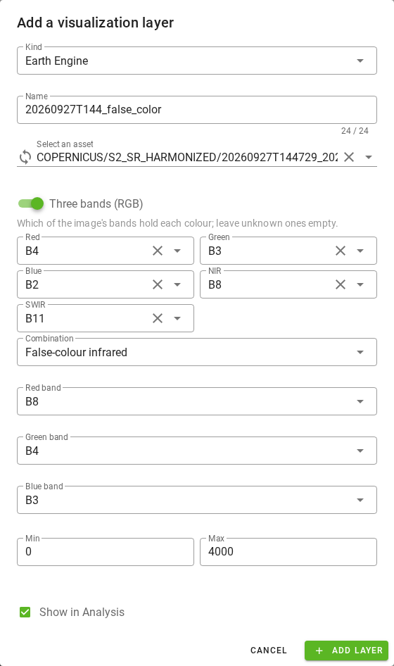

.. labels-ok: True colour; False-colour infrared; SWIR / NIR / red

.. list-table::
    :header-rows: 1
    :widths: 20 40 40

    *   -   Field
        -   Description
        -   Default and limits
    *   -   **Name**
        -   The layer's name in the list, on the maps and in the legend.
        -   Suggested from the image or file name, plus the band or combination. At most 24 characters, unique in the project.
    *   -   Asset or **GeoTIFF**
        -   A GEE *image* (not a collection), or a .tif file in your SEPAL folder.
        -   The GeoTIFF's folder must be writable: the app writes an overview file next to it so that the layer draws quickly.
    *   -   **Three bands (RGB)**
        -   Off: one band drawn with a colour ramp. On: three bands as a red-green-blue (RGB) composite.
        -   Off.
    *   -   **Band**
        -   The band to draw (one-band layer).
        -
    *   -   **Colour ramp**
        -   The colours for a one-band layer: **Grayscale**, **Blues**, **Greens**, **Oranges**, **Cool–warm**, **Viridis**, **Terrain**, **Heat** or **Magma**.
        -   **Grayscale**.
    *   -   **Invert**
        -   Reverses the ramp.
        -   Off.
    *   -   **Red**, **Green**, **Blue**, **NIR**, **SWIR**
        -   Which of the image's bands holds each colour, near infrared (NIR) and shortwave infrared (SWIR) (RGB layer). Leave unknown ones empty.
        -   Guessed from the band names (e.g. ``B4`` or ``SR_B4`` for red).
    *   -   **Combination**
        -   Fills the three bands from those roles: **True colour**, **False-colour infrared** (NIR / red / green), **SWIR / NIR / red**, or **Custom** to choose them yourself.
        -   The first combination the roles allow. A combination is offered only when its roles are filled.
    *   -   **Red band**, **Green band**, **Blue band**
        -   The bands drawn in red, green and blue.
        -   Must be three different bands. Choosing one by hand switches **Combination** to **Custom**.
    *   -   **Min**, **Max**
        -   The value range stretched over the colours.
        -   0 and 1. Both must be numbers, **Min** below **Max**.

.. tip::

    Set **Min** and **Max** to the real range of the data (e.g. 0 to 3000 for a Sentinel-2 surface-reflectance image). With the default 0 to 1, most images draw all white.

Planet NICFI
""""""""""""

.. shot: layers-add-nicfi | The "Add a visualization layer" dialog with Kind = Planet NICFI, Name filled in, Month (YYYY-MM) left empty with its hint, the "Region: Americas" line, and Show in Analysis ticked. Crop to the dialog.

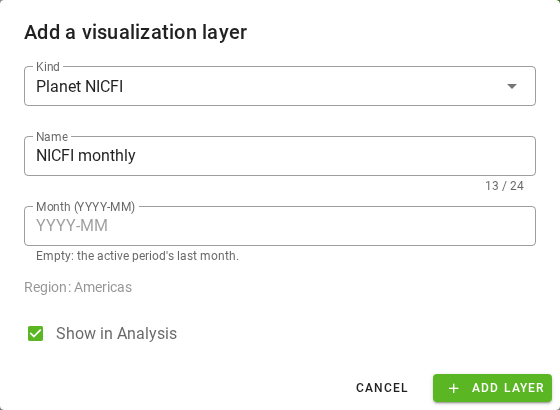

The monthly Planet NICFI tropical mosaic, read through GEE and drawn in true colour.

.. list-table::
    :header-rows: 1
    :widths: 20 40 40

    *   -   Field
        -   Description
        -   Default and limits
    *   -   **Name**
        -   The layer's name.
        -   At most 24 characters, unique in the project.
    *   -   **Month (YYYY-MM)**
        -   The month of the mosaic.
        -   Empty: the active period's last month, which follows the active period when it changes. Without a period, last month.

The region (**Americas**, **Africa** or **Asia**) comes from the centre of the AOI and is shown under the month. When the layer is saved, the app checks that your GEE account can read that region.

.. important::

    "Your Earth Engine account has no access to Planet NICFI …" means the account has not been granted NICFI access. Request it from Planet's NICFI programme, then add the layer again.

Show in Analysis
""""""""""""""""

**Show in Analysis** (all kinds) adds the layer to both maps of the `Analysis <defo-analysis_>`_ screen, turned off. Turn it on there from the layer menu. The Analysis maps show no legend for it.

Save a layer
^^^^^^^^^^^^

Select **Add layer** (or **Save** when editing). The app checks the bands, the range and, for a GeoTIFF, the folder. A problem is shown in red inside the dialog, which stays open. While the check runs, the button reads **Cancel** and stops it.

Common messages
^^^^^^^^^^^^^^^

"Pick an Earth Engine image."
    Image collections are not accepted as layers. Export a single image first.

"Pick three different bands for red, green and blue."
    Choose a different band for each colour.

"The folder … is not writable, so the layer's overviews cannot be built."
    Move the GeoTIFF to a folder of your own in SEPAL.

"The file … no longer exists."
    The file of a GeoTIFF layer was moved or deleted. Edit the layer and choose the file again.

.. _defo-period:

Monitoring period
-----------------

A *period* is one monitoring round, usually a month. For each period, the app downloads every source over the period's dates plus a *look-back* before them, and builds that period's alert sets. A project usually holds a series of consecutive periods.

Open the **Period** step of the **Workflow** panel. It unlocks once the project has at least one `alert source <defo-alerts_>`_.

.. shot: period-list | The Period step of the demo project with its one period listed: "start → end" in the Period column, the Sets count, the Status column, the period's radio selected (active), and the notes under it ("Search window: … → …", "No earlier set: every alert in the search window is kept", and "Its dates are fixed: it has alert sets." if it has a set). Crop to the Workflow panel.

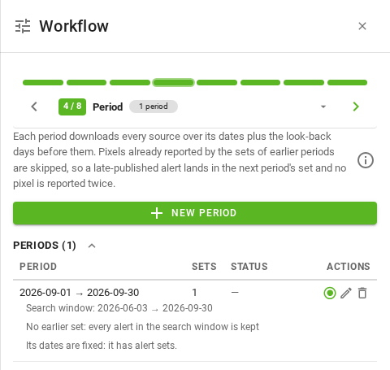

.. _defo-period-tracking:

Loss that spans several periods
^^^^^^^^^^^^^^^^^^^^^^^^^^^^^^^

Each period is processed on its own, but forest loss does not keep to the period's dates. Some loss could be missed between two periods:

-   a clearing that starts too small to be an alert;
-   alerts that the providers publish late, after their period was processed; or
-   a clearing that keeps growing at the edge of an alert reported in an earlier period.

The app tracks this loss from one period to the next, and never reports the same loss twice:

.. list-table::
    :header-rows: 1
    :widths: 35 65

    *   -   Case
        -   What the app does
    *   -   Loss already reported by an earlier period
        -   Its pixels (the *footprint* of the earlier alert set) are removed from the new period's run, so it is not reported again.
    *   -   A cluster too small to be an alert, or an alert published late
        -   The `look-back <defo-period-lookback_>`_ searches back into the earlier period: the pixels set aside come back and can join new pixels to form an alert.
    *   -   A clearing that grows next to a reviewed alert
        -   The new alert is `linked to the earlier alert <defo-period-growth_>`_ as a *growth alert*, and kept even when it is under the minimum size.

.. _defo-period-lookback:

The search window and the look-back
"""""""""""""""""""""""""""""""""""

A clearing often starts small and grows over the following weeks. In the period where it starts, its cluster of alert pixels is still smaller than the **Minimum alert size** of `Integrate & vectorize <defo-integrate_>`_, so it does not become an alert: its pixels are set aside as *not analysable*.

The look-back keeps these pixels in play:

-   Each period searches a wider *search window*: its own dates plus the look-back days before its start.
-   The pixels set aside by the earlier period come back into the run and join the new pixels that touch them.
-   If the cluster they form together reaches the minimum size, it becomes an alert. Its first detection date is the date of its earliest pixel, in the earlier period.

To avoid reporting the same loss twice, every pixel already reported by an alert set of an *earlier* period is removed before the new period's alerts are built: only what was set aside comes back. The look-back also catches alerts that the providers published late, after the earlier period was processed.

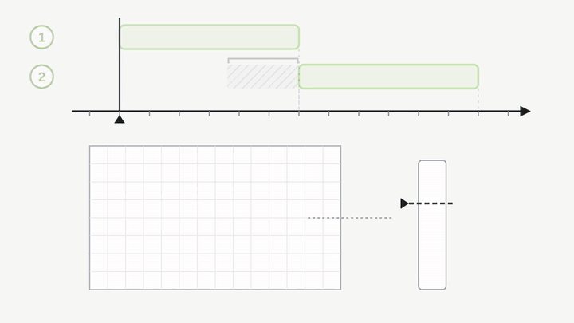

.. note::

    The first period has no earlier set to compare with, so every alert in its search window is kept. Its row reads **No earlier set: every alert in the search window is kept**. With a look-back, that includes alerts dated before the period's start.

    A new project's first period starts with no look-back, so it searches only its own dates unless a look-back is set. A project made with **Duplicate** keeps the look-back of the project it was copied from.

.. _defo-period-growth:

Growth next to earlier alerts
"""""""""""""""""""""""""""""

The pixels of a reported alert are part of the footprint, so the look-back does not bring them back. But a clearing often keeps growing at the edge of an alert reported in an earlier period. The new pixels then form a cluster of their own, often smaller than the **Minimum alert size**, which would be set aside like any small cluster.

When the earlier alert was saved as **True alert** or **Needs review**, `Integrate & vectorize <defo-integrate-growth_>`_ keeps this growth in view:

-   A new alert that touches or overlaps the earlier alert is a *growth alert*, linked to it.
-   A cluster under the minimum size is kept when it touches the earlier alert: it is a growth alert *under the minimum area*. A small cluster that touches nothing is set aside, and the look-back can still bring it back in the next period.
-   The run looks for earlier alerts in every earlier period, whatever the look-back.

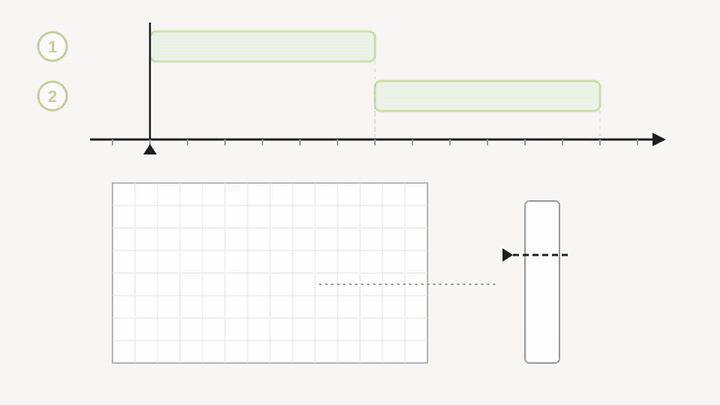

The alerts linked to each other, across all periods, make the *history* of a clearing. Analysis shows it on each alert (see `Earlier alerts <defo-analysis-earlier_>`_), and the `Overview <defo-overview-growth_>`_ sums it up.

.. tip::

    Only the reviews saved when `Integrate & vectorize <defo-integrate_>`_ starts count. Review the alerts of a period before you run the next one, so that their growth is linked. An alert reviewed later can still be linked by hand in `Earlier alerts <defo-analysis-earlier_>`_.

The period list
^^^^^^^^^^^^^^^

Each row of **Periods** shows:

.. list-table::
    :header-rows: 1
    :widths: 20 80

    *   -   Column
        -   Description
    *   -   **Period**
        -   The period's dates ("start → end"), with notes under them: its search window and any warnings.
    *   -   **Sets**
        -   The number of alert sets built for this period.
    *   -   **Status**
        -   **out of date** when a source download or an alert set no longer matches the current settings (run it again in `Download & harmonize <defo-prepare_>`_ or `Integrate & vectorize <defo-integrate_>`_); **missing** when an alert set's files are gone; a dash when everything is current.

The icons on the right side of each row:

-   the radio button makes the period *active*: `Download & harmonize <defo-prepare_>`_ and `Integrate & vectorize <defo-integrate_>`_ work on the active period;
-   the pencil icon changes its dates or look-back; and
-   the bin icon deletes it.

.. _defo-period-add:

Add a period
^^^^^^^^^^^^

.. shot: period-new | The "New period" dialog pre-filled for a second period: Start = the day after the demo period's end, End = today, Look-back (days) = 90 (the last value used, the demo period's) with its hint, the "Search window: … → …" preview line and the masks note, Add period enabled. Crop to the dialog.

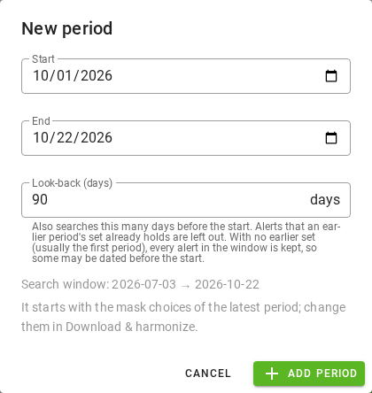

Select **New period**. The dialog is pre-filled so that the new period continues the series.

.. list-table::
    :header-rows: 1
    :widths: 20 35 45

    *   -   Field
        -   Description
        -   Default and limits
    *   -   **Start**
        -   The first day of the period.
        -   The day after the latest period ends. For the first period, the first day of the current month.
    *   -   **End**
        -   The last day of the period.
        -   Today. Must be after **Start**. Two periods cannot have the same dates.
    *   -   **Look-back (days)**
        -   The number of days before **Start** that are also searched.
        -   0 (no look-back) for a new project's first period (a duplicated project keeps the look-back of its source), then the last value used. A whole number from 0 to 3650.

Under the fields, the dialog previews the search window ("Search window: start → end"). Select **Add period**: the period is created and becomes the active period.

A new period starts with the mask choices of the latest period. Change them in `Download & harmonize <defo-prepare_>`_.

.. tip::

    For the set-aside clusters to come back, the look-back must reach into the previous period. With a look-back of 0, the search window starts on the period's own first day and nothing set aside earlier is reconsidered.

    A cluster that stays too small stays in play in later periods for as long as their look-back reaches back to its pixels. A longer look-back gives a slowly growing clearing more time to reach the minimum size, but makes every download bigger (see `What earlier periods already reported <defo-integrate-earlier_>`_).

Change a period
^^^^^^^^^^^^^^^

For a period without alert sets, the pencil icon opens a dialog to change its dates. New dates give the period a new identity: its downloads and harmonized files are deleted, because they were made for the old window.

A period with alert sets has fixed dates (its note reads **Its dates are fixed: it has alert sets.**). The pencil icon then opens a dialog where only the look-back can change. The period's downloads then show as out of date.

Delete a period
^^^^^^^^^^^^^^^

Select the bin icon. The confirmation dialog lists what is deleted: the period's downloads and harmonized files, and its alert sets with their reviewed alerts.

.. important::

    A period with alert sets can be deleted only when it is the latest period. An earlier period's sets are the footprint the later sets were built from, so delete the later periods first. Periods cannot change or be deleted while a task is writing into the project.

.. _defo-prepare:

Download & harmonize
--------------------

This step prepares every input of the active `period <defo-period_>`_ on one common grid. Each alert source is downloaded over the period's search window in its own projection, then *harmonized*: aligned onto the project grid and cut by the period's masks. Nothing whose inputs are unchanged runs twice.

Open the **Download & harmonize** step of the **Workflow** panel. It unlocks once the project has an active period. It works on the active period: to prepare another period, make it active in the `Period <defo-period_>`_ step first.

From top to bottom, the step has three parts: the **Project grid**, the **Masks** and the **Sources for this period**.

.. shot: prepare-step | The Download & harmonize step of the demo project after a full run: the Project grid card (EPSG of the UTM zone, Resolution 10 m, the "… × … pixels, about … MB per source before compression" line and "The grid is locked because the project has alert sets."), the Masks card with one mask, and the "Sources for this period" table with GLAD-L, RADD and GLAD-S2 all green "ready" in both Download and Harmonize, each with its "ready · N alert pixels" and "… on disk" notes. Crop to the Workflow panel.

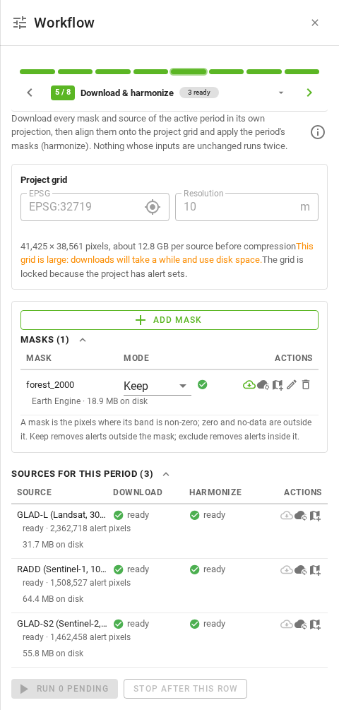

The project grid
^^^^^^^^^^^^^^^^

Every raster of the project is aligned onto one grid: one projection in metres and one pixel size, over the AOI. Alerts from sources with different pixel sizes can then be combined pixel by pixel, and the minimum alert size in hectares becomes a pixel count.

.. list-table::
    :header-rows: 1
    :widths: 15 40 45

    *   -   Field
        -   Description
        -   Default and limits
    *   -   **EPSG**
        -   The projection of the grid, as a European Petroleum Survey Group (EPSG) code. The target button at the end of the field fills in the Universal Transverse Mercator (UTM) zone of the AOI.
        -   The UTM zone of the AOI's centre. Must be a projected system in metres: a geographic system (like 4326) or one in feet is refused.
    *   -   **Resolution**
        -   The pixel size, in metres.
        -   The finest pixel size among the project's sources: 10 m with RADD or GLAD-S2, 30 m with GLAD-L only, a custom source's own pixel size, or 30 m when nothing is known. Must be greater than 0.

Under the fields, the grid's size is previewed: "width × height pixels, about … per source before compression". Above 2 GB per source, a warning reads **This grid is large: downloads will take a while and use disk space.** (it does not block the step).

Select **Save grid**. The masks and the sources table appear only once a grid is saved.

The grid can change until the first alert set is made. A new grid only harmonizes the sources again from the files already downloaded; it does not download them again. Once the project has an alert set, the card reads **The grid is locked because the project has alert sets.**

.. note::

    Changing the `AOI <defo-aoi_>`_ clears the grid and deletes every download and harmonized file of the project, which were made for the old area. Save the grid again here, then run the rows again.

Masks
^^^^^

A *mask* limits where alerts are kept. It is a raster defined once for the project: a GEE image or image collection, or a GeoTIFF, with one band. A pixel is inside the mask where that band is not zero; zero and no-data pixels are outside it.

Each period chooses a **Mode** for each mask:

.. list-table::
    :header-rows: 1
    :widths: 20 80

    *   -   Mode
        -   Effect on the period's alerts
    *   -   **Off**
        -   The mask is not used in this period.
    *   -   **Keep**
        -   Alerts *outside* the mask are removed (e.g. keep only alerts inside a forest mask).
    *   -   **Exclude**
        -   Alerts *inside* the mask are removed (e.g. drop alerts in plantations or water).

When several masks are on, all of them apply. Masks act on the harmonized sources, so a change of **Mode** makes the period's sources out of date. **Run … pending** then harmonizes them again without downloading them. A new period starts with the mask choices of the latest period.

Add a mask
""""""""""

.. shot: prepare-mask-add | The "Add a mask" dialog with Raster source = Earth Engine asset, a forest-cover image asset picked, Name filled from it with its hint "At most 24 characters; it also names the mask's files.", Band chosen, Mode in the active period = Keep, and the grey note under it. Crop to the dialog.

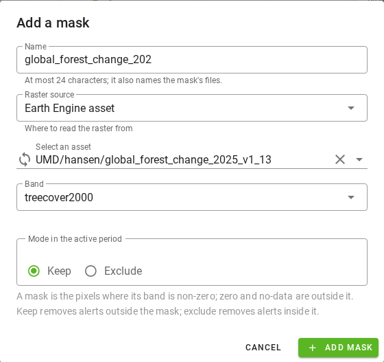

Select **Add mask** to open the **Add a mask** dialog.

.. list-table::
    :header-rows: 1
    :widths: 20 40 40

    *   -   Field
        -   Description
        -   Default and limits
    *   -   **Name**
        -   The mask's name in lists, legends and file names.
        -   Suggested from the asset or file name. At most 24 characters, at least one letter or digit, unique among the project's masks.
    *   -   **Raster source**
        -   **Earth Engine asset** or **GeoTIFF in my SEPAL folder**.
        -   **Earth Engine asset**.
    *   -   Asset or **GeoTIFF**
        -   The GEE image or image collection, or the .tif file.
        -   The bands are read as soon as it is chosen.
    *   -   **Band**
        -   The band that defines the mask.
        -   Required.
    *   -   **Mode in the active period**
        -   **Keep** or **Exclude**.
        -   **Keep**. The mask is turned on in the active period only; every other period leaves it off until it is turned on there.

When **Add mask** is selected, the app checks the raster and its band. A problem is shown in red inside the dialog, which stays open for corrections.

The mask list
"""""""""""""

Each row of **Masks** shows the mask's name, its **Mode** in the active period, and one status icon for its download and its alignment to the grid (hover over it to read both). The note under the name gives its origin (**Earth Engine** or **GeoTIFF**) and its size on disk.

The icons on the right side of each row:

-   the cloud icon downloads and aligns the mask;
-   the cloud-refresh icon (GEE masks only) downloads it again, for an asset that changed;
-   the map icon shows it on the map: a GEE mask can be previewed before it is downloaded, a GeoTIFF mask once it is aligned;
-   the pencil icon opens **Edit mask** *name*: the raster and band can change, the name cannot. Once an alert set used the mask, it can no longer be edited (**An alert set already uses this mask: add a new one instead.**); and
-   the bin icon deletes the mask. Its download and aligned file are deleted and every period stops using it. Alert sets that used it keep their alerts and show as out of date.

A mask is downloaded and aligned once for the whole project, whichever period runs it.

Sources for this period
^^^^^^^^^^^^^^^^^^^^^^^

The table has one row per alert source of the project:

.. list-table::
    :header-rows: 1
    :widths: 20 80

    *   -   Column
        -   Description
    *   -   **Source**
        -   The source's name. The notes under it give its coverage warnings, what its harmonized file found ("ready · 1234 alert pixels", "ready · 0 alerts found" or "ready · all 56 alert pixels removed by masks") and its size on disk.
    *   -   **Download**
        -   The download over the period's search window.
    *   -   **Harmonize**
        -   The alignment onto the grid, with the masks applied.

Each stage reads:

-   **ready**;
-   **out of date**, when its inputs changed (the period's dates, the AOI, the grid or a mask);
-   **missing**, when it is not made yet; or
-   **running**, with the download's percentage.

A source that cannot run reads **not covered** or **no data** in both cells, with the reason under its name ("Not covered: …" or "No data for this period: …"). See `Alert sources <defo-alerts_>`_ for coverage.

The icons on the right side of each row:

-   the cloud icon runs the row: it first aligns any mask of the period that needs it, then downloads the source (if needed) and harmonizes it. It is disabled when the row is ready;
-   the cloud-refresh icon downloads the source again even if nothing changed, for a catalogue that updates its alerts over the same dates; and
-   the map icon shows the harmonized alerts on the map.

Run everything
""""""""""""""

Select **Run … pending** (e.g. **Run 4 pending**). It first aligns the masks that need it, then runs every source that is missing or out of date, one row at a time:

-   rows that read **not covered** or **no data** are skipped;
-   a row that fails shows its error in red under it, and the run goes on with the next row.

**Stop after this row** ends the run once the row now running has finished. The rows already done stay done.

The run shows as a task notification titled **Download & harmonize**, with the step it is on ("Preparing GLAD-L", then "Harmonizing GLAD-L") and the download's percentage ("Download & harmonize · 35%"). The percentage also shows in the row's **Download** cell.

.. tip::

    Each row needs free disk space for its files. The app checks it before writing, and stops the row with a message when the disk is too full. The grid size line gives an idea of how big a source can get.

Common messages
^^^^^^^^^^^^^^^

"Not enough free disk space: this needs … GB in …, and … GB is free."
    Free some space in your SEPAL folder, or use a coarser grid.

"A row of this run is already being prepared …"
    A mask is being aligned by another period's run, or the row is still running. Run it again once that has finished.

"The AOI's geometry is still being fetched; run this row again in a moment."
    GeoTIFF sources and masks need the AOI's shape. Wait a moment. If it could not be fetched, select **Check again** under the table, then run them.

"Mask … covers none of the AOI: as a keep mask, every alert would be removed."
    The mask misses the area. Check its asset or band, or turn it off.

"A job is writing into this project; save the grid once it has finished."
    The grid, masks and sources cannot change while a download or an **Integrate & vectorize** run is going.

"missing: file not found: …" (under a row) or "Mask …: file not found (…). Put the file back at this path to use the mask."
    A GeoTIFF source or mask was moved, renamed or deleted from your SEPAL folder. Put the file back at the path shown, or edit the source or mask to point at its new place.

"A mask on in this period is not aligned on the current grid yet; Run … pending aligns the masks first."
    A source cannot be harmonized before the period's masks are aligned. Select **Run … pending**, or run the mask's row first.

"Mask …: its native grid (projection and scale) is unknown; edit the mask."
    The app does not know how to download this GEE mask. Open it with the pencil icon and save it again, so that its raster is checked anew.

.. _defo-integrate:

Integrate & vectorize
---------------------

This step turns the harmonized sources of the active period into an *alert set*: the list of alerts to review in `Analysis <defo-analysis_>`_. It:

-   combines the sources pixel by pixel;
-   removes what earlier periods already reported;
-   groups neighbouring alert pixels into alerts; and
-   draws one polygon per alert.

Open the **Integrate & vectorize** step of the **Workflow** panel. It unlocks once at least one source of the active period is ready in `Download & harmonize <defo-prepare_>`_.

.. shot: integrate-form | The Integrate & vectorize step of the demo project: "Sources to combine" with GLAD-L, RADD and GLAD-S2 checked, each with its "ready · N alert pixels" note; under them the "Include probable (unconfirmed) alerts" switch (on) with the "Set per source" link; Minimum alert size 0.5 ha with its hint; Order = Bigger alerts first; "Limit the number of alerts" ticked, with Maximum number of alerts 100 and its hint "Keeps the 100 biggest alerts."; the Attribute layers card with one layer; the grey "Creates or replaces the alert set …" line and the Integrate & vectorize button. Crop to the Workflow panel.

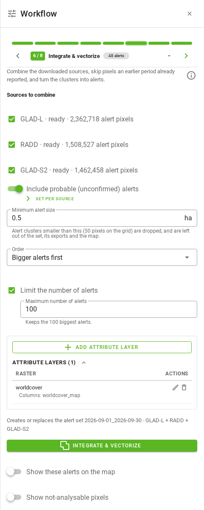

What an alert is
^^^^^^^^^^^^^^^^

An alert is a *cluster*: a group of alert pixels that touch each other, by their sides or corners, whichever source flagged each pixel. Where GLAD-L and RADD pixels touch, they form *one* alert that lists both sources. An alert is never split into one alert per source.

Each alert keeps:

-   the sources that detected it;
-   its first and last detection dates (the earliest and latest date among its pixels);
-   its area in hectares; and
-   a statistic of each attribute layer's bands (see below).

A cluster smaller than the **Minimum alert size** (see `The options <defo-integrate-options_>`_) does not become an alert: its pixels are set aside as *not analysable*.

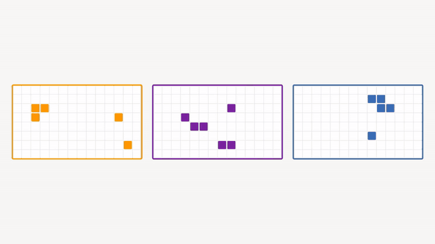

.. _defo-integrate-earlier:

What earlier periods already reported
"""""""""""""""""""""""""""""""""""""

Pixels inside the alerts of an alert set from an *earlier* period (its *footprint*) are removed before the clusters are made. This way, the `look-back <defo-period-lookback_>`_ never reports the same loss twice.

Pixels that did not become alerts (a cluster below the minimum size, or beyond the maximum number of alerts) are kept as *not analysable*. They are not in the footprint: bringing them back is the purpose of the `look-back <defo-period-lookback_>`_.

A later period's run adds those pixels back when both conditions are met:

-   its look-back reaches back into the earlier period (that period ends on or after the start of the new search window); and
-   the two periods share a source.

The pixels come back whatever their detection date within the earlier set's own search window. They join the new pixels that touch them, and a cluster that now reaches the minimum size becomes an alert. Its detection dates can be older than its own period and look-back. With a look-back of 0, the search window starts on the period's own first day, so nothing set aside is reconsidered.

.. _defo-integrate-growth:

Growth of earlier loss
""""""""""""""""""""""

A clearing often keeps growing from one month to the next. The run links each new alert to the *earlier loss* it grows from: the alerts of earlier periods' sets that were saved as **True alert** or **Needs review**. An earlier alert's shape is the polygon drawn for it in `Refine the polygon <defo-analysis-refine_>`_, or else its detected cluster.

-   A new alert that touches or overlaps an earlier alert's shape is a *growth alert*, linked to every earlier alert it touches. One without a link is a *new* alert.
-   A cluster smaller than the **Minimum alert size** is kept when it touches earlier loss: it is a growth alert *under the minimum area*. A small cluster that touches nothing is set aside as *not analysable*, as before.
-   Growth alerts are sorted and limited with the others: **Limit the number of alerts** can leave them out.
-   Only the reviews saved when the run starts count. An earlier alert confirmed afterwards is not linked, but it can be linked by hand in `Earlier alerts <defo-analysis-earlier_>`_.

The alerts linked to each other, across all periods, make the *history* of a clearing. Analysis shows it on each alert, and the `Overview <defo-overview-growth_>`_ sums it up.

.. _defo-integrate-options:

The options
^^^^^^^^^^^

The form opens with the settings of the active alert set (all but the sources), or with the defaults below when there is none.

.. list-table::
    :header-rows: 1
    :widths: 20 50 30

    *   -   Option
        -   Description
        -   Default and limits
    *   -   **Sources to combine**
        -   The sources whose alerts go into the set. Each ready source is listed with what its harmonized file found. A source that does not cover the AOI, or has no data for the period, is listed as disabled, with the reason.
        -   Every ready source. At least one.
    *   -   **Include probable (unconfirmed) alerts**
        -   Shown only when at least one selected source has a *probable* (low-confidence) class. One switch for all such sources. Off, their probable pixels are dropped before anything else, and only their confirmed pixels count. With two or more such sources, **Set per source** unfolds one switch per source (see below).
        -   On.
    *   -   **Minimum alert size**
        -   Clusters smaller than this are dropped. The hint gives that size in pixels of the grid (at 10 m, 0.5 ha is "50 pixels on the grid").
        -   0.5 ha. Any number of hectares, 0 or more. Even at 0, an alert is at least one pixel.
    *   -   **Order**
        -   The order of the alerts in the set, which is the review order: **Bigger alerts first**, **Smaller alerts first**, **Recent alerts first** (by last detection date) or **Older alerts first** (by first detection date).
        -   **Bigger alerts first**.
    *   -   **Limit the number of alerts**
        -   When selected, shows **Maximum number of alerts**: only the first alerts in the chosen **Order** are kept. Its hint says which (e.g. "Keeps the 100 biggest alerts." or "Keeps the 100 most recent alerts."). When cleared, every alert is kept.
        -   Cleared. When selected, the limit starts at 100. It must be a whole number greater than 0.
    *   -   **Attribute layers**
        -   Rasters whose band statistics are added to every alert (see below).
        -   None.

Probable alerts per source
""""""""""""""""""""""""""

With two or more selected sources that have a probable class, select **Set per source** under **Include probable (unconfirmed) alerts** to give each one its own switch, named after the source:

-   A selected source without a probable class (a custom source that has only detection dates) is listed as "(source): dates only, no probable level".
-   When the sources' switches differ, the main switch reads off, the note **Mixed: the sources below differ.** replaces **Set per source**, and the per-source switches stay open.
-   Turning the main switch on or off sets every source at once.

.. _defo-integrate-attributes:

Attribute layers
""""""""""""""""

An *attribute layer* adds information to each alert from a raster (e.g. the majority land-cover class under the alert, or its mean elevation). The values are columns of the alert table: they are exported with the alerts, and columns of classes can be used in the Analysis filter.

.. shot: integrate-attribute | The "Add an attribute layer" dialog with Raster source = Earth Engine asset, a land-cover image picked, Load bands pressed, "Bands of …" shown, Layer name filled with its hint "Alert columns are named <layer name>_<band>.", one band selected with statistic Majority and its column name beside it. Crop to the dialog.

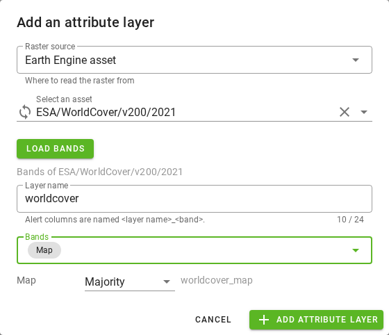

To add an attribute layer:

1.  Select **Add attribute layer** to open the **Add an attribute layer** dialog.
2.  Choose the **Raster source** (**Earth Engine asset**, an image, or **GeoTIFF in my SEPAL folder**), then choose the raster.
3.  Select **Load bands**. The bands are read and listed ("Bands of …").
4.  Check the **Layer name**, suggested from the raster. The columns are named *layer name*\_\ *band*.
5.  In **Bands**, select one or more bands. For each, choose the statistic computed over the alert: **Majority** (the default, for classes), **Mean**, **Minimum**, **Maximum** or **Median**. The column name is shown beside it.
6.  Select **Add attribute layer**.

Rules:

-   A layer needs at least one band (**Keep at least one band.**).
-   Two layers cannot read the same raster (**Another attribute layer already reads this raster.**).
-   Column names never take the name of an alert column or of another layer's column: a clash gets a suffix.

The list under **Attribute layers** shows each layer with its columns. The pencil icon edits a layer and the bin icon removes it. The layers belong to this form until it runs: they are saved with the alert set.

Run the step
^^^^^^^^^^^^

The grey line above the button names the set the run makes: "Creates or replaces the alert set (period) · (sources)". An alert set is identified by its period and its sources:

-   a new combination of sources makes a new set: a period can hold several sets (e.g. one with GLAD-L only and one with all three sources); and
-   the same combination again *replaces* the set.

Select **Integrate & vectorize**. The button stays disabled until at least one source is selected and, when **Limit the number of alerts** is selected, the limit is valid ("Enter a whole number greater than 0." under the field).

The run goes through "Combining sources", "Vectorizing clusters", "Saving the alerts", "Writing the footprint" and "Building map tiles". When it ends, a message reads "N alerts ready for review", followed by "Linked N alerts to earlier loss (M under the minimum area)" when it found `growth alerts <defo-integrate-growth_>`_, and the new set becomes the *active set*: the one the `Questionnaire <defo-questionnaire_>`_, `Evaluation <defo-evaluation_>`_, `Analysis <defo-analysis_>`_ and `Overview <defo-overview_>`_ work on. The step stays open.

If no alert is left, the set is still made, empty, and the message gives the reason for each source (e.g. "GLAD-L: all 56 alert pixels removed by masks" or "RADD: probable (unconfirmed) alerts were left out").

.. _defo-integrate-replace:

Replace a set
"""""""""""""

.. shot: integrate-replace | The "Replace this alert set?" confirmation for the demo set, with "N reviewed alerts in this set will be discarded. The evaluator split and its pending returns will be discarded." (the demo set is split), then the list of reviewed alerts ("#0 · Reviewed: confirmed · 383.18 ha" …); the Cancel and orange Replace buttons. Crop to the dialog.

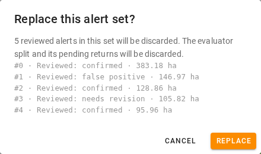

When the set about to be replaced has reviewed alerts or an `evaluator split <defo-evaluation_>`_, the **Replace this alert set?** dialog lists what would be lost: the reviewed alerts (up to 20, then "… and N more"), and the split with the reviews that evaluators have not sent back yet. When alerts of later periods grow from this set, it adds "N alerts of later periods are linked to this set; their links will break.": after the run, those links show as "earlier set was re-run" (see `Earlier alerts <defo-analysis-earlier_>`_). Select **Replace** to continue. A set with nothing to lose is replaced without confirmation.

.. attention::

    Replacing a set discards its reviews. To try other settings without losing reviews, choose another combination of sources, which makes a separate set.

.. _defo-integrate-outdated:

When the active set is out of date
""""""""""""""""""""""""""""""""""

If the inputs of the active set changed since it was made (a source downloaded again, a mask switched, the period's look-back, the AOI or the grid changed), an orange line reads: "The active set (…) was built from inputs that have changed since." Run **Integrate & vectorize** again to rebuild it, which discards its reviews.

If the set's files were deleted from the project folder, the line reads: "The active set's files (…) are missing from the project folder."

.. _defo-integrate-map:

View the alerts on the map
^^^^^^^^^^^^^^^^^^^^^^^^^^

Once the project has a set, switches under the button draw it on the map:

.. list-table::
    :header-rows: 1
    :widths: 35 65

    *   -   Switch
        -   Description
    *   -   **Show these alerts on the map**
        -   The active set's alerts, coloured by review status. Click on an alert to view "Alert (id) · (status) · (area) ha". Its **Review** button opens it in Analysis.
    *   -   **Show not-analysable pixels**
        -   The alert pixels that did not become alerts: **Too small** or **Over the alert cap**.
    *   -   **Show earlier sets**
        -   The alerts of earlier periods' sets, for context.

The map keeps them in other steps. Turn them off here.

Common messages
^^^^^^^^^^^^^^^

"… is not downloaded and harmonized for this period; run Download & harmonize first."
    A source's files are out of date. Run it in `Download & harmonize <defo-prepare_>`_.

"The footprint of the earlier set … is missing; run Integrate & vectorize on that set again first."
    An earlier period's files were deleted. Make that period active and run its set again.

"Not enough free disk space: …"
    The run writes a few rasters the size of the grid. Free some space.

"The project's period, area of interest or grid changed while the run was going, so the alert set was not recorded."
    Run it again.

"tippecanoe is not installed: the map will show alert points without polygons."
    The set is made; the map shows its alerts as points instead of polygons.

"The map tiles could not be shown (…): showing alert points without polygons."
    The set is made, but its map layer could not be built. The map shows its alerts as points.

"The alert store of … is missing; run Integrate & vectorize for that period again."
    With **Show earlier sets**, an earlier set's alert file is gone from the project folder. Make that period active and run its set again.

.. _defo-questionnaire:

Questionnaire
-------------

The *questionnaire* holds the questions answered for every alert in `Analysis <defo-analysis_>`_, after its verdict. The answers are:

-   saved with the alert (one column per question);
-   exported with it;
-   charted in the `Overview <defo-overview_>`_; and
-   available to the alert's Word report.

This step also chooses the report template.

Open the **Questionnaire** step of the **Workflow** panel. It unlocks once the project has an alert set (see `Integrate & vectorize <defo-integrate_>`_). The questionnaire belongs to the project: every alert set of the project is reviewed with it.

.. shot: questionnaire-list | The Questionnaire step of the demo project with two questions: the default "Loss driver" (chips "several answers", "9 options", "typed answers", "True alert", "Needs review", note {loss_driver}) and one added question (e.g. "Access road nearby?", "one answer", "2 options", "required" in red, "True alert", "Needs review"); the "Show the questions expanded in Analysis" switch and its hint; the Report template line collapsed ("Report template · Default template", chip "default"). Crop to the Workflow panel.

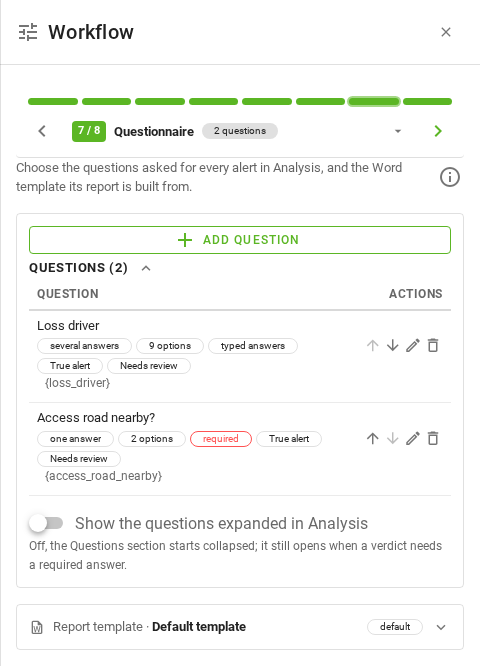

The question list
^^^^^^^^^^^^^^^^^

A new project starts with one question, **Loss driver**:

-   several answers;
-   nine options: **Agriculture expansion**, **Livestock grazing**, **Logging**, **Urban expansion**, **Shifting cultivation**, **Mining**, **Forest fires**, **Hurricanes** and **Other**;
-   typed answers allowed; and
-   asked for **True alert** and **Needs review** (not for a false positive).

Edit or delete it like any other question.

Each row of **Questions** shows the question and chips that sum it up: **one answer** or **several answers**, the number of options, **typed answers**, **required**, and the verdicts it is asked for (or **all verdicts**). The note under it is its report placeholder, such as ``{loss_driver}``.

The icons on the right side of each row:

-   the arrows move the question up or down: Analysis asks the questions in this order;
-   the pencil icon edits it; and
-   the bin icon deletes it.

With no questions, the list reads **No questions: Analysis will only ask for the verdict.**

**Show the questions expanded in Analysis** (off by default) opens the **Questions** section of Analysis on every alert. When off, the section starts collapsed; it still opens when a verdict needs a required answer.

Add or edit a question
^^^^^^^^^^^^^^^^^^^^^^

.. shot: questionnaire-add | The "Add a question" dialog filled in: Question "Access road nearby?", Answer = One answer, two options "Yes" and "No" with their arrow and close icons, Add option, Allow typed answers off, Required on, Ask when the verdict is: True alert and Needs review checked, False positive unchecked; the "Report placeholder: {access_road_nearby}" line. Crop to the dialog.

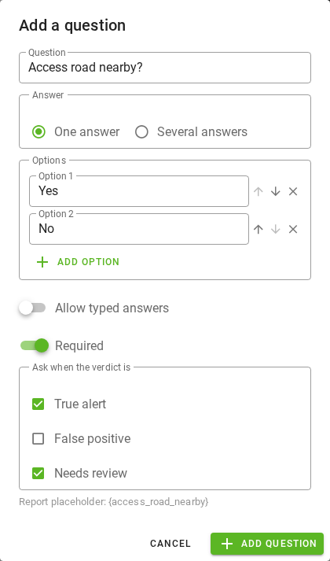

Select **Add question** (or the pencil icon of a question) to open the **Add a question** (or **Edit question**) dialog.

.. list-table::
    :header-rows: 1
    :widths: 20 45 35

    *   -   Field
        -   Description
        -   Default and limits
    *   -   **Question**
        -   The text shown in Analysis.
        -   Required.
    *   -   **Answer**
        -   **One answer** or **Several answers**. With several, the answers are saved together, separated by commas.
        -   **One answer**.
    *   -   **Options**
        -   The answers to choose from. **Add option** adds one; the arrows reorder them; the cross removes one.
        -   At least one option, unless typed answers are allowed. An option cannot be empty, contain a comma or repeat another option.
    *   -   **Allow typed answers**
        -   Lets the reviewer type an answer that is not in the options.
        -   Off.
    *   -   **Required**
        -   The review cannot be saved without an answer (for the verdicts it is asked for).
        -   Off.
    *   -   **Ask when the verdict is**
        -   The verdicts the question is asked for: **True alert**, **False positive**, **Needs review**. For the other verdicts, it is hidden.
        -   All three. At least one.

The last line shows the question's report placeholder (e.g. "Report placeholder: {access_road_nearby}"). It is made from the question's text when the question is created and never changes, even if the question is renamed.

Select **Add question** (or **Save**). The dialog shows what is missing in red until the question can be saved.

.. note::

    Renaming a question or one of its options keeps the answers already saved: they are stored under the question's placeholder name and each option's own code, not under their text.

Delete a question
^^^^^^^^^^^^^^^^^

Select the bin icon. The confirmation dialog states how many alerts of the active set answered the question. The answers already saved stay in the alert table, but they are no longer shown, exported or charted.

.. _defo-questionnaire-template:

The report template
^^^^^^^^^^^^^^^^^^^

In Analysis, each reviewed alert can be exported with a Word report (see `Export <defo-export_>`_). The report is built from a .docx template, where *placeholders* such as ``{area_loss}`` are replaced by the alert's values.

.. shot: questionnaire-template | The Report template card expanded: "Report template · Default template" with its "default" chip, the "Report template (.docx)" file picker and its hint, and the placeholder chips under "Placeholders the template can use (click to copy):", the grey ones then the green {verdict}, {loss_driver} and the added question's key, with the note under them. Crop to the card.

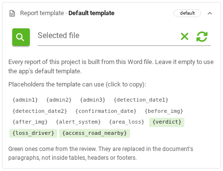

The **Report template** line names the template in use, with a chip: **default** (the app's own template), **custom** (your file) or **missing** (your file was moved or deleted). Open it with the arrow on the right side:

-   **Report template (.docx)**: choose a Word file in your SEPAL folder. Every report of this project is then built from it. Clear the field to go back to the default template.
-   **Placeholders the template can use (click to copy):** select a chip to copy its placeholder, then paste it into the template.

.. list-table::
    :header-rows: 1
    :widths: 40 60

    *   -   Placeholder
        -   Replaced by
    *   -   ``{admin1}``, ``{admin2}``, ``{admin3}``
        -   The administrative areas the alert falls in.
    *   -   ``{detection_date1}``, ``{detection_date2}``
        -   The alert's first and last detection dates.
    *   -   ``{confirmation_date}``
        -   The day the report is built.
    *   -   ``{before_img}``, ``{after_img}``
        -   The names of the before and after images chosen in the review.
    *   -   ``{alert_system}``
        -   The sources that detected the alert.
    *   -   ``{area_loss}``
        -   The alert's area, in hectares.
    *   -   ``{verdict}`` (green)
        -   The verdict, in the language of the app.
    *   -   One per question (green)
        -   The answer to that question; empty when the question is not asked for the alert's verdict.

The green placeholders come from the review. Placeholders are replaced in the document's paragraphs, not inside tables, headers or footers.

Images in the report
""""""""""""""""""""

The report also holds six pictures of the alert, cut from the before and after images chosen in the review. They are not in the chip list: the template marks where each one goes with a paragraph holding only its marker, from ``[Placeholder for Image 1]`` to ``[Placeholder for Image 6]``. That whole paragraph is replaced by the picture (250 pt wide), so put nothing else in it.

.. list-table::
    :header-rows: 1
    :widths: 60 40

    *   -   Marker
        -   Picture
    *   -   ``[Placeholder for Image 1]``, ``[Placeholder for Image 4]``
        -   The before image.
    *   -   ``[Placeholder for Image 2]``, ``[Placeholder for Image 5]``
        -   The after image.
    *   -   ``[Placeholder for Image 3]``, ``[Placeholder for Image 6]``
        -   The after image with the alert's outline in red.

Images 1–3 show the images in one band combination, and images 4–6 in another. The default template places them under its captions ("Image 1: Pre-deforestation …", "Image 2: Post-deforestation …" and "Image 3: Deforestation alert generated."), two pictures per caption. A template without these markers gets a report with no pictures.

.. tip::

    To make a custom template, lay it out like the default one: the text with the placeholders above, then each caption followed by its image markers, every marker alone in its paragraph.

The template can show two messages:

-   "… is not a Word file (.docx) in your SEPAL folder; the report template was not changed.": choose a .docx file.
-   **missing**, with "The file is gone: pick it again, or clear it to use the default template.": the card stays open until the file is chosen again or the field is cleared.

.. tip::

    When the alerts are split among evaluators, their review packages carry the questionnaire and the report template. If the questionnaire changes after the packages are built, build them again (see `Evaluation <defo-evaluation_>`_).

Next, go to the `Evaluation <defo-evaluation_>`_ step, where **Start analysis** starts reviewing.

.. _defo-evaluation:

Evaluation
----------

This step decides who reviews the alerts of the active set:

-   review them all yourself; or
-   split them among several evaluators. Each evaluator gets a *review package*, reviews their own alerts in their own SEPAL account, and sends back a *reviewed copy*, which is then merged into the project.

Open the **Evaluation** step of the **Workflow** panel. It unlocks once the project has an alert set (see `Integrate & vectorize <defo-integrate_>`_). It works on the active set: a split belongs to one alert set.

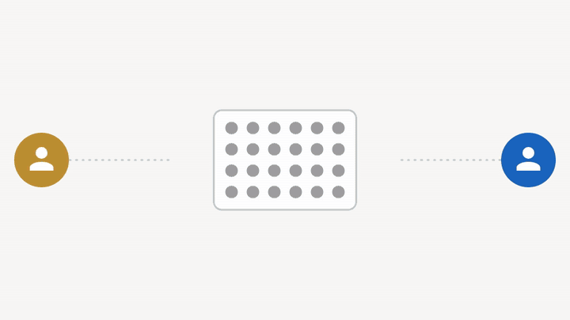

In the animation, red marks a confirmed loss and green a false positive.

Review mode
^^^^^^^^^^^

Under **Review mode**, select one of two checkboxes:

.. list-table::
    :header-rows: 1
    :widths: 30 70

    *   -   **Review mode**
        -   Description
    *   -   **Solo**
        -   You review every alert. Nothing else to set up: select **Start analysis**.
    *   -   **Multiple evaluators**
        -   The alerts are split among evaluators, and each one gets a review package. The evaluators table appears under it.

A project starts with neither checkbox selected. The note under them reads "Choose who reviews the alerts: only you, or several evaluators.", and the **Evaluation** step of the **Workflow** panel stays empty.

-   Selecting one checkbox clears the other; clearing the selected checkbox leaves no mode again.
-   **Solo** completes the step (its badge reads "1 evaluator").
-   **Multiple evaluators** completes the step once the alerts are split.
-   While a split exists, both checkboxes are disabled on **Multiple evaluators** (**Remove the split to switch to solo.**).

.. _defo-evaluation-split:

Split the alerts
^^^^^^^^^^^^^^^^

.. shot: evaluation-split | The "Split the alerts" dialog of the demo project: Evaluators by = Names, two name rows filled ("Ana", "Luis") with their close icons, Add evaluator, "Empty rows are skipped.", Include already reviewed alerts unchecked with its hint, and the Split button. Crop to the dialog.

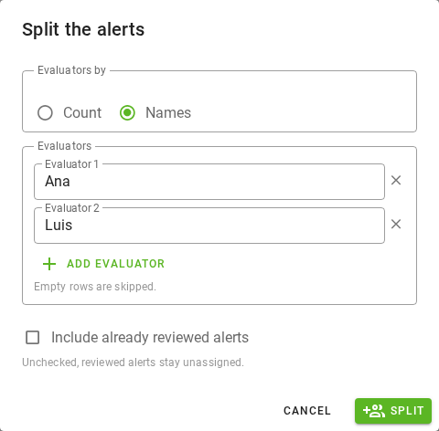

With **Multiple evaluators** selected, select **Split alerts…** above the evaluators table to open the **Split the alerts** dialog:

.. list-table::
    :header-rows: 1
    :widths: 25 45 30

    *   -   Field
        -   Description
        -   Default and limits
    *   -   **Evaluators by**
        -   **Count**: the evaluators are named "Evaluator 1", "Evaluator 2"… **Names**: enter their names.
        -   **Count**.
    *   -   **Number of evaluators**
        -   With **Count**.
        -   2. From 1 to 50.
    *   -   **Evaluator 1**, **Evaluator 2**…
        -   With **Names**: one row per evaluator. **Add evaluator** adds a row; the cross removes one.
        -   Two empty rows. Empty rows are skipped; two rows cannot have the same name; at most 50.
    *   -   **Include already reviewed alerts**
        -   Also deals out alerts that are already reviewed. When cleared, they stay unassigned.
        -   Cleared.

Select **Split**. The alerts are dealt out one by one in the set's order (the **Order** chosen in `Integrate & vectorize <defo-integrate-options_>`_), like cards: the first to evaluator 1, the second to evaluator 2, and so on round the list. Each evaluator gets about the same number of alerts, spread over the whole order.

The evaluators table
""""""""""""""""""""

.. shot: evaluation-table | The Evaluation step of the demo project after the split, packages built and one copy merged: Review mode with the Multiple evaluators box ticked (both greyed out) and its note; the Evaluators table with rows "Ana" and "Luis" (Assigned, Reviewed, Merged date for one, a dash for the other) and their green cloud icons, plus the grey "Unassigned" row; "Built …" under it; the Regenerate packages and Merge reviewed copy… buttons; Start analysis. Crop to the Workflow panel.

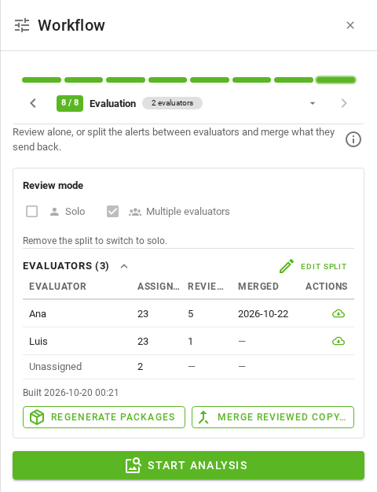

.. list-table::
    :header-rows: 1
    :widths: 20 80

    *   -   Column
        -   Description
    *   -   **Evaluator**
        -   The evaluator's name. A last row, **Unassigned**, counts the alerts no evaluator got.
    *   -   **Assigned**
        -   The number of alerts the evaluator has.
    *   -   **Reviewed**
        -   The number of them that are reviewed in *your* project (by you, or merged from the evaluator).
    *   -   **Merged**
        -   The date their reviewed copy was last merged, or a dash.

The cloud icon on each row downloads that evaluator's package once it is built.

Change or remove the split
""""""""""""""""""""""""""

**Edit split** (in place of **Split alerts…**) reopens the dialog as **Edit the split**:

-   **Re-split** deals the alerts again with the new names or count. It is a new split: reviews already merged stay, but packages already sent for the old split can no longer be merged (the dialog warns: **Packages already sent for this split will no longer merge.**).
-   **Remove split** clears every assignment. Reviews stay.

.. attention::

    Running `Integrate & vectorize <defo-integrate-replace_>`_ again on the same set replaces it: its reviews and its split are discarded, and reviewed copies of the old set can no longer be merged.

.. _defo-evaluation-packages:

Review packages
^^^^^^^^^^^^^^^

Select **Generate packages**. The app builds one .zip file per evaluator in the alert set's folder (the button reads "Building 1 / 2…"). Each package holds:

-   the set's alerts with their assignments;
-   the questionnaire;
-   the AOI;
-   the list of satellite scenes already found;
-   the earlier alerts that the set's alerts can be linked to (see `Earlier alerts <defo-analysis-earlier_>`_), as they are when the packages are built; and
-   the report template, when a custom one was chosen.

When they are ready, "Built (date and time)" shows under the table and each row's cloud icon becomes a download.

To share the packages:

1.  Download each evaluator's package and send it to them (by email, a shared drive…).
2.  The evaluator copies it into their SEPAL folder and imports it with **Import** in the `Project <defo-project-import_>`_ dialog.

The package opens as a review copy in Analysis, filtered to the evaluator's alerts, with the setup steps locked.

A package needs the AOI's shape. Until it is loaded, the step reads **Packages wait for the AOI geometry: open the AOI step to load it.**

If the `questionnaire <defo-questionnaire_>`_ changes after the packages are built, the cloud icons turn amber ("Built before the questionnaire changed: generate the packages again."). Select **Regenerate packages** and send the new ones.

.. _defo-evaluation-return:

What the evaluator does
^^^^^^^^^^^^^^^^^^^^^^^

.. shot: evaluation-return | The Evaluation step in an evaluator's review copy (imported from a demo package): the "Review copy for …" banner, the Return reviews card with "5 / 23 of your alerts reviewed", its cloud icon, "Built …", "Only your assigned alerts are returned." and the Regenerate reviewed copy button. Crop to the Workflow panel.

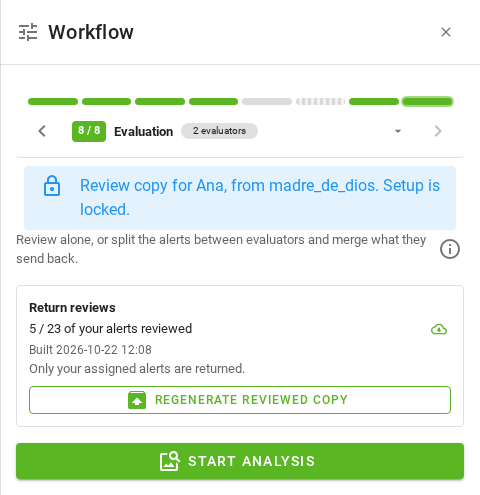

In a review copy, the **Evaluation** step shows **Return reviews** instead: the number of the evaluator's alerts that are reviewed ("5 / 23 of your alerts reviewed") and **Generate reviewed copy**.

The evaluator:

1.  reviews their alerts in `Analysis <defo-analysis_>`_;
2.  selects **Generate reviewed copy**, then downloads it with the cloud icon (a .zip file ending in ``__reviewed.zip``); and
3.  sends it back to the project's creator.

Only the evaluator's assigned alerts that they reviewed are returned, with the links they ticked to earlier alerts. A reviewed copy holds the reviews as of its build: after reviewing more, select **Regenerate reviewed copy**. The evaluator can send copies as often as needed. When a newer copy is merged, alerts merged before and reviewed differently since show as conflicts: choose **Take theirs** to take the evaluator's latest reviews.

.. _defo-evaluation-merge:

Merge a reviewed copy
^^^^^^^^^^^^^^^^^^^^^

.. shot: evaluation-merge | The "Merge reviews from Ana" preview: the summary line "Ana: 3 new reviews, 1 conflicts, 1 unchanged, 0 ignored", the "Alerts you reviewed differently" choice with Keep mine selected and Take theirs, and the Merge button. Crop to the dialog.

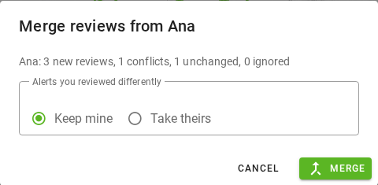

To merge a reviewed copy:

1.  Copy the reviewed copy into your SEPAL folder.
2.  Select **Merge reviewed copy…** and choose it in **Reviewed copy (.zip)**. Choose one copy at a time.
3.  Read the preview, titled with the evaluator's name and shown before anything changes (see the table below).
4.  When there are conflicts, choose under **Alerts you reviewed differently**: **Keep mine** (the default) or **Take theirs**.
5.  Select **Merge**.

.. list-table::
    :header-rows: 1
    :widths: 20 80

    *   -   Count
        -   Description
    *   -   new reviews
        -   Alerts the evaluator reviewed that are not reviewed in your project. They are taken.
    *   -   conflicts
        -   Alerts that were also reviewed in your project (by you or an earlier merge), differently. A different link to an earlier alert counts as a difference.
    *   -   unchanged
        -   Alerts whose review is the same on both sides.
    *   -   ignored
        -   Alerts that are not assigned to this evaluator. They are never taken.

After the merge, the set's alerts are updated, a message reads "Merged N reviews from (evaluator).", and the **Merged** column shows the date.

The preview may also warn that "The questionnaire changed since the packages were made; answers are merged by question key.", or list columns it ignores. If the alert open in Analysis is among the merged ones, it is reloaded.

.. tip::

    In `Analysis <defo-analysis_>`_, the filter can show the alerts of one evaluator (or the unassigned ones) through its **Evaluator** attribute.

Common messages
^^^^^^^^^^^^^^^

"This copy is for set …; make it the active set to merge."
    Choose that set in the set selector of Analysis or the Overview first.

"The set was re-run since this copy was made." or "This copy was made for an earlier split."
    The copy no longer matches the set's alerts. It cannot be merged.

"This zip is a review package, not a reviewed copy."
    Choose the file the evaluator sent back.

"A review copy cannot merge reviewed copies; open the creator's project."
    Merge in the original project.

"This set has an attribute named 'evaluator'; rename that attribute layer and re-run the set."
    The set's alert table already has an ``evaluator`` column, from an attribute layer, so it cannot be split. In `Integrate & vectorize <defo-integrate-attributes_>`_, give that layer another name and run the set again (this replaces the set and its reviews).

"This set's alerts carry evaluator assignments but the project has no split record. Remove the split to start again."
    A split was written to the alerts but not to the project (e.g. the project was closed at that moment). Open **Edit split**, select **Remove split**, then split again.

"This alert set was rewritten while the split was being made, so nothing was changed. Try again."
    A review was saved or a copy merged at the same time. Split again.

"This alert set is being re-run in Integrate & vectorize. Try again once it has finished." (when splitting)
    Wait for the run to end.

"No alerts to assign." (when splitting)
    Every alert may already be reviewed: select **Include already reviewed alerts**.

.. _defo-analysis:

Analysis
--------

.. labels-ok: Google; Esri; Enter

Use the Analysis screen to review the alerts of the active set, one at a time. For each alert:

1.  Compare a *before* and an *after* satellite image.
2.  Give a verdict.
3.  Answer the project's questions.
4.  Save.

The alert's polygon can also be redrawn, by hand or with two auto-detection models, and the alert's files exported.

Open the screen
^^^^^^^^^^^^^^^

The screen opens with the active alert set, from any of these:

-   **Start analysis**, at the bottom of the `Evaluation <defo-evaluation_>`_ step;
-   **Analysis**, in the left rail; or
-   **Review alerts** in the `Overview <defo-overview_>`_, or the **Review** button of an alert clicked on the main map (see `View the alerts on the map <defo-integrate-map_>`_).

It needs an alert set: until `Integrate & vectorize <defo-integrate_>`_ has made one, the counter reads "No alert set is loaded". A set opens on the alert under review when the screen was last left (the position is saved with the project).

**Workflow**, in the upper-left corner, goes back to the workflow steps. The left rail stays usable on this screen.

The screen
^^^^^^^^^^

.. shot: analysis-screen | The whole Analysis screen of the demo project at 1440×900, on an unreviewed alert in the middle of the set: the top bar (Workflow, "Analysis · <project>", the funnel, the Alert set selector, the tally "12 reviewed · 36 left" over its bar, the help icon, Previous · 13 / 48 · Next); the two maps with "Before image · Sentinel-2 2026-05-28 · 27%" and "After image · Sentinel-2 2026-09-27 · 18%" titles, the layers icon at the top right of each map and the basemap thumbnail at the bottom left; the timeline under the maps with both handles placed; the right panel with Source / Detected / Status, the Verdict buttons, the Questions section open with the loss driver and the added "Access road nearby?" question, the Refine polygon section closed, and the footer (Export this alert, Save & next, Save). No crop.

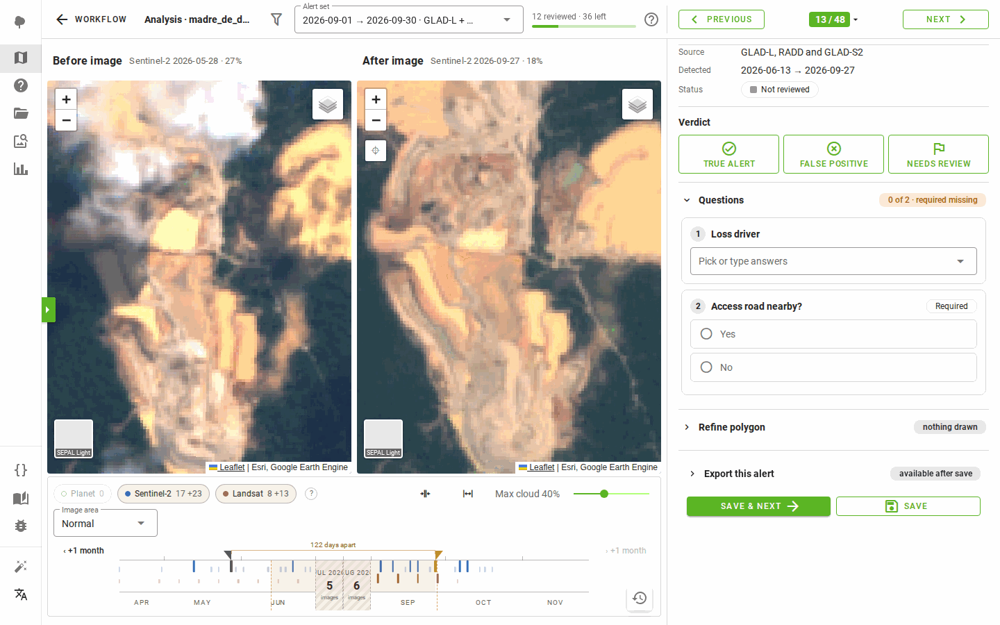

.. list-table::
    :header-rows: 1
    :widths: 20 80

    *   -   Part
        -   Content
    *   -   Top bar
        -   The filter, the alert set, the review progress, the help and the navigation.
    *   -   The two maps
        -   The *before* image on the left side, the *after* image on the right side. They move together: pan or zoom one and the other follows.
    *   -   The timeline
        -   Under the maps: every image of the alert's area, on one date axis. Its two handles choose the before and the after image.
    *   -   The review panel
        -   On the right side: what the alert table says about the alert, the verdict, the questions, the drawing tools, the earlier alerts nearby, then a footer that stays at the bottom with the export section and the save buttons. Only this panel scrolls.

The help icon in the top bar opens **About analysis**, a short summary of this subsection.

.. _defo-analysis-topbar:

The top bar
^^^^^^^^^^^

.. shot: analysis-topbar | The top bar of the Analysis screen with the filter menu open below the funnel: "Filter alerts" title, Attribute = Evaluator, Values = Ana (23) selected as a chip, the Clear filter and Apply buttons; to the right the Alert set selector, the tally "5 reviewed · 18 left · filtered · 48 total" over its bar, and Previous · 06 / 23 · Next. Crop to the top bar and the open menu.

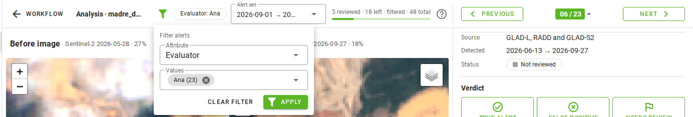

From left to right:

.. list-table::
    :header-rows: 1
    :widths: 25 75

    *   -   Control
        -   Description
    *   -   Funnel
        -   Opens the filter (see below). While a filter is on, the funnel is filled and a chip names it (e.g. "Evaluator: Ana"). The chip's cross removes the filter.
    *   -   **Alert set**
        -   The set under review: "period · sources · N alerts · N reviewed", newest first. Choosing another set makes it the project's active set, also for the other steps and the Overview.
    *   -   Progress
        -   "12 reviewed · 36 left" over a bar.
    *   -   **Previous** / **Next**
        -   The previous or next alert in the set's order. They stop at the first and the last alert.
    *   -   Counter
        -   The alert's number in the set ("13 / 48"). Select it to open a small menu: **Jump to alert number** (enter a number and select **Go**, or press **Enter**) and **Next unreviewed alert**, which goes to the next alert without a verdict, starting again from the top after the last one.

The order of the alerts is the **Order** chosen in `Integrate & vectorize <defo-integrate-options_>`_.

Filter the alerts
"""""""""""""""""

The filter keeps one attribute's values and hides the other alerts from the navigation. To filter the alerts:

1.  Select the funnel to open **Filter alerts**.
2.  In **Attribute**, choose what to filter on. The list offers **Evaluator** (when the set is `split <defo-evaluation-split_>`_), **Status**, **Kind** (when the set has `growth alerts <defo-integrate-growth_>`_: choose **Growth** to review them together), each question of the questionnaire, then the set's other columns that hold between 2 and 50 different values, such as the columns of an `attribute layer <defo-integrate-attributes_>`_. If the set has none, the menu reads "No attribute to filter by".
3.  In **Values**, select one or more values, each with its number of alerts (e.g. "Ana (24)"). An alert matches when it has any of them. Empty cells are listed as **Unassigned** for the evaluator and **(empty)** for other columns.
4.  Select **Apply**.

**Clear filter** removes the filter.

With a filter on:

-   **Previous**, **Next**, **Next unreviewed alert** and **Save & next** move among the matching alerts only;
-   the counter counts the matches ("06 / 24"), or reads "– / 24" while the alert on screen is not one of them, and the progress line ends with "filtered · 48 total";
-   the jump menu still takes the alert's number in the whole set, but refuses one the filter hides ("Alert 12 is not in the current filter"); and
-   when nothing matches, the counter reads "No alerts match this filter".

When a filter is applied, the screen moves to the alert on screen if it matches, else to the first unreviewed match, else to the first match. Alerts keep their numbers: a filter never renumbers them.

The filter lasts until it is cleared or another alert set is chosen. It is not saved with the project. A `review copy <defo-evaluation-return_>`_ opens already filtered to the evaluator's alerts.

The maps
^^^^^^^^

Both maps centre on the alert when it opens. A yellow dashed box marks the alert's extent.

.. list-table::
    :header-rows: 1
    :widths: 20 25 55

    *   -   Control
        -   Location
        -   Description
    *   -   **Layers**
        -   Upper-right corner of each map
        -   The map's layers, in three sections. Select a layer to show it on that map only.
    *   -   **Basemap**
        -   Lower-left corner of each map
        -   Hover over the thumbnail to choose the basemap: Google, Esri (both satellite), **SEPAL Light** or **SEPAL Dark**. The choice applies to both maps. The default follows the app's theme: **SEPAL Light**, or **SEPAL Dark** in the dark theme. Switching the theme swaps them; a satellite basemap stays.
    *   -   **Zoom to the alert**
        -   Upper-left corner of the after map
        -   Zooms both maps back to the alert.

The **Layers** menu lists:

.. list-table::
    :header-rows: 1
    :widths: 25 75

    *   -   Section
        -   Layers
    *   -   **Imagery**
        -   *True Color* (on) and *False Color* (near infrared, red and green; off): the image chosen for that map.
    *   -   **Alerts**
        -   *Original Alert*: the alert pixels of the set, half transparent (off). *Alert BB*: the alert's bounding box. *Defo Layer*: the polygon saved for the alert (see `Refine the polygon <defo-analysis-refine_>`_). *Earlier alerts* (see `Earlier alerts <defo-analysis-earlier_>`_).
    *   -   **Optional layers**
        -   The `optional layers <defo-layers_>`_ marked **Show in Analysis**, turned off.

A map displays "Imagery failed to load" when the tiles of its image do not load.

Choose the images: the timeline
^^^^^^^^^^^^^^^^^^^^^^^^^^^^^^^

.. shot: analysis-timeline | The timeline strip of the demo alert at full width: the chips Planet 0 (greyed: the build account has no NICFI access), Sentinel-2 17 +22, Landsat 8 +13, the "?" button, Collapse the alert window / Expand every month, the Max cloud 40% slider, Image area = Normal; the track with "‹ +1 month" and "+1 month ›", the gold alert-window band with two collapsed month blocks in it, Sentinel-2 stripes on top, Landsat under them, a few faded half-height stripes over the cloud limit, the before handle left of the band and the after handle right of it with the "122 days apart" bracket between them; the month names on the axis. Crop to the timeline card.

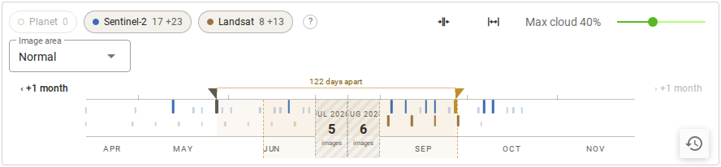

The timeline shows every image that covers the alert, from about two months before the alert was first detected to two months after it was last detected. Each collection has its own band:

-   *Sentinel-2* stripes on top;
-   *Landsat* in the middle; and
-   *Planet* (the NICFI monthly mosaic) as a bar across its month at the bottom.

A faded, half-height stripe is an image over the cloud limit. The gold band is the *alert window*: the dates over which the alert was detected. On a `growth alert <defo-integrate-growth_>`_, a grey band behind it marks the detection dates of each earlier alert it is linked to: choose a before image taken after the earlier clearing to see only the new loss.

Two handles above the track choose the images: the left one the before image, the right one the after image. The bracket between them states how many days apart they are ("49 days apart"), or warns "the same image on both sides".

To move a handle, use one of these methods:

-   Drag a handle and release it on the chosen image. The before handle cannot pass the after handle.
-   Click on a stripe: the nearest suitable handle moves to it. Images over the cloud limit cannot be selected.
-   With the keyboard: press **Tab** to reach a handle, move along the dates with the left and right arrow keys, jump to the first or last image with **Home** and **End**, and choose with **Enter**.

When an alert opens, the app chooses the image nearest *before* the alert window and the image nearest *after* it, among the images under the cloud limit. It never chooses an image inside the alert window (it would show only part of the clearing) nor a Planet mosaic, but both can be chosen by hand. A side with no image under the cloud limit is left "not set". A reviewed alert opens on the images it was saved with. If one of them is no longer available, its map title reads "Saved image not available; picked automatically".

Each map's title names its image: "Before image · Sentinel-2 2026-07-28 · 3%" (collection, date, cloud cover). When the other collection has an image of the same day, a button in the title ("⇄ Landsat") switches to it.

The toolbar above the track:

.. labels-ok: Tab; Home; End

.. list-table::
    :header-rows: 1
    :widths: 25 55 20

    *   -   Control
        -   Description
        -   Default
    *   -   *Planet*, *Sentinel-2*, *Landsat* chips
        -   Show or hide a collection. Each chip counts the collection's images in view, then ("+7") those over the cloud limit. The Planet chip is disabled when your GEE account has no NICFI access.
        -   All on.
    *   -   **?** button
        -   Shows or hides a legend of the timeline.
        -   Hidden.
    *   -   **Collapse the alert window**
        -   Folds the months that lie wholly inside the alert window into blocks that give their number of images. Select a block to unfold its month; select a month's name on the axis to fold it. On a long alert, the folded months share less than half of the track, so that the months before and after the window keep their room. When they get too narrow to read, the folded months of each half-year form one block ("Jan – Jun 2024") with the year on the axis under it; select it to split it into one block per month.
        -   Folded when an alert opens.
    *   -   **Expand every month**
        -   Unfolds every month.
        -
    *   -   **Max cloud**
        -   The cloud limit, from 0 to 100 % in steps of 5. Images over it are faded and never chosen automatically. Planet mosaics have no cloud figure, so the limit never hides them.
        -   40 %.
    *   -   **Image area**
        -   How far around the alert the images reach: **Normal**, **Large** or **Extra large** (100 m, 1 km or 2.5 km around it). Larger areas take longer to load and export. It goes back to **Normal** on the next alert.
        -   **Normal**.
    *   -   **+1 month** (left and right of the track)
        -   Adds a month before or after the view. The right one stops at the current month.
        -

The images come from an index of the images over the project's area, kept on disk and refreshed after 24 hours. While it loads, the toolbar reads "Loading the image index…"; an index older than a day reads "Index from (date)". If a refresh fails, the index on screen keeps working, and **Try again** retries.

.. _defo-analysis-panel:

The review panel
^^^^^^^^^^^^^^^^

The top of the panel shows what the alert table says:

.. list-table::
    :header-rows: 1
    :widths: 20 80

    *   -   Row
        -   Description
    *   -   **Source**
        -   The sources that detected the alert.
    *   -   **Detected**
        -   Its first and last detection dates.
    *   -   **Status**
        -   Its review status, with its colour: **Not reviewed**, **Reviewed: confirmed**, **Reviewed: false positive** or **Reviewed: needs revision**.
    *   -   **Kind**
        -   Whether the alert grows from earlier loss (see `Growth of earlier loss <defo-integrate-growth_>`_): **Growth** (a purple chip), **Growth · under minimum area**, or **New · under minimum area** (a small alert whose links were all removed). Hidden for a new alert.
    *   -   **History**
        -   For an alert linked to earlier loss: the alerts of its history and the area they confirm, for example "3 alerts · 2.1 ha confirmed since Aug 2026 (+0.3 ha not reviewed)". The area counts once where shapes overlap. Hidden when the alert has no history.

If the active set is out of date or its files are missing, an orange line above it says so, as in the `Overview <defo-overview_>`_. The review is still possible.

.. shot: analysis-console | The review panel on an alert being reviewed: Source "GLAD-L, RADD and GLAD-S2", Detected "2026-06-13 → 2026-09-27", Status chip "Not reviewed"; under Verdict the three buttons with True alert filled; the Questions section open with its badge "1 of 2 · required missing", question 1 "Loss driver" with Agriculture expansion picked in its list and a check mark, question 2 "Access road nearby?" with its Required tag and no answer; the footer with Export this alert (badge "available after save"), Save & next, Save, and the orange "Unsaved changes on this alert" line. Crop to the right panel.

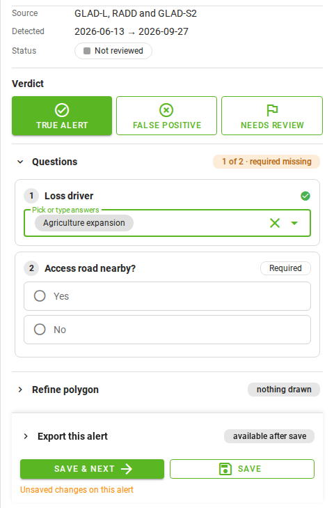

Verdict
"""""""

Under **Verdict**, select one of:

.. list-table::
    :header-rows: 1
    :widths: 20 30 50

    *   -   Button
        -   Stored status
        -   Use it when
    *   -   **True alert**
        -   **Reviewed: confirmed**
        -   The images show forest loss where the alert is.
    *   -   **False positive**
        -   **Reviewed: false positive**
        -   They show no forest loss: clouds, shadows, a seasonal change…
    *   -   **Needs review**
        -   **Reviewed: needs revision**
        -   No decision is possible yet, or the alert needs a second look.

An unreviewed alert opens with no verdict: nothing is chosen automatically. A reviewed alert opens on its saved verdict and answers.

Questions
"""""""""

The **Questions** section holds the questions of the `questionnaire <defo-questionnaire_>`_, in their order and numbered. Once a verdict is chosen, it shows only the questions asked for that verdict. The section's badge counts the answers ("1 of 2 answered") and turns orange when a required question has no answer ("1 of 2 · required missing").

-   A question with one answer shows its options as tiles: select one.
-   A question with several answers shows them as chips: select each one that applies.
-   A question that allows typed answers is a list that also accepts typing (**Pick or type answers**).

With no questions in the project, the section reads "This project asks no questions: add some in the Questionnaire step."; when the chosen verdict asks none, "No questions are asked for this verdict."

A **Required** tag marks a question that must be answered before saving. The section starts open or closed as set by **Show the questions expanded in Analysis** in the questionnaire. It opens by itself when the chosen verdict asks a required question with no answer yet, and when a save is refused for that reason.

.. _defo-analysis-refine:

Refine the polygon
""""""""""""""""""

The alert's polygon comes from the alert pixels. In **Refine polygon**, draw the area that was actually lost instead. The saved polygon is stored with the review, shown as *Defo Layer* on the maps, and its area becomes the alert's area. The section's badge reads "nothing drawn" or, for example, "2 shapes · 1.3 ha".

.. shot: analysis-refine | The after map in drawing mode, beside the open Refine polygon section: on the map, the drawing toolbar at the top left (draw polygon, trash), the Fill holes / Remove hole bar under it, the hint "Right-click a vertex to delete it", the patches Model 1 found, drawn with their vertices; in the panel, Stop drawing (in Start drawing's place) and Save drawing, the Model 1 row with Run, the Remove from map icon and "Found 9 patches · 25.9 ha", the Model 2 row with Run and the Add to map icon greyed; the badge "nothing drawn" (no drawing saved yet) and the footer line "Save your drawing before saving this review". Crop to the after map and the right panel.

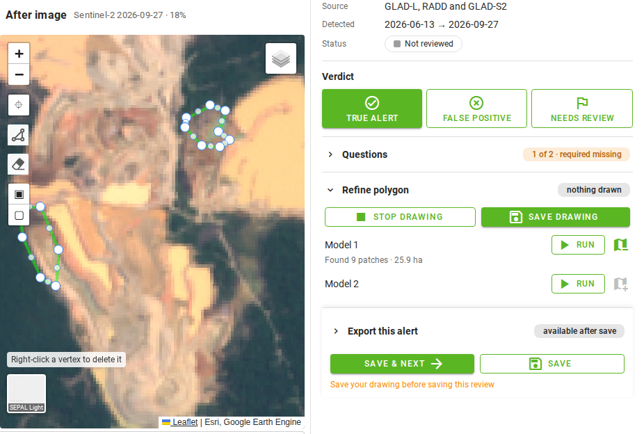

To refine the polygon:

1.  Select **Start drawing**. Both maps switch to drawing mode, the alert's box is hidden, and the saved polygon (if any) becomes the drawing, in blue. **Stop drawing** takes the button's place.
2.  Edit the drawing on either map; the other follows:

    -   The polygon button in the upper-left corner draws a new shape: click on its corners, then click on the first one to close it.
    -   Drag a corner to move it, click on the small marker in the middle of a side to add a corner, and right-click a corner to delete it. An edit that would make a shape cross itself is undone.
    -   The bin button deletes the next shape clicked. Its actions **Select area** (drag a box around the shapes to delete) and **Clear all** ask for confirmation first ("Delete 2 shapes?", **Cancel** / **Delete**), with the shapes concerned in red. Press **Esc** to cancel.
    -   **Fill holes** removes the holes of the selected shape, or of every shape when none is selected. **Remove hole**: click inside a hole to remove it; press **Esc** or select the button again to stop.

3.  Select **Save drawing**. The drawing becomes the alert's polygon. A drawing with no shape removes the polygon.
4.  Select **Stop drawing** to leave drawing mode. If the drawing has changes not saved with **Save drawing**, the **Discard unsaved drawing?** dialog asks first: **Keep drawing**, **Save and stop** or **Discard changes**.

.. important::

    **Save drawing** does not save the review: select **Save** or **Save & next** afterwards. Until the drawing is saved, the footer reads "Save your drawing before saving this review" and the review cannot be saved.

The two models
##############

Under the drawing buttons, two convolutional neural networks (CNNs) can find the loss on the before and after images on screen: **Model 1** ("Smaller and faster model") and **Model 2** ("Larger but slower model").

To use a model:

1.  Select **Run** on a model's row. The app downloads the two images (the area set by **Image area**) and runs the model. It takes a while; the run shows in the task list.
2.  Read the result on the row (e.g. "Found 3 patches · 2.1 ha"). Patches smaller than the set's **Minimum alert size** are left out. When the model found nothing, a red warning icon appears instead ("Model did not find forest loss polygons").
3.  Select the map icon with a plus sign (**Add to map**) to add the patches to the drawing (it starts drawing mode if needed): lime for **Model 1**, purple for **Model 2**. The icon then turns into a minus sign (**Remove from map**), which takes them off again.
4.  Edit the result like any drawing, then select **Save drawing**.

Choosing other images or another **Image area** drops the models' results: run them again. If another alert is opened while a model runs, its result is not added ("The model finished after you moved to another alert: its prediction was not added.").

.. _defo-analysis-earlier:

Earlier alerts
""""""""""""""

This section appears when the active set's period has earlier periods with alert sets. It lists the earlier loss near the alert: the alerts of earlier periods reviewed as **Reviewed: confirmed** or **Reviewed: needs revision**, within the distance set in **Within** (1 km by default, from 0.1 to 50 km), plus every alert linked to this one, however far. Use it to check whether an alert continues a clearing already reported, and to link it to that clearing.

The alerts are grouped by period, newest first. Each row shows:

-   a bar in the period's colour;
-   a box, ticked when the alert is linked to this one;
-   the earlier alert's number and area ("#12 · 3.4 ha"), and its status; and
-   how it relates to this alert: "touches" (linked by `Integrate & vectorize <defo-integrate-growth_>`_), "touches · not linked" (the link was removed) or its distance ("40 m").

Select an alert's number to zoom both maps to it.

To link or unlink an alert, tick or clear its box. The change is part of the review: the footer reads "Unsaved changes on this alert", and **Save** or **Save & next** saves it with the verdict. Ticking an alert of an earlier period makes this alert a growth alert, even if it does not touch it.

Some rows have no box:

-   "via #12": the alert belongs to the history through another link (here, alert 12). Clearing the box of alert 12 removes it too.
-   "earlier set was re-run": the earlier alert's set was made again in `Integrate & vectorize <defo-integrate-replace_>`_, so the link no longer points at the same alert. The row is greyed, is not counted in the history, and the link is dropped the next time this alert is saved.

A linked alert that was later reviewed as a false positive stays ticked with "now false positive". It is greyed and left out of the history; clear its box to remove the link.

Turn on **Show on the maps** to outline the listed alerts on both maps. The colour is the period's, and a small legend lists the periods shown, with "solid: confirmed · dashed: needs revision · thick: linked". The switch starts on for a growth alert; on other alerts it keeps your last choice. When the list covers several periods, the **Periods** menu hides some of them. The badge reads "off", "none within 1 km" or, for example, "4 within 1 km · 1 linked".

In a `review copy <defo-evaluation-return_>`_, the list comes from a snapshot of the earlier alerts taken when the packages were built: the section reads "Earlier alerts as of (date)", or "No earlier alerts in this copy" for a package made by an older version of the app.

Save the review
^^^^^^^^^^^^^^^

The footer stays at the bottom of the panel:

.. list-table::
    :header-rows: 1
    :widths: 25 75

    *   -   Button
        -   Description
    *   -   **Save & next**
        -   Saves the review, then opens the next alert (the next match under a filter). It moves on only if the save worked.
    *   -   **Save**
        -   Saves the review and stays on the alert.

The line under the buttons reads "Unsaved changes on this alert", "Save your drawing before saving this review" or "Saved 14:32".

A save writes into the alert set:

-   the verdict, as the alert's status;
-   the answers to the questions asked for that verdict (the others are left empty);
-   the before and after images chosen, so that the alert reopens on them;
-   the polygon saved in **Refine polygon**, with its area as the alert's area;
-   the earlier alerts ticked in `Earlier alerts <defo-analysis-earlier_>`_, as the alert's links; and
-   the names of the administrative areas under the alert, from the FAO GAUL 2015 boundaries in GEE (this takes a few seconds).

Reviews show at once in the progress bar, in the set selector and in the `Overview <defo-overview_>`_. A review can change at any time: open the alert, change it and save again.

Export the alert
^^^^^^^^^^^^^^^^

**Export this alert**, in the footer, builds the alert's files once it is saved: a .zip file with its GeoPackage and images, a Word report and, for a true alert, an animated GIF. See `One alert, from Analysis <defo-export-alert_>`_.

.. shot: analysis-footer | The footer of the review panel after Save on a true alert: Export this alert open with its badge "ready to build", the dashed Build alert files tile, the Timelapse tile "Animated GIF · click to create it", then Save & next, Save and the green "Saved 14:32" line. Crop to the footer.

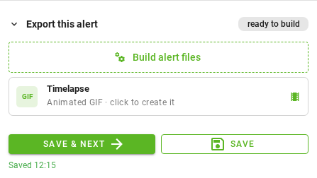

Keyboard
^^^^^^^^

The screen has no global keyboard shortcuts. The keys that work:

.. labels-ok: Esc; ←; →; ?

.. list-table::
    :header-rows: 1
    :widths: 30 20 50

    *   -   Key
        -   Location
        -   Action
    *   -   **Tab**, **←** **→**, **Home**, **End**, **Enter**
        -   Timeline handles
        -   Reach a handle, move it along the dates, jump to the first or last image, choose the image.
    *   -   **Enter**
        -   Jump menu
        -   Same as **Go**.
    *   -   **Esc**
        -   Maps
        -   Cancels **Select area** or a delete confirmation; stops **Remove hole**.

Common messages
^^^^^^^^^^^^^^^

"Answer under 'Verdict' before saving."
    Choose a verdict first.

"Answer “(question)” before saving."
    A required question has no answer; the **Questions** section opens on it.

"A false positive cannot have a drawn deforestation polygon: delete the polygon or change the answer."
    Remove the polygon in **Refine polygon** (an empty drawing, then **Save drawing**), or choose another verdict.

"Save your drawing before saving this review."
    Select **Save drawing**, or stop drawing and discard the changes.

"This alert set was rebuilt while you were reviewing it, so the alerts on screen are out of date and this review was not saved."
    The set was run again in `Integrate & vectorize <defo-integrate_>`_. Review the rebuilt alerts.

"The active alert set changed while saving, so this review was not saved." or "These alerts belong to another alert set than the active one, so they were not saved into it."
    Another set became active meanwhile. Open the alert again and save.

"Saved, but you changed this alert while it was saving: save again to store those changes."
    Save again.

"The before and after images for this alert are not both ready, so the model has nothing to run on."
    Choose both images and let the two maps finish drawing them.

"No images cover this alert in this window."
    Add months with **+1 month**, or raise **Max cloud**.

"The images in this window are all in collections you have switched off."
    Turn a collection chip back on.

"Could not draw the before image: …" or "Could not draw the after image: …"
    Choose the image again, or another one.

.. _defo-overview:

Overview
--------

The Overview sums up an alert set: how many alerts it holds, how many are reviewed, and how much loss was confirmed, where and when. It also writes the set's alerts to a GeoPackage or a CSV table. Its figures follow the reviews as they are saved.

Open the Overview
^^^^^^^^^^^^^^^^^

Select **Overview** in the left rail. It opens as a large dialog over the map; close it with its cross. It shows the active alert set, or "No alert set yet. Run Integrate & vectorize to produce one." when the project has none.

.. shot: overview-dashboard | The Overview dialog of the demo project, on the newest set with about a third of its 48 alerts reviewed, measure Area (ha): the header with the Alert set selector, Area (ha) filled and Alert count outlined, Review alerts; the two switches; the four KPI tiles (Confirmed loss 305 ha with "▼ 780 less than 2026-09-01 → 2026-09-30" and its sparkline, Detected in total 1,177, Reviewed 33 % "16 of 48 alerts", Largest alert 31.9 "Alert 0 · Peru · …"); below them the left column with By review status and Across monitoring periods (two periods, the newest set 2026-10-01 → 2026-10-20). Crop to the dialog, down to the top of the second row of cards.

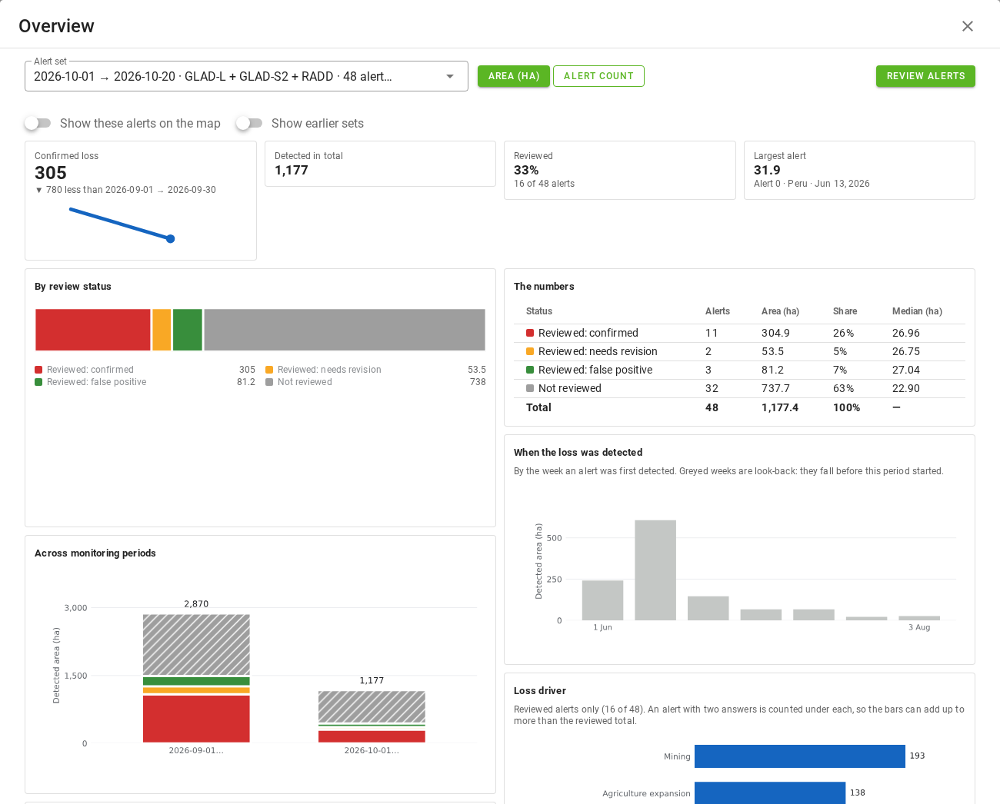

The header
^^^^^^^^^^

.. list-table::
    :header-rows: 1
    :widths: 25 55 20

    *   -   Control
        -   Description
        -   Default
    *   -   **Alert set**
        -   The set summed up. Choosing another one makes it the project's active set, as in `Analysis <defo-analysis-topbar_>`_.
        -   The active set.
    *   -   **Area (ha)** / **Alert count**
        -   Whether every figure of the page counts hectares or alerts.
        -   **Area (ha)**.
    *   -   **Review alerts**
        -   Closes the Overview and opens `Analysis <defo-analysis_>`_ on this set. Disabled when the set has no alerts.
        -
    *   -   **Show these alerts on the map**
        -   Draws the set's alerts on the main map, coloured by status, as in `Integrate & vectorize <defo-integrate-map_>`_.
        -   Off.
    *   -   **Show earlier sets**
        -   Draws the alerts of the earlier periods' sets on the main map. Only shown when there are earlier sets.
        -   Off.

The two map switches are shown only when the set has alerts. Turning one on closes the Overview, to show the map.

If the set is out of date or its files are missing, an orange line says so ("This set was built from inputs that have changed since…" or "This set's files are missing from the project folder…"). The figures still show what the set holds. Run `Integrate & vectorize <defo-integrate-outdated_>`_ again to rebuild it, which discards its reviews.

The key figures
^^^^^^^^^^^^^^^

.. list-table::
    :header-rows: 1
    :widths: 25 75

    *   -   Tile
        -   Content
    *   -   **Confirmed loss**
        -   The area (or number) of alerts reviewed as **Reviewed: confirmed**. With an earlier period, it compares with that period, in the page's measure ("▼ 780 less than 2026-09-01 → 2026-09-30", or "▲ … more than …"), and draws a small line across the periods.
    *   -   **Detected in total**
        -   The area (or number) of all the set's alerts, whatever their status.
    *   -   **Reviewed**
        -   The share of alerts that have a verdict, and "16 of 48 alerts". It always counts alerts.
    *   -   **Largest alert**
        -   The largest alert's area, its number, its country (once reviewed) and its date. It always counts hectares. The number is the alert's row in the set, which is the Analysis counter's number minus one.

.. _defo-overview-figures:

The figures
^^^^^^^^^^^

.. shot: overview-figures | The Overview dialog scrolled down, measure Area (ha): in the left column How big the alerts are and By administrative area with Province / state selected (a one-row table: Peru › Madre de Dios); in the right column The numbers (Status / Alerts / Area (ha) / Share / Median (ha) with the Total row), When the loss was detected (weekly bars with greyed look-back weeks), the card of the loss-driver question (Mining, Agriculture expansion, No answer, Logging), the Access road nearby? card (No, No answer) and By alert source. Crop to the dialog body, above the Export alerts card.

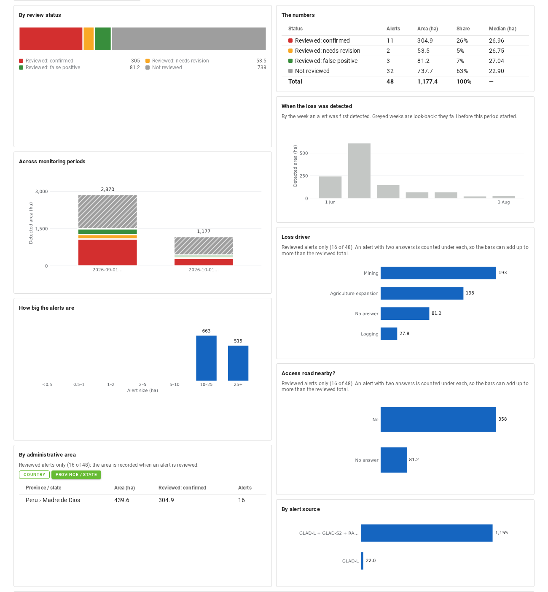

Left column:

.. list-table::
    :header-rows: 1
    :widths: 25 75

    *   -   Card
        -   Content
    *   -   **By review status**
        -   One bar split by status, and the value of each status.
    *   -   **Across monitoring periods**
        -   One column per monitoring period of the project, split by status, from its newest alert set. A period still under review shows its unreviewed share hatched. With one period only, it reads "This project has one monitoring period. Add a second one and its trend is charted here."
    *   -   **How big the alerts are**
        -   The alerts by size: under 0.5 ha, 0.5–1 ha, 1–2 ha, 2–5 ha, 5–10 ha, 10–25 ha, and 25 ha or more.
    *   -   **By administrative area**
        -   The reviewed alerts by administrative area, up to eight areas, the most confirmed loss first: their **Area (ha)**, the hectares **Reviewed: confirmed** and the number of **Alerts**. Two buttons above the table set the level: **Country**, or **Province / state**, the first level below the country, shown with its country ("Peru › Madre de Dios"). Reviewed alerts only, since the areas are recorded (from the FAO GAUL boundaries) when an alert is saved; an alert with none recorded is counted as **Not recorded**. An alert across a border is listed under all the areas it falls in, joined by commas.

Right column:

.. list-table::
    :header-rows: 1
    :widths: 25 75

    *   -   Card
        -   Content
    *   -   **The numbers**
        -   A table: per status, the number of alerts, their area, their share of the measure and the median alert size, with a **Total** row.
    *   -   **History of growing clearings**
        -   Only when the set has `growth alerts <defo-integrate-growth_>`_ (see below).
    *   -   **When the loss was detected**
        -   The alerts by the week they were first detected. Greyed weeks are look-back weeks: they fall before the period started (see `What earlier periods already reported <defo-integrate-earlier_>`_).
    *   -   One card per question
        -   The answers given to each `question <defo-questionnaire_>`_, for reviewed alerts only: the five most frequent, then **Other** and **No answer**. An alert with two answers counts under each.
    *   -   **By alert source**
        -   The alerts by the combination of sources that detected them.

When a figure cannot be drawn, its card reads "This figure could not be drawn; its numbers are below." and lists them.

.. _defo-overview-growth:

Growing clearings
"""""""""""""""""

The **History of growing clearings** card follows the clearings that this set's growth alerts extend. Its headline gives the set's growth alerts and their area ("3 growth alerts · 4.2 ha", or only the number with **Alert count**). The line under it splits them ("Growth: 2 · Under minimum area: 1") and says how many are reviewed.

Its table lists the histories that include an alert of this set, the largest confirmed area first:

.. list-table::
    :header-rows: 1
    :widths: 25 75

    *   -   Column
        -   Content
    *   -   **Monitoring periods**
        -   The first and the last period of the history.
    *   -   **Alerts**
        -   The number of alerts in the history, all periods together.
    *   -   **Confirmed (ha)**
        -   The area of the history's alerts reviewed as **Reviewed: confirmed** or **Reviewed: needs revision**, counted once where their shapes overlap.
    *   -   **This set adds (ha)**
        -   The area of this set's alerts in the history, false positives left out.
    *   -   **Review**
        -   Closes the Overview and opens this set's alert of the history in `Analysis <defo-analysis_>`_.

Export the set
^^^^^^^^^^^^^^

The **Export alerts** card, at the bottom, writes the set's alerts to a file for a geographic information system (GIS) or a spreadsheet. See `The whole set, from the Overview <defo-export-set_>`_.

Common messages
^^^^^^^^^^^^^^^

"No alert set yet. Run Integrate & vectorize to produce one."
    The project has no set: run `Integrate & vectorize <defo-integrate_>`_.

"This set has no alerts."
    The set was made but found no alert; nothing is charted.

"This set's alerts could not be read: …"
    The set's files are damaged or missing. Run `Integrate & vectorize <defo-integrate_>`_ again.

"No reviewed alert answered this yet." or "No alert has been reviewed yet, so no administrative area is on record."
    Review alerts in `Analysis <defo-analysis_>`_ to fill these cards.

.. _defo-export:

Export
------

The app exports alerts in two ways:

-   the files of one reviewed alert, from the Analysis screen; and
-   the alerts of a whole set, from the Overview.

Every file is written into the alert set's folder in the project (``periods/<start>_<end>/sets/<set>/``, see `Project <defo-project_>`_), so it can also be found there later, in SEPAL's file browser.

.. _defo-export-alert:

One alert, from Analysis
^^^^^^^^^^^^^^^^^^^^^^^^

The **Export this alert** section sits in the footer of the `Analysis <defo-analysis_>`_ review panel. It works on the alert on screen, once its review is saved: its badge reads "available after save", then "ready to build", then "3 files ready".

.. shot: export-alert-files | The Export this alert section of the Analysis footer after Build alert files on a true alert of the demo project: badge "3 files ready", the Alert data tile "GeoPackage + before/after GeoTIFF", the Alert report tile "Word, from the project's template", the Timelapse tile "Animated GIF" as a download link, and the Rebuild files tile; Save & next and Save under them, the green "Saved 14:32" line. Crop to the footer.

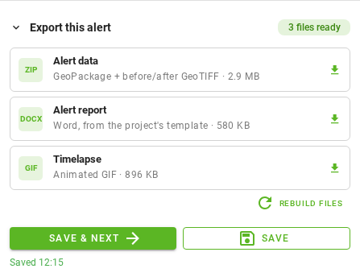

.. list-table::
    :header-rows: 1
    :widths: 25 75

    *   -   Tile
        -   Description
    *   -   **Build alert files**
        -   Builds the alert's data and report. It reads "(save first)" and is disabled until **Save** or **Save & next** is selected on this alert in this session. It runs in the task list and takes a while: it downloads the before and after images.
    *   -   **Alert data**
        -   Downloads a .zip file: the alert's GeoPackage, its before and after images as one GeoTIFF and, for a true alert, its GIF.
    *   -   **Alert report**
        -   Downloads the alert's Word report.
    *   -   **Rebuild files**
        -   Builds the files again (e.g. after the review changed).
    *   -   **Timelapse**
        -   Makes and downloads an animated GIF of the alert (see below).

The files are named after the alert's row in the set (the counter's number minus one):

.. list-table::
    :header-rows: 1
    :widths: 40 60

    *   -   File
        -   Content
    *   -   ``alert_<n>.gpkg``
        -   The alert as one feature with its attributes and answers (the answers in the app's current language). Its geometry is the polygon drawn in `Refine the polygon <defo-analysis-refine_>`_, or else the alert's bounding box.
    *   -   ``alert_<n>_<before>_<after>.tif``
        -   The before and after images, cut to the **Image area**. The two date parts name each image's collection (``s`` Sentinel-2, ``l`` Landsat, ``p`` Planet) and date.
    *   -   ``alert_<n>_<before>_<after>.gif``
        -   The timelapse, when made, named like the GeoTIFF.
    *   -   ``alert_<n>.zip``
        -   The GeoPackage, the GeoTIFF and, for a true alert, the GIF.
    *   -   ``alert_<n>.docx``
        -   The Word report.

The links of the tiles are for the review on screen. Choosing other images, saving the alert again or changing the report template hides them: build the files again.

The report
""""""""""

The report is built from the project's Word template, chosen in the `Questionnaire <defo-questionnaire-template_>`_ step, or from the app's default template when the project has none. The template's placeholders are filled with the alert's attributes, its answers and its images. See `The report template <defo-questionnaire-template_>`_ for the list.

The timelapse
"""""""""""""

The **Timelapse** tile makes an animated GIF that runs through the images of the alert's area, from before to after, with the alert's outline over them. Each frame is labelled with its collection and date. The before and after frames also name their side ("Before · Sentinel-2 2026-07-28").

It is offered for a true alert only: the tile is active when the alert is saved as **Reviewed: confirmed** and the images on screen are those it was saved with. Otherwise, it reads "Save as a true alert, with the images on screen, to create it".

The frames are:

-   the before and after images chosen in the review; and
-   up to two images before the before image and two after the after image, found within 12 months, under the timeline's **Max cloud** limit and never a Planet mosaic.

The GIF is saved next to the other files and, when the alert's files are built, added to the .zip file.

.. _defo-export-set:

The whole set, from the Overview
^^^^^^^^^^^^^^^^^^^^^^^^^^^^^^^^

The **Export alerts** card, at the bottom of the `Overview <defo-overview_>`_, writes the alerts of the set shown to a single file. Its top line sums up the alerts that the chosen **Alerts** chip writes, with the set's sources and dates (e.g. "11 alerts · 304.9 ha · GLAD-L + GLAD-S2 + RADD · 2026-10-01 – 2026-10-20" for **Confirmed**). The folder chip next to it copies the folder's path when selected.

.. shot: export-overview-card | The Export alerts card at the bottom of the Overview of the demo project, on the set 2026-10-01 → 2026-10-20: the summary line ("11 alerts · 304.9 ha · GLAD-L + GLAD-S2 + RADD · 2026-10-01 – 2026-10-20"), the folder chip; the Alerts chips Confirmed (11) selected, All reviewed (16), Not reviewed (32), All (48); the GeoPackage tile written ("11 polygons · answers · 2026-10-20 02:13 · 224 KB", as a download link) and the CSV table tile still to create ("11 rows · all columns, WKT"); the footer line with the file name. Crop to the card.

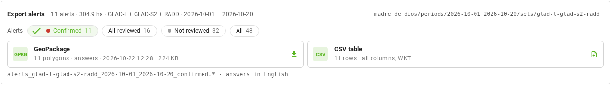

To export the set:

1.  Choose the alerts to write with the **Alerts** chips: **Confirmed**, **All reviewed**, **Not reviewed** or **All**. Each chip shows its number of alerts; a chip with none is disabled. **Confirmed** is chosen first when the set has confirmed alerts, **All** otherwise.
2.  Select a format tile to write the file. It reads "Writing 11 alerts…" while it works, and the task list shows **Exporting alerts**.
3.  Select the tile again, now a download link with the time it was written, to download the file.

.. list-table::
    :header-rows: 1
    :widths: 25 75

    *   -   Tile
        -   Content
    *   -   **GeoPackage**
        -   One polygon per alert, with its attributes and answers. The geometry is the alert's polygon from `Integrate & vectorize <defo-integrate_>`_, not the one drawn in Analysis.
    *   -   **CSV table**
        -   One row per alert with every column, geometries written as well-known text (WKT), including the polygon drawn in Analysis.

Both files add three columns on `growth <defo-integrate-growth_>`_:

-   ``kind``: ``new``, ``growth``, ``growth_small`` or ``new_small`` (see **Kind** in `The review panel <defo-analysis-panel_>`_);
-   ``grows_from``: the alert's links, separated by ";", each written as *set*\ ``#``\ *alert number*\ ``@``\ *run of that set*; and
-   ``history_area_ha``: the confirmed area of the alert's history, 0 for an alert without one.

The file is named after the set's sources, its period and the chosen alerts (e.g. ``alerts_glad-l-glad-s2-radd_2026-08-01_2026-09-30_confirmed.gpkg``): ``_reviewed`` for **All reviewed**, ``_unreviewed`` for **Not reviewed**, and no suffix for **All**. The card's last line shows the name. Answers are written in the app's current language.

When reviews are saved after a file was written, its tile reads **Reviews changed since**, with an **Update** button. Select it to write the file again.

Common messages
^^^^^^^^^^^^^^^

"The before and after images for this alert are not both ready, so its files cannot be built."
    Choose both images on the timeline and let the two maps finish drawing them.

"No alert set is active, so there is nowhere in the project to save the alert files. Run Integrate & vectorize first."
    Run `Integrate & vectorize <defo-integrate_>`_.

"The report template … is gone. Pick it again in the Questionnaire step, or clear it to use the default template."
    The project's template was moved or deleted: see `The report template <defo-questionnaire-template_>`_.

"The alert files are ready, but the GIF could not be made, so the zip has no GIF."
    Try the **Timelapse** tile on its own.

"The before and after images are the same image, so the GIF would show no change."
    Choose two different images on the timeline.

"Fewer than two images could be rendered for this alert, so no GIF was made."
    Choose other before and after images, then try again.

"The alert files finished building after you moved to another alert: they were not offered for download here."
    Go back to the alert: the files are in the set folder.

.. _defo-use-case:

Use case: alert review in Madre de Dios, Peru
---------------------------------------------

.. labels-ok: Admin level 1; Select AOI; True colour

This use case follows a small forest-monitoring team through two monthly rounds in the department of Madre de Dios, in the Peruvian Amazon, on the borders with Brazil and Bolivia. Gold mining and the spread of agriculture both put pressure on its forest, so the team wants to know each month where forest was lost, and why.

The team has:

-   a coordinator, who sets up the project and reviews alerts; and
-   two evaluators, Ana and Luis, who review their share of the alerts from their own SEPAL accounts.

.. note::

    The values in this use case come from the demo project the screenshots of this article are taken from. The verdicts and answers show how the app records a review; they are examples, not a checked assessment of the forest in Madre de Dios.

Set up the project
^^^^^^^^^^^^^^^^^^

The coordinator sets up the project as follows:

1.  **Project**: in the app, select **New project** and name it ``madre_de_dios`` (see `Create a project <defo-project-create_>`_).
2.  **AOI**: in the `AOI <defo-aoi_>`_ step, choose **Admin level 1**, then Peru, then "Madre De Dios" (as the list spells it), and select **Select AOI**. The area is saved as ``PER_Madre_De_Dios``. A whole department is a large area: every later step takes longer than for a district.
3.  **Alert sources**: in `Alert sources <defo-alerts_>`_, add the three predefined sources: **GLAD-L (Landsat, 30 m)**, **RADD (Sentinel-1, 10 m)** and **GLAD-S2 (Sentinel-2, 10 m)**. Each one **covers the AOI**. Under RADD, the app notes that it detects only in primary humid tropical forest: elsewhere in the department, only GLAD-L and GLAD-S2 can report alerts.
4.  **Optional layers**: to judge alerts against a recent image, add one `optional layer <defo-layers_>`_: an **Earth Engine** Sentinel-2 image of 27 September 2026 (tile 19LDF, east of Puerto Maldonado), with **Three bands (RGB)** on, **True colour** (B4, B3, B2), **Min** 0 and **Max** 3000, named ``Sentinel-2 2026-09-27``, and **Show in Analysis** selected.

.. note::

    A Planet NICFI monthly mosaic would cover the whole department, but the account used for this article has no NICFI access. This is also why the *Planet* chip of the Analysis timeline reads 0 in the screenshots below.

The September round
^^^^^^^^^^^^^^^^^^^

Period
""""""

In `Monitoring period <defo-period_>`_, the coordinator:

1.  selects **New period**;
2.  sets the dates from 2026-09-01 to 2026-09-30;
3.  enters 90 in **Look-back (days)** (a new project's first period starts at 0); and
4.  selects **Add period**.

The search window runs from 2026-06-03 to 2026-09-30, so clusters that started between June and August, and alerts the sources published late, are found too. As the first period, it has no earlier set: every alert in its search window is kept.

Download & harmonize
""""""""""""""""""""

In `Download & harmonize <defo-prepare_>`_, the coordinator:

1.  keeps the suggested grid, the UTM zone of the department (``EPSG:32719``) at 10 m, and selects **Save grid**. The grid is 41425 × 38561 pixels, about 12.8 GB per source before compression, so the app warns that the downloads will take a while;
2.  adds a mask so that only alerts in forest count: **Add mask**, the Hansen Global Forest Change image ``UMD/hansen/global_forest_change_2025_v1_13``, band ``treecover2000``, named ``forest_2000``, mode **Keep**; and
3.  selects **Run … pending**, which aligns the mask, then downloads and harmonizes the three sources.

The run took about 15 minutes. Each source then reads **ready**: GLAD-L with 2362718 alert pixels, RADD with 1508527 and GLAD-S2 with 1462458.

Integrate & vectorize
"""""""""""""""""""""

In `Integrate & vectorize <defo-integrate_>`_, the coordinator:

-   keeps the three sources and **Include probable (unconfirmed) alerts** on;
-   sets **Minimum alert size** to 1 ha and **Order** to **Bigger alerts first**; and
-   selects **Limit the number of alerts**, with **Maximum number of alerts** set to 48: the team can review about 48 alerts a month, so it starts with the biggest ones.

The run makes the alert set "2026-09-01 → 2026-09-30 · GLAD-L + GLAD-S2 + RADD" with 48 alerts, from 383.18 ha down to 27.84 ha: 2870 ha in all.

The clusters beyond the cap are kept as not analysable. The next period reconsiders them only if its look-back reaches back into September and it uses the same sources. October's 90-day look-back does (see `What earlier periods already reported <defo-integrate-earlier_>`_).

Review alone, then together
^^^^^^^^^^^^^^^^^^^^^^^^^^^

First reviews
"""""""""""""

Before sharing the work, the coordinator opens `Analysis <defo-analysis_>`_ and reviews the two biggest alerts:

-   alert 1 (383.18 ha) as **True alert**, with the loss driver **Mining**; and
-   alert 2 (146.97 ha) as **False positive**.

Split the alerts
""""""""""""""""

In `Evaluation <defo-evaluation_>`_, the coordinator selects **Multiple evaluators**, then **Split alerts…**, chooses **Names**, enters Ana and Luis, and selects **Split**. The alerts are dealt out in turn: Ana and Luis get 23 each, and the two alerts already reviewed stay **Unassigned**.

Before the packages
"""""""""""""""""""

The coordinator goes on reviewing in the original project while the split is set:

-   alert 3 as **True alert**, with **Agriculture expansion**;
-   alert 4 as **Needs review**, with **Logging**; and
-   alert 5 as **True alert**, with **Mining**.

These verdicts travel in the packages, so the evaluators see them; alerts 3 and 5 are among Ana's. The coordinator then selects **Generate packages** and sends each evaluator their .zip file.

Ana's review copy
"""""""""""""""""

Ana copies the package into her SEPAL folder and imports it with **Import** in the `Project <defo-project-import_>`_ dialog. It opens as the project ``madre-de-dios__e01-ana``, on the Analysis screen, already filtered to her alerts ("Evaluator: Ana").

Ana works through them with **Save & next**:

-   the top bar counts "5 reviewed · 18 left · filtered · 48 total" (the coordinator's two reviews of her alerts and three of her own);
-   the counter numbers her alerts from 1 to 23; and
-   her third alert, for example, is saved as **True alert** with **Mining**: the after image shows bare, sandy ground with a green pond at the edge of the forest, which looks like the pits that alluvial gold mining leaves.

.. shot: use-case-ana-copy | The Analysis screen of Ana's review copy (project madre-de-dios__e01-ana): the filled funnel with the "Evaluator: Ana" chip, the tally "5 reviewed · 18 left · filtered · 48 total", the counter "03 / 23"; before and after images of one of her alerts; the review panel with Status "Reviewed: confirmed", True alert chosen and the Loss driver answered "Mining"; the after image shows sandy ground and a pond. No crop.

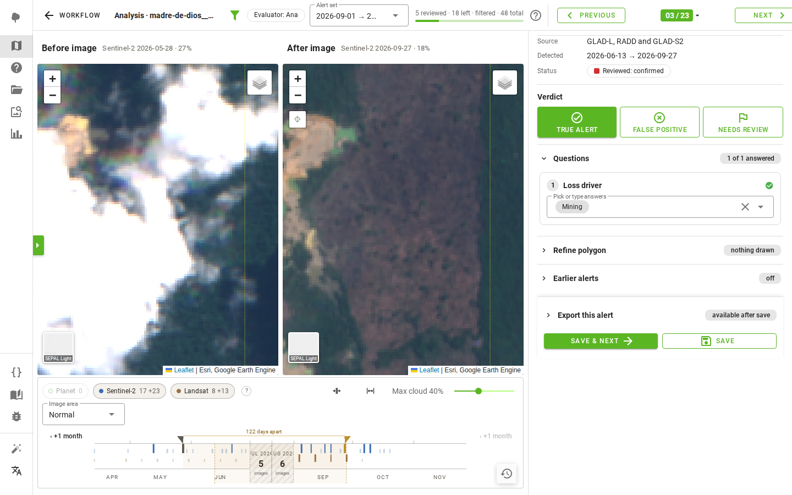

When done for now, Ana selects **Generate reviewed copy** in the `Evaluation <defo-evaluation-return_>`_ step ("5 / 23 of your alerts reviewed") and sends the ``__reviewed.zip`` file back.

Merge Ana's reviews
"""""""""""""""""""

The coordinator copies the file into the SEPAL folder, selects **Merge reviewed copy…** and chooses it. The preview reads "Ana: 3 new reviews, 1 conflicts, 1 unchanged, 0 ignored":

-   the unchanged review is alert 3, which Ana left as the coordinator saved it; and
-   the conflict is alert 5: the coordinator had confirmed it as mining, while Ana marked it as a false positive.

The coordinator keeps the original verdict with **Keep mine**, and plans to look at that alert again with Ana. After **Merge**, the evaluators table shows Ana with five of her 23 alerts reviewed and the date of the merge (see `Merge a reviewed copy <defo-evaluation-merge_>`_).

Add a question
^^^^^^^^^^^^^^

The team also wants to record whether each clearing has an access road nearby. In the `Questionnaire <defo-questionnaire_>`_ step, after the default **Loss driver**, the coordinator adds a second question:

1.  **Add question**;
2.  "Access road nearby?";
3.  **One answer**, with the options Yes and No;
4.  **Required** on; and
5.  asked for **True alert** and **Needs review** only.

Because the questionnaire changed after the packages were built, their cloud icons in `Evaluation <defo-evaluation-packages_>`_ turn amber. Packages already sent still merge, by question key. For the new question to reach the evaluators, the coordinator selects **Regenerate packages** and sends the new ones.

From then on, a true alert or an alert that needs review gets both answers (a false positive gets neither: both questions are asked only for the other two verdicts). For example, alert 10 is saved as **True alert**, with **Agriculture expansion** as the loss driver and "No" for the access road. Its status reads **Reviewed: confirmed**, and the **Questions** section reads "2 of 2 answered".

.. shot: use-case-reviewed-alert | The Analysis screen of the demo project on alert 10 / 48 of the September set (tally "13 reviewed · 35 left"), reviewed: before and after images; the review panel with Status "Reviewed: confirmed", True alert chosen, the Questions section open with "2 of 2 answered", Loss driver = Agriculture expansion and "Access road nearby?" = No; Export this alert "available after save". No crop.

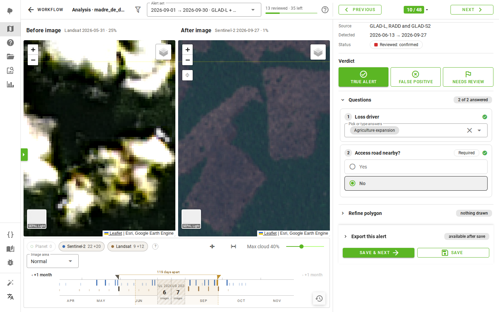

Back in the workflow, **Show these alerts on the map** in `Integrate & vectorize <defo-integrate-map_>`_ draws the set over the department. At this zoom, each alert is a dot coloured by its review status:

-   grey for **Not reviewed**;
-   red for **Reviewed: confirmed**;
-   green for **Reviewed: false positive**; and
-   amber for **Reviewed: needs revision**.

With 13 of the 48 alerts reviewed, most dots are still grey. Most alerts lie in the south of the department.

.. shot: use-case-alerts-map | The main map over Madre de Dios with the September set's 48 alerts drawn from Integrate & vectorize's "Show these alerts on the map" switch, after 13 reviews: grey dots (Not reviewed), red (Reviewed: confirmed), green (Reviewed: false positive) and amber (Reviewed: needs revision), most of them in the south; the alert legend ("Alerts · 2026-09-01_2026-09-30 · GLAD-L + GLAD-S2 + RADD"). Crop to the map, between the left rail and the Workflow panel.

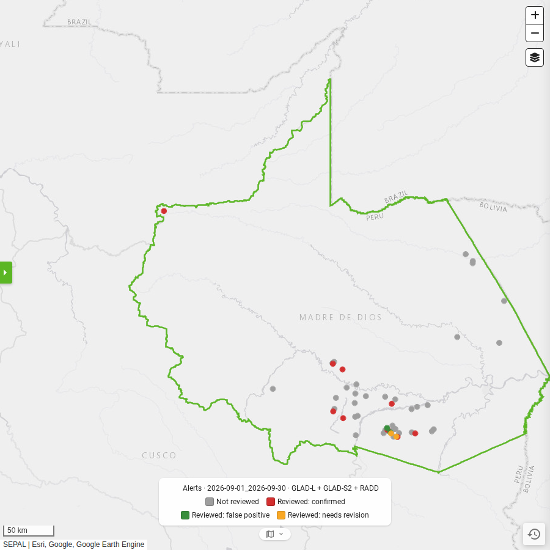

The October round
^^^^^^^^^^^^^^^^^

At the start of the next round, the coordinator selects **New period** in `Monitoring period <defo-period-add_>`_. The dialog is pre-filled: from 2026-10-01 (the day after September ends) to today, with the 90 days of look-back used last time. The coordinator sets the end to 2026-10-20, the day of this round. **Add period** makes it the active period, with the September period's mask choices.

Then:

-   **Run … pending** in `Download & harmonize <defo-prepare_>`_ downloads the three sources for the new window; the grid and the mask are already there.
-   In `Integrate & vectorize <defo-integrate_>`_, the coordinator uses the same settings as in September (1 ha, the 48 biggest alerts). Before grouping the pixels into alerts, the run removes every pixel inside September's 48 alerts, so that nothing is reported twice. The new set holds 48 alerts again, for 1177 ha. None of them touches an alert confirmed in September, so the run links none to earlier loss (see `Growth of earlier loss <defo-integrate-growth_>`_).

The team reviews them as in September; 16 are reviewed so far, 11 of them as true alerts. With **Show these alerts on the map** and **Show earlier sets** both on, the map shows the October alerts next to September's, which are drawn in fainter colours. The October alerts lie in the same parts of the department as September's.

.. shot: use-case-periods-map | The main map over Madre de Dios with Integrate & vectorize's "Show these alerts on the map" and "Show earlier sets" both on: the October set's alerts coloured by status, the September set's alerts in faded colours, and the legend with its selector showing the earlier set's legend ("Earlier set · 2026-09-01_2026-09-30 · …"). Crop to the map, between the left rail and the Workflow panel.

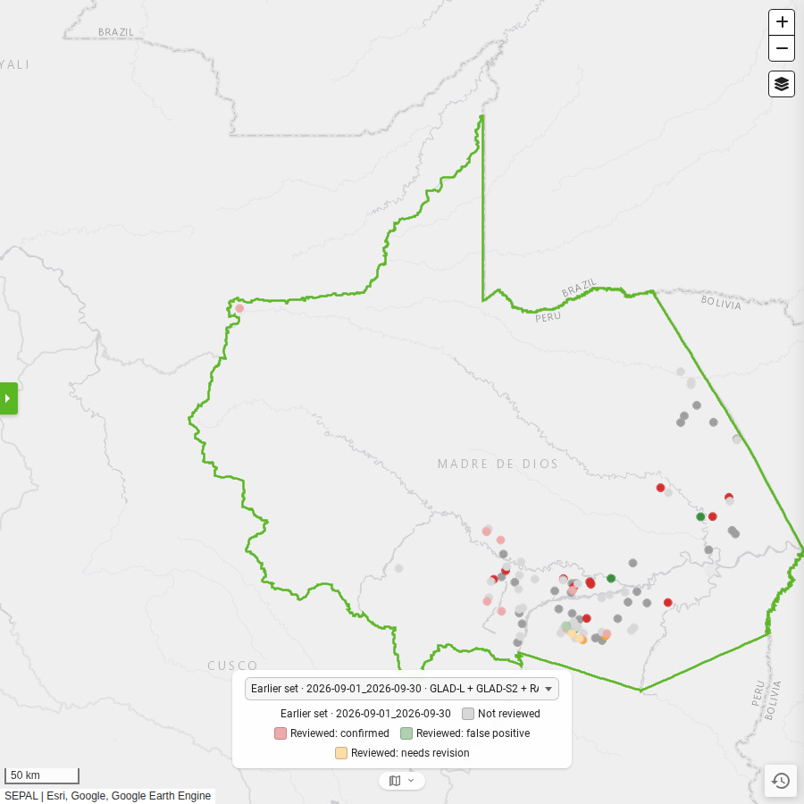

Read the figures
^^^^^^^^^^^^^^^^

The `Overview <defo-overview_>`_ sums up the October set. In **Area (ha)**:

-   **Confirmed loss**: 305 ha, with "▼ 780 less than 2026-09-01 → 2026-09-30";
-   **Detected in total**: 1177 ha;
-   **Reviewed**: 33 %, "16 of 48 alerts"; and
-   **Largest alert**: 31.9 ha, the card's "Alert 0". The Overview numbers alerts from 0, in the set's order; the Analysis counter starts at 1, so this is the first alert there.

.. shot: use-case-overview | The Overview dialog on the October set (2026-10-01 → 2026-10-20 · GLAD-L + GLAD-S2 + RADD · 48 alerts), measure Area (ha): the header and the two map switches, then the four key-figure tiles: Confirmed loss 305 with "▼ 780 less than 2026-09-01 → 2026-09-30" and its sparkline, Detected in total 1,177, Reviewed 33 % "16 of 48 alerts", Largest alert 31.9 "Alert 0 · …". Crop to the dialog, down to the bottom of the tiles, without the next row of cards.

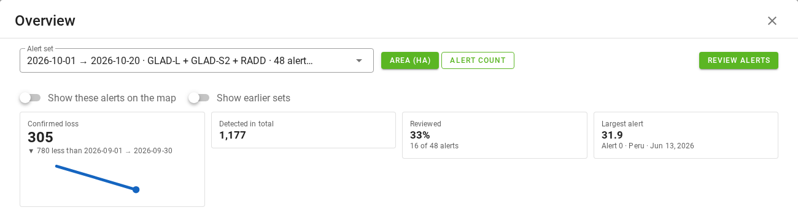

.. important::

    The comparison needs care. **Confirmed loss** counts only the alerts reviewed as true alerts, and only a third of the October alerts are reviewed; the September figure, too, covers only the September alerts reviewed so far. The arrow means that less loss is *confirmed* so far, not that less forest was lost: the figure grows as the team goes on reviewing.

**Across monitoring periods** shows the two periods side by side, with the share still under review hatched (2870 ha detected in September, 1177 ha in October).

Further down:

-   the card of the loss-driver question splits the reviewed area by answer (in October: Mining first, then Agriculture expansion); and
-   the card of the new question splits it by its answers (in October: all "No", 358 ha, with 81.2 ha under "No answer").

See `The figures <defo-overview-figures_>`_ for every card.

Share the results
^^^^^^^^^^^^^^^^^

The whole set
"""""""""""""

At the bottom of the Overview, the **Export alerts** card writes the October set to a file. The coordinator chooses **Confirmed** (11 alerts, 304.9 ha) and selects the **GeoPackage** tile. The file ``alerts_glad-l-glad-s2-radd_2026-10-01_2026-10-20_confirmed.gpkg`` holds one polygon per confirmed alert with its attributes and both answers, ready for a GIS. The **CSV table** tile writes the same alerts as a table for a spreadsheet. See `The whole set, from the Overview <defo-export-set_>`_.

One alert
"""""""""

To report on one alert, the coordinator opens it in Analysis, saves it, and selects **Build alert files** under **Export this alert**. The result is a .zip file with the alert's GeoPackage and its before and after images, and a Word report built from the project's template. For a true alert, the **Timelapse** tile also makes an animated GIF of the images from before to after. See `One alert, from Analysis <defo-export-alert_>`_.

Every file is also kept in the alert set's folder of the project, under ``periods/2026-10-01_2026-10-20/sets/glad-l-glad-s2-radd/``.

Next month
^^^^^^^^^^

For the next round, the team plans to:

-   select **New period** again: the dates continue the series, and the look-back brings back the clusters set aside as too small the month before, so a slowly growing clearing becomes an alert once it reaches 1 ha, without any pixel being reported twice;
-   review the October alerts before the next run: an alert confirmed by then can become the earlier loss that November's alerts grow from, and a clearing that keeps growing shows its history in Analysis and in the Overview;
-   check the questionnaire before splitting: a question added after the packages are built needs **Regenerate packages**;
-   review the alerts still **Not reviewed** in the earlier sets too, since the Overview's comparison is only as complete as the reviews behind it; and
-   use **Duplicate** in the `Project <defo-project-duplicate_>`_ dialog to monitor a neighbouring area with the same sources, mask and layers.
