Forest Cover Loss Alerts
========================
*Monitorea las alertas de pérdida de cobertura forestal en un área de interés, período tras período*

.. labels-ok: Map; Forest Cover Loss Alerts; Aplicaciones

**Forest Cover Loss Alerts** es una aplicación de SEPAL para monitorear la pérdida de cobertura forestal en un área de interés (AOI). La aplicación:

-   descarga de Google Earth Engine (GEE) las alertas Global Land Analysis and Discovery (GLAD) GLAD-L y GLAD-S2 y las alertas Radar for Detecting Deforestation (RADD), y también tus propias fuentes de alertas si las tienes;
-   las alinea en una misma cuadrícula;
-   agrupa los píxeles de alerta contiguos en alertas, y cada una indica todas las fuentes que la detectaron; y
-   te permite revisar las alertas una a una sobre imágenes satelitales de *antes* y de *después*.

Para cada alerta, confírmala o descártala, responde a tus propias preguntas sobre ella y vuelve a dibujar su polígono a mano o con dos modelos de redes neuronales. La revisión puede repartirse entre varios evaluadores. Los resultados se obtienen como archivos GeoPackage, tablas de valores separados por comas (CSV), informes de Word e imágenes GIF animadas.

Este artículo está dirigido a analistas de monitoreo forestal que usan SEPAL. Describe cada paso de la aplicación, en el orden en que se usan, y termina con un ejemplo completo.

.. _defo-workflow:

El flujo de trabajo de un vistazo
---------------------------------

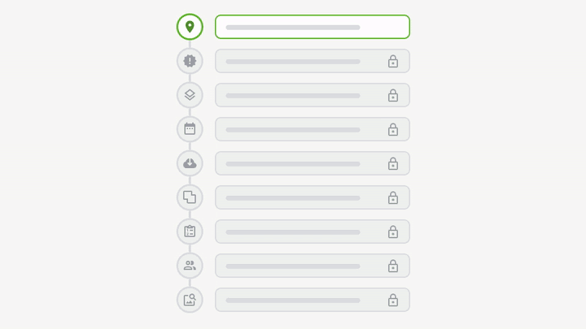

El panel **Flujo de trabajo** agrupa los pasos en dos niveles: **Preparar alertas** crea un conjunto de alertas y **Preparar la revisión** prepara su revisión. Las demás herramientas se abren desde la barra lateral izquierda (consulta `La ventana de la aplicación <defo-window_>`_).

.. list-table::
    :header-rows: 1
    :widths: 20 30 50

    *   -   Nivel
        -   Subsección
        -   Para qué sirve
    *   -   –
        -   `Proyecto <defo-project_>`_
        -   Crear, abrir, importar o eliminar un proyecto, la carpeta que guarda todo tu trabajo.
    *   -   **Preparar alertas**
        -   `Área de interés <defo-aoi_>`_
        -   Elegir el área que se va a monitorear.
    *   -
        -   `Período de monitoreo <defo-period_>`_
        -   Fijar las fechas de una ronda de monitoreo.
    *   -
        -   `Fuentes de alertas <defo-alerts_>`_
        -   Elegir los conjuntos de datos de alertas del período y descargarlos.
    *   -
        -   `Armonizar <defo-harmonize_>`_
        -   Alinear las descargas en una misma cuadrícula y aplicar las máscaras.
    *   -
        -   `Integrar y vectorizar <defo-integrate_>`_
        -   Combinar las fuentes en un conjunto de alertas, con un polígono por alerta.
    *   -   **Preparar la revisión**
        -   `Capas adicionales <defo-layers_>`_ (opcional)
        -   Añadir capas de referencia para evaluar las alertas.
    *   -
        -   `Cuestionario <defo-questionnaire_>`_ (opcional)
        -   Redactar las preguntas que se hacen para cada alerta y elegir la plantilla del informe.
    *   -
        -   `Evaluación <defo-evaluation_>`_
        -   Revisar en solitario o repartir las alertas entre evaluadores.
    *   -   –
        -   `Análisis <defo-analysis_>`_
        -   Revisar cada alerta sobre imágenes de antes y después.
    *   -   –
        -   `Resumen <defo-overview_>`_
        -   Ver las cifras de un conjunto de alertas.
    *   -   –
        -   `Exportar <defo-export_>`_
        -   Exportar los archivos de una alerta o las alertas de todo un conjunto.

**Preparar la revisión** sigue bloqueado hasta que el proyecto tiene un conjunto de alertas: crea uno primero en **Preparar alertas**.

Para ver un ejemplo completo de principio a fin, consulta `Caso de uso: revisión de alertas en Madre de Dios, Perú <defo-use-case_>`_.

.. _defo-setup:

Configuración
-------------

Requisitos:

-   una cuenta de SEPAL;
-   una cuenta de GEE vinculada a SEPAL; y
-   para las imágenes *Planet* de la línea de tiempo de Análisis, acceso en GEE a los mosaicos tropicales Planet de la Iniciativa Internacional de Noruega para el Clima y los Bosques (NICFI).

Para iniciar la aplicación, ve al panel **Aplicaciones** de SEPAL y selecciona **Forest Cover Loss Alerts**.

La aplicación se ejecuta en tu sesión de SEPAL y guarda tus proyectos en tu carpeta personal de SEPAL, en ``module_results/deforestation_alerts/``.

.. note::

    El proceso de inicio puede tardar varios minutos.

.. _defo-window:

La ventana de la aplicación
^^^^^^^^^^^^^^^^^^^^^^^^^^^

El mapa ocupa toda la ventana. El panel **Flujo de trabajo**, a la derecha, contiene los pasos. A la izquierda hay una barra lateral estrecha de iconos.

La cabecera del panel **Flujo de trabajo** queda a la vista mientras el paso de debajo se desplaza:

-   Una franja muestra los dos niveles uno al lado del otro, **Preparar alertas** y **Preparar la revisión**, cada uno con su nombre sobre una barra por paso. Una barra rellena tiene resultados (una AOI, períodos, fuentes…), una barra gris sigue vacía y una barra rayada está bloqueada: pasa el cursor sobre ella para leer el motivo (por ejemplo, "Crea primero un conjunto de alertas."). Los dos pasos opcionales, **Capas adicionales** y **Cuestionario**, tienen una barra discontinua. El nombre de un nivel recibe una marca de verificación en cuanto su último paso obligatorio tiene resultados. Selecciona una barra para abrir su paso.
-   Bajo la franja, la posición del paso en su nivel (por ejemplo, "3 / 5"), su nombre y lo que contiene ("3 fuentes"). Un paso opcional que sigue vacío no muestra ningún recuento: su barra discontinua ya lo marca como opcional. Selecciona el nombre para saltar a otro paso desde una lista, o usa las flechas de cada lado para ir al paso anterior o al siguiente.
-   Bajo el nombre, una línea indica qué hacer en el paso (por ejemplo, "Define el período de monitoreo."). El botón de información a la derecha de esa línea abre la ayuda del paso.

Para usar la barra lateral izquierda:

-   Pasa el cursor sobre un icono para ver su nombre.
-   Selecciona la flecha del borde de la barra para desplegarla y mostrar los nombres. Selecciona su chincheta para mantenerla desplegada. Una barra desplegada sin fijar se vuelve a plegar cuando haces clic en el mapa, tanto en la pantalla principal como en los mapas de Análisis.

.. note::

    Mientras hay un diálogo abierto, la barra no responde. Cierra antes el diálogo con su cruz.

De arriba abajo, la barra contiene:

-   **Map**: muestra el mapa sin ningún diálogo encima;
-   **Acerca**: una breve descripción de la aplicación (las fuentes que descarga, cómo se revisan y exportan las alertas y dónde se guardan tus proyectos);
-   **Proyecto**: abre el diálogo `Proyecto <defo-project_>`_;
-   **Análisis**: abre la pantalla de `Análisis <defo-analysis_>`_; y
-   **Resumen**: abre el diálogo `Resumen <defo-overview_>`_.

En la parte inferior de la barra hay tres enlaces al repositorio de GitHub de la aplicación (su código fuente, su documentación y un formulario para reportar un error) y después dos botones:

-   El botón de tema pasa, clic tras clic, del tema oscuro (icono de luna) al tema claro (icono de sol) y a un tema automático que sigue la configuración de tu sistema.
-   El selector de idioma muestra el código del idioma actual. Selecciónalo para elegir inglés, español, francés o portugués. Las etiquetas de la aplicación cambian al instante. Al principio, la aplicación sigue el idioma del navegador si es uno de estos cuatro, y si no, el inglés.

El navegador recuerda el tema y el idioma para la próxima sesión.

.. _defo-project:

Proyecto
--------

Todo el trabajo se hace dentro de un *proyecto*: una AOI, sus fuentes de alertas, sus períodos de monitoreo y todos los conjuntos de alertas generados a partir de ellos. Un proyecto es una carpeta en tu carpeta personal de SEPAL. La aplicación lo guarda automáticamente después de cada cambio: no hay botón **Guardar**.

Usa el diálogo **Proyecto** para crear, abrir, importar, copiar y eliminar proyectos. Se abre solo al iniciar la aplicación. Después, selecciona **Proyecto** en la barra lateral izquierda.

Cuando no hay ningún proyecto abierto
^^^^^^^^^^^^^^^^^^^^^^^^^^^^^^^^^^^^^

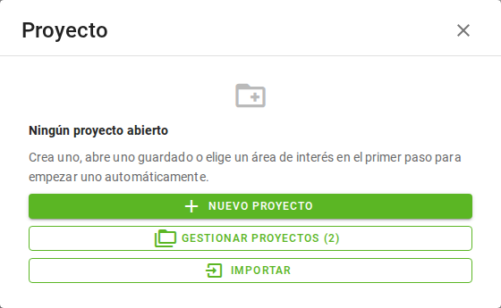

Si hay proyectos guardados, el diálogo ofrece el último modificado bajo **Continuar donde lo dejaste**, con sus números, su AOI y cuándo se modificó: selecciona **Continuar** para abrirlo. Si no hay ningún proyecto guardado, indica **Ningún proyecto abierto**. Debajo hay tres botones:

.. list-table::
    :header-rows: 1
    :widths: 25 75

    *   -   Botón
        -   Descripción
    *   -   **Nuevo proyecto**
        -   Pide un nombre y crea un proyecto vacío.
    *   -   **Gestionar proyectos**
        -   Muestra los proyectos guardados en tu carpeta de SEPAL, para abrir o eliminar uno. El botón indica cuántos hay y está desactivado mientras no haya ninguno.
    *   -   **Importar**
        -   Importa un paquete de revisión preparado por un colega (consulta `Importar un paquete de revisión <defo-project-import_>`_).

.. tip::

    No hace falta crear un proyecto primero. Ve directamente al paso `AOI <defo-aoi_>`_ y selecciona un área: la aplicación crea un proyecto con el nombre del área y la fecha de hoy (por ejemplo, ``PER_Madre_De_Dios_20261019``).

Cuando hay un proyecto abierto
^^^^^^^^^^^^^^^^^^^^^^^^^^^^^^

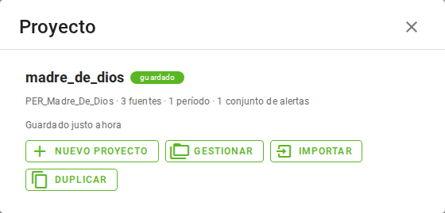

El diálogo muestra:

-   el nombre del proyecto con una etiqueta: **guardado** cuando el proyecto ya está en disco, o **error al guardar** en rojo cuando el último guardado automático falló (una línea debajo indica el motivo; los cambios siguen en la aplicación, así que corrige la causa, normalmente un disco lleno, antes de cerrar la pestaña del navegador);
-   un resumen: la AOI (o "sin AOI todavía") y el número de fuentes, períodos y conjuntos de alertas; y
-   cuándo se guardó el proyecto por última vez (por ejemplo, "Guardado hace 3 minutos").

El icono de lápiz junto al nombre renombra el proyecto y el icono de copia lo duplica. Los botones de debajo son los mismos que cuando no hay ningún proyecto abierto: **Nuevo proyecto**, **Gestionar proyectos** e **Importar**.

.. _defo-project-create:

Crear un proyecto
^^^^^^^^^^^^^^^^^

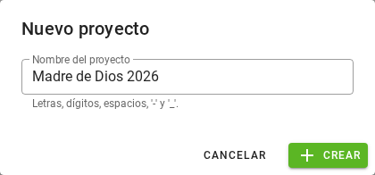

Para crear un proyecto:

1.  Selecciona **Nuevo proyecto**.
2.  Escribe un nombre en el campo **Nombre del proyecto**.
3.  Selecciona **Crear** (o pulsa **Intro**).

El **Nombre del proyecto** solo admite letras, cifras, espacios, guiones (``-``) y guiones bajos (``_``). No puede estar vacío y debe ser distinto de todas las carpetas de proyecto que ya hay en tu carpeta de SEPAL (sin distinguir mayúsculas y minúsculas).

El nombre se comprueba a medida que escribes. Si coincide con un proyecto guardado, el formulario ofrece un enlace como **Abrir Madre de Dios 2026 en su lugar**.

El nuevo proyecto se abre en el paso `AOI <defo-aoi_>`_, que siempre es el primer paso del flujo de trabajo.

Abrir, buscar y eliminar proyectos
^^^^^^^^^^^^^^^^^^^^^^^^^^^^^^^^^^

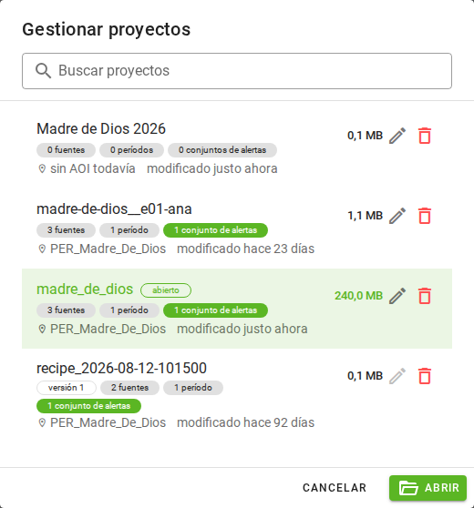

**Gestionar proyectos** muestra cada proyecto guardado con:

-   pequeñas etiquetas con su número de fuentes, períodos y conjuntos de alertas (la de conjuntos de alertas aparece en color cuando el proyecto tiene resultados por revisar);
-   su AOI (o "sin AOI todavía") y cuándo se modificó por última vez (por ejemplo, "modificado hace 2 días");
-   su tamaño en disco, medido al abrir el diálogo; y
-   una etiqueta **abierto** en el proyecto que está abierto en ese momento.

Para abrir un proyecto:

1.  Escribe en el campo **Buscar proyectos** para dejar solo los proyectos cuyo nombre contiene ese texto.
2.  Selecciona un proyecto.
3.  Selecciona **Abrir**.

Para renombrar un proyecto:

1.  Selecciona el icono de lápiz de su fila (o junto al nombre del proyecto abierto).
2.  Escribe el nuevo nombre. Sigue las mismas reglas que el nombre de un proyecto nuevo.
3.  Selecciona **Renombrar**.

No se puede renombrar un proyecto mientras una tarea sigue escribiendo en él.

Para eliminar un proyecto:

1.  Selecciona el icono rojo de la papelera en su fila. El diálogo de confirmación muestra el tamaño de la carpeta del proyecto.
2.  Escribe el nombre exacto del proyecto en el campo de confirmación.
3.  Selecciona **Eliminar**.

.. attention::

    Al eliminar se borra toda la carpeta del proyecto: descargas, conjuntos de alertas, revisiones e informes. No se puede deshacer.

    -   Si eliminas el proyecto abierto, primero se cierra.
    -   Un proyecto no se puede eliminar mientras una tarea (una descarga, una ejecución de **Integrar y vectorizar** o el guardado de una revisión) siga escribiendo en él. Espera a que la tarea termine.

.. _defo-project-duplicate:

Duplicar un proyecto
^^^^^^^^^^^^^^^^^^^^

**Duplicar** copia el proyecto abierto con un nombre nuevo. La copia conserva la AOI, las fuentes, las máscaras, las capas y la cuadrícula, la retrospección y la plantilla del informe, sin períodos ni conjuntos de alertas. La copia se abre en su paso AOI.

Úsalo para:

-   empezar una nueva ronda de monitoreo con la misma configuración; o
-   monitorear otra área una vez que la AOI de un proyecto está bloqueada (consulta `Área de interés <defo-aoi_>`_).

.. note::

    Las preguntas del cuestionario no se copian: la copia empieza con las preguntas predeterminadas. Vuelve a añadir las tuyas en su paso `Cuestionario <defo-questionnaire_>`_.

**Duplicar** no está disponible en una copia de revisión.

.. _defo-project-import:

Importar un paquete de revisión
^^^^^^^^^^^^^^^^^^^^^^^^^^^^^^^

Cuando el creador de un proyecto reparte las alertas entre varios evaluadores (consulta `Evaluación <defo-evaluation_>`_), cada evaluador recibe un *paquete de revisión*: un archivo .zip.

Para trabajar con un paquete de revisión:

1.  Copia el archivo .zip en tu carpeta de SEPAL.
2.  En el diálogo **Proyecto**, selecciona **Importar**.
3.  En el diálogo **Importar un paquete de revisión**, elige el archivo en **Paquete de revisión (.zip)**. La importación empieza en cuanto se elige el archivo.

El paquete se convierte en un proyecto nuevo, una *copia de revisión*, con el nombre del proyecto original y del evaluador (por ejemplo, ``madre-de-dios__e01-ana``). Se abre directamente en la pantalla de `Análisis <defo-analysis_>`_, filtrada a las alertas asignadas a ese evaluador. En una copia de revisión, los pasos de configuración están bloqueados y un aviso indica: "Copia de revisión para (evaluador), de (proyecto). La configuración está bloqueada."

Si el mismo paquete ya se importó, el diálogo **Ya importado** ofrece dos opciones:

-   **Abrir la copia existente**: abre la copia que ya existe, con sus revisiones; o
-   **Importar como copia nueva**: vuelve a importar el paquete como un proyecto aparte. La copia existente nunca se sobrescribe.

.. important::

    Una *copia revisada* (el archivo que devuelve un evaluador) no se puede importar aquí. El creador del proyecto la integra en el paso `Evaluación <defo-evaluation_>`_ del proyecto original.

Dónde están los archivos
^^^^^^^^^^^^^^^^^^^^^^^^

Cada proyecto es una carpeta con el nombre del proyecto, dentro de ``module_results/deforestation_alerts/`` en tu carpeta personal de SEPAL:

.. list-table::
    :header-rows: 1
    :widths: 30 70

    *   -   Dentro de la carpeta del proyecto
        -   Contenido
    *   -   ``project.json``
        -   La configuración y el historial del proyecto. La aplicación lo escribe en cada guardado.
    *   -   ``aoi.geojson``
        -   La AOI, cuando es una forma dibujada, un archivo vectorial o un archivo de puntos. Un área administrativa o un recurso de GEE se leen en cambio desde GEE.
    *   -   ``masks/``
        -   Las máscaras de `Armonizar <defo-harmonize_>`_, alineadas con la cuadrícula del proyecto.
    *   -   ``imagery/``
        -   El índice de escenas satelitales que se usan en la pantalla de Análisis.
    *   -   ``periods/<start>_<end>/``
        -   Una carpeta por período de monitoreo: descargas en ``raw/``, rasters en ``harmonized/`` y ``sets/`` con una carpeta por conjunto de alertas.

.. note::

    No toques estos archivos mientras la aplicación esté en ejecución. Usa las herramientas de `exportación <defo-export_>`_ de la aplicación para sacar los resultados.

.. _defo-aoi:

Área de interés
---------------

.. labels-ok: Método de selección de AOI; País/Provincia; Nivel administrativo 1; Nivel administrativo 2; Archivo vectorial; Dibujar figura(s) en el mapa; Archivo de puntos; Nombre del asset; Usar selección; Crea un nombre para tu AOI; Selecciona un Asset; columna; Valor; id; latitud; longitud; Column; Value

La AOI es el área que monitorea el proyecto:

-   todas las descargas de alertas se recortan a ella;
-   la cobertura de cada fuente de alertas se mide sobre ella; y
-   la cuadrícula del proyecto se construye a su alrededor.

Abre el paso **AOI**, el primer paso del panel **Flujo de trabajo**. El paso siempre está disponible, incluso sin ningún proyecto abierto.

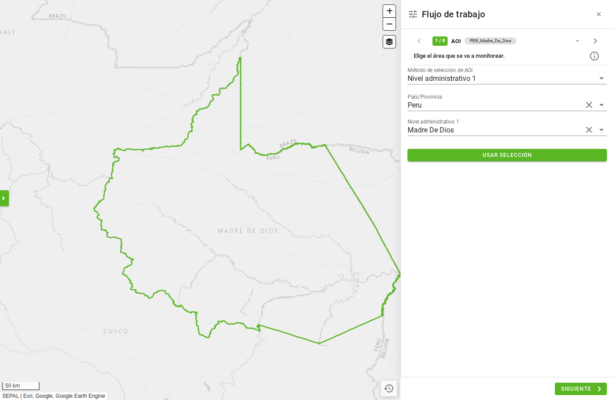

Seleccionar el área
^^^^^^^^^^^^^^^^^^^

Para seleccionar la AOI:

1.  Elige un método en el menú desplegable **Método de selección de AOI**.
2.  Completa sus campos.
3.  Selecciona **Usar selección**.

El área se dibuja en el mapa y se guarda con el proyecto de inmediato.

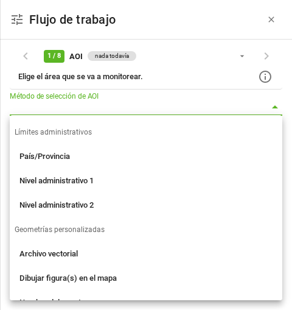

.. list-table::
    :header-rows: 1
    :widths: 20 40 40

    *   -   Método
        -   Entrada
        -   Notas
    *   -   **País/Provincia**
        -   Un país.
        -   Los límites administrativos provienen del conjunto de datos Global Administrative Unit Layers (GAUL) de la Organización de las Naciones Unidas para la Alimentación y la Agricultura (FAO).
    *   -   **Nivel administrativo 1**
        -   Un país y luego una unidad de primer nivel (una región, un estado o un departamento).
        -   Cada lista se completa en cuanto se elige el nivel superior.
    *   -   **Nivel administrativo 2**
        -   Un país, una unidad de primer nivel y luego una unidad de segundo nivel (una provincia o un distrito).
        -
    *   -   **Archivo vectorial**
        -   Un archivo .shp, .geojson, .gpkg o .kml en tu carpeta de SEPAL.
        -   Conserva todas las entidades, o elige una **columna** y un **Valor** para conservar solo las entidades que coinciden.
    *   -   **Dibujar figura(s) en el mapa**
        -   Formas dibujadas en el mapa con las herramientas de dibujo que aparecen, y un nombre opcional en **Crea un nombre para tu AOI**.
        -   Todas las formas dibujadas forman juntas la AOI. Sin nombre, se llama ``drawn_`` seguido de la fecha y la hora.
    *   -   **Archivo de puntos**
        -   Una tabla .csv o .txt con una columna **id**, una **latitud** y una **longitud**.
        -   Construye la AOI a partir de puntos. Los puntos no tienen superficie, así que para monitorear es preferible un método que dé polígonos.
    *   -   **Nombre del asset**
        -   Una tabla (colección de entidades) o una imagen de GEE que puedas leer, elegida en **Selecciona un Asset** o pegada con su identificador completo.
        -   Para una tabla, conserva solo las entidades cuya **Column** tiene un **Value** determinado.

Cuando la selección termina, la aplicación confirma: "AOI guardada: (nombre)". El panel **Flujo de trabajo** muestra el nombre de la AOI en la cabecera, y se desbloquea el paso `Período <defo-period_>`_.

.. tip::

    Una AOI nacional funciona, pero todo lo que viene después (descargas, cuadrícula, vectorización) crece con el área. Empieza con una provincia o un distrito mientras aprendes a usar la aplicación.

Qué pasa al seleccionar un área
^^^^^^^^^^^^^^^^^^^^^^^^^^^^^^^

Al seleccionar un área:

-   Si no hay ningún proyecto abierto, se crea uno con el nombre de la AOI y la fecha de hoy (por ejemplo, ``PER_Madre_De_Dios_20261019``). Un área administrativa toma el código ISO del país y el nombre de la unidad.
-   La cobertura de cada fuente de alertas sobre la nueva área se comprueba una vez y se guarda en el proyecto. El paso `Alertas <defo-alerts_>`_ la muestra.
-   Si el proyecto ya tenía otra AOI, se eliminan todas las descargas, los rasters armonizados y las máscaras creados para el área anterior, porque estaban recortados a ella. La cuadrícula del proyecto se restablece, para que se construya de nuevo alrededor de la nueva área.

Cuando la AOI está bloqueada
^^^^^^^^^^^^^^^^^^^^^^^^^^^^

En cuanto el proyecto tiene un conjunto de alertas, su AOI ya no puede cambiar: una nueva área invalidaría todas las descargas y todas las huellas de alertas. El paso muestra entonces "Este proyecto ya tiene conjuntos de alertas, así que su AOI está bloqueada. Duplica el proyecto (diálogo de proyecto) para monitorear otra área." y el selector queda desactivado.

Para monitorear otra área con las mismas fuentes, máscaras, capas y cuadrícula, selecciona **Duplicar** en el diálogo `Proyecto <defo-project-duplicate_>`_ y luego selecciona la nueva área en la copia.

En una copia de revisión (consulta `Importar un paquete de revisión <defo-project-import_>`_), el paso solo muestra el nombre de la AOI: el área es la que eligió el creador del proyecto.

.. important::

    La AOI no puede cambiar mientras una tarea escribe en el proyecto (una descarga o una ejecución de **Integrar y vectorizar**). La aplicación indica: "Un trabajo está escribiendo en este proyecto; cambia la AOI cuando termine." Espera a que la tarea termine y vuelve a seleccionar el área.

.. _defo-period:

Período de monitoreo
--------------------

Un *período* es una ronda de monitoreo, normalmente un mes. Para cada período, la aplicación descarga las fuentes de alertas del período en sus fechas más una *retrospección* anterior a ellas, y genera los conjuntos de alertas de ese período. Un proyecto suele tener una serie de períodos consecutivos.

Las dos fechas de un período están incluidas: un período del 1 al 31 de enero conserva las alertas fechadas el día 1 y el día 31. Lo mismo vale para su ventana de búsqueda.

Abre el paso **Período** del panel **Flujo de trabajo**. Se desbloquea en cuanto el proyecto tiene una `AOI <defo-aoi_>`_.

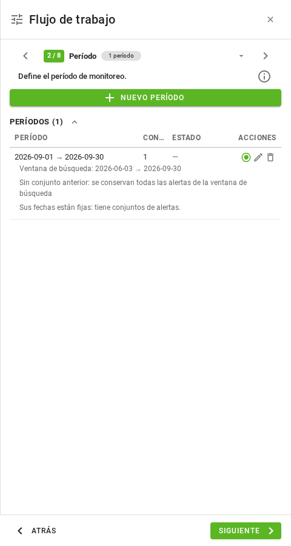

.. _defo-period-tracking:

Pérdidas que abarcan varios períodos
^^^^^^^^^^^^^^^^^^^^^^^^^^^^^^^^^^^^

Cada período se procesa por separado, pero la pérdida de bosque no se ajusta a las fechas del período. Parte de la pérdida podría perderse entre dos períodos:

-   un desmonte que empieza demasiado pequeño para ser una alerta;
-   alertas que los proveedores publican tarde, después de procesar su período; o
-   un desmonte que sigue creciendo en el borde de una alerta reportada en un período anterior.

La aplicación sigue esta pérdida de un período al siguiente, y nunca reporta dos veces la misma pérdida:

.. list-table::
    :header-rows: 1
    :widths: 35 65

    *   -   Caso
        -   Qué hace la aplicación
    *   -   Pérdida ya reportada por un período anterior
        -   Sus píxeles (la *huella* del conjunto de alertas anterior) se eliminan de la ejecución del nuevo período, así que no se reporta de nuevo.
    *   -   Un grupo demasiado pequeño para ser una alerta, o una alerta publicada tarde
        -   La `retrospección <defo-period-lookback_>`_ busca hacia atrás en el período anterior: los píxeles que se dejaron de lado vuelven y pueden unirse a píxeles nuevos para formar una alerta.
    *   -   Un desmonte que crece junto a una alerta revisada
        -   La alerta nueva se `vincula a la alerta anterior <defo-period-growth_>`_ como *alerta de crecimiento*, y se conserva aunque esté bajo el tamaño mínimo.

.. _defo-period-lookback:

La ventana de búsqueda y la retrospección
"""""""""""""""""""""""""""""""""""""""""

Un desmonte suele empezar pequeño y crecer durante las semanas siguientes. En el período en que empieza, su grupo de píxeles de alerta es todavía menor que el **Tamaño mínimo de grupo** de `Integrar y vectorizar <defo-integrate_>`_, así que no llega a ser una alerta: sus píxeles se dejan de lado como *no analizables*.

La retrospección mantiene esos píxeles en juego:

-   Cada período busca en una *ventana de búsqueda* más amplia: sus propias fechas más los días de retrospección anteriores a su inicio.
-   Los píxeles que el período anterior dejó de lado vuelven a la ejecución y se unen a los píxeles nuevos que los tocan.
-   Si el grupo que forman juntos alcanza el tamaño mínimo, se convierte en una alerta. Su primera fecha de detección es la de su píxel más antiguo, en el período anterior.

Para no reportar dos veces la misma pérdida, todos los píxeles ya reportados por un conjunto de alertas de un período *anterior* se eliminan antes de generar las alertas del nuevo período: solo vuelve lo que se dejó de lado. La retrospección también capta las alertas que los proveedores publicaron tarde, después de procesar el período anterior.

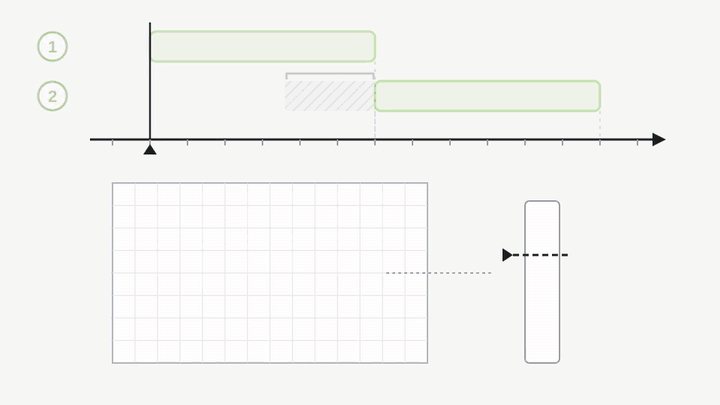

.. note::

    El primer período no tiene ningún conjunto anterior con el que compararse, así que se conservan todas las alertas de su ventana de búsqueda. Su fila indica **Sin conjunto anterior: se conservan todas las alertas de la ventana de búsqueda**. Con retrospección, eso incluye alertas fechadas antes del inicio del período.

    El primer período de un proyecto nuevo empieza sin retrospección, así que solo busca en sus propias fechas, a menos que se defina una. Un proyecto creado con **Duplicar** conserva la retrospección del proyecto del que se copió.

.. _defo-period-growth:

Crecimiento junto a alertas anteriores
""""""""""""""""""""""""""""""""""""""

Los píxeles de una alerta reportada forman parte de la huella, así que la retrospección no los recupera. Pero un desmonte suele seguir creciendo en el borde de una alerta reportada en un período anterior. Los píxeles nuevos forman entonces un grupo propio, a menudo menor que el **Tamaño mínimo de grupo**, que se dejaría de lado como cualquier grupo pequeño.

Cuando la alerta anterior se guardó como **Alerta verdadera** o **Requiere revisión**, `Integrar y vectorizar <defo-integrate-growth_>`_ no pierde de vista este crecimiento:

-   Una alerta nueva que toca la alerta anterior, o que está a un píxel de la cuadrícula o menos de ella, es una *alerta de crecimiento*, vinculada a ella.
-   Un grupo bajo el tamaño mínimo se conserva cuando toca la alerta anterior: es una alerta de crecimiento *bajo el área mínima* (salvo que **Conservar los grupos más pequeños que tocan una pérdida confirmada anterior** esté desmarcada). Un grupo pequeño que no toca nada se deja de lado, y la retrospección aún puede recuperarlo en el período siguiente.
-   La ejecución busca alertas anteriores en todos los períodos anteriores, sea cual sea la retrospección.

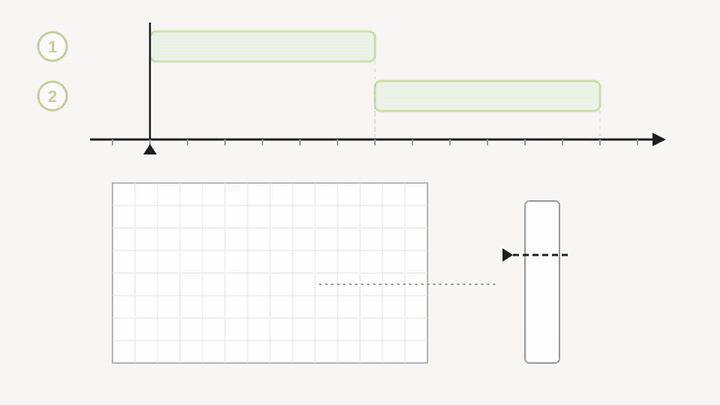

Las alertas vinculadas entre sí, a lo largo de todos los períodos, forman el *historial* de un desmonte. Análisis lo muestra en cada alerta (consulta `Alertas anteriores <defo-analysis-earlier_>`_), y el `Resumen <defo-overview-growth_>`_ lo resume.

.. tip::

    Solo cuentan las revisiones guardadas cuando empieza `Integrar y vectorizar <defo-integrate_>`_. Revisa las alertas de un período antes de ejecutar el siguiente, para que su crecimiento quede vinculado. Una alerta revisada después todavía se puede vincular a mano en `Alertas anteriores <defo-analysis-earlier_>`_.

La lista de períodos
^^^^^^^^^^^^^^^^^^^^

Cada fila de **Períodos** muestra:

.. list-table::
    :header-rows: 1
    :widths: 20 80

    *   -   Columna
        -   Descripción
    *   -   **Período**
        -   Las fechas del período ("inicio → fin"), con notas debajo: su ventana de búsqueda y las advertencias que haya.
    *   -   **Conjuntos**
        -   El número de conjuntos de alertas generados para este período.
    *   -   Columna **Estado**
        -   **desactualizada** cuando la descarga de una fuente o un conjunto de alertas ya no corresponde a la configuración actual (vuelve a ejecutarlo en `Alertas <defo-alerts_>`_, `Armonizar <defo-harmonize_>`_ o `Integrar y vectorizar <defo-integrate_>`_); **falta** cuando los archivos de un conjunto de alertas han desaparecido; un guion cuando todo está al día.

Los iconos a la derecha de cada fila:

-   el botón de opción convierte el período en el período *activo*: `Alertas <defo-alerts_>`_, `Armonizar <defo-harmonize_>`_ e `Integrar y vectorizar <defo-integrate_>`_ trabajan sobre el período activo;
-   el icono de lápiz cambia sus fechas o su retrospección; y
-   el icono de papelera elimina el período.

.. _defo-period-add:

Añadir un período
^^^^^^^^^^^^^^^^^

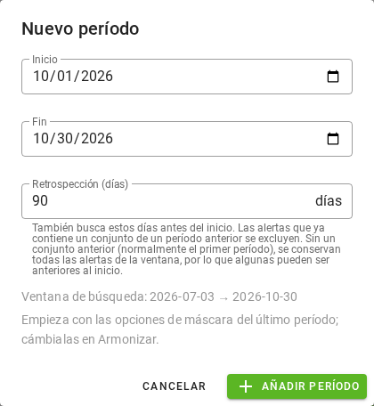

Selecciona **Nuevo período**. El diálogo viene rellenado para que el nuevo período continúe la serie.

.. list-table::
    :header-rows: 1
    :widths: 20 35 45

    *   -   Campo
        -   Descripción
        -   Valor predeterminado y límites
    *   -   **Inicio**
        -   El primer día del período.
        -   El día siguiente al fin del último período. Para el primer período, el primer día del mes en curso.
    *   -   **Fin**
        -   El último día del período.
        -   Hoy. Debe ser posterior a **Inicio**. Dos períodos no pueden tener las mismas fechas.
    *   -   **Retrospección (días)**
        -   El número de días antes de **Inicio** en los que también se busca.
        -   0 (sin retrospección) para el primer período de un proyecto nuevo (un proyecto duplicado conserva la retrospección de su origen); después, el último valor usado. Un número entero de 0 a 3650.

Debajo de los campos, el diálogo muestra una vista previa de la ventana de búsqueda ("Ventana de búsqueda: inicio → fin"). Selecciona **Añadir período**: el período se crea y pasa a ser el período activo.

Un período nuevo empieza con las opciones de máscara del último período. Cámbialas en `Armonizar <defo-harmonize_>`_. Sus fuentes de alertas son las marcadas con **Añadir a los nuevos períodos** en `Alertas <defo-alerts-new-periods_>`_; añade o quita fuentes allí.

.. tip::

    Para que los grupos dejados de lado vuelvan, la retrospección debe llegar hasta el período anterior. Con una retrospección de 0, la ventana de búsqueda empieza el primer día del propio período y no se vuelve a considerar nada de lo que se dejó de lado antes.

    Un grupo que sigue siendo demasiado pequeño permanece en juego en los períodos siguientes mientras su retrospección llegue hasta sus píxeles. Una retrospección más larga da más tiempo a un desmonte que crece despacio para alcanzar el tamaño mínimo, pero hace más grande cada descarga (consulta `Lo que ya reportaron los períodos anteriores <defo-integrate-earlier_>`_).

Modificar un período
^^^^^^^^^^^^^^^^^^^^

En un período sin conjuntos de alertas, el icono de lápiz abre un diálogo para cambiar sus fechas. Con fechas nuevas, el período pasa a ser otro: sus descargas y sus archivos armonizados se eliminan, porque se hicieron para la ventana anterior.

Un período con conjuntos de alertas tiene las fechas fijas (su nota indica **Sus fechas están fijas: tiene conjuntos de alertas.**). El icono de lápiz abre entonces un diálogo donde solo se puede cambiar la retrospección. Las descargas del período aparecen entonces como desactualizadas.

Eliminar un período
^^^^^^^^^^^^^^^^^^^

Selecciona el icono de papelera. El diálogo de confirmación enumera lo que se elimina: las descargas y los archivos armonizados del período, y sus conjuntos de alertas con sus alertas revisadas.

.. important::

    Un período con conjuntos de alertas solo se puede eliminar cuando es el último período. Los conjuntos de un período anterior son la huella a partir de la cual se generaron los conjuntos posteriores, así que elimina primero los períodos posteriores. Los períodos no se pueden modificar ni eliminar mientras una tarea escribe en el proyecto.

.. _defo-alerts:

Fuentes de alertas
------------------

Una *fuente de alertas* es un conjunto de datos de alertas de pérdida de bosque. Cada píxel de alerta es *confirmado* (confianza alta) o *probable* (confianza baja) y lleva el día en que se detectó por primera vez.

El paso **Alertas** muestra las fuentes del `período <defo-period_>`_ activo, indica qué parte de la AOI y del período cubre cada una, y las descarga. Cada período tiene sus propias fuentes: una fuente añadida aquí se añade solo al período activo.

Abre el paso **Alertas** del panel **Flujo de trabajo**. Se desbloquea en cuanto el proyecto tiene un `período <defo-period_>`_. Trabaja sobre el período activo: para trabajar en otro período, primero hazlo activo en el paso `Período <defo-period_>`_. El recuadro de la parte superior del paso indica el período y su ventana de búsqueda, por ejemplo, "Período 2026-09-01 → 2026-09-30 · ventana de búsqueda desde el 2026-06-03 (90 días de retrospección)".

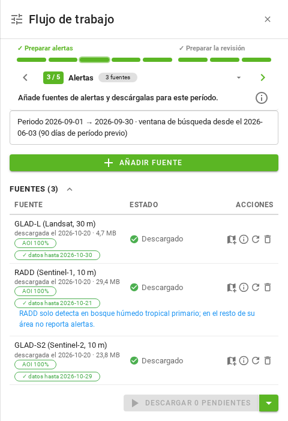

La lista de fuentes
^^^^^^^^^^^^^^^^^^^

Cada fila de **Fuentes** muestra:

.. list-table::
    :header-rows: 1
    :widths: 20 80

    *   -   Parte de la fila
        -   Descripción
    *   -   **Fuente**
        -   El nombre de la fuente y, debajo, una línea con lo que contiene la fila ("descargada el 2026-10-20 · 4,7 MB") o por qué necesita una descarga (por ejemplo, "la ventana de búsqueda cambió (…): descargar de nuevo"), y dos chips:

            -   **AOI**: la parte de la AOI dentro de la huella de la fuente, por ejemplo, "AOI 100%". Una fuente que solo cubre parte de la AOI no recibe alertas sobre el resto.
            -   Las fechas: "✓ datos hasta 2026-10-30" (verde) cuando la fuente tiene datos hasta el final de la ventana de búsqueda, "datos solo hasta …" (naranja) cuando sus datos terminan dentro de la ventana, o "✗ los datos terminan el …" (rojo) cuando no tiene ninguno en la ventana.
    *   -   **Estado**
        -   El estado de la fila, o un botón para descargarla (consulta `Descargar las fuentes <defo-alerts-download_>`_).
    *   -   Icono de mapa
        -   Muestra la fuente en el mapa: las alertas de la ventana de búsqueda del período activo. Una fuente GeoTIFF solo se muestra una vez armonizada.
    *   -   Icono de información
        -   Abre los **Detalles** de la fuente (consulta `El diálogo de detalles <defo-harmonize-details_>`_), con la casilla **Añadir a los nuevos períodos** y, para una fuente personalizada, el botón **Editar**.
    *   -   **Descargar de nuevo**
        -   Descarga la fuente de nuevo (ver más abajo).
    *   -   **Quitar de este período**
        -   Quita la fuente del período activo (consulta `Quitar una fuente de un período <defo-alerts-remove_>`_).

La cobertura se comprueba una vez, al elegir la AOI, y se guarda en el proyecto. Si la comprobación falló (por ejemplo, porque no se pudo acceder a GEE), aparece un botón **Comprobar de nuevo** debajo de la lista.

Añadir una fuente
^^^^^^^^^^^^^^^^^

Selecciona **Añadir fuente** para abrir el diálogo **Añadir una fuente de alertas** y elige el **Tipo de fuente**:

-   **Predefinida o del proyecto**: una de las fuentes del catálogo, o una fuente del proyecto que no está en este período (por ejemplo, una usada en un período anterior); o
-   **Personalizada (0 de 6)**: tu propia imagen de GEE, colección de imágenes o GeoTIFF. El contador indica cuántos de los seis espacios personalizados del período están en uso.

Un período admite como máximo tres fuentes predefinidas y seis personalizadas. El proyecto conserva todas las fuentes que ha usado, sin límite.

.. _defo-alerts-new-periods:

Bajo la fuente, la casilla **Añadir a los nuevos períodos** (marcada por defecto) decide si los períodos creados después empiezan con esta fuente. Nunca cambia los períodos existentes. Para cambiarla más tarde, abre los **Detalles** de la fuente con su icono de información.

Fuentes predefinidas
""""""""""""""""""""

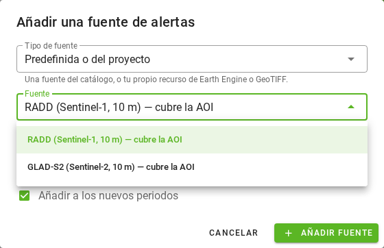

Elige una fuente en el menú desplegable **Fuente de alertas** y selecciona **Añadir fuente**. La lista contiene las fuentes predefinidas y las fuentes propias del proyecto que todavía no están en este período. Cada opción muestra su cobertura de la AOI. Una fuente que no cubre nada de la AOI aparece desactivada, con el motivo.

.. list-table::
    :header-rows: 1
    :widths: 25 30 45

    *   -   Fuente
        -   Sensor y tamaño de píxel
        -   Cobertura
    *   -   **GLAD-L (Landsat, 30 m)**
        -   Landsat, unos 30 m.
        -   Las tierras de sus cuatro teselas regionales (Asia, África, América Central y América del Sur), entre unos 35°S y 35°N.
    *   -   **RADD (Sentinel-1, 10 m)**
        -   Radar Sentinel-1, 10 m. Ve a través de las nubes.
        -   Los trópicos húmedos de África, el sudeste asiático y América Central y del Sur. Solo detecta en bosque tropical húmedo primario; en el resto de su área, no reporta alertas.
    *   -   **GLAD-S2 (Sentinel-2, 10 m)**
        -   Sentinel-2, 10 m.
        -   90°O–30°O, 20°S–20°N.

Cuando todas las fuentes ya están en el período, el diálogo indica: "Todas las fuentes ya están en este período."

Fuentes personalizadas
""""""""""""""""""""""

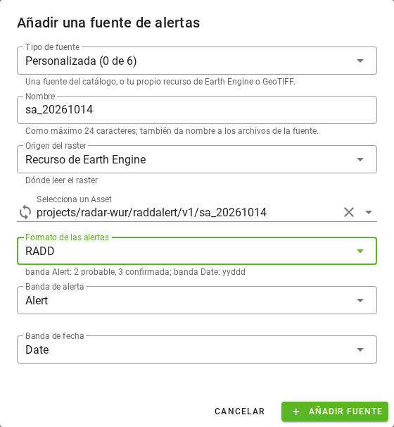

Una fuente personalizada lee tu propio raster de alertas a través de uno de cuatro formatos predefinidos. El formulario se lee de arriba abajo: el nombre, de dónde viene el raster, el propio raster y luego sus bandas. Las bandas se leen en cuanto se elige el raster ("Leyendo las bandas…"), y los campos que dependen de ellas solo aparecen una vez leídas.

.. list-table::
    :header-rows: 1
    :widths: 20 40 40

    *   -   Campo
        -   Descripción
        -   Valor predeterminado y límites
    *   -   **Nombre**
        -   El nombre de la fuente en listas, leyendas y nombres de archivo.
        -   Se sugiere a partir del nombre del recurso o del archivo. Como máximo 24 caracteres, al menos una letra o cifra, único en el proyecto. GLAD-L, RADD y GLAD-S2 están reservados.
    *   -   **Fuente**
        -   De dónde se lee el raster: **Earth Engine** (un recurso) o **GeoTIFF / VRT** (un archivo de tu carpeta de SEPAL: un GeoTIFF, o un VRT, un raster virtual de GDAL que se lee como los GeoTIFF a los que apunta).
        -   **Earth Engine**.
    *   -   Recurso o **GeoTIFF / VRT**
        -   La imagen o colección de imágenes de GEE, o el archivo .tif.
        -   Una colección de imágenes se usa completa, con la imagen más reciente encima. Para una colección de instantáneas semanales (como la propia de RADD), indica en su lugar el identificador de la última imagen. El GeoTIFF necesita un sistema de referencia de coordenadas.
    *   -   **Formato de las alertas**
        -   Cómo se leen las bandas (ver más abajo). Aparece cuando el raster tiene dos bandas o más. Un raster con una banda no tiene formato que elegir: el formulario indica "Una banda (…): se lee como la fecha de la alerta." y la fuente se lee como **Solo fecha**.
        -   Se sugiere a partir de los nombres de las bandas cuando la aplicación los reconoce, y se marca "(sugerido)".
    *   -   **Banda de alerta**
        -   La banda que contiene la clase de alerta.
        -   Solo para **RADD**, **Alertas CCDC de SEPAL** y **Alertas PyEO de SEPAL**. Empieza en la banda que espera el formato; cuando el raster no tiene esa banda, la ayuda indica "Elige la banda que contiene el nivel de la alerta."
    *   -   **Banda de fecha**
        -   La banda que contiene la fecha de detección.
        -   Siempre obligatoria. Empieza en la banda que espera el formato, y su ayuda la nombra (por ejemplo, "3 bandas. Date parece la fecha de la alerta."), o te pide que la elijas.
    *   -   **Codificación de fecha**
        -   Cómo está escrita la fecha: **yymm (año y mes; la alerta se fecha el día 1)**, **yyddd (año y día del año)**, **yyyyddd (año y día del año)** o **año decimal**.
        -   Solo para **Solo fecha**. Se sugiere a partir de los valores de la banda de fecha (ver más abajo).

Para una fuente **Solo fecha**, la aplicación lee los valores mínimo y máximo de la banda de fecha sobre la AOI ("Leyendo los valores de fecha…") y sugiere la codificación que les corresponde, por ejemplo "Valores de 24001 a 24366: se leen como yyddd." Comprueba la sugerencia: la aplicación solo lee los dos extremos del rango. Cuando los valores no parecen fechas ("… no parecen fechas. Revisa la banda de fecha."), o cuando ningún píxel de la AOI tiene fecha ("Ningún píxel con fecha en la AOI: elige la codificación."), elige tú la codificación.

Los cuatro formatos:

.. list-table::
    :header-rows: 1
    :widths: 25 75

    *   -   Formato de las alertas
        -   Cómo un píxel se convierte en alerta
    *   -   **RADD**
        -   Banda de alerta: 2 es probable, 3 es confirmada. Banda de fecha en ``yyddd``.
    *   -   **Alertas CCDC de SEPAL**
        -   Resultados de Continuous Change Detection and Classification (CCDC). ``detection_count``: una o dos detecciones son probables, tres o más son confirmadas. ``first_detection_date`` en años fraccionarios.
    *   -   **Alertas PyEO de SEPAL**
        -   Resultados de la detección de cambios de Python for Earth Observation (PyEO), leídos como los de CCDC. ``total_changes``: uno o dos cambios son probables, tres o más son confirmados. ``first_change_date_above_threshold`` en años fraccionarios.
    *   -   **Solo fecha**
        -   Una banda de fecha con la codificación elegida. Cada píxel con fecha es una alerta confirmada.

Al seleccionar **Añadir fuente**, la aplicación comprueba el raster: que las bandas existen y son numéricas, que las fechas se pueden leer y que la fuente cubre la AOI. Cualquier problema se muestra en rojo dentro del diálogo, que sigue abierto para hacer correcciones. Mientras se hace la comprobación, el botón indica **Cancelar** y la detiene.

Editar una fuente personalizada
"""""""""""""""""""""""""""""""

Abre los **Detalles** de la fuente con su icono de información y selecciona **Editar** para volver a abrir el formulario, titulado con el nombre de la fuente. El nombre no se puede cambiar; el raster, el formato y las bandas sí. El formulario conserva el formato y las bandas guardados hasta que se elige otro raster.

En cuanto un conjunto de alertas usa la fuente, ya no se puede editar: quítala y añade una nueva.

.. _defo-alerts-download:

Descargar las fuentes
^^^^^^^^^^^^^^^^^^^^^

Cada fuente se descarga en la ventana de búsqueda del período, en su propia proyección y recortada a la AOI. Una fuente GeoTIFF no se descarga: se lee de su archivo. Descargar no armoniza la fuente: eso es el paso siguiente, `Armonizar <defo-harmonize_>`_, que solo se ejecuta cuando lo inicias allí.

La columna **Estado** indica:

.. list-table::
    :header-rows: 1
    :widths: 25 75

    *   -   Estado
        -   Significado
    *   -   "Descargada"
        -   Descargada para la ventana de búsqueda actual. La línea bajo el nombre da la fecha de descarga y el tamaño en disco.
    *   -   **Descargar**
        -   La fuente todavía no se ha descargado para la ventana de búsqueda de este período, o su descarga está desactualizada. Selecciona el botón para descargarla.
    *   -   **Leer archivo**
        -   Lo mismo para una fuente GeoTIFF, que se lee de su archivo.
    *   -   **Reintentar**
        -   La última descarga falló. Su error se muestra en rojo debajo de la fila.
    *   -   "Descargando 42%", "Leyendo", "En cola"
        -   La fila se está ejecutando, o espera su turno ("esperando a la fila de arriba").
    *   -   "no cubierta", "sin datos"
        -   La fuente no se puede ejecutar para este período: no cubre la AOI, o no tiene datos para la ventana de búsqueda (su chip de fechas está en rojo).
    *   -   "Sin archivo"
        -   El archivo de una fuente GeoTIFF ha desaparecido (consulta `Mensajes frecuentes <defo-harmonize-messages_>`_).

Un botón azul ejecuta una fila por primera vez; uno naranja rehace un archivo desactualizado. La línea bajo el nombre indica entonces el motivo: por ejemplo, "la ventana de búsqueda cambió (…): descargar de nuevo" o "la AOI cambió: descargar de nuevo". En la `copia de revisión <defo-evaluation-return_>`_ de un evaluador no se ejecuta nada: en lugar de un botón, la columna indica "A descargar".

.. note::

    Una fila descargada no tiene botón: una fuente ya descargada para la ventana de búsqueda del período no se vuelve a descargar por sí sola. Para obtener las últimas alertas de un catálogo que sigue añadiendo alertas a fechas pasadas, usa **Descargar de nuevo**. La aplicación pregunta antes, indicando la ventana y la fecha del archivo que reemplaza. No se ofrece para una fuente GeoTIFF ("Nada que descargar de nuevo: se lee de un archivo").

Cada fila se descarga con su propio botón. Selecciona los botones de varias filas para descargarlas todas: cada uno inicia su propio trabajo, y se ponen en cola, una fila tras otra. Las filas que indican "no cubierta" o "sin datos" no tienen botón; una fila que falla muestra su error en rojo debajo. La fila en curso muestra su propia barra de progreso; una fila iniciada no se puede detener.

La descarga también aparece como una notificación de tarea titulada **Descarga**, con la fuente en la que está y su porcentaje.

.. _defo-alerts-remove:

Quitar una fuente de un período
^^^^^^^^^^^^^^^^^^^^^^^^^^^^^^^

Selecciona el icono de papelera (**Quitar de este período**) y confirma. Se eliminan los archivos descargados y armonizados de la fuente en este período. Los conjuntos de alertas de este período que ya la usaban conservan sus alertas y aparecen como desactualizados.

La fuente sigue en el proyecto: los demás períodos la conservan, y se puede volver a añadir con **Añadir fuente**. Una fuente nunca se elimina de todo el proyecto.

Mensajes frecuentes
^^^^^^^^^^^^^^^^^^^

"Esta fuente no cubre la AOI."
    La huella del raster no alcanza el área: revisa el recurso o la AOI.

"Falta una banda asignada." o "Una banda asignada no es numérica."
    Elige otras bandas u otro formato.

"Este recurso CCDC guarda sus fechas como días julianos o tiempo Unix …"
    Solo se admiten resultados de CCDC fechados en años fraccionarios.

"Este período ya tiene 6 fuentes personalizadas."
    Quita una fuente personalizada del período antes de añadir otra.

"Un trabajo está escribiendo en este proyecto; …"
    Las fuentes no pueden cambiar durante una descarga o una ejecución de **Integrar y vectorizar**. Espera a que termine.

.. _defo-harmonize:

Armonizar
---------

Este paso pone todas las entradas del `período <defo-period_>`_ activo en una cuadrícula común. Cada fuente descargada en `Alertas <defo-alerts-download_>`_ se *armoniza*: se alinea con la cuadrícula del proyecto y se recorta con las máscaras del período. Nunca se repite nada cuyas entradas no hayan cambiado.

Abre el paso **Armonizar** del panel **Flujo de trabajo**. Se desbloquea en cuanto al menos una fuente del período activo está descargada (o es una fuente GeoTIFF). Trabaja sobre el período activo: para armonizar otro período, primero hazlo activo en el paso `Período <defo-period_>`_.

De arriba abajo, el paso tiene tres partes: la **Cuadrícula del proyecto**, las **Máscaras** y las **Fuentes de este período**.

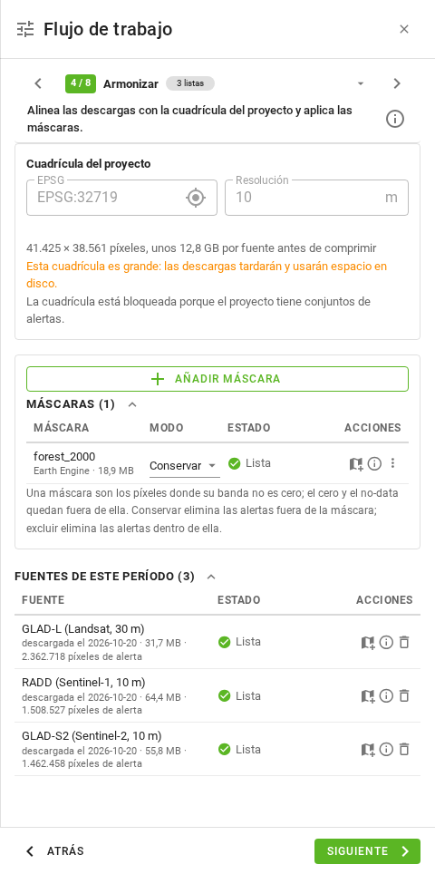

La cuadrícula del proyecto
^^^^^^^^^^^^^^^^^^^^^^^^^^

Todos los rasters del proyecto se alinean con una misma cuadrícula: una proyección en metros y un tamaño de píxel, sobre la AOI. Así, las alertas de fuentes con distintos tamaños de píxel se pueden combinar píxel a píxel, y el tamaño mínimo de alerta en hectáreas se convierte en un número de píxeles.

.. list-table::
    :header-rows: 1
    :widths: 15 40 45

    *   -   Campo
        -   Descripción
        -   Valor predeterminado y límites
    *   -   **EPSG**
        -   La proyección de la cuadrícula, como código del European Petroleum Survey Group (EPSG). El botón de mira al final del campo rellena la zona Universal Transversal de Mercator (UTM) de la AOI.
        -   La zona UTM del centro de la AOI. Debe ser un sistema proyectado en metros: se rechaza un sistema geográfico (como 4326) o uno en pies.
    *   -   **Resolución**
        -   El tamaño de píxel, en metros.
        -   El tamaño de píxel más fino entre las fuentes del proyecto: 10 m con RADD o GLAD-S2, 30 m solo con GLAD-L, el tamaño de píxel propio de una fuente personalizada, o 30 m cuando no se sabe nada. Debe ser mayor que 0.

Debajo de los campos se muestra el tamaño de la cuadrícula: "ancho × alto píxeles, unos … por fuente antes de comprimir". Por encima de 2 GB por fuente, un aviso indica **Esta cuadrícula es grande: las descargas tardarán y usarán espacio en disco.** (no bloquea el paso).

Selecciona **Guardar cuadrícula**. Las máscaras y la tabla de fuentes solo aparecen una vez guardada una cuadrícula.

La cuadrícula puede cambiar hasta que se genere el primer conjunto de alertas. Una cuadrícula nueva solo vuelve a armonizar las fuentes a partir de los archivos ya descargados; no las descarga de nuevo. En cuanto el proyecto tiene un conjunto de alertas, la tarjeta indica **La cuadrícula está bloqueada porque el proyecto tiene conjuntos de alertas.**

.. note::

    Cambiar la `AOI <defo-aoi_>`_ borra la cuadrícula y elimina todas las descargas y todos los archivos armonizados del proyecto, que se hicieron para el área anterior. Vuelve a guardar la cuadrícula aquí y luego ejecuta de nuevo las filas.

Máscaras
^^^^^^^^

Una *máscara* limita dónde se conservan las alertas. Es un raster que se define una sola vez para el proyecto: una imagen o colección de imágenes de GEE, o un GeoTIFF, con una banda. Un píxel está dentro de la máscara donde esa banda no es cero; los píxeles con cero o sin datos quedan fuera.

Cada período elige un **Modo** para cada máscara:

.. list-table::
    :header-rows: 1
    :widths: 20 80

    *   -   Modo
        -   Efecto sobre las alertas del período
    *   -   **Inactiva**
        -   La máscara no se usa en este período.
    *   -   **Conservar**
        -   Se eliminan las alertas *fuera* de la máscara (por ejemplo, para conservar solo las alertas dentro de una máscara de bosque).
    *   -   **Excluir**
        -   Se eliminan las alertas *dentro* de la máscara (por ejemplo, para descartar las alertas en plantaciones o en agua).

Cuando hay varias máscaras activas, se aplican todas. Las máscaras actúan sobre las fuentes armonizadas, así que un cambio de **Modo** deja desactualizadas las fuentes del período. El botón **Armonizar** de cada fila las vuelve a armonizar sin descargarlas. Un período nuevo empieza con las opciones de máscara del último período.

Añadir una máscara
""""""""""""""""""

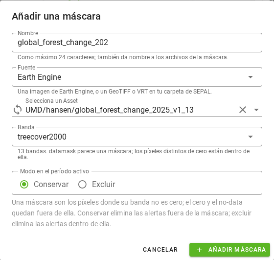

Selecciona **Añadir máscara** para abrir el diálogo **Añadir una máscara**. Las bandas se leen en cuanto se elige el raster.

.. list-table::
    :header-rows: 1
    :widths: 20 40 40

    *   -   Campo
        -   Descripción
        -   Valor predeterminado y límites
    *   -   **Nombre**
        -   El nombre de la máscara en listas, leyendas y nombres de archivo.
        -   Se sugiere a partir del nombre del recurso o del archivo. Como máximo 24 caracteres, al menos una letra o cifra, único entre las máscaras del proyecto.
    *   -   **Fuente**
        -   **Earth Engine** (un recurso) o **GeoTIFF / VRT** (un archivo de tu carpeta de SEPAL).
        -   **Earth Engine**.
    *   -   Recurso o **GeoTIFF / VRT**
        -   La imagen o colección de imágenes de GEE, o el archivo .tif.
        -
    *   -   **Banda**
        -   La banda que define la máscara. Aparece cuando el raster tiene dos bandas o más; con una banda, el formulario indica "Una banda (…): la máscara se hace con ella."
        -   La banda cuyo nombre parece de máscara (por ejemplo, ``datamask``), nombrada en la ayuda ("… parece una máscara; los píxeles distintos de cero están dentro de ella."); si no hay ninguna, elígela tú.
    *   -   **Modo en el período activo**
        -   **Conservar** o **Excluir**.
        -   **Conservar**. La máscara se activa solo en el período activo; los demás períodos la dejan inactiva hasta que se active en ellos.

Al seleccionar **Añadir máscara**, la aplicación comprueba el raster y su banda. Cualquier problema se muestra en rojo dentro del diálogo, que sigue abierto para hacer correcciones.

La lista de máscaras
""""""""""""""""""""

Cada fila de **Máscaras** muestra:

.. list-table::
    :header-rows: 1
    :widths: 20 80

    *   -   Columna
        -   Descripción
    *   -   **Máscara**
        -   El nombre de la máscara. La línea de debajo indica su fuente y su tamaño en disco una vez lista ("Earth Engine · 18,9 MB"), o por qué necesita una ejecución ("aún no descargada", "la cuadrícula cambió (…): alinear de nuevo"). Termina con "Inactiva" cuando la máscara está inactiva en el período activo.
    *   -   **Modo**
        -   El modo de la máscara en el período activo: **Inactiva**, **Conservar** o **Excluir**. Un cambio se aplica enseguida; las fuentes del período pasan entonces a estar desactualizadas.
    *   -   **Estado**
        -   "Lista", o un botón para la siguiente ejecución de la máscara: **Descargar** (una máscara de GEE todavía no descargada) o **Alinear** (con la cuadrícula). Un botón naranja rehace un archivo desactualizado. Durante una ejecución, la celda indica "Descargando 42%", "Alineando" o "En cola".

Los iconos a la derecha de cada fila:

-   el icono de mapa muestra la máscara en el mapa: una máscara de GEE se puede previsualizar antes de descargarla, y una máscara GeoTIFF, una vez alineada;
-   el icono de información abre sus **Detalles** (consulta `El diálogo de detalles <defo-harmonize-details_>`_); y
-   el menú **Más acciones** (tres puntos) contiene:

    -   **Descargar de nuevo** (solo máscaras de GEE), para un recurso que ha cambiado. La aplicación pregunta primero: "Esto obtiene la máscara de nuevo desde Earth Engine, reemplaza su descarga y luego la alinea.";
    -   **Editar**, que abre **Editar máscara** *nombre*: el raster y la banda se pueden cambiar, el nombre no. En cuanto un conjunto de alertas ha usado la máscara, ya no se puede editar (**Un conjunto de alertas ya usa esta máscara: añade una nueva en su lugar.**); y
    -   **Eliminar máscara…**, que elimina la máscara después de confirmar. Se eliminan su descarga y su archivo alineado, y todos los períodos dejan de usarla. Los conjuntos de alertas que la usaban conservan sus alertas y aparecen como desactualizados.

Una máscara se descarga y se alinea una sola vez para todo el proyecto, sea cual sea el período que la ejecute.

.. _defo-harmonize-sources:

Fuentes de este período
^^^^^^^^^^^^^^^^^^^^^^^

La tabla tiene una fila por cada fuente de alertas del período activo, con dos columnas:

.. list-table::
    :header-rows: 1
    :widths: 20 80

    *   -   Columna
        -   Descripción
    *   -   **Fuente**
        -   El nombre de la fuente. La línea de debajo indica lo que contiene la fila o lo que espera (ver más abajo). Los avisos, como una cobertura parcial, y los errores aparecen como líneas bajo la fila.
    *   -   **Estado**
        -   El estado de la fila, o un botón para su siguiente ejecución.

La columna **Estado** indica:

.. list-table::
    :header-rows: 1
    :widths: 25 75

    *   -   Estado
        -   Significado
    *   -   "Lista"
        -   Descargada y armonizada con las entradas actuales. La línea bajo el nombre indica la fecha de descarga, el tamaño en disco y lo que encontró el archivo armonizado: "descargada el 2026-10-20 · 31,7 MB · 2.362.718 píxeles de alerta".
    *   -   **Armonizar**
        -   La descarga está al día, pero el archivo armonizado falta o está desactualizado (una descarga nueva, una cuadrícula nueva, un cambio de máscara). Selecciona el botón para ejecutar la fila: alinea las máscaras del período que lo necesiten y luego armoniza la fuente, sin descargarla.
    *   -   "Descárgala o léela primero en Alertas"
        -   La fuente no está descargada para la ventana de búsqueda de este período, o su descarga está desactualizada. La fila no tiene botón: descárgala primero en `Alertas <defo-alerts-download_>`_.
    *   -   **Reintentar**
        -   La última ejecución de la fila falló. Su error aparece en rojo bajo la fila.
    *   -   "Descargando 42%", "Armonizando", "En cola"
        -   La fila está en curso, o espera su turno en una ejecución ("esperando a la fila de arriba"). Una fila que se está descargando en Alertas también aparece en curso aquí, y no se puede armonizar hasta que termine su descarga.
    *   -   "no cubierta", "sin datos"
        -   La fuente no se puede ejecutar en este período: no cubre la AOI, o no tiene datos para la ventana de búsqueda. La línea bajo el nombre da el motivo. Consulta `Fuentes de alertas <defo-alerts_>`_ para la cobertura.
    *   -   "Sin archivo"
        -   El archivo de una fuente GeoTIFF ha desaparecido (consulta `Mensajes frecuentes <defo-harmonize-messages_>`_).

En la `copia de revisión <defo-evaluation-return_>`_ de un evaluador no se ejecuta nada: en lugar de un botón, la columna indica "A armonizar" o "A alinear".

Un botón azul ejecuta una fila por primera vez; uno naranja rehace un archivo desactualizado. La línea bajo el nombre indica entonces el motivo: por ejemplo, "la cuadrícula cambió (EPSG:32719 · 30 m → EPSG:32719 · 10 m): armonizar de nuevo", "se descargó de nuevo desde entonces: armonizar de nuevo" o "la máscara forest_2000 cambió: armonizar de nuevo".

Los iconos a la derecha de cada fila:

-   el icono de mapa (**Mostrar en el mapa**) muestra en el mapa las alertas armonizadas;
-   el icono de información abre los **Detalles** de la fila (ver más abajo); y
-   **Eliminar archivo armonizado** quita el archivo armonizado de la fuente en este período, después de confirmar. La descarga se conserva: armoniza la fuente de nuevo en este paso para reconstruir el archivo. Los conjuntos de alertas de este período hechos con la fuente pasan a estar desactualizados; sus alertas y sus revisiones se conservan.

.. _defo-harmonize-details:

El diálogo de detalles
""""""""""""""""""""""

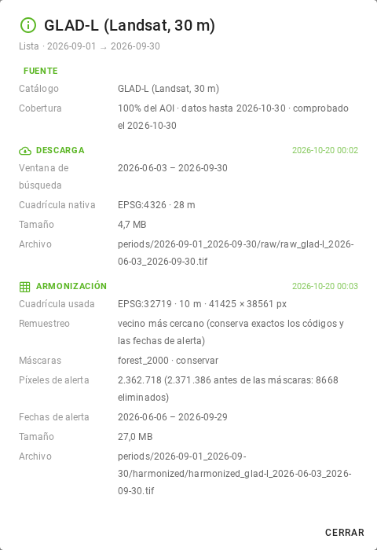

El icono de información de una fuente o de una máscara abre un resumen de solo lectura de con qué se hicieron sus archivos. Empieza con el estado de la fila y, para una fuente, el período. Cuando la fila está desactualizada, una línea naranja **Motivo:** dice qué cambió.

En `Alertas <defo-alerts_>`_, el icono de información de una fuente abre el mismo diálogo, con dos controles más: la casilla **Añadir a los nuevos períodos** (consulta `Añadir una fuente <defo-alerts-new-periods_>`_) y, para una fuente personalizada, **Editar**.

.. list-table::
    :header-rows: 1
    :widths: 25 75

    *   -   Sección
        -   Lo que enumera
    *   -   **Fuente**
        -   Una fuente predefinida: su **Catálogo** y su **Cobertura** de la AOI, con la última fecha de datos y el día en que se comprobó. Una fuente personalizada: su **Tipo**, **Referencia**, **Formato**, **Codificación de fechas**, **Bandas** y **Cuadrícula nativa**. Una máscara: su **Referencia**, **Banda**, **Cuadrícula nativa** y los períodos en que se usa (**Usada en**).
    *   -   **Descarga** (**Lectura del archivo** para una fuente GeoTIFF)
        -   La **Ventana de búsqueda**, la **Cuadrícula nativa** en la que se descargó el archivo, su **Tamaño** y su **Archivo** en la carpeta del proyecto.
    *   -   **Armonización** (**Alineación** para una máscara)
        -   La **Cuadrícula usada**, con la cuadrícula actual cuando cambió desde entonces, el **Remuestreo**, las **Máscaras** aplicadas con su modo, los **Píxeles de alerta** conservados (y cuántos eliminaron las máscaras), las **Fechas de alerta** encontradas, el **Tamaño** y el **Archivo**. Para una máscara: sus **Píxeles de la máscara**.

Cada sección indica la fecha y la hora en que se escribió su archivo, o "Aún no ejecutado". Selecciona **Cerrar**, o pulsa **Esc**, para cerrar el diálogo.

.. labels-ok: Esc

Ejecutar varias filas
"""""""""""""""""""""

Cada fila se ejecuta con su propio botón. El **Armonizar** de una fuente primero alinea las máscaras activas en el período que lo necesitan y luego armoniza la fuente; el **Alinear** de una máscara alinea solo esa máscara. Selecciona los botones de varias filas para ejecutarlas todas: cada uno inicia su propio trabajo, y se ponen en cola, una fila tras otra:

-   las filas que indican "no cubierta" o "sin datos", y las filas que faltan por descargar, no tienen botón;
-   una fila que falla muestra su error en rojo debajo, y la fila siguiente continúa;
-   mientras el trabajo de una fuente alinea una máscara, el **Armonizar** de otra fuente que necesita la misma máscara muestra "En cola" y empieza cuando la máscara esté alineada.

La fila en curso muestra su propia barra de progreso, que avanza sin fin mientras no tiene porcentaje. Una fila iniciada no se puede detener; las filas ya hechas quedan hechas.

La ejecución también aparece como una notificación de tarea titulada **Armonizar**, con la fila en la que está (por ejemplo, "Armonizando GLAD-L").

.. tip::

    Cada fila necesita espacio libre en disco para sus archivos. La aplicación lo comprueba antes de escribir y detiene la fila con un mensaje cuando el disco está demasiado lleno. La línea del tamaño de la cuadrícula da una idea de cuánto puede ocupar una fuente.

.. _defo-harmonize-messages:

Mensajes frecuentes
^^^^^^^^^^^^^^^^^^^

"No hay suficiente espacio libre en disco: esto necesita … GB en …, y hay … GB libres."
    Libera espacio en tu carpeta de SEPAL o usa una cuadrícula más gruesa.

"Ya se está preparando una fila de esta ejecución …"
    Otro trabajo está alineando la máscara cuyo **Alinear** seleccionaste (el de otro período, o el **Armonizar** de una fuente), o la fila todavía está en curso. Vuelve a ejecutarla cuando termine.

"La geometría de la AOI todavía se está obteniendo; ejecuta esta fila de nuevo en un momento."
    Las fuentes y las máscaras GeoTIFF necesitan la forma de la AOI. Espera un momento. Si no se pudo obtener, selecciona **Comprobar de nuevo** debajo de la tabla y luego ejecútalas.

"La máscara … no cubre nada de la AOI: como máscara de conservar, se eliminarían todas las alertas."
    La máscara no alcanza el área. Revisa su recurso o su banda, o desactívala.

"Un trabajo está escribiendo en este proyecto; guarda la cuadrícula cuando termine."
    La cuadrícula, las máscaras y las fuentes no pueden cambiar mientras hay en curso una descarga o una ejecución de **Integrar y vectorizar**.

"Sin archivo", con "falta: archivo no encontrado: …" bajo la fila, o "Máscara …: archivo no encontrado (…). Vuelve a poner el archivo en esta ruta para usar la máscara."
    Una fuente o máscara GeoTIFF se movió, se renombró o se eliminó de tu carpeta de SEPAL. Vuelve a poner el archivo en la ruta indicada, o edita la fuente o la máscara para que apunte a su nueva ubicación.

"Una máscara activa en este período todavía no está alineada con la cuadrícula actual; Armonizar en una fuente alinea primero las máscaras."
    Una fuente no se puede armonizar antes de que las máscaras del período estén alineadas. Selecciona el **Armonizar** de la fuente, o primero el botón **Alinear** de la máscara.

"Máscara …: se desconoce su cuadrícula nativa (proyección y escala); edita la máscara."
    La aplicación no sabe cómo descargar esta máscara de GEE. Ábrela con **Editar** en su menú **Más acciones** y vuelve a guardarla, para que su raster se compruebe de nuevo.

.. _defo-integrate:

Integrar y vectorizar
---------------------

Este paso convierte las fuentes armonizadas del período activo en un *conjunto de alertas*: la lista de alertas que se revisan en `Análisis <defo-analysis_>`_. El paso:

-   combina las fuentes píxel a píxel;
-   elimina lo que los períodos anteriores ya reportaron;
-   agrupa los píxeles de alerta vecinos en *grupos*; y
-   dibuja un polígono por grupo. Cada grupo que conserva es una alerta del conjunto.

Abre el paso **Integrar y vectorizar** del panel **Flujo de trabajo**. Se desbloquea en cuanto al menos una fuente del período activo está lista en `Armonizar <defo-harmonize_>`_.

El formulario sigue la ejecución, en tres tarjetas con borde: las fuentes que se combinan, los ajustes de los grupos y las capas de atributos. El botón **Integrar y vectorizar** está debajo de ellas. Bajo las fuentes, unas líneas grises dicen lo que la ejecución hace además por sí sola, sin ningún ajuste:

-   "Elimina los píxeles ya presentes en N conjuntos de alertas anteriores" (consulta `Lo que ya reportaron los períodos anteriores <defo-integrate-earlier_>`_); y
-   "Recupera los píxeles no analizables de N conjuntos anteriores dentro de la retrospección", contados para las fuentes seleccionadas.

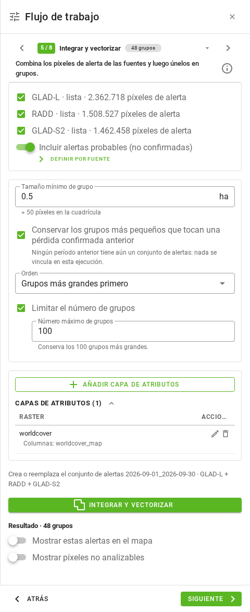

Qué es una alerta
^^^^^^^^^^^^^^^^^

Una alerta es un *grupo*: un conjunto de píxeles de alerta que se tocan entre sí, por los lados o por las esquinas, sea cual sea la fuente que detectó cada píxel. Donde se tocan píxeles de GLAD-L y de RADD, forman *una sola* alerta que indica ambas fuentes. Una alerta nunca se divide en una alerta por fuente.

Cada alerta conserva:

-   las fuentes que la detectaron;
-   su primera y su última fecha de detección (la fecha más temprana y la más tardía entre sus píxeles);
-   su superficie en hectáreas; y
-   una estadística de las bandas de cada capa de atributos (ver más abajo).

Un grupo más pequeño que el **Tamaño mínimo de grupo** (consulta `Las opciones <defo-integrate-options_>`_) no llega a ser una alerta: sus píxeles se dejan de lado como *no analizables*.

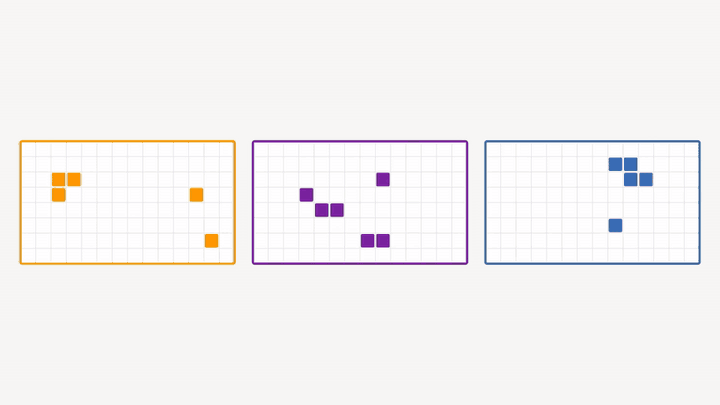

.. _defo-integrate-earlier:

Lo que ya reportaron los períodos anteriores
""""""""""""""""""""""""""""""""""""""""""""

Los píxeles que caen dentro de las alertas de un conjunto de alertas de un período *anterior* (su *huella*) se eliminan antes de formar los grupos. Así, la `retrospección <defo-period-lookback_>`_ nunca reporta dos veces la misma pérdida.

Los píxeles que no llegaron a ser alertas (un grupo por debajo del tamaño mínimo, o más allá del número máximo de alertas) se conservan como *no analizables*. No forman parte de la huella: recuperarlos es la función de la `retrospección <defo-period-lookback_>`_.

La ejecución de un período posterior vuelve a añadir esos píxeles cuando se cumplen las dos condiciones:

-   su retrospección llega hasta el período anterior (ese período termina el día en que empieza la nueva ventana de búsqueda o después); y
-   los dos períodos comparten una fuente.

Los píxeles vuelven sea cual sea su fecha de detección dentro de la propia ventana de búsqueda del conjunto anterior. Se unen a los píxeles nuevos que los tocan, y un grupo que ahora alcanza el tamaño mínimo se convierte en una alerta. Sus fechas de detección pueden ser anteriores a su propio período y a su retrospección. Con una retrospección de 0, la ventana de búsqueda empieza el primer día del propio período, así que no se vuelve a considerar nada de lo que se dejó de lado.

.. _defo-integrate-growth:

Crecimiento de una pérdida anterior
"""""""""""""""""""""""""""""""""""

Un desmonte suele seguir creciendo de un mes a otro. La ejecución vincula cada alerta nueva a la *pérdida anterior* de la que crece: las alertas de los conjuntos de períodos anteriores que se guardaron como **Alerta verdadera** o **Requiere revisión**. La forma de una alerta anterior es el polígono dibujado para ella en `Precisar el polígono <defo-analysis-refine_>`_ o, si no lo hay, su grupo detectado.

-   Un grupo nuevo que está a un píxel de la cuadrícula o menos de la forma de una alerta anterior, de borde a borde, es una *alerta de crecimiento*, vinculada a todas las alertas anteriores así de cercanas. Un grupo a un píxel vacío de distancia todavía cuenta; un hueco diagonal de un píxel queda más lejos. Una alerta sin vínculo es una alerta *nueva*.
-   Con **Conservar los grupos más pequeños que tocan una pérdida confirmada anterior** marcada (el valor predeterminado), un grupo más pequeño que el **Tamaño mínimo de grupo** se conserva cuando está así de cerca de una pérdida anterior: es una alerta de crecimiento *bajo el área mínima*. Si se desmarca, todos los grupos pequeños se dejan de lado. Un grupo pequeño que no toca nada siempre se deja de lado como *no analizable*.
-   Las alertas de crecimiento se ordenan y se limitan junto con las demás: **Limitar el número de grupos** puede dejarlas fuera.
-   Los conjuntos generados antes de este alcance de un píxel conservan los vínculos con los que se generaron hasta que se vuelven a ejecutar.
-   Solo cuentan las revisiones guardadas cuando empieza la ejecución. Una alerta anterior confirmada después no se vincula, pero se puede vincular a mano en `Alertas anteriores <defo-analysis-earlier_>`_.

Las alertas vinculadas entre sí, a lo largo de todos los períodos, forman el *historial* de un desmonte. Análisis lo muestra en cada alerta, y el `Resumen <defo-overview-growth_>`_ lo resume.

.. _defo-integrate-options:

Las opciones
^^^^^^^^^^^^

El formulario se abre con la configuración del conjunto de alertas activo (todo menos las fuentes), o con los valores predeterminados de abajo cuando no hay ninguno.

.. list-table::
    :header-rows: 1
    :widths: 20 50 30

    *   -   Opción
        -   Descripción
        -   Valor predeterminado y límites
    *   -   Fuentes
        -   Las fuentes cuyas alertas entran en el conjunto, en la primera tarjeta. Cada fuente lista aparece con lo que encontró su archivo armonizado. Una fuente que no cubre la AOI, o que no tiene datos para el período, aparece desactivada, con el motivo.
        -   Todas las fuentes listas. Al menos una.
    *   -   **Incluir alertas probables (no confirmadas)**
        -   Solo aparece cuando al menos una de las fuentes seleccionadas tiene una clase *probable* (confianza baja). Un único interruptor para todas esas fuentes. Si está desactivado, sus píxeles probables se descartan antes que nada, y solo cuentan sus píxeles confirmados. Con dos o más fuentes de ese tipo, **Definir por fuente** despliega un interruptor por fuente (ver más abajo).
        -   Activado.
    *   -   **Tamaño mínimo de grupo**
        -   Se descartan los grupos más pequeños que este tamaño, salvo que la opción siguiente los conserve. La ayuda indica ese tamaño en píxeles de la cuadrícula (a 10 m, 0,5 ha son "50 píxeles en la cuadrícula").
        -   0,5 ha. Cualquier número de hectáreas, 0 o más. Incluso con 0, un grupo tiene al menos un píxel.
    *   -   **Conservar los grupos más pequeños que tocan una pérdida confirmada anterior**
        -   Conserva un grupo bajo el tamaño mínimo cuando está a un píxel o menos de una alerta anterior revisada como **Alerta verdadera** o **Requiere revisión** (consulta `Crecimiento de una pérdida anterior <defo-integrate-growth_>`_). Una línea debajo indica cuándo la ejecución no tiene nada con lo que vincular: "Ningún período anterior tiene aún un conjunto de alertas: nada se vincula en esta ejecución." o "Aún no se ha revisado ninguna alerta de un período anterior: nada se vincula en esta ejecución."
        -   Marcada.
    *   -   **Orden**
        -   El orden de los grupos en el conjunto, que es el orden de revisión: **Grupos más grandes primero**, **Grupos más pequeños primero**, **Grupos más recientes primero** (por la última fecha de detección) o **Grupos más antiguos primero** (por la primera fecha de detección).
        -   **Grupos más grandes primero**.
    *   -   **Limitar el número de grupos**
        -   Si se marca, muestra **Número máximo de grupos**: solo se conservan los primeros grupos según el **Orden** elegido. Su ayuda indica cuáles (por ejemplo, "Conserva los 100 grupos más grandes." o "Conserva los 100 grupos más recientes."). Si no se marca, se conservan todos los grupos.
        -   Sin marcar. Al marcarlo, el límite empieza en 100. Debe ser un número entero mayor que 0.
    *   -   **Capas de atributos**
        -   Rasters cuyas estadísticas de bandas se añaden a cada alerta (ver más abajo).
        -   Ninguna.

Alertas probables por fuente
""""""""""""""""""""""""""""

Con dos o más fuentes seleccionadas que tienen una clase probable, selecciona **Definir por fuente** bajo **Incluir alertas probables (no confirmadas)** para dar a cada una su propio interruptor, con el nombre de la fuente:

-   Una fuente seleccionada sin clase probable (una fuente personalizada que solo tiene fechas de detección) aparece como "(fuente): solo fechas, sin nivel probable".
-   Cuando los interruptores de las fuentes difieren, el interruptor principal aparece desactivado, la nota **Mixto: las fuentes de abajo difieren.** sustituye a **Definir por fuente** y los interruptores por fuente siguen desplegados.
-   Activar o desactivar el interruptor principal cambia todas las fuentes a la vez.

.. _defo-integrate-attributes:

Capas de atributos
""""""""""""""""""

Una *capa de atributos* añade a cada alerta información de un raster (por ejemplo, la clase de cobertura del suelo mayoritaria bajo la alerta, o su altitud media). Los valores son columnas de la tabla de alertas: se exportan con las alertas, y las columnas de clases se pueden usar en el filtro de Análisis.

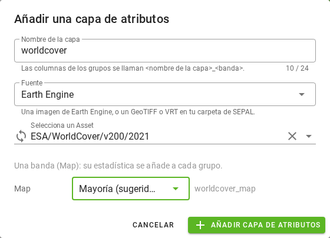

Para añadir una capa de atributos:

1.  Selecciona **Añadir capa de atributos** para abrir el diálogo **Añadir una capa de atributos**.
2.  Comprueba el **Nombre de la capa**, sugerido a partir del raster una vez elegido. Las columnas se llaman *nombre de la capa*\_\ *banda*.
3.  Elige la **Fuente** (**Earth Engine**, una imagen, o **GeoTIFF / VRT**, un archivo de tu carpeta de SEPAL) y luego elige el raster. Sus bandas se leen enseguida.
4.  Con una banda, el formulario indica "Una banda (…): su estadística se añade a cada grupo." Con dos o más, selecciona una o varias en **Bandas**.
5.  Para cada banda, elige la estadística que se calcula sobre la alerta: **Mayoría** (para clases), **Media**, **Mínimo**, **Máximo** o **Mediana**. Empieza en **Mayoría** cuando el nombre de la banda parece de clases (por ejemplo, ``landcover``), y en **Media** en los demás casos, marcada "(sugerido)". El nombre de la columna aparece al lado.
6.  Selecciona **Añadir capa de atributos**.

Reglas:

-   Una capa necesita al menos una banda (**Conserva al menos una banda.**).
-   Dos capas no pueden leer el mismo raster (**Otra capa de atributos ya lee este raster.**).
-   Los nombres de columna nunca toman el nombre de una columna de las alertas ni de una columna de otra capa: si coinciden, se les añade un sufijo.

La lista bajo **Capas de atributos** muestra cada capa con sus columnas. El icono de lápiz edita una capa y el icono de papelera la quita. Las capas pertenecen a este formulario hasta que se ejecuta: se guardan con el conjunto de alertas.

Ejecutar el paso
^^^^^^^^^^^^^^^^

La línea gris sobre el botón indica qué conjunto genera la ejecución: "Crea o reemplaza el conjunto de alertas (período) · (fuentes)". Un conjunto de alertas se identifica por su período y sus fuentes:

-   una combinación nueva de fuentes genera un conjunto nuevo: un período puede tener varios conjuntos (por ejemplo, uno solo con GLAD-L y otro con las tres fuentes); y
-   la misma combinación otra vez *reemplaza* el conjunto.

Selecciona **Integrar y vectorizar**. El botón sigue desactivado hasta que haya al menos una fuente seleccionada y, cuando **Limitar el número de grupos** está marcado, el límite sea válido ("Introduce un número entero mayor que 0." bajo el campo).

La ejecución pasa por "Combinando fuentes", "Vectorizando grupos", "Guardando los grupos", "Escribiendo la huella" y "Generando las teselas del mapa". Al terminar, un mensaje indica "N grupos listos para revisar", seguido de "Se vincularon N grupos a pérdidas anteriores (M por debajo del área mínima)" cuando encontró `alertas de crecimiento <defo-integrate-growth_>`_, y el nuevo conjunto pasa a ser el *conjunto activo*: aquel con el que trabajan `Cuestionario <defo-questionnaire_>`_, `Evaluación <defo-evaluation_>`_, `Análisis <defo-analysis_>`_ y `Resumen <defo-overview_>`_. El paso sigue abierto.

Si no queda ningún grupo, el conjunto se genera igualmente, vacío: el mensaje indica "No hay grupos nuevos en este período: el conjunto de alertas está vacío." y da el motivo para cada fuente (por ejemplo, "GLAD-L: los 56 píxeles de alerta eliminados por máscaras" o "RADD: se dejaron fuera las alertas probables (no confirmadas)").

.. _defo-integrate-replace:

Reemplazar un conjunto
""""""""""""""""""""""

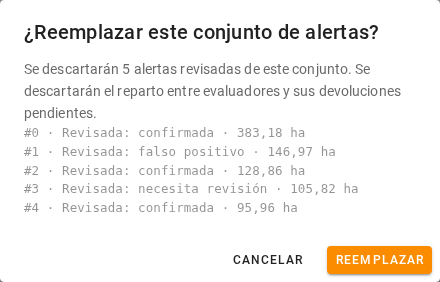

Cuando el conjunto que se va a reemplazar tiene alertas revisadas o un `reparto entre evaluadores <defo-evaluation_>`_, el diálogo **¿Reemplazar este conjunto de alertas?** enumera lo que se perdería: las alertas revisadas (hasta 20, y luego "… y N más"), y el reparto con las revisiones que los evaluadores todavía no han devuelto. Cuando hay alertas de períodos posteriores que crecen de este conjunto, añade "N grupos de períodos posteriores están vinculados a este conjunto; sus vínculos se romperán.": tras la ejecución, esos vínculos aparecen como "el conjunto anterior se volvió a ejecutar" (consulta `Alertas anteriores <defo-analysis-earlier_>`_). Selecciona **Reemplazar** para continuar. Un conjunto sin nada que perder se reemplaza sin confirmación.

.. attention::

    Reemplazar un conjunto descarta sus revisiones. Para probar otra configuración sin perder revisiones, elige otra combinación de fuentes, que genera un conjunto aparte.

.. _defo-integrate-outdated:

Cuando el conjunto activo está desactualizado
"""""""""""""""""""""""""""""""""""""""""""""

Si las entradas del conjunto activo cambiaron desde que se generó (una fuente descargada de nuevo, una máscara activada o desactivada, o un cambio en la retrospección del período, la AOI o la cuadrícula), una línea naranja indica: "El conjunto activo (…) se generó a partir de entradas que han cambiado desde entonces." Vuelve a ejecutar **Integrar y vectorizar** para reconstruirlo, lo que descarta sus revisiones.

Si los archivos del conjunto se eliminaron de la carpeta del proyecto, la línea indica: "Faltan los archivos del conjunto activo (…) en la carpeta del proyecto."

.. _defo-integrate-map:

Ver las alertas en el mapa
^^^^^^^^^^^^^^^^^^^^^^^^^^

En cuanto el proyecto tiene un conjunto, un título bajo el botón cuenta las alertas del conjunto activo ("Resultado · 48 grupos"), y los interruptores debajo dibujan el conjunto en el mapa:

.. list-table::
    :header-rows: 1
    :widths: 35 65

    *   -   Interruptor
        -   Descripción
    *   -   **Mostrar estas alertas en el mapa**
        -   Las alertas del conjunto activo, coloreadas según su estado de revisión. Haz clic en una alerta para ver "Alerta (id) · (estado) · (superficie) ha". Su botón **Revisar** la abre en Análisis.
    *   -   **Mostrar píxeles no analizables**
        -   Los píxeles de alerta que no llegaron a ser alertas: **Demasiado pequeño** o **Sobre el límite de alertas**.
    *   -   **Mostrar conjuntos anteriores**
        -   Las alertas de los conjuntos de períodos anteriores, como contexto.

El mapa las conserva en los demás pasos. Desactívalas aquí.

Mensajes frecuentes
^^^^^^^^^^^^^^^^^^^

"… no está descargada y armonizada para este período; descárgala primero en Alertas y armonízala en Armonizar."
    Los archivos de una fuente están desactualizados. Descárgala en `Alertas <defo-alerts-download_>`_ y luego armonízala en `Armonizar <defo-harmonize_>`_.

"Falta la huella del conjunto anterior …; ejecuta Integrar y vectorizar en ese conjunto de nuevo primero."
    Se eliminaron los archivos de un período anterior. Haz activo ese período y vuelve a ejecutar su conjunto.

"No hay suficiente espacio libre en disco: …"
    La ejecución escribe algunos rasters del tamaño de la cuadrícula. Libera espacio.

"El período, el área de interés o la cuadrícula del proyecto cambiaron mientras la ejecución estaba en curso, así que el conjunto de alertas no se registró."
    Vuelve a ejecutarla.

"tippecanoe no está instalado: el mapa mostrará los puntos de alerta sin polígonos."
    El conjunto se genera; el mapa muestra sus alertas como puntos en lugar de polígonos.

"No se pudieron mostrar las teselas del mapa (…): se muestran los puntos de alerta sin polígonos."
    El conjunto se genera, pero no se pudo crear su capa de mapa. El mapa muestra sus alertas como puntos.

"Falta la base de alertas de …; vuelve a ejecutar Integrar y vectorizar para ese período."
    Con **Mostrar conjuntos anteriores**, el archivo de alertas de un conjunto anterior ha desaparecido de la carpeta del proyecto. Haz activo ese período y vuelve a ejecutar su conjunto.

.. _defo-layers:

Capas adicionales
-----------------

Las capas de visualización ayudan a revisar las alertas: un mapa de cobertura del suelo, una línea base de bosque, un mosaico reciente. Nunca modifican las alertas. Una capa es una imagen de Earth Engine o un GeoTIFF. Se puede mostrar en el mapa principal y, con **Mostrar en Análisis** marcado, en los dos mapas de la pantalla de `Análisis <defo-analysis_>`_.

Abre el paso **Capas adicionales** del panel **Flujo de trabajo**, el primer paso de **Preparar la revisión**. Se desbloquea en cuanto el proyecto tiene un conjunto de alertas (consulta `Integrar y vectorizar <defo-integrate_>`_).

El paso es opcional: sáltalo y vuelve en cualquier momento. Su barra en la cabecera es discontinua, y el paso no muestra ningún recuento hasta que tiene una capa.

.. note::

    Los mosaicos de Planet NICFI no son una capa adicional: si tu cuenta de GEE tiene acceso a NICFI, llegan con las imágenes *Planet* de la `línea de tiempo de Análisis <defo-analysis-timeline_>`_.

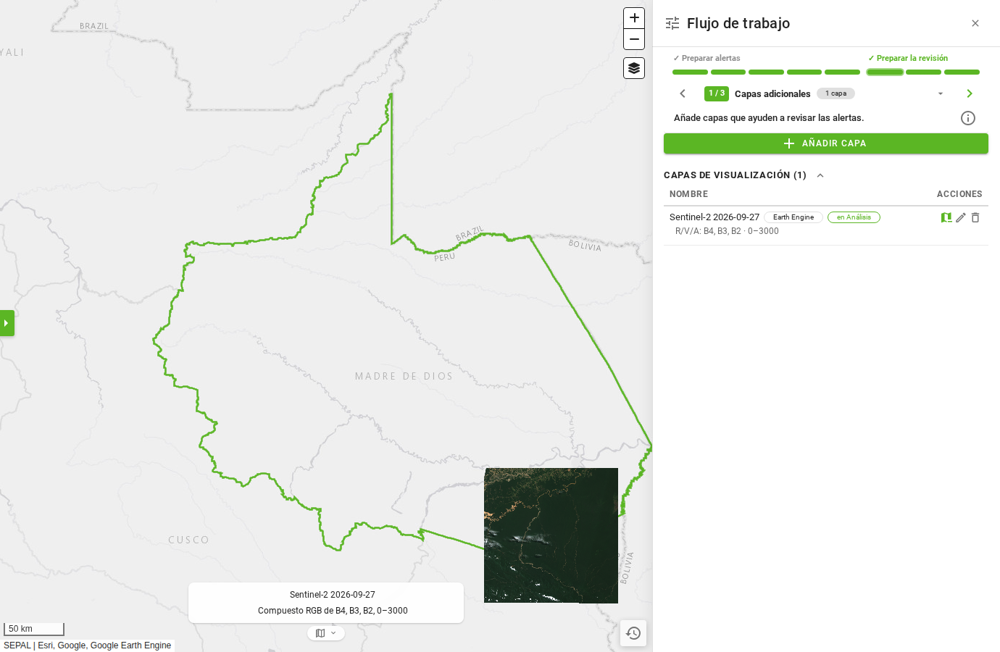

La lista de capas
^^^^^^^^^^^^^^^^^

Cada fila de **Capas de visualización** muestra:

-   el **Nombre** de la capa;
-   una etiqueta con su fuente (**Earth Engine** o **GeoTIFF / VRT**);
-   una etiqueta **en Análisis** cuando se muestra en los mapas de Análisis; y
-   una nota con sus bandas y su rango de valores o, para una capa categórica, su banda y su número de clases ("banda Map · 9 clases").

Los iconos a la derecha de cada fila:

-   el icono de mapa muestra la capa en el mapa principal, con su leyenda;
-   el icono de lápiz la abre para editarla (**Editar la capa** *nombre*); y
-   el icono de papelera la elimina. La capa se quita del proyecto; su archivo o su recurso no se tocan.

Añadir una capa
^^^^^^^^^^^^^^^

Selecciona **Añadir capa** para abrir el diálogo **Añadir una capa de visualización**. El formulario se lee de arriba abajo: el nombre, la fuente, la imagen y luego cómo se dibujan sus bandas. Las bandas se leen en cuanto se elige la imagen ("Leyendo las bandas…"), y cada elección posterior es un menú desplegable.

.. list-table::
    :header-rows: 1
    :widths: 20 40 40

    *   -   Campo
        -   Descripción
        -   Valor predeterminado y límites
    *   -   **Nombre**
        -   El nombre de la capa en la lista, en los mapas y en la leyenda.
        -   Si lo dejas vacío, se toma del nombre del recurso o del archivo, más la banda o la combinación. Como máximo 24 caracteres, único en el proyecto.
    *   -   **Fuente**
        -   **Earth Engine** (un recurso de imagen) o **GeoTIFF / VRT** (un archivo de tu carpeta de SEPAL).
        -   **Earth Engine**.
    *   -   Recurso o **GeoTIFF / VRT**
        -   Una *imagen* de GEE (no una colección), o un archivo .tif.
        -   Hay que poder escribir en la carpeta del GeoTIFF: la aplicación escribe a su lado un archivo de pirámides para que la capa se dibuje rápido.

Lo que sigue depende del número de bandas de la imagen:

-   Una banda: el formulario la nombra ("Una banda (…): se dibuja sola.").
-   Dos bandas: elige en **Banda** la que se dibuja. RGB necesita tres bandas o más.
-   Tres bandas o más: **Bandas** pide **Seleccionar una banda** (y luego **Banda**) o **Compuesto RGB**. Se sugiere **Compuesto RGB** cuando los nombres de las bandas dan el rojo, el verde y el azul (por ejemplo, ``B4``, ``B3`` y ``B2`` de Sentinel-2). **Banda** empieza en la primera banda.

Una banda
"""""""""

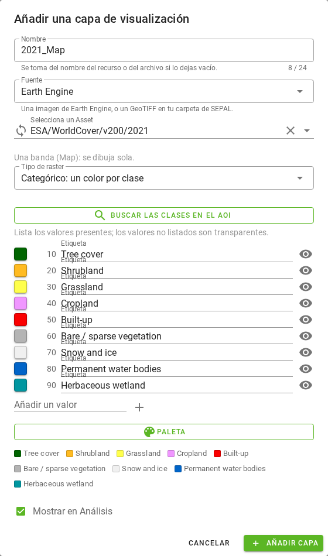

Una banda sola lleva un **Tipo de raster**:

-   **Continuo: una rampa de color** para valores medidos (reflectancia, altitud, cobertura arbórea); o
-   **Categórico: un color por clase** para clases de números enteros (un mapa de cobertura del suelo, una máscara de bosque, un año de pérdida). Se sugiere cuando el nombre de la banda parece de clases (por ejemplo, ``landcover``, ``class``, ``lossyear``, ``datamask``).

Debajo de los campos aparece una vista previa de la leyenda de la capa.

.. list-table::
    :header-rows: 1
    :widths: 20 40 40

    *   -   Campo
        -   Descripción
        -   Valor predeterminado y límites
    *   -   **Rampa de color**
        -   *Continuo*: los colores, de **Mín** a **Máx**: **Escala de grises**, **Azules**, **Verdes**, **Naranjas**, **Frío–cálido**, **Viridis**, **Terreno**, **Calor** o **Magma**.
        -   **Escala de grises**.
    *   -   **Invertir**
        -   *Continuo*: invierte la rampa.
        -   Desactivado.
    *   -   **Mín**, **Máx**
        -   *Continuo*: el rango de valores que se estira sobre los colores.
        -   0 y 1. Ambos deben ser números, con **Mín** menor que **Máx**.
    *   -   **Ajustar a la AOI (2–98 %)**
        -   *Continuo*: rellena **Mín** y **Máx** con los percentiles 2 y 98 de la banda sobre el rectángulo que envuelve la AOI.
        -
    *   -   **Buscar las clases en la AOI**
        -   *Categórico*: enumera los valores enteros presentes sobre la AOI, cada uno con un color, su valor, una **Etiqueta** y un icono de ojo que lo oculta o lo muestra. Cuando la imagen nombra sus clases y sus colores (como ESA WorldCover), las clases los toman; si no, cada clase se etiqueta con su valor.
        -   Como máximo 50 clases. Los valores no enumerados y las clases ocultas son transparentes.
    *   -   **Añadir un valor**
        -   *Categórico*: añade una clase a mano. Escribe el número entero y pulsa **Intro** o selecciona el icono de suma.
        -   Cada valor una sola vez.
    *   -   **Paleta**
        -   *Categórico*: vuelve a colorear todas las clases con una paleta: **Set1**, **Set2**, **Tab10** o **Paired**. Selecciona el cuadrado de color de una clase para elegir su color a mano.
        -

.. labels-ok: Intro

Cuando una banda solo contiene 0 y 1 sobre la AOI, las clases encontradas nombran el 1 como la banda y empiezan con el 0 oculto: "Solo 0 y 1 en la AOI: 1 lleva el nombre de la banda y 0 empieza oculto (transparente)." Selecciona el icono de ojo del 0 para dibujarlo también.

Compuesto RGB
"""""""""""""

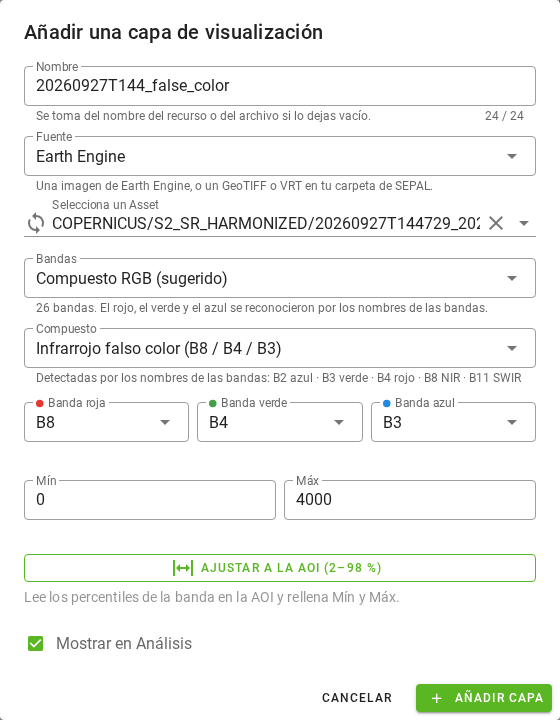

.. labels-ok: Color verdadero; Infrarrojo falso color; SWIR / NIR / rojo

.. list-table::
    :header-rows: 1
    :widths: 20 40 40

    *   -   Campo
        -   Descripción
        -   Valor predeterminado y límites
    *   -   **Compuesto**
        -   Una combinación estándar, nombrada con sus bandas (por ejemplo, "Color verdadero (B4 / B3 / B2)"): **Color verdadero**, **Infrarrojo falso color** (infrarrojo cercano, rojo, verde) o **SWIR / NIR / rojo** (infrarrojo de onda corta, infrarrojo cercano, rojo); o **Personalizado: elige las bandas**. La ayuda enumera los papeles de banda detectados a partir de los nombres de las bandas ("Detectadas por los nombres de las bandas: …").
        -   La primera combinación que permiten los nombres de las bandas. Una combinación cuyas bandas no se reconocieron todas indica "(bandas no encontradas)" y no se puede elegir. Si no se reconoce ningún nombre de banda, las tres primeras bandas se usan como rojo, verde y azul.
    *   -   **Banda roja**, **Banda verde**, **Banda azul**
        -   Las bandas que se dibujan en rojo, verde y azul.
        -   Las rellena el **Compuesto**. Deben ser tres bandas distintas. Las bandas elegidas a mano que coinciden con una combinación la seleccionan; las demás seleccionan **Personalizado: elige las bandas**.
    *   -   **Mín**, **Máx**
        -   El rango de valores que se estira sobre los colores, el mismo para las tres bandas.
        -   0 y 1. Ambos deben ser números, con **Mín** menor que **Máx**.
    *   -   **Ajustar a la AOI (2–98 %)**
        -   Rellena **Mín** y **Máx** con un solo rango para las tres bandas, a partir de sus percentiles 2 y 98 sobre el rectángulo que envuelve la AOI.
        -

.. tip::

    Ajusta **Mín** y **Máx** al rango real de los datos (por ejemplo, de 0 a 3000 para una imagen Sentinel-2 de reflectancia de superficie), o selecciona **Ajustar a la AOI (2–98 %)**. Con el rango predeterminado de 0 a 1, la mayoría de las imágenes se ven completamente blancas.

Mostrar en Análisis
"""""""""""""""""""

**Mostrar en Análisis** añade la capa a los dos mapas de la pantalla de `Análisis <defo-analysis_>`_, desactivada. Actívala allí desde el menú de capas. Los mapas de Análisis no muestran su leyenda.

Guardar una capa
^^^^^^^^^^^^^^^^

Selecciona **Añadir capa** (o **Guardar** al editar). La aplicación comprueba las bandas, el rango o las clases y, para un GeoTIFF, la carpeta. Cualquier problema se muestra en rojo dentro del diálogo, que sigue abierto. Mientras se hace la comprobación, el botón indica **Cancelar** y la detiene.

Las capas guardadas antes de que existieran los estilos de visualización conservan exactamente su aspecto.

Mensajes frecuentes
^^^^^^^^^^^^^^^^^^^

"Elige una imagen de Earth Engine."
    Las colecciones de imágenes no se aceptan como capas. Exporta primero una sola imagen.

"Elige tres bandas distintas para rojo, verde y azul."
    Elige una banda distinta para cada color.

"Esta banda tiene valores no enteros: dibújala como Continua."
    **Buscar las clases en la AOI** encontró valores decimales: la banda no es un conjunto de clases. Pon **Tipo de raster** en **Continuo: una rampa de color**.

"Más de 50 valores: esta banda parece continua."
    Dibuja la banda como **Continuo: una rampa de color**, o añade a mano las clases que necesites con **Añadir un valor**.

"No hay valores en la AOI." o "La banda no tiene dispersión de valores en la AOI."
    La banda no tiene datos sobre la AOI, o tiene el mismo valor en todas partes. Revisa la imagen y la banda, o escribe tú **Mín** y **Máx**.

"Busca las clases o añade un valor." o "Muestra al menos una clase."
    Una capa categórica necesita al menos una clase, y al menos una clase que no esté oculta.

"No se puede escribir en la carpeta …, así que no se pueden generar las pirámides de la capa."
    Mueve el GeoTIFF a una carpeta propia en SEPAL.

"El archivo … ya no existe."
    El archivo de una capa GeoTIFF se movió o se eliminó. Edita la capa y vuelve a elegir el archivo.

.. _defo-questionnaire:

Cuestionario
------------

El *cuestionario* contiene las preguntas que se responden para cada alerta en `Análisis <defo-analysis_>`_, después de su veredicto. Las respuestas:

-   se guardan con la alerta (una columna por pregunta);
-   se exportan con ella;
-   se grafican en el `Resumen <defo-overview_>`_; y
-   están disponibles para el informe de Word de la alerta.

Este paso también elige la plantilla del informe.

Abre el paso **Cuestionario** del panel **Flujo de trabajo**, en **Preparar la revisión**. Se desbloquea en cuanto el proyecto tiene un conjunto de alertas (consulta `Integrar y vectorizar <defo-integrate_>`_). El cuestionario pertenece al proyecto: todos los conjuntos de alertas del proyecto se revisan con él. El paso es opcional: sin cambios, Análisis hace la pregunta predeterminada.

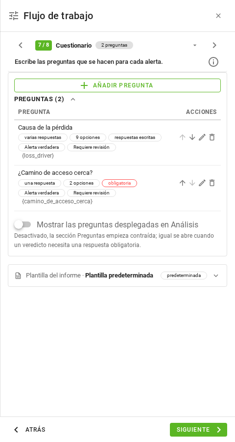

La lista de preguntas
^^^^^^^^^^^^^^^^^^^^^

Un proyecto nuevo empieza con una pregunta, **Causa de la pérdida**:

-   varias respuestas;
-   nueve opciones: **Expansión agrícola**, **Pastoreo ganadero**, **Tala**, **Expansión urbana**, **Agricultura migratoria**, **Minería**, **Incendios forestales**, **Huracanes** y **Otra**;
-   se permiten respuestas escritas; y
-   se pregunta para **Alerta verdadera** y **Requiere revisión** (no para un falso positivo).

Edítala o elimínala como cualquier otra pregunta.

Cada fila de **Preguntas** muestra la pregunta y unas etiquetas que la resumen: **una respuesta** o **varias respuestas**, el número de opciones, **respuestas escritas**, **obligatoria**, y los veredictos para los que se pregunta (o **todos los veredictos**). La nota debajo es su marcador para el informe, como ``{loss_driver}``.

Los iconos a la derecha de cada fila:

-   las flechas suben o bajan la pregunta: Análisis hace las preguntas en este orden;
-   el icono de lápiz la edita; y
-   el icono de papelera la elimina.

Sin preguntas, la lista indica **Sin preguntas: Análisis solo pedirá el veredicto.**

**Mostrar las preguntas desplegadas en Análisis** (desactivado por defecto) abre la sección **Preguntas** de Análisis en cada alerta. Si está desactivado, la sección empieza contraída; igualmente se abre cuando un veredicto exige una respuesta obligatoria.

Añadir o editar una pregunta
^^^^^^^^^^^^^^^^^^^^^^^^^^^^

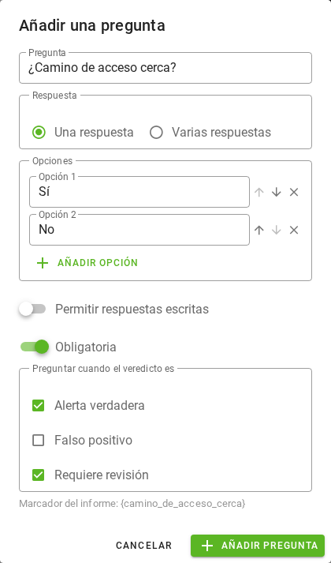

Selecciona **Añadir pregunta** (o el icono de lápiz de una pregunta) para abrir el diálogo **Añadir una pregunta** (o **Editar pregunta**).

.. list-table::
    :header-rows: 1
    :widths: 20 45 35

    *   -   Campo
        -   Descripción
        -   Valor predeterminado y límites
    *   -   **Pregunta**
        -   El texto que se muestra en Análisis.
        -   Obligatorio.
    *   -   **Respuesta**
        -   **Una respuesta** o **Varias respuestas**. Con varias, las respuestas se guardan juntas, separadas por comas.
        -   **Una respuesta**.
    *   -   **Opciones**
        -   Las respuestas entre las que elegir. **Añadir opción** añade una; las flechas las reordenan; la cruz quita una.
        -   Al menos una opción, salvo que se permitan respuestas escritas. Una opción no puede estar vacía, contener una coma ni repetir otra opción.
    *   -   **Permitir respuestas escritas**
        -   Permite al revisor escribir una respuesta que no está entre las opciones.
        -   Desactivado.
    *   -   **Obligatoria**
        -   La revisión no se puede guardar sin una respuesta (para los veredictos en los que se pregunta).
        -   Desactivado.
    *   -   **Preguntar cuando el veredicto es**
        -   Los veredictos para los que se hace la pregunta: **Alerta verdadera**, **Falso positivo**, **Requiere revisión**. Para los demás veredictos, queda oculta.
        -   Los tres. Al menos uno.

La última línea muestra el marcador de la pregunta para el informe (por ejemplo, "Marcador del informe: {access_road_nearby}"). Se crea a partir del texto de la pregunta cuando se crea la pregunta y nunca cambia, aunque se cambie el nombre de la pregunta.

Selecciona **Añadir pregunta** (o **Guardar**). El diálogo muestra en rojo lo que falta hasta que la pregunta se pueda guardar.

.. note::

    Cambiar el nombre de una pregunta o de una de sus opciones conserva las respuestas ya guardadas: se almacenan con el nombre del marcador de la pregunta y el código propio de cada opción, no con su texto.

Eliminar una pregunta
^^^^^^^^^^^^^^^^^^^^^

Selecciona el icono de papelera. El diálogo de confirmación indica cuántas alertas del conjunto activo respondieron la pregunta. Las respuestas ya guardadas se quedan en la tabla de alertas, pero dejan de mostrarse, exportarse y graficarse.

.. _defo-questionnaire-template:

La plantilla del informe
^^^^^^^^^^^^^^^^^^^^^^^^

En Análisis, cada alerta revisada se puede exportar con un informe de Word (consulta `Exportar <defo-export_>`_). El informe se genera a partir de una plantilla .docx en la que los *marcadores* como ``{area_loss}`` se sustituyen por los valores de la alerta.

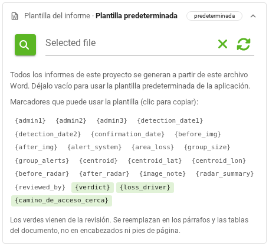

La línea **Plantilla del informe** indica la plantilla en uso, con una etiqueta: **predeterminada** (la plantilla propia de la aplicación), **propia** (tu archivo) o **no encontrada** (tu archivo se movió o se eliminó). Despliégala con la flecha de la derecha:

-   **Plantilla de informe (.docx)**: elige un archivo de Word de tu carpeta de SEPAL. A partir de entonces, todos los informes de este proyecto se generan con él. Vacía el campo para volver a la plantilla predeterminada.
-   **Marcadores que puede usar la plantilla (clic para copiar):** selecciona una etiqueta para copiar su marcador y luego pégalo en la plantilla.

.. list-table::
    :header-rows: 1
    :widths: 40 60

    *   -   Marcador
        -   Se sustituye por
    *   -   ``{admin1}``, ``{admin2}``, ``{admin3}``
        -   Las áreas administrativas en las que cae la alerta.
    *   -   ``{detection_date1}``, ``{detection_date2}``
        -   La primera y la última fecha de detección de la alerta.
    *   -   ``{confirmation_date}``
        -   El día en que se genera el informe.
    *   -   ``{before_img}``, ``{after_img}``
        -   Los nombres de las imágenes de antes y después elegidas en la revisión.
    *   -   ``{alert_system}``
        -   Las fuentes que detectaron la alerta.
    *   -   ``{area_loss}``
        -   La superficie de la alerta, en hectáreas (la del grupo, para un grupo).
    *   -   ``{centroid}``
        -   El centro de la alerta (del contorno del grupo, para un grupo) como latitud, longitud en grados decimales ("-12.345678, -69.123456").
    *   -   ``{centroid_lat}``, ``{centroid_lon}``
        -   La misma latitud y longitud, cada una por separado ("-12.345678", "-69.123456").
    *   -   ``{group_size}``, ``{group_alerts}``
        -   Para una alerta revisada en un grupo: el número de alertas del grupo y sus números ("12, 15, 16"). En los demás casos, "1" y el número de la propia alerta.
    *   -   ``{verdict}`` (verde)
        -   El veredicto, en el idioma de la aplicación.
    *   -   Uno por pregunta (verde)
        -   La respuesta a esa pregunta; vacío cuando la pregunta no se hace para el veredicto de la alerta.

Los marcadores verdes provienen de la revisión. Los marcadores se sustituyen en los párrafos del documento, no dentro de tablas, encabezados ni pies de página.

Imágenes en el informe
""""""""""""""""""""""

El informe también contiene seis imágenes de la alerta, recortadas de las imágenes de antes y después elegidas en la revisión. No están en la lista de etiquetas: la plantilla indica dónde va cada una con un párrafo que solo contiene su marca, de ``[Placeholder for Image 1]`` a ``[Placeholder for Image 6]``. Ese párrafo entero se sustituye por la imagen (de 250 pt de ancho), así que no pongas nada más en él.

.. list-table::
    :header-rows: 1
    :widths: 60 40

    *   -   Marca
        -   Imagen
    *   -   ``[Placeholder for Image 1]``, ``[Placeholder for Image 4]``
        -   La imagen de antes.
    *   -   ``[Placeholder for Image 2]``, ``[Placeholder for Image 5]``
        -   La imagen de después.
    *   -   ``[Placeholder for Image 3]``, ``[Placeholder for Image 6]``
        -   La imagen de después con el contorno de la alerta en rojo.

Las imágenes 1 a 3 muestran las imágenes en una combinación de bandas, y las imágenes 4 a 6 en otra. La plantilla predeterminada las coloca bajo sus leyendas, en inglés ("Image 1: Pre-deforestation …", "Image 2: Post-deforestation …" e "Image 3: Deforestation alert generated."), dos imágenes por leyenda. Una plantilla sin estas marcas genera un informe sin imágenes.

.. tip::

    Para crear una plantilla propia, organízala como la predeterminada: el texto con los marcadores de arriba y, después, cada leyenda seguida de sus marcas de imagen, cada marca sola en su párrafo.

La plantilla puede mostrar dos mensajes:

-   "… no es un archivo Word (.docx) de tu carpeta de SEPAL; no se cambió la plantilla de informe.": elige un archivo .docx.
-   **no encontrada**, con "El archivo ya no está: elíjalo de nuevo o vacíe el campo para usar la plantilla predeterminada.": la tarjeta sigue desplegada hasta que se vuelva a elegir el archivo o se vacíe el campo.

.. tip::

    Cuando las alertas se reparten entre evaluadores, sus paquetes de revisión llevan el cuestionario y la plantilla del informe. Si el cuestionario cambia después de generar los paquetes, vuelve a generarlos (consulta `Evaluación <defo-evaluation_>`_).

A continuación, ve al paso `Evaluación <defo-evaluation_>`_, donde **Iniciar análisis** empieza la revisión.

.. _defo-evaluation:

Evaluación
----------

Este paso decide quién revisa las alertas del conjunto activo:

-   revisarlas todas tú mismo; o
-   repartirlas entre varios evaluadores. Cada evaluador recibe un *paquete de revisión*, revisa sus propias alertas en su propia cuenta de SEPAL y devuelve una *copia revisada*, que luego se integra en el proyecto.

Abre el paso **Evaluación** del panel **Flujo de trabajo**, el último paso de **Preparar la revisión**. Se desbloquea en cuanto el proyecto tiene un conjunto de alertas (consulta `Integrar y vectorizar <defo-integrate_>`_). Trabaja sobre el conjunto activo: un reparto pertenece a un conjunto de alertas.

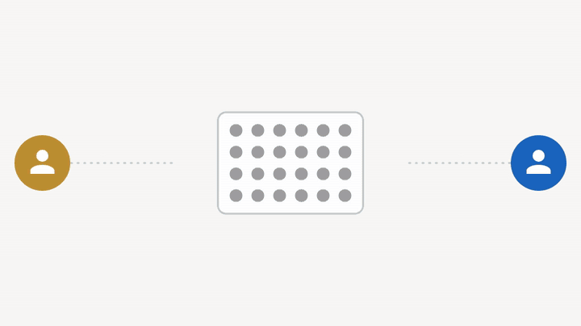

En la animación, el rojo indica una pérdida confirmada y el verde un falso positivo.

Modo de revisión
^^^^^^^^^^^^^^^^

En **Modo de revisión**, marca una de las dos casillas:

.. list-table::
    :header-rows: 1
    :widths: 30 70

    *   -   **Modo de revisión**
        -   Descripción
    *   -   **Individual**
        -   Revisas tú todas las alertas. No hay nada más que configurar: selecciona **Iniciar análisis**.
    *   -   **Varios evaluadores**
        -   Las alertas se reparten entre evaluadores, y cada uno recibe un paquete de revisión. La tabla de evaluadores aparece debajo.

Un proyecto empieza sin ninguna casilla marcada. La nota debajo indica "Elige quién revisa las alertas: solo tú o varios evaluadores.", y el paso **Evaluación** del panel **Flujo de trabajo** queda vacío.

-   Al marcar una casilla se desmarca la otra; al desmarcar la casilla marcada, vuelve a no haber ningún modo.
-   **Individual** completa el paso (su indicador muestra "1 evaluador").
-   **Varios evaluadores** completa el paso en cuanto las alertas están repartidas.
-   Mientras exista un reparto, las dos casillas quedan desactivadas en **Varios evaluadores** (**Quita el reparto para pasar a evaluación individual.**).

.. _defo-evaluation-group:

Revisar juntas las alertas cercanas
"""""""""""""""""""""""""""""""""""

En su propia tarjeta, bajo el modo de revisión (y bajo la tabla de evaluadores con **Varios evaluadores**), la casilla **Revisar juntas las alertas cercanas** permite que `Análisis <defo-analysis-nearby_>`_ revise alertas vecinas como un solo grupo: "En Análisis, las alertas a esta distancia pueden revisarse con un solo veredicto, un solo conjunto de respuestas y un solo polígono." Funciona en los dos modos. Una vez marcada:

.. list-table::
    :header-rows: 1
    :widths: 30 45 25

    *   -   Campo
        -   Descripción
        -   Valor predeterminado y límites
    *   -   **Distancia (m)**
        -   A qué distancia, de borde a borde, debe estar una alerta para que se ofrezca en el grupo.
        -   300. De 10 a 5000.
    *   -   **Incluir las alertas ya revisadas**
        -   Ofrece también las alertas revisadas antes de activar la agrupación. "Sin marcar, las alertas revisadas antes de activar la agrupación nunca se ofrecen."
        -   Sin marcar.

Algunos cambios quedan bloqueados:

-   Una vez guardados los grupos, la agrupación no se puede desactivar y la distancia no puede cambiar: "Hay 2 grupos guardados: quítalos para desactivar la agrupación."
-   Un reparto fija los tres ajustes: "Las alertas se repartieron con agrupación: quita el reparto para cambiarla." (o "sin agrupación").
-   En una copia de revisión, aparecen como "Definido por el creador del proyecto."

.. _defo-evaluation-split:

Repartir las alertas
^^^^^^^^^^^^^^^^^^^^

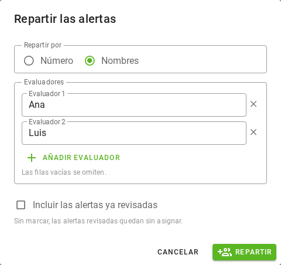

Con **Varios evaluadores** marcado, selecciona **Repartir alertas…** debajo del modo de revisión para abrir el diálogo **Repartir las alertas**:

.. list-table::
    :header-rows: 1
    :widths: 25 45 30

    *   -   Campo
        -   Descripción
        -   Valor predeterminado y límites
    *   -   **Repartir por**
        -   **Número**: los evaluadores se llaman "Evaluador 1", "Evaluador 2"… **Nombres**: escribe sus nombres.
        -   **Número**.
    *   -   **Número de evaluadores**
        -   Con **Número**.
        -   2. De 1 a 50.
    *   -   **Evaluador 1**, **Evaluador 2**…
        -   Con **Nombres**: una fila por evaluador. **Añadir evaluador** añade una fila; la cruz quita una.
        -   Dos filas vacías. Las filas vacías se omiten; dos filas no pueden tener el mismo nombre; como máximo 50.
    *   -   **Incluir las alertas ya revisadas**
        -   Reparte también las alertas que ya están revisadas. Sin marcar, quedan sin asignar.
        -   Sin marcar.

Selecciona **Repartir**. Las alertas se reparten una a una en el orden del conjunto (el **Orden** elegido en `Integrar y vectorizar <defo-integrate-options_>`_), como cartas: la primera al evaluador 1, la segunda al evaluador 2, y así sucesivamente, dando la vuelta a la lista. Cada evaluador recibe más o menos el mismo número de alertas, distribuidas a lo largo de todo el orden.

Con **Revisar juntas las alertas cercanas** marcada, el reparto nunca separa un grupo. Las alertas que están a la distancia elegida unas de otras, de borde a borde, se encadenan en un grupo de alertas cercanas. Cada grupo va entero al evaluador que tiene menos alertas hasta ese momento. Cuando un grupo tiene más de una parte equitativa, el diálogo avisa: "Un grupo de alertas cercanas contiene 30 alertas, más de una parte equitativa."

La tabla de evaluadores
"""""""""""""""""""""""

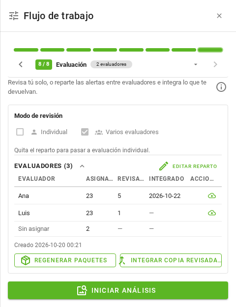

.. list-table::
    :header-rows: 1
    :widths: 20 80

    *   -   Columna
        -   Descripción
    *   -   **Evaluador**
        -   El nombre del evaluador. Una última fila, **Sin asignar**, cuenta las alertas que no recibió ningún evaluador.
    *   -   **Asignadas**
        -   El número de alertas que tiene el evaluador.
    *   -   Columna **Revisadas**
        -   Cuántas de ellas están revisadas en *tu* proyecto (por ti, o integradas desde el evaluador).
    *   -   **Integrado**
        -   La fecha en que se integró por última vez su copia revisada, o un guion.

El icono de nube de cada fila descarga el paquete de ese evaluador una vez generado.

Modificar o quitar el reparto
"""""""""""""""""""""""""""""

**Editar reparto** (en lugar de **Repartir alertas…**) vuelve a abrir el diálogo como **Editar el reparto**:

-   **Repartir de nuevo** vuelve a repartir las alertas con los nuevos nombres o el nuevo número. Es un reparto nuevo: las revisiones ya integradas se quedan, pero los paquetes ya enviados para el reparto anterior ya no se pueden integrar (el diálogo avisa: **Los paquetes ya enviados para este reparto dejarán de poder integrarse.**).
-   **Quitar el reparto** borra todas las asignaciones. Las revisiones se quedan.

.. attention::

    Volver a ejecutar `Integrar y vectorizar <defo-integrate-replace_>`_ sobre el mismo conjunto lo reemplaza: se descartan sus revisiones y su reparto, y las copias revisadas del conjunto anterior ya no se pueden integrar.

.. _defo-evaluation-packages:

Paquetes de revisión
^^^^^^^^^^^^^^^^^^^^

Selecciona **Generar paquetes**. La aplicación crea un archivo .zip por evaluador en la carpeta del conjunto de alertas (el botón indica "Creando 1 / 2…"). Cada paquete contiene:

-   las alertas del conjunto con sus asignaciones;
-   el cuestionario;
-   la AOI;
-   la lista de escenas satelitales ya encontradas;
-   las alertas anteriores a las que se pueden vincular las alertas del conjunto (consulta `Alertas anteriores <defo-analysis-earlier_>`_), tal como están al generar los paquetes; y
-   la plantilla del informe, cuando se eligió una propia.

Cuando están listos, aparece "Creado (fecha y hora)" bajo la tabla y el icono de nube de cada fila pasa a ser una descarga.

Para compartir los paquetes:

1.  Descarga el paquete de cada evaluador y envíaselo (por correo electrónico, una unidad compartida…).
2.  El evaluador lo copia en su carpeta de SEPAL y lo importa con **Importar** en el diálogo `Proyecto <defo-project-import_>`_.

El paquete se abre como una copia de revisión en Análisis, filtrada a las alertas del evaluador, con los pasos de configuración bloqueados.

Un paquete necesita la forma de la AOI. Hasta que esté cargada, el paso indica **Los paquetes esperan la geometría de la AOI: abre el paso AOI para cargarla.**

Si el `cuestionario <defo-questionnaire_>`_ cambia después de generar los paquetes, los iconos de nube se vuelven ámbar ("Creado antes de que cambiara el cuestionario: genera los paquetes de nuevo."). Selecciona **Regenerar paquetes** y envía los nuevos.

.. _defo-evaluation-return:

Qué hace el evaluador
^^^^^^^^^^^^^^^^^^^^^

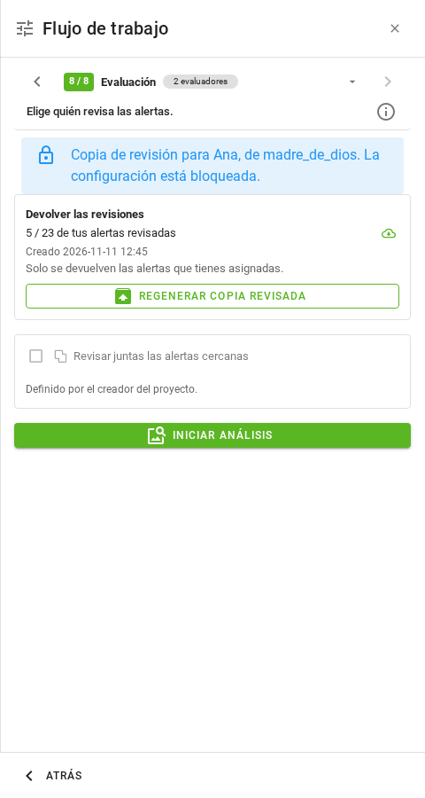

En una copia de revisión, el paso **Evaluación** muestra en su lugar **Devolver las revisiones**: cuántas de las alertas del evaluador están revisadas ("5 / 23 de tus alertas revisadas") y **Generar copia revisada**.

El evaluador:

1.  revisa sus alertas en `Análisis <defo-analysis_>`_;
2.  selecciona **Generar copia revisada** y luego la descarga con el icono de nube (un archivo .zip que termina en ``__reviewed.zip``); y
3.  la envía de vuelta al creador del proyecto.

Solo se devuelven las alertas asignadas al evaluador que este revisó, con los vínculos a alertas anteriores que marcó. Una copia revisada contiene las revisiones tal como estaban al generarla: después de revisar más, selecciona **Regenerar copia revisada**. El evaluador puede enviar copias tantas veces como haga falta. Cuando se integra una copia más reciente, las alertas integradas antes y revisadas de otra forma desde entonces aparecen como conflictos: elige **Tomar las suyas** para quedarte con las últimas revisiones del evaluador.

.. _defo-evaluation-merge:

Integrar una copia revisada
^^^^^^^^^^^^^^^^^^^^^^^^^^^

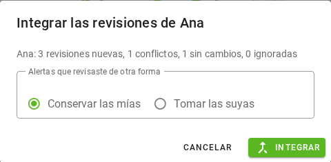

Para integrar una copia revisada:

1.  Copia la copia revisada en tu carpeta de SEPAL.
2.  Selecciona **Integrar copia revisada…** y elígela en **Copia revisada (.zip)**. Elige una copia cada vez.
3.  Lee la vista previa, titulada con el nombre del evaluador y mostrada antes de que cambie nada (consulta la tabla de abajo).
4.  Cuando hay conflictos, elige en **Alertas que revisaste de otra forma**: **Conservar las mías** (la opción predeterminada) o **Tomar las suyas**.
5.  Selecciona **Integrar**.

.. list-table::
    :header-rows: 1
    :widths: 20 80

    *   -   Recuento
        -   Descripción
    *   -   revisiones nuevas
        -   Alertas que el evaluador revisó y que no están revisadas en tu proyecto. Se incorporan.
    *   -   conflictos
        -   Alertas que también se revisaron en tu proyecto (por ti o en una integración anterior), de otra forma. Un vínculo distinto a una alerta anterior cuenta como una diferencia.
    *   -   sin cambios
        -   Alertas cuya revisión es igual en ambos lados.
    *   -   ignoradas
        -   Alertas que no están asignadas a este evaluador. Nunca se incorporan.

Con la agrupación activada, cada recuento indica también su número de grupos ("3 revisiones nuevas (1 grupo)"). Un grupo se integra entero: cuando una de sus alertas está en conflicto, todo el grupo es un conflicto.

Después de la integración, las alertas del conjunto se actualizan, un mensaje indica "N revisiones de (evaluador) integradas." y la columna **Integrado** muestra la fecha.

La vista previa también puede avisar de que "El cuestionario cambió desde que se crearon los paquetes; las respuestas se fusionan por clave de pregunta.", o enumerar columnas que ignora. Si la alerta abierta en Análisis está entre las integradas, se vuelve a cargar.

.. tip::

    En `Análisis <defo-analysis_>`_, el filtro puede mostrar las alertas de un evaluador (o las no asignadas) mediante su atributo **Evaluador**.

Mensajes frecuentes
^^^^^^^^^^^^^^^^^^^

"Esta copia es del conjunto …; actívelo para fusionarla."
    Elige primero ese conjunto en el selector de conjuntos de Análisis o del Resumen.

"El conjunto se volvió a ejecutar después de crear esta copia." o "Esta copia se hizo para una división anterior."
    La copia ya no corresponde a las alertas del conjunto. No se puede integrar.

"Este zip es un paquete de revisión, no una copia revisada."
    Elige el archivo que devolvió el evaluador.

"Esta revisión devuelta rompería un grupo de alertas, así que no se fusionó nada. Elija Conservar las mías o pida al evaluador que actualice la aplicación y vuelva a enviar la revisión."
    Aceptar las revisiones del evaluador separaría un grupo guardado en tu proyecto. Elige **Conservar las mías**, o pide una copia revisada hecha con una aplicación actualizada.

"Una copia de revisión no puede fusionar copias revisadas; abra el proyecto del creador."
    Integra la copia en el proyecto original.

"Este conjunto tiene un atributo llamado 'evaluator'; cambia el nombre de esa capa de atributos y vuelve a ejecutar el conjunto."
    La tabla de alertas del conjunto ya tiene una columna ``evaluator``, procedente de una capa de atributos, así que no se puede repartir. En `Integrar y vectorizar <defo-integrate-attributes_>`_, da otro nombre a esa capa y vuelve a ejecutar el conjunto (esto reemplaza el conjunto y sus revisiones).

"Las alertas de este conjunto tienen evaluadores asignados, pero el proyecto no guarda ningún reparto. Quita el reparto para empezar de nuevo."
    Un reparto se escribió en las alertas pero no en el proyecto (por ejemplo, porque el proyecto se cerró en ese momento). Abre **Editar reparto**, selecciona **Quitar el reparto** y vuelve a repartir.

"Este conjunto de alertas se reescribió mientras se hacía el reparto, así que no se ha cambiado nada. Inténtalo de nuevo."
    Se guardó una revisión o se integró una copia al mismo tiempo. Vuelve a repartir.

"Este conjunto de alertas se está volviendo a ejecutar en Integrar y vectorizar. Inténtalo de nuevo cuando termine." (al repartir)
    Espera a que termine la ejecución.

"No hay alertas que asignar." (al repartir)
    Puede que todas las alertas ya estén revisadas: marca **Incluir las alertas ya revisadas**.

.. _defo-analysis:

Análisis
--------

.. labels-ok: Google; Esri; Intro

Usa la pantalla de Análisis para revisar las alertas del conjunto activo, una a una. Para cada alerta:

1.  Compara una imagen satelital de *antes* y otra de *después*.
2.  Da un veredicto.
3.  Responde a las preguntas del proyecto.
4.  Guarda.

También puedes volver a dibujar el polígono de la alerta, a mano o con dos modelos de detección automática, y exportar los archivos de la alerta.

Abrir la pantalla
^^^^^^^^^^^^^^^^^

La pantalla se abre con el conjunto de alertas activo desde cualquiera de estos puntos:

-   **Iniciar análisis**, al final del paso `Evaluación <defo-evaluation_>`_;
-   **Análisis**, en la barra lateral izquierda; o
-   **Revisar alertas** en el `Resumen <defo-overview_>`_, o el botón **Revisar** de una alerta en la que has hecho clic en el mapa principal (consulta `Ver las alertas en el mapa <defo-integrate-map_>`_).

Necesita un conjunto de alertas: mientras `Integrar y vectorizar <defo-integrate_>`_ no haya generado uno, el contador indica "No hay ningún conjunto de alertas cargado". Un conjunto se abre en la alerta que estabas revisando la última vez que saliste de la pantalla (la posición se guarda con el proyecto).

**Flujo de trabajo**, en la esquina superior izquierda, vuelve a los pasos del flujo de trabajo. La barra lateral izquierda sigue disponible en esta pantalla: un clic en un mapa la pliega cuando está desplegada y sin fijar, y una barra fijada y desplegada desplaza la pantalla a su derecha en lugar de tapar los mapas.

La pantalla
^^^^^^^^^^^

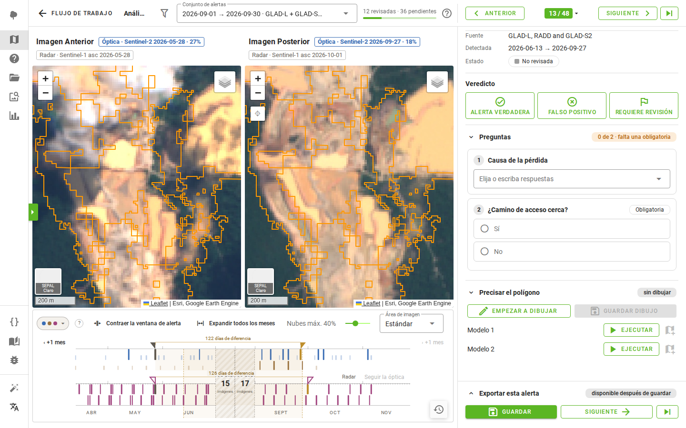

.. list-table::
    :header-rows: 1
    :widths: 20 80

    *   -   Parte
        -   Contenido
    *   -   Barra superior
        -   El filtro, el conjunto de alertas, el progreso de la revisión, la ayuda y la navegación.
    *   -   Los dos mapas
        -   La imagen de *antes* a la izquierda y la imagen de *después* a la derecha. Se mueven juntos: si desplazas o acercas uno, el otro lo sigue.
    *   -   La línea de tiempo
        -   Debajo de los mapas: todas las imágenes del área de la alerta, en un mismo eje de fechas. Sus dos controles eligen la imagen de antes y la de después.
    *   -   El panel de revisión
        -   A la derecha: lo que dice la tabla de alertas sobre la alerta, el veredicto, las preguntas, las herramientas de dibujo, las alertas anteriores cercanas y, después, un pie que queda fijo abajo con la sección de exportación y los botones de guardado. Solo este panel se desplaza.

El icono de ayuda de la barra superior abre **Acerca del análisis**, un breve resumen de esta subsección.

.. _defo-analysis-topbar:

La barra superior
^^^^^^^^^^^^^^^^^

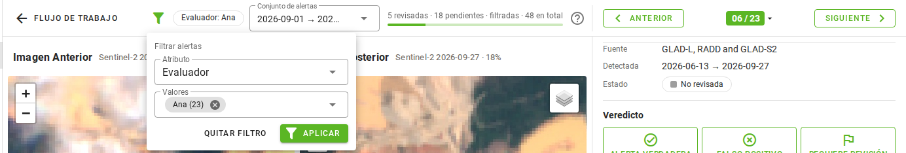

De izquierda a derecha:

.. list-table::
    :header-rows: 1
    :widths: 25 75

    *   -   Control
        -   Descripción
    *   -   Embudo
        -   Abre el filtro (ver más abajo). Mientras hay un filtro activo, el embudo aparece relleno y una etiqueta lo nombra (por ejemplo, "Evaluador: Ana"). La cruz de la etiqueta quita el filtro.
    *   -   **Conjunto de alertas**
        -   El conjunto que se está revisando: "período · fuentes · N alertas · N revisadas", del más reciente al más antiguo. Elegir otro conjunto lo convierte en el conjunto activo del proyecto, también para los demás pasos y el Resumen.
    *   -   Progreso
        -   "12 revisadas · 36 pendientes" sobre una barra.
    *   -   **Anterior** / **Siguiente**
        -   La alerta anterior o siguiente en el orden del conjunto. Se detienen en la primera y la última alerta.
    *   -   Contador
        -   El número de la alerta en el conjunto ("13 / 48"). Selecciónalo para abrir **Ir al número de alerta**: escribe un número y selecciona **Ir**, o pulsa **Intro**.
    *   -   Icono **Siguiente alerta sin revisar**
        -   Va a la siguiente alerta sin veredicto y vuelve a empezar desde arriba después de la última. Desactivado cuando no queda ninguna otra alerta por revisar.

Cuando la alerta en pantalla tiene cambios sin guardar, cualquier forma de pasar a otra alerta pregunta primero (consulta `Guardar la revisión <defo-analysis-save_>`_).

El orden de las alertas es el **Orden** elegido en `Integrar y vectorizar <defo-integrate-options_>`_.

Filtrar las alertas
"""""""""""""""""""

El filtro conserva los valores de un atributo y oculta las demás alertas de la navegación. Para filtrar las alertas:

1.  Selecciona el embudo para abrir **Filtrar alertas**.
2.  En **Atributo**, elige por qué filtrar. La lista ofrece **Evaluador** (cuando el conjunto está `repartido <defo-evaluation-split_>`_), **Estado**, **Tipo** (cuando el conjunto tiene `alertas de crecimiento <defo-integrate-growth_>`_: elige **Crecimiento** para revisarlas juntas), cada pregunta del cuestionario y luego las demás columnas del conjunto que tienen entre 2 y 50 valores distintos, como las columnas de una `capa de atributos <defo-integrate-attributes_>`_. Si el conjunto no tiene ninguna, el menú indica "No hay ningún atributo por el que filtrar".
3.  En **Valores**, selecciona uno o varios valores, cada uno con su número de alertas (por ejemplo, "Ana (24)"). Una alerta coincide cuando tiene cualquiera de ellos. Las celdas vacías aparecen como **Sin asignar** para el evaluador y **(vacío)** para las demás columnas.
4.  Selecciona **Aplicar**.

**Quitar filtro** quita el filtro.

Con un filtro activo:

-   **Anterior**, **Siguiente** y el icono **Siguiente alerta sin revisar** se mueven solo entre las alertas que coinciden;
-   el contador cuenta las coincidencias ("06 / 24"), o indica "– / 24" mientras la alerta en pantalla no es una de ellas, y la línea de progreso termina con "filtradas · 48 en total";
-   el menú de salto sigue aceptando el número de la alerta en todo el conjunto, pero rechaza uno que el filtro oculta ("La alerta 12 no está en el filtro actual"); y
-   cuando nada coincide, el contador indica "Ninguna alerta coincide con este filtro".

Al aplicar un filtro, la pantalla pasa a la alerta en pantalla si coincide; si no, a la primera coincidencia sin revisar, y si no, a la primera coincidencia. Las alertas conservan sus números: un filtro nunca las vuelve a numerar.

El filtro dura hasta que lo quitas o eliges otro conjunto de alertas. No se guarda con el proyecto. Una `copia de revisión <defo-evaluation-return_>`_ se abre ya filtrada a las alertas del evaluador.

Los mapas
^^^^^^^^^

Los dos mapas se centran en la alerta cuando se abre. Un recuadro amarillo discontinuo marca la extensión de la alerta.

.. list-table::
    :header-rows: 1
    :widths: 20 25 55

    *   -   Control
        -   Ubicación
        -   Descripción
    *   -   **Capas**
        -   Esquina superior derecha de cada mapa
        -   Las capas del mapa, en tres secciones. Selecciona una capa para mostrarla solo en ese mapa.
    *   -   **Mapa base**
        -   Esquina inferior izquierda de cada mapa
        -   Pasa el cursor sobre la miniatura para elegir el mapa base: Google, Esri (ambos satelitales), **SEPAL Claro** o **SEPAL Oscuro**. La elección se aplica a los dos mapas. El predeterminado sigue el tema de la aplicación: **SEPAL Claro**, o **SEPAL Oscuro** con el tema oscuro. Al cambiar de tema se intercambian; un mapa base satelital se mantiene.
    *   -   **Acercar a la alerta**
        -   Esquina superior izquierda del mapa de después
        -   Vuelve a acercar los dos mapas a la alerta.
    *   -   Barra de escala
        -   Esquina inferior izquierda de cada mapa, bajo la miniatura del mapa base
        -   La escala del mapa, en metros o kilómetros.

El menú **Capas** contiene:

.. list-table::
    :header-rows: 1
    :widths: 25 75

    *   -   Sección
        -   Capas
    *   -   **Imágenes**
        -   *True Color* (activada) y *False Color* (infrarrojo cercano, rojo y verde; desactivada): la imagen elegida para ese mapa.
    *   -   **Alertas**
        -   *Original alert*: el contorno del polígono de la alerta de `Integrar y vectorizar <defo-integrate_>`_, y de las demás alertas de su grupo (consulta `Alertas cercanas <defo-analysis-nearby_>`_), activada de forma predeterminada y oculta mientras dibujas. *All alerts*: los píxeles de alerta de todo el conjunto, semitransparentes (desactivada). *Alert BB*: el recuadro que delimita la alerta. *Defo Layer*: el polígono guardado para la alerta (consulta `Precisar el polígono <defo-analysis-refine_>`_). *Alertas anteriores* (consulta `Alertas anteriores <defo-analysis-earlier_>`_). *Nearby alerts*, solo cuando las alertas cercanas se revisan juntas.
    *   -   **Capas adicionales**
        -   Las `capas adicionales <defo-layers_>`_ marcadas con **Mostrar en Análisis**, desactivadas.

Un mapa muestra "No se pudieron cargar las imágenes" cuando los mosaicos de su imagen no se cargan.

.. _defo-analysis-timeline:

Elegir las imágenes: la línea de tiempo
^^^^^^^^^^^^^^^^^^^^^^^^^^^^^^^^^^^^^^^

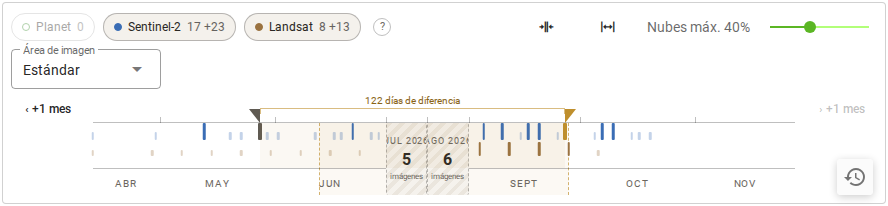

La línea de tiempo muestra todas las imágenes que cubren la alerta, desde unos dos meses antes de la primera detección de la alerta hasta dos meses después de la última. Cada colección tiene su propia banda:

-   las franjas de *Sentinel-2* arriba;
-   *Landsat* en el medio; y
-   *Planet* (el mosaico mensual de NICFI) como una barra a lo largo de su mes, abajo, solo cuando tu cuenta de GEE tiene acceso a NICFI.

Una franja atenuada de media altura es una imagen que supera el límite de nubes. La banda dorada es la *ventana de alerta*: las fechas en las que se detectó la alerta. En una `alerta de crecimiento <defo-integrate-growth_>`_, una banda gris detrás de ella marca las fechas de detección de cada alerta anterior a la que está vinculada: elige una imagen de antes tomada después del desmonte anterior para ver solo la pérdida nueva.

Dos controles sobre la pista eligen las imágenes: el izquierdo, la imagen de antes; el derecho, la imagen de después. El corchete entre ellos indica cuántos días las separan ("49 días de diferencia"), o avisa con "la misma imagen en ambos lados".

Para mover un control, usa uno de estos métodos:

-   Arrastra un control y suéltalo sobre la imagen elegida. El control de antes no puede pasar al de después.
-   Haz clic en una franja: el control adecuado más cercano se mueve a ella. Las imágenes que superan el límite de nubes no se pueden seleccionar.
-   Con el teclado: pulsa **Tab** para llegar a un control, recorre las fechas con las flechas izquierda y derecha, salta a la primera o la última imagen con **Inicio** y **Fin**, y elige con **Intro**.

Cuando se abre una alerta, la aplicación elige la imagen más cercana *antes* de la ventana de alerta y la imagen más cercana *después* de ella, entre las imágenes por debajo del límite de nubes. Nunca elige una imagen dentro de la ventana de alerta (solo mostraría parte del desmonte) ni un mosaico de Planet, pero ambos se pueden elegir a mano. Un lado sin ninguna imagen por debajo del límite de nubes queda "sin definir". Una alerta revisada se abre con las imágenes con las que se guardó. Si una de ellas ya no está disponible, el título de su mapa indica "La imagen guardada no está disponible; se eligió automáticamente".

El título de cada mapa nombra su imagen: "Imagen Anterior · Sentinel-2 2026-07-28 · 3%" (colección, fecha y nubosidad). Cuando la otra colección tiene una imagen del mismo día, un botón en el título ("⇄ Landsat") cambia a ella.

La barra de herramientas sobre la pista:

.. labels-ok: Tab; Inicio; Fin

.. list-table::
    :header-rows: 1
    :widths: 25 55 20

    *   -   Control
        -   Descripción
        -   Valor predeterminado
    *   -   Etiquetas *Planet*, *Sentinel-2* y *Landsat*
        -   Muestran u ocultan una colección. Cada etiqueta cuenta las imágenes de la colección que están a la vista y luego ("+7") las que superan el límite de nubes. La etiqueta de Planet solo aparece cuando tu cuenta de GEE tiene acceso a NICFI.
        -   Todas activadas.
    *   -   Botón **?**
        -   Muestra u oculta una leyenda de la línea de tiempo.
        -   Oculta.
    *   -   **Contraer la ventana de alerta**
        -   Pliega los meses que quedan enteramente dentro de la ventana de alerta en bloques que indican su número de imágenes. Selecciona un bloque para desplegar su mes; selecciona el nombre de un mes en el eje para plegarlo. En una alerta larga, los meses plegados ocupan menos de la mitad de la pista, para que los meses antes y después de la ventana conserven su espacio. Cuando quedan demasiado estrechos para leerse, los meses plegados de cada semestre forman un solo bloque ("ene – jun 2024") con el año en el eje debajo; selecciónalo para dividirlo en un bloque por mes.
        -   Plegada cuando se abre una alerta.
    *   -   **Expandir todos los meses**
        -   Despliega todos los meses.
        -
    *   -   **Nubes máx.**
        -   El límite de nubes, de 0 a 100 % en pasos de 5. Las imágenes que lo superan aparecen atenuadas y nunca se eligen automáticamente. Los mosaicos de Planet no tienen cifra de nubes, así que el límite nunca los oculta.
        -   40 %.
    *   -   **Área de imagen**
        -   Hasta dónde llegan las imágenes alrededor de la alerta: **Estándar**, **Grande** o **Muy grande** (100 m, 1 km o 2,5 km a su alrededor). Las áreas más grandes tardan más en cargarse y exportarse. Guardar la revisión guarda el área: la alerta vuelve a abrirse con ella, y sus archivos y su GIF se hacen con ella. Una alerta nunca guardada se abre en **Estándar**.
        -   **Estándar**.
    *   -   **+1 mes** (a la izquierda y a la derecha de la pista)
        -   Añade un mes antes o después de la vista. El de la derecha se detiene en el mes actual.
        -

Las imágenes provienen de un índice de las imágenes sobre el área del proyecto, guardado en disco y actualizado pasadas 24 horas. Mientras se carga, la barra de herramientas indica "Cargando el índice de imágenes…"; un índice de más de un día indica "Índice del (fecha)". Si una actualización falla, el índice en pantalla sigue funcionando, y **Intentar de nuevo** vuelve a intentarlo.

.. _defo-analysis-panel:

El panel de revisión
^^^^^^^^^^^^^^^^^^^^

La parte superior del panel muestra lo que dice la tabla de alertas:

.. list-table::
    :header-rows: 1
    :widths: 20 80

    *   -   Fila
        -   Descripción
    *   -   **Fuente**
        -   Las fuentes que detectaron la alerta.
    *   -   **Detectada**
        -   Sus fechas de primera y última detección.
    *   -   Fila **Estado**
        -   Su estado de revisión, con su color: **No revisada**, **Revisada: confirmada**, **Revisada: falso positivo** o **Revisada: necesita revisión**.
    *   -   **Grupo**
        -   Para una alerta revisada con alertas cercanas: "grupo de 4". Oculta en los demás casos.
    *   -   **Tipo**
        -   Si la alerta crece de una pérdida anterior (consulta `Crecimiento de una pérdida anterior <defo-integrate-growth_>`_): **Crecimiento** (una etiqueta morada), **Crecimiento · bajo el área mínima** o **Nueva · bajo el área mínima** (una alerta pequeña a la que se le quitaron todos sus vínculos). Oculta para una alerta nueva.
    *   -   **Historial**
        -   Para una alerta vinculada a una pérdida anterior: las alertas de su historial y la superficie que confirman, por ejemplo "3 alertas · 2,1 ha confirmadas desde ago 2026 (+0,3 ha sin revisar)". La superficie se cuenta una sola vez donde las formas se superponen. Oculto cuando la alerta no tiene historial.

Si el conjunto activo está desactualizado o faltan sus archivos, una línea naranja encima lo indica, como en el `Resumen <defo-overview_>`_. La revisión sigue siendo posible.

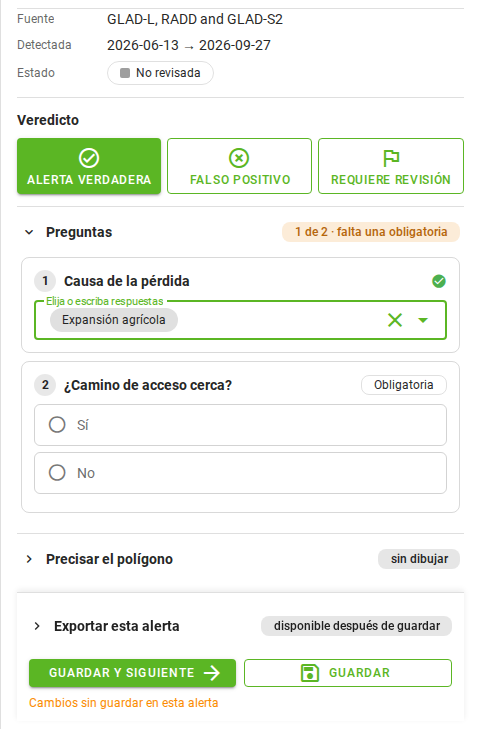

Veredicto
"""""""""

En **Veredicto**, selecciona una de estas opciones:

.. list-table::
    :header-rows: 1
    :widths: 20 30 50

    *   -   Botón
        -   Estado guardado
        -   Úsalo cuando
    *   -   **Alerta verdadera**
        -   **Revisada: confirmada**
        -   Las imágenes muestran pérdida de bosque donde está la alerta.
    *   -   **Falso positivo**
        -   **Revisada: falso positivo**
        -   No muestran pérdida de bosque: nubes, sombras, un cambio estacional…
    *   -   **Requiere revisión**
        -   **Revisada: necesita revisión**
        -   Todavía no es posible decidir, o la alerta necesita una segunda mirada.

Una alerta sin revisar se abre sin veredicto: nada se elige automáticamente. Una alerta revisada se abre con su veredicto y sus respuestas guardados.

Preguntas
"""""""""

La sección **Preguntas** contiene las preguntas del `cuestionario <defo-questionnaire_>`_, en su orden y numeradas. Una vez elegido un veredicto, muestra solo las preguntas que se hacen para ese veredicto. El indicador de la sección cuenta las respuestas ("1 de 2 respondidas") y se vuelve naranja cuando una pregunta obligatoria no tiene respuesta ("1 de 2 · falta una obligatoria").

-   Una pregunta de una sola respuesta muestra sus opciones como mosaicos: selecciona uno.
-   Una pregunta de varias respuestas las muestra como etiquetas: selecciona cada una que corresponda.
-   Una pregunta que admite respuestas escritas es una lista en la que también se puede escribir (**Elija o escriba respuestas**).

Si el proyecto no tiene preguntas, la sección indica "Este proyecto no hace preguntas: añádalas en el paso Cuestionario."; cuando el veredicto elegido no hace ninguna, "No se hacen preguntas para este veredicto."

Una etiqueta **Obligatoria** marca una pregunta que debe responderse antes de guardar. La sección empieza abierta o cerrada según **Mostrar las preguntas desplegadas en Análisis** en el cuestionario. Se abre sola cuando el veredicto elegido hace una pregunta obligatoria que aún no tiene respuesta, y cuando se rechaza un guardado por ese motivo.

.. _defo-analysis-refine:

Precisar el polígono
""""""""""""""""""""

El polígono de la alerta proviene de los píxeles de alerta. En **Precisar el polígono**, dibuja en su lugar el área que realmente se perdió. El polígono guardado se almacena con la revisión, se muestra como *Defo Layer* en los mapas, y su superficie pasa a ser la superficie de la alerta. El indicador de la sección indica "sin dibujar" o, por ejemplo, "2 formas · 1,3 ha".

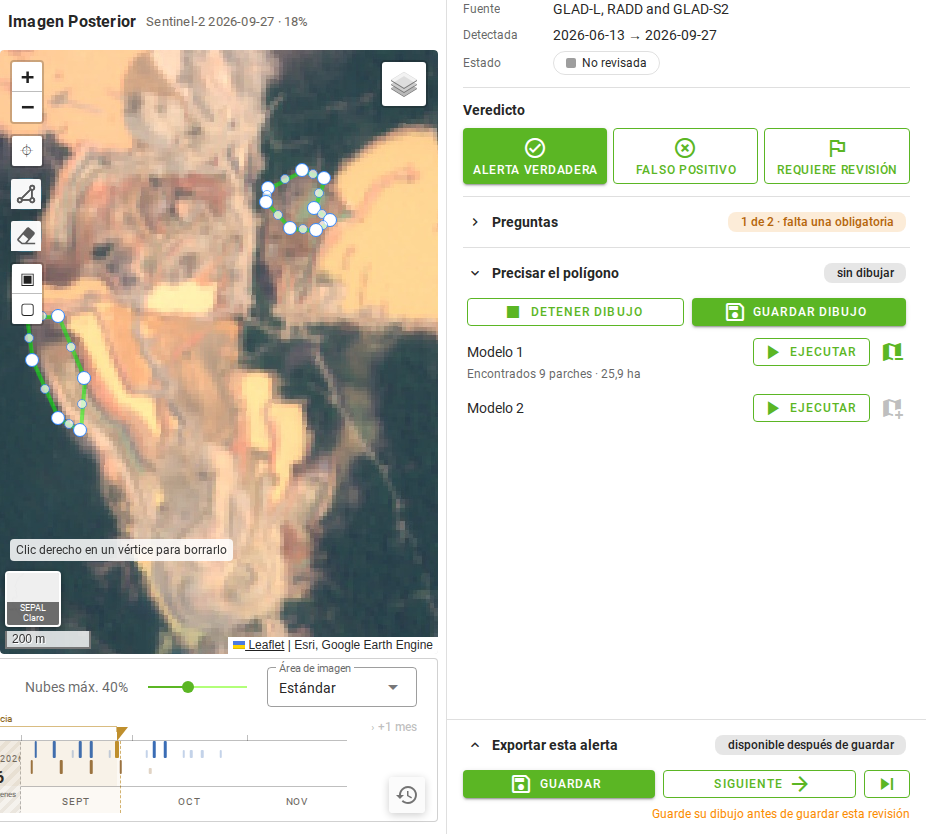

Para precisar el polígono:

1.  Selecciona **Empezar a dibujar**. Los dos mapas pasan al modo de dibujo, el recuadro de la alerta se oculta y el polígono guardado (si existe) se convierte en el dibujo, en azul. **Detener dibujo** ocupa el lugar del botón.
2.  Edita el dibujo en cualquiera de los dos mapas; el otro lo sigue:

    -   El botón de polígono de la esquina superior izquierda dibuja una forma nueva: haz clic en sus esquinas y luego en la primera para cerrarla.
    -   Arrastra una esquina para moverla, haz clic en el pequeño marcador del centro de un lado para añadir una esquina y haz clic derecho en una esquina para borrarla. Una edición que haría que una forma se cruce consigo misma se deshace.
    -   El botón de la papelera borra la siguiente forma en la que hagas clic. Sus acciones **Seleccionar área** (arrastra un recuadro alrededor de las formas que quieres borrar) y **Borrar todo** piden confirmación primero ("¿Borrar 2 formas?", **Cancelar** / **Borrar**), con las formas afectadas en rojo. Pulsa **Esc** para cancelar.
    -   **Rellenar huecos** elimina los huecos de la forma seleccionada, o de todas las formas cuando no hay ninguna seleccionada. **Quitar hueco**: haz clic dentro de un hueco para quitarlo; pulsa **Esc** o vuelve a seleccionar el botón para terminar.

3.  Selecciona **Guardar dibujo**. El dibujo se convierte en el polígono de la alerta. Un dibujo sin ninguna forma elimina el polígono.
4.  Selecciona **Detener dibujo** para salir del modo de dibujo. Si el dibujo tiene cambios no guardados con **Guardar dibujo**, el diálogo **¿Descartar el dibujo sin guardar?** pregunta antes: **Seguir dibujando**, **Guardar y detener** o **Descartar cambios**.

.. important::

    **Guardar dibujo** no guarda la revisión: después, selecciona **Guardar**. Hasta que se guarda el dibujo, el pie indica "Guarde su dibujo antes de guardar esta revisión" y la revisión no se puede guardar.

Los dos modelos
###############

Bajo los botones de dibujo, dos redes neuronales convolucionales (CNN) pueden encontrar la pérdida en las imágenes de antes y después que hay en pantalla: **Modelo 1** ("Modelo pequeño y rápido") y **Modelo 2** ("Modelo grande pero más lento").

Para usar un modelo:

1.  Selecciona **Ejecutar** en la fila de un modelo. La aplicación descarga las dos imágenes (el área fijada en **Área de imagen**) y ejecuta el modelo. Tarda un poco; la ejecución aparece en la lista de tareas.
2.  Lee el resultado en la fila (por ejemplo, "Encontrados 3 parches · 2,1 ha"). Los parches más pequeños que el **Tamaño mínimo de grupo** del conjunto se descartan. Cuando el modelo no encuentra nada, aparece en su lugar un icono rojo de aviso ("El modelo no encontró pérdidas").
3.  Selecciona el icono de mapa con un signo más (**Agregar al mapa**) para añadir los parches al dibujo (activa el modo de dibujo si hace falta): verde lima para **Modelo 1** y morado para **Modelo 2**. El icono pasa entonces a un signo menos (**Quitar del mapa**), que los vuelve a quitar.
4.  Edita el resultado como cualquier dibujo y selecciona **Guardar dibujo**.

Elegir otras imágenes u otra **Área de imagen** descarta los resultados de los modelos: vuelve a ejecutarlos. Si se abre otra alerta mientras un modelo se ejecuta, su resultado no se añade ("El modelo terminó después de pasar a otra alerta: su predicción no se agregó.").

.. _defo-analysis-earlier:

Alertas anteriores
""""""""""""""""""

Esta sección aparece cuando el período del conjunto activo tiene períodos anteriores con conjuntos de alertas. Enumera la pérdida anterior cercana a la alerta: las alertas de períodos anteriores revisadas como **Revisada: confirmada** o **Revisada: necesita revisión**, dentro de la distancia fijada en **Dentro de**, en metros (100 m por defecto, de 10 m a 50 km), más todas las alertas vinculadas a esta, por lejos que estén. Úsala para comprobar si una alerta continúa un desmonte ya reportado, y para vincularla a ese desmonte.

Las alertas se agrupan por período, del más reciente al más antiguo. Cada fila muestra:

-   una barra del color del período;
-   una casilla, marcada cuando la alerta está vinculada a esta;
-   el número y la superficie de la alerta anterior ("#12 · 3,4 ha"), y su estado; y
-   su relación con esta alerta: "toca" (vinculada por `Integrar y vectorizar <defo-integrate-growth_>`_), "toca · no vinculada" (se quitó el vínculo) o su distancia ("40 m").

Selecciona el número de una alerta para acercar los dos mapas a ella.

Para vincular o desvincular una alerta, marca o desmarca su casilla. El cambio forma parte de la revisión: el pie indica "Cambios sin guardar en esta alerta", y **Guardar** lo guarda con el veredicto. Marcar una alerta de un período anterior convierte esta alerta en una alerta de crecimiento, aunque no la toque.

Una alerta de crecimiento más pequeña que el **Tamaño mínimo de grupo** está en el conjunto solo por su vínculo. Desmarcar su último vínculo pregunta primero (**¿Desvincular de la alerta anterior?**): por ejemplo, "La alerta #14 tiene 0,2 ha, por debajo del mínimo de 0,5 ha. Es una alerta solo porque está vinculada a #12." Selecciona **Desvincular** para quitar el vínculo: la alerta sigue en el conjunto como **Nueva · bajo el área mínima**.

Algunas filas no tienen casilla:

-   "vía #12": la alerta pertenece al historial a través de otro vínculo (aquí, la alerta 12). Desmarcar la casilla de la alerta 12 la quita también.
-   "el conjunto anterior se volvió a ejecutar": el conjunto de la alerta anterior se volvió a generar en `Integrar y vectorizar <defo-integrate-replace_>`_, así que el vínculo ya no apunta a la misma alerta. La fila aparece en gris, no cuenta en el historial, y el vínculo se elimina la próxima vez que se guarde esta alerta.

Una alerta vinculada que después se revisó como falso positivo sigue marcada, con "ahora falso positivo". Aparece en gris y queda fuera del historial; desmarca su casilla para quitar el vínculo.

Activa **Mostrar en los mapas** para contornear las alertas de la lista en los dos mapas. El color es el del período, y una pequeña leyenda enumera los períodos mostrados, con "continua: confirmada · discontinua: requiere revisión · gruesa: vinculada". El interruptor empieza activado en una alerta de crecimiento; en las demás alertas conserva tu última elección. Cuando la lista abarca varios períodos, el menú **Períodos** oculta algunos de ellos. El indicador muestra "desactivado", "ninguna a menos de 100 m" o, por ejemplo, "4 a menos de 100 m · vínculos: 1".

En una `copia de revisión <defo-evaluation-return_>`_, la lista proviene de una instantánea de las alertas anteriores tomada al generar los paquetes: la sección indica "Alertas anteriores al (fecha)", o "No hay alertas anteriores en esta copia" en un paquete creado con una versión anterior de la aplicación.

.. _defo-analysis-nearby:

Alertas cercanas
""""""""""""""""

Esta sección solo aparece cuando **Revisar juntas las alertas cercanas** está marcada en `Evaluación <defo-evaluation-group_>`_. Un mismo desmonte suele generar varias alertas pequeñas una al lado de otra. Revísalas juntas: un solo veredicto, un solo conjunto de respuestas, un solo par de imágenes y un solo polígono para todas ellas.

La sección enumera las alertas que están dentro de la distancia fijada en **Evaluación**, medida de borde a borde desde la alerta en pantalla: primero las marcadas, luego las demás más cercanas, como máximo 50 ("12 más en el radio, no listadas"). Cada fila muestra:

-   una casilla, marcada cuando la alerta forma parte del próximo guardado;
-   el número de la alerta (selecciónalo para acercar los dos mapas a ella), su primera fecha de detección y su superficie;
-   su distancia ("40 m"), o "en este grupo";
-   "grupo n.º 12" cuando pertenece a otro grupo;
-   su estado; y
-   en un conjunto repartido, "asignada a Ana", en gris y sin casilla, para una alerta de otro evaluador.

La lista ofrece las alertas sin revisar y las alertas revisadas en un grupo. Las alertas revisadas antes de activar la agrupación solo se ofrecen con **Incluir las alertas ya revisadas**.

Las alertas de la lista se contornean en los dos mapas (capa *Nearby alerts*). Haz clic en un mapa cerca de un contorno para marcar o desmarcar esa alerta. **Seleccionar todas** marca todas las alertas de la lista y **Borrar** las desmarca. El indicador muestra "3 seleccionadas", "5 a menos de 300 m" o "ninguna a menos de 300 m". Cuando una alerta marcada queda fuera de las imágenes, una línea indica "Algunas alertas seleccionadas quedan fuera del área de la imagen: elija un área mayor en la línea de tiempo."

Para revisar un grupo:

1.  Marca las alertas que muestran el mismo desmonte.
2.  Da el veredicto, responde a las preguntas, elige las imágenes y dibuja el polígono como para una sola alerta.
3.  Selecciona **Guardar**, que entonces indica "Guardar para 4 alertas".

Cuando el guardado cambia otras revisiones, el diálogo **¿Guardar este grupo?** las enumera primero, por ejemplo:

-   "#15 (Revisada: confirmada): se reemplaza su revisión";
-   "#16 (Revisada: confirmada): pasa desde el grupo n.º 9" o "se une con el grupo n.º 9" (un grupo entero se une cuando se marca su alerta principal); y
-   "#17 (No revisada): sale del grupo y vuelve a sin revisar" (una alerta de este grupo que se dejó sin marcar).

Selecciona **Guardar** o **Cancelar**.

Todas las alertas del grupo reciben el mismo veredicto, las mismas respuestas, las mismas imágenes y los mismos vínculos a alertas anteriores. La alerta en pantalla cuando el grupo se guarda por primera vez es su alerta *principal*: conserva el polígono dibujado. Cuando el grupo tiene un dibujo, las demás alertas reciben una superficie de 0, para que la pérdida cuente una sola vez.

Una alerta de un grupo guardado se abre con el aviso "Revisada en un grupo de 4 (alerta principal #12)", y la fila **Grupo** del panel indica "grupo de 4". La capa *Original alert* contornea todo el grupo. En una alerta que no es la principal, **Quitar del grupo** la saca del grupo: confirma con **Quitar**. La alerta vuelve a estar sin revisar.

Un grupo necesita un solo evaluador: "Estas alertas están asignadas a evaluadores distintos: un grupo necesita uno solo." En una copia de revisión, solo pueden unirse tus propias alertas: "Algunas de estas alertas no te están asignadas."

.. _defo-analysis-save:

Guardar la revisión
^^^^^^^^^^^^^^^^^^^

La *barra de acciones* queda fija en la parte inferior del panel: la sección **Exportar esta alerta**, luego los botones y luego una línea de estado.

.. list-table::
    :header-rows: 1
    :widths: 25 75

    *   -   Botón
        -   Descripción
    *   -   **Guardar**
        -   Guarda la revisión y se queda en la alerta. Con alertas cercanas marcadas, indica "Guardar para 4 alertas".
    *   -   **Siguiente**
        -   Abre la siguiente alerta (la siguiente coincidencia si hay un filtro).
    *   -   Icono **Siguiente alerta sin revisar**
        -   Abre la siguiente alerta sin veredicto, como en la barra superior.

El botón relleno muestra el paso siguiente: **Guardar** mientras la alerta tiene cambios sin guardar o ninguna revisión guardada, **Siguiente** una vez guardada la revisión.

Con cambios sin guardar, **Siguiente**, el icono y los botones **Anterior**, **Siguiente**, **Ir** e icono de la barra superior preguntan primero. Los botones dejan paso a "Esta alerta tiene cambios sin guardar": **Descartar** desecha los cambios y avanza, **Quedarse** te mantiene en la alerta.

La línea de estado indica "Cambios sin guardar en esta alerta", "Guarde su dibujo antes de guardar esta revisión" o "Guardada a las 14:32".

Un guardado escribe en el conjunto de alertas:

-   el veredicto, como estado de la alerta;
-   las respuestas a las preguntas que se hacen para ese veredicto (las demás quedan vacías);
-   las imágenes de antes y de después elegidas, para que la alerta se vuelva a abrir con ellas;
-   el polígono guardado en **Precisar el polígono**, con su superficie como superficie de la alerta;
-   las alertas anteriores marcadas en `Alertas anteriores <defo-analysis-earlier_>`_, como vínculos de la alerta;
-   con alertas cercanas marcadas, el grupo (consulta `Alertas cercanas <defo-analysis-nearby_>`_); y
-   los nombres de las áreas administrativas bajo la alerta, a partir de los límites FAO GAUL 2015 de GEE (esto tarda unos segundos).

Las revisiones aparecen de inmediato en la barra de progreso, en el selector de conjuntos y en el `Resumen <defo-overview_>`_. Una revisión puede cambiar en cualquier momento: abre la alerta, cámbiala y vuelve a guardar.

Exportar la alerta
^^^^^^^^^^^^^^^^^^

**Exportar esta alerta**, en la parte superior de la barra de acciones, genera los archivos de la alerta una vez guardada: un archivo .zip con su GeoPackage y sus imágenes, un informe de Word y, para una alerta verdadera, un GIF animado. Consulta `Una alerta, desde Análisis <defo-export-alert_>`_.

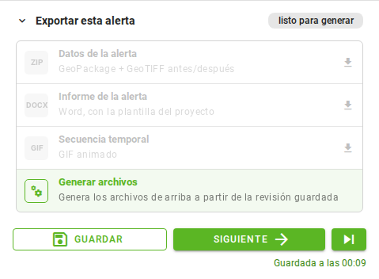

Teclado
^^^^^^^

La pantalla no tiene atajos de teclado globales. Las teclas que funcionan son:

.. labels-ok: Esc; ←; →; ?

.. list-table::
    :header-rows: 1
    :widths: 30 20 50

    *   -   Tecla
        -   Ubicación
        -   Acción
    *   -   **Tab**, **←** **→**, **Inicio**, **Fin**, **Intro**
        -   Controles de la línea de tiempo
        -   Llegar a un control, moverlo por las fechas, saltar a la primera o la última imagen, elegir la imagen.
    *   -   **Intro**
        -   Menú de salto
        -   Igual que **Ir**.
    *   -   **Esc**
        -   Mapas
        -   Cancela **Seleccionar área** o una confirmación de borrado; termina **Quitar hueco**.

Mensajes frecuentes
^^^^^^^^^^^^^^^^^^^

"Responde en «Veredicto» antes de guardar."
    Elige primero un veredicto.

"Responda «(pregunta)» antes de guardar."
    Una pregunta obligatoria no tiene respuesta; la sección **Preguntas** se abre en ella.

"Un falso positivo no puede tener un polígono de deforestación dibujado: elimina el polígono o cambia la respuesta."
    Quita el polígono en **Precisar el polígono** (un dibujo vacío y luego **Guardar dibujo**), o elige otro veredicto.

"Guarde su dibujo antes de guardar esta revisión."
    Selecciona **Guardar dibujo**, o deja de dibujar y descarta los cambios.

"Este conjunto de alertas se reconstruyó mientras lo revisabas, así que las alertas en pantalla están desactualizadas y esta revisión no se ha guardado."
    El conjunto se volvió a ejecutar en `Integrar y vectorizar <defo-integrate_>`_. Revisa las alertas reconstruidas.

"El conjunto de alertas activo cambió durante el guardado, así que esta revisión no se ha guardado." o "Estas alertas pertenecen a otro conjunto de alertas distinto del activo, así que no se han guardado en él."
    Otro conjunto pasó a ser el activo entretanto. Vuelve a abrir la alerta y guarda.

"Se guardó, pero cambiaste esta alerta mientras se guardaba: guarda de nuevo para almacenar esos cambios."
    Vuelve a guardar.

"Las imágenes anterior y posterior de esta alerta no están listas, así que el modelo no tiene sobre qué ejecutarse."
    Elige las dos imágenes y espera a que los dos mapas terminen de dibujarlas.

"Ninguna imagen cubre esta alerta en esta ventana."
    Añade meses con **+1 mes**, o sube **Nubes máx.**.

"Todas las imágenes de esta ventana están en colecciones que has desactivado."
    Vuelve a activar la etiqueta de una colección.

"No se pudo mostrar la imagen de antes: …" o "No se pudo mostrar la imagen de después: …"
    Vuelve a elegir la imagen, u otra.

.. _defo-overview:

Resumen
-------

El Resumen sintetiza un conjunto de alertas: cuántas alertas contiene, cuántas están revisadas y cuánta pérdida se confirmó, dónde y cuándo. También escribe las alertas del conjunto en un GeoPackage o una tabla CSV. Sus cifras siguen las revisiones a medida que se guardan.

Abrir el Resumen
^^^^^^^^^^^^^^^^

Selecciona **Resumen** en la barra lateral izquierda. Se abre como un diálogo grande sobre el mapa; ciérralo con su cruz. Muestra el conjunto de alertas activo, o "Todavía no hay ningún conjunto de alertas. Ejecuta Integrar y vectorizar para generar uno." cuando el proyecto no tiene ninguno.

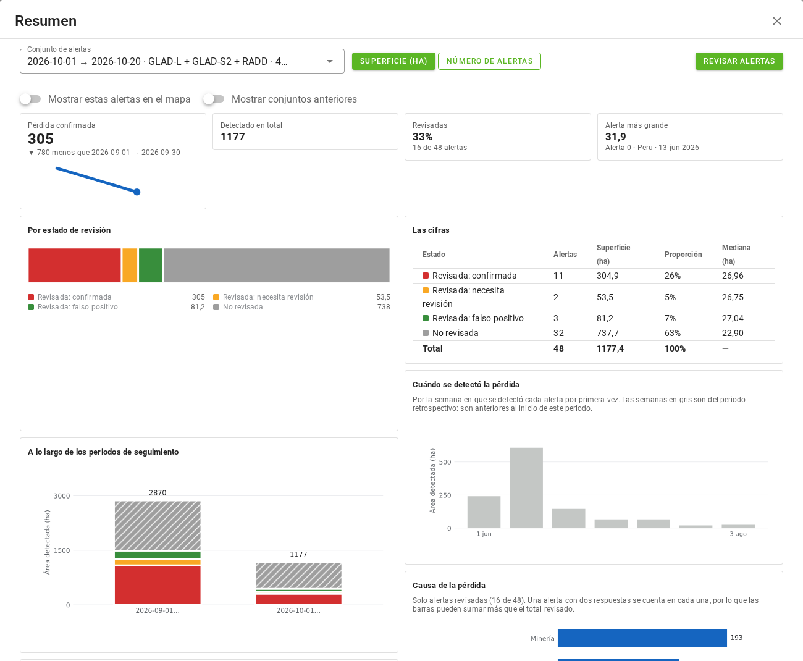

El encabezado
^^^^^^^^^^^^^

.. list-table::
    :header-rows: 1
    :widths: 25 55 20

    *   -   Control
        -   Descripción
        -   Valor predeterminado
    *   -   **Conjunto de alertas**
        -   El conjunto resumido. Elegir otro lo convierte en el conjunto activo del proyecto, como en `Análisis <defo-analysis-topbar_>`_.
        -   El conjunto activo.
    *   -   **Superficie (ha)** / **Número de alertas**
        -   Si todas las cifras de la página cuentan hectáreas o alertas.
        -   **Superficie (ha)**.
    *   -   **Revisar alertas**
        -   Cierra el Resumen y abre `Análisis <defo-analysis_>`_ en este conjunto. Desactivado cuando el conjunto no tiene alertas.
        -
    *   -   **Mostrar estas alertas en el mapa**
        -   Dibuja las alertas del conjunto en el mapa principal, coloreadas según su estado, como en `Integrar y vectorizar <defo-integrate-map_>`_.
        -   Desactivado.
    *   -   **Mostrar conjuntos anteriores**
        -   Dibuja en el mapa principal las alertas de los conjuntos de períodos anteriores. Solo aparece cuando hay conjuntos anteriores.
        -   Desactivado.

Los dos interruptores de mapa solo aparecen cuando el conjunto tiene alertas. Al activar uno, el Resumen se cierra para mostrar el mapa.

Si el conjunto está desactualizado o faltan sus archivos, una línea naranja lo indica ("Este conjunto se generó a partir de entradas que han cambiado desde entonces…" o "Faltan los archivos de este conjunto en la carpeta del proyecto…"). Las cifras siguen mostrando lo que contiene el conjunto. Vuelve a ejecutar `Integrar y vectorizar <defo-integrate-outdated_>`_ para reconstruirlo, lo que descarta sus revisiones.

Las cifras clave
^^^^^^^^^^^^^^^^

.. list-table::
    :header-rows: 1
    :widths: 25 75

    *   -   Mosaico
        -   Contenido
    *   -   **Pérdida confirmada**
        -   La superficie (o el número) de las alertas revisadas como **Revisada: confirmada**. Si hay un período anterior, compara con ese período, en la medida de la página ("▼ 780 menos que 2026-09-01 → 2026-09-30", o "▲ … más que …"), y dibuja una pequeña línea a lo largo de los períodos.
    *   -   **Detectado en total**
        -   La superficie (o el número) de todas las alertas del conjunto, sea cual sea su estado.
    *   -   **Revisadas**
        -   La proporción de alertas que tienen veredicto, y "16 de 48 alertas". Siempre cuenta alertas.
    *   -   **Alerta más grande**
        -   La superficie de la alerta más grande, su número, su país (una vez revisada) y su fecha. Siempre cuenta hectáreas. El número es la fila de la alerta en el conjunto, es decir, el número del contador de Análisis menos uno.

.. _defo-overview-figures:

Las figuras
^^^^^^^^^^^

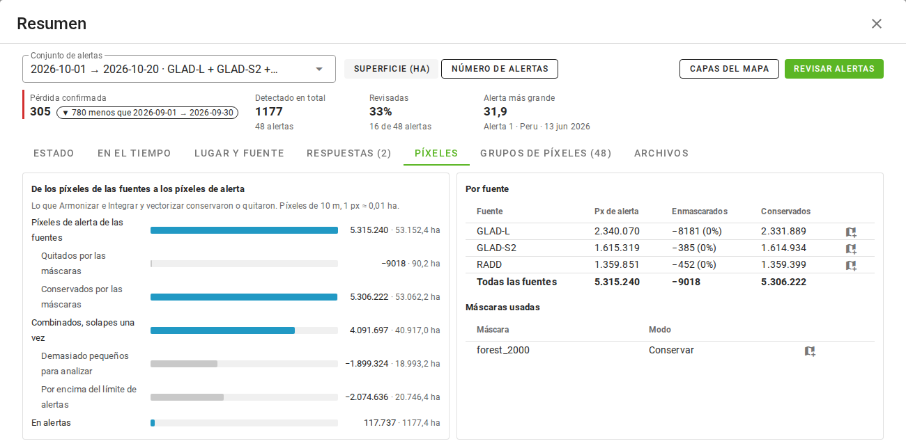

Columna izquierda:

.. list-table::
    :header-rows: 1
    :widths: 25 75

    *   -   Tarjeta
        -   Contenido
    *   -   **Por estado de revisión**
        -   Una barra dividida por estado y el valor de cada estado.
    *   -   **A lo largo de los períodos de seguimiento**
        -   Una columna por período de monitoreo del proyecto, dividida por estado, a partir de su conjunto de alertas más reciente. Un período que aún está en revisión muestra rayada su parte sin revisar. Con un solo período, indica "Este proyecto tiene un solo período de seguimiento. Añade otro y aquí se dibujará su tendencia."
    *   -   **Tamaño de las alertas**
        -   Las alertas por tamaño: menos de 0,5 ha, 0,5–1 ha, 1–2 ha, 2–5 ha, 5–10 ha, 10–25 ha y 25 ha o más.
    *   -   **Por área administrativa**
        -   Las alertas revisadas por área administrativa, hasta ocho áreas, primero la de mayor pérdida confirmada: su **Superficie (ha)**, las hectáreas **Revisada: confirmada** y el número de **Alertas**. Dos botones sobre la tabla fijan el nivel: **País**, o **Provincia / departamento**, el primer nivel por debajo del país, que se muestra con su país ("Peru › Madre de Dios"). Solo alertas revisadas, porque las áreas se registran (a partir de los límites FAO GAUL) cuando se guarda una alerta; una alerta sin ninguna registrada se cuenta como **Sin registrar**. Una alerta que cruza un límite aparece en todas las áreas en las que cae, separadas por comas.

Columna derecha:

.. list-table::
    :header-rows: 1
    :widths: 25 75

    *   -   Tarjeta
        -   Contenido
    *   -   **Las cifras**
        -   Una tabla: por estado, el número de alertas, su superficie, su proporción de la medida y el tamaño mediano de las alertas, con una fila **Total**.
    *   -   **Historial de talas que crecen**
        -   Solo cuando el conjunto tiene `alertas de crecimiento <defo-integrate-growth_>`_ (ver más abajo).
    *   -   **Alertas cercanas**
        -   Cómo se reúnen las alertas del conjunto en grupos de alertas cercanas (ver más abajo).
    *   -   **Cuándo se detectó la pérdida**
        -   Las alertas según la semana en que se detectaron por primera vez. Las semanas en gris son semanas de retrospección: caen antes del inicio del período (consulta `Lo que ya reportaron los períodos anteriores <defo-integrate-earlier_>`_).
    *   -   Una tarjeta por pregunta
        -   Las respuestas dadas a cada `pregunta <defo-questionnaire_>`_, solo para las alertas revisadas: las cinco más frecuentes, luego **Otros** y **Sin respuesta**. Una alerta con dos respuestas cuenta en cada una.
    *   -   **Por fuente de alertas**
        -   Las alertas según la combinación de fuentes que las detectaron.

Cuando una figura no se puede dibujar, su tarjeta indica "No se pudo dibujar esta figura; sus cifras están abajo." y las enumera.

.. _defo-overview-growth:

Desmontes que crecen
""""""""""""""""""""

La tarjeta **Historial de talas que crecen** sigue los desmontes que amplían las alertas de crecimiento de este conjunto. Su titular indica las alertas de crecimiento del conjunto y su superficie ("3 alertas de crecimiento · 4,2 ha", o solo el número con **Número de alertas**). La línea de debajo las desglosa ("Crecimiento: 2 · Bajo el área mínima: 1") e indica cuántas están revisadas.

Su tabla enumera los historiales que incluyen una alerta de este conjunto, primero el de mayor superficie confirmada:

.. list-table::
    :header-rows: 1
    :widths: 25 75

    *   -   Columna
        -   Contenido
    *   -   **Períodos de monitoreo**
        -   El primer y el último período del historial.
    *   -   **Alertas**
        -   El número de alertas del historial, todos los períodos juntos.
    *   -   **Confirmadas (ha)**
        -   La superficie de las alertas del historial revisadas como **Revisada: confirmada** o **Revisada: necesita revisión**, contada una sola vez donde sus formas se superponen.
    *   -   **Aporta este conjunto (ha)**
        -   La superficie de las alertas de este conjunto en el historial, sin los falsos positivos.
    *   -   **Revisar**
        -   Cierra el Resumen y abre la alerta de este conjunto del historial en `Análisis <defo-analysis_>`_.

Alertas cercanas
""""""""""""""""

La tarjeta **Alertas cercanas** muestra cómo se encadenan en grupos las alertas del conjunto: las alertas que están a la distancia de **Revisar juntas las alertas cercanas** (consulta `Evaluación <defo-evaluation-group_>`_), de borde a borde, forman un grupo. Al repartir, cada grupo va a un solo evaluador.

-   El titular cuenta los grupos ("6 grupos de alertas cercanas"), o indica "Ninguna alerta a menos de 300 m de otra".
-   La línea de debajo indica, por ejemplo, "En un grupo: 20 de 48 alertas · Solas: 28 · El mayor: 5 alertas".
-   La última línea cuenta los grupos guardados en Análisis ("2 grupos guardados en Análisis (7 alertas)"), o indica "Aún no hay ningún grupo guardado en Análisis".

Cuando la agrupación está desactivada, la tarjeta usa la distancia del proyecto y añade "Revisar juntas las alertas cercanas está desactivado: actívalo en el paso Evaluación."

Exportar el conjunto
^^^^^^^^^^^^^^^^^^^^

La tarjeta **Exportar alertas**, en la parte inferior, escribe las alertas del conjunto en un archivo para un sistema de información geográfica (SIG) o una hoja de cálculo. Consulta `Todo el conjunto, desde el Resumen <defo-export-set_>`_.

Mensajes frecuentes
^^^^^^^^^^^^^^^^^^^

"Todavía no hay ningún conjunto de alertas. Ejecuta Integrar y vectorizar para generar uno."
    El proyecto no tiene ningún conjunto: ejecuta `Integrar y vectorizar <defo-integrate_>`_.

"Este conjunto no tiene alertas."
    El conjunto se generó pero no encontró ninguna alerta; no se grafica nada.

"No se pudieron leer las alertas de este conjunto: …"
    Los archivos del conjunto están dañados o faltan. Vuelve a ejecutar `Integrar y vectorizar <defo-integrate_>`_.

"Ninguna alerta revisada respondió esto todavía." o "Todavía no se ha revisado ninguna alerta, así que no hay áreas administrativas registradas."
    Revisa alertas en `Análisis <defo-analysis_>`_ para completar estas tarjetas.

.. _defo-export:

Exportar
--------

La aplicación exporta las alertas de dos maneras:

-   los archivos de una alerta revisada, desde la pantalla de Análisis; y
-   las alertas de todo un conjunto, desde el Resumen.

Cada archivo se escribe en la carpeta del conjunto de alertas dentro del proyecto (``periods/<start>_<end>/sets/<set>/``, consulta `Proyecto <defo-project_>`_), así que también se puede encontrar allí más tarde, en el explorador de archivos de SEPAL.

.. _defo-export-alert:

Una alerta, desde Análisis
^^^^^^^^^^^^^^^^^^^^^^^^^^

La sección **Exportar esta alerta** está en la parte superior de la barra de acciones del panel de revisión de `Análisis <defo-analysis-save_>`_. Trabaja con la alerta en pantalla, una vez guardada su revisión: su indicador muestra "disponible después de guardar", luego "listo para generar" y luego "3 archivos listos".

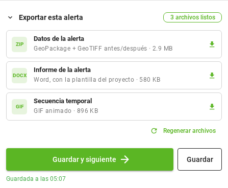

.. list-table::
    :header-rows: 1
    :widths: 25 75

    *   -   Mosaico
        -   Descripción
    *   -   **Generar archivos**
        -   Genera los datos y el informe de la alerta a partir de la revisión guardada ("Genera los archivos de arriba a partir de la revisión guardada"). Está desactivado hasta que se guarda la revisión en pantalla: entonces indica "Guarda primero esta alerta", o "Guarda primero tus cambios" cuando hay cambios sin guardar. Una alerta revisada que se abre con las imágenes con las que se guardó está lista enseguida. Se ejecuta en la lista de tareas ("Generando archivos…") y tarda un poco: descarga las imágenes de antes y de después.
    *   -   **Datos de la alerta**
        -   Descarga un archivo .zip: el GeoPackage de la alerta, sus imágenes de antes y de después en un solo GeoTIFF y, para una alerta verdadera, su GIF.
    *   -   **Informe de la alerta**
        -   Descarga el informe de Word de la alerta.
    *   -   **Regenerar archivos**
        -   Vuelve a generar los archivos (por ejemplo, después de cambiar la revisión).
    *   -   **Secuencia temporal**
        -   Crea y descarga un GIF animado de la alerta (ver más abajo). Para una alerta no guardada como alerta verdadera, indica "Solo alertas verdaderas".

Los archivos llevan el nombre de la fila de la alerta en el conjunto (el número del contador menos uno):

.. list-table::
    :header-rows: 1
    :widths: 40 60

    *   -   Archivo
        -   Contenido
    *   -   ``alert_<n>.gpkg``
        -   La alerta como una entidad con sus atributos y respuestas (las respuestas en el idioma actual de la aplicación). Su geometría es el polígono dibujado en `Precisar el polígono <defo-analysis-refine_>`_ o, si no lo hay, el recuadro que delimita la alerta.
    *   -   ``alert_<n>_<before>_<after>.tif``
        -   Las imágenes de antes y de después, recortadas al **Área de imagen**. Las dos partes de fecha indican la colección de cada imagen (``s`` Sentinel-2, ``l`` Landsat, ``p`` Planet) y su fecha.
    *   -   ``alert_<n>_<before>_<after>.gif``
        -   La secuencia temporal, si se creó, con un nombre como el del GeoTIFF.
    *   -   ``alert_<n>.zip``
        -   El GeoPackage, el GeoTIFF y, para una alerta verdadera, el GIF.
    *   -   ``alert_<n>.docx``
        -   El informe de Word.

Para una alerta de un grupo (consulta `Alertas cercanas <defo-analysis-nearby_>`_), los archivos describen todo el grupo: el GeoPackage contiene una entidad con la superficie sumada del grupo, sus fechas de primera y última detección, sus fuentes, ``group_size`` (el número de alertas) y ``group_alerts`` (sus números, por ejemplo "12, 15, 16"), y el GIF contornea todas las alertas del grupo.

Los enlaces de los mosaicos corresponden a la revisión en pantalla. Elegir otras imágenes, volver a guardar la alerta o cambiar la plantilla del informe los oculta: vuelve a generar los archivos.

El informe
""""""""""

El informe se genera a partir de la plantilla de Word del proyecto, elegida en el paso `Cuestionario <defo-questionnaire-template_>`_, o a partir de la plantilla predeterminada de la aplicación cuando el proyecto no tiene ninguna. Los marcadores de la plantilla se rellenan con los atributos de la alerta, sus respuestas y sus imágenes. Consulta la lista en `La plantilla del informe <defo-questionnaire-template_>`_.

La secuencia temporal
"""""""""""""""""""""

El mosaico **Secuencia temporal** crea un GIF animado que recorre las imágenes del área de la alerta, de antes a después, con el contorno de la alerta encima. Cada fotograma dura 2 segundos y lleva su colección y su fecha. Los fotogramas de antes y de después también indican su lado ("Antes · Sentinel-2 2026-07-28").

Solo se ofrece para una alerta verdadera: el mosaico se activa cuando la alerta está guardada como **Revisada: confirmada** y las imágenes en pantalla son aquellas con las que se guardó. Si no, indica "Guárdela como alerta verdadera, con las imágenes que se muestran, para crearlo".

Los fotogramas son:

-   las imágenes de antes y de después elegidas en la revisión; y
-   hasta dos imágenes anteriores a la imagen de antes y dos posteriores a la imagen de después, buscadas en un plazo de 12 meses, por debajo del límite **Nubes máx.** de la línea de tiempo y nunca un mosaico de Planet.

El GIF se guarda junto a los demás archivos y, cuando se generan los archivos de la alerta, se añade al archivo .zip.

.. _defo-export-set:

Todo el conjunto, desde el Resumen
^^^^^^^^^^^^^^^^^^^^^^^^^^^^^^^^^^

La tarjeta **Exportar alertas**, en la parte inferior del `Resumen <defo-overview_>`_, escribe las alertas del conjunto mostrado en un único archivo. Su primera línea resume las alertas que escribe la etiqueta **Alertas** elegida, con las fuentes y las fechas del conjunto (por ejemplo, "11 alertas · 304,9 ha · GLAD-L + GLAD-S2 + RADD · 2026-10-01 – 2026-10-20" para **Confirmadas**). La etiqueta de carpeta que hay al lado copia la ruta de la carpeta al seleccionarla.

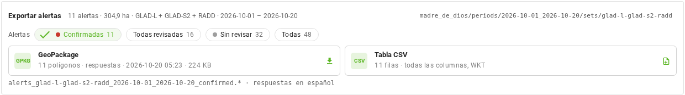

Para exportar el conjunto:

1.  Elige las alertas que se escriben con las etiquetas **Alertas**: **Confirmadas**, **Todas revisadas**, **Sin revisar** o **Todas**. Cada etiqueta muestra su número de alertas; una etiqueta sin ninguna está desactivada. **Confirmadas** se elige primero cuando el conjunto tiene alertas confirmadas, y **Todas** en caso contrario.
2.  Selecciona un mosaico de formato para escribir el archivo. Indica "Escribiendo 11 alertas…" mientras trabaja, y la lista de tareas muestra **Exportando alertas**.
3.  Vuelve a seleccionar el mosaico, ahora un enlace de descarga con la hora en que se escribió, para descargar el archivo.

.. list-table::
    :header-rows: 1
    :widths: 25 75

    *   -   Mosaico
        -   Contenido
    *   -   **GeoPackage**
        -   Un polígono por alerta, con sus atributos y respuestas. La geometría es el polígono de la alerta de `Integrar y vectorizar <defo-integrate_>`_, no el dibujado en Análisis.
    *   -   **Tabla CSV**
        -   Una fila por alerta con todas las columnas y las geometrías escritas como texto conocido (WKT), incluido el polígono dibujado en Análisis.

Los dos archivos añaden tres columnas sobre el `crecimiento <defo-integrate-growth_>`_:

-   ``kind``: ``new``, ``growth``, ``growth_small`` o ``new_small`` (consulta **Tipo** en `El panel de revisión <defo-analysis-panel_>`_);
-   ``grows_from``: los vínculos de la alerta, separados por ";", cada uno escrito como *conjunto*\ ``#``\ *número de alerta*\ ``@``\ *ejecución de ese conjunto*; y
-   ``history_area_ha``: la superficie confirmada del historial de la alerta, 0 para una alerta sin historial.

El archivo lleva el nombre de las fuentes del conjunto, su período y las alertas elegidas (por ejemplo, ``alerts_glad-l-glad-s2-radd_2026-08-01_2026-09-30_confirmed.gpkg``): ``_reviewed`` para **Todas revisadas**, ``_unreviewed`` para **Sin revisar**, y sin sufijo para **Todas**. La última línea de la tarjeta muestra el nombre. Las respuestas se escriben en el idioma actual de la aplicación.

Cuando se guardan revisiones después de escribir un archivo, su mosaico indica **Revisiones cambiadas desde entonces**, con un botón **Actualizar**. Selecciónalo para volver a escribir el archivo.

Mensajes frecuentes
^^^^^^^^^^^^^^^^^^^

"Las imágenes anterior y posterior de esta alerta no están listas, así que no se pueden generar sus archivos."
    Elige las dos imágenes en la línea de tiempo y espera a que los dos mapas terminen de dibujarlas.

"No hay ningún conjunto de alertas activo, así que no hay dónde guardar los archivos de la alerta en el proyecto. Ejecuta primero Integrar y vectorizar."
    Ejecuta `Integrar y vectorizar <defo-integrate_>`_.

"La plantilla del informe … ya no existe. Vuelve a elegirla en el paso Cuestionario o vacía el campo para usar la plantilla por defecto."
    La plantilla del proyecto se movió o se eliminó: consulta `La plantilla del informe <defo-questionnaire-template_>`_.

"Los archivos de la alerta están listos, pero no se pudo crear el GIF, así que el zip no lo incluye."
    Prueba el mosaico **Secuencia temporal** por separado.

"Las imágenes anterior y posterior son la misma imagen, así que el GIF no mostraría ningún cambio."
    Elige dos imágenes distintas en la línea de tiempo.

"Se pudieron generar menos de dos imágenes para esta alerta, así que no se creó el GIF."
    Elige otras imágenes de antes y de después y vuelve a intentarlo.

"Los archivos de la alerta terminaron de generarse después de pasar a otra alerta: no se ofrecieron para descargar aquí."
    Vuelve a la alerta: los archivos están en la carpeta del conjunto.

.. _defo-use-case:

Caso de uso: revisión de alertas en Madre de Dios, Perú
-------------------------------------------------------

.. labels-ok: Nivel administrativo 1; Usar selección; Color verdadero

Este caso de uso sigue a un pequeño equipo de monitoreo forestal durante dos rondas mensuales en el departamento de Madre de Dios, en la Amazonía peruana, en la frontera con Brasil y Bolivia. La minería de oro y la expansión agrícola presionan sus bosques, así que el equipo quiere saber cada mes dónde se perdió bosque y por qué.

El equipo está formado por:

-   una coordinadora, que configura el proyecto y revisa alertas; y
-   dos evaluadores, Ana y Luis, que revisan su parte de las alertas desde sus propias cuentas de SEPAL.

.. note::

    Los valores de este caso de uso provienen del proyecto de demostración del que se tomaron las capturas de este artículo. Los veredictos y las respuestas muestran cómo la aplicación registra una revisión; son ejemplos, no una evaluación verificada del bosque de Madre de Dios.

Configurar el proyecto
^^^^^^^^^^^^^^^^^^^^^^

La coordinadora configura el proyecto así:

1.  **Proyecto**: en la aplicación, selecciona **Nuevo proyecto** y lo llama ``madre_de_dios`` (consulta `Crear un proyecto <defo-project-create_>`_).
2.  **AOI**: en el paso `AOI <defo-aoi_>`_, elige **Nivel administrativo 1**, luego Perú y luego "Madre De Dios" (como lo escribe la lista), y selecciona **Usar selección**. El área se guarda como ``PER_Madre_De_Dios``. Un departamento entero es un área grande: todos los pasos siguientes tardan más que para un distrito.

La ronda de septiembre
^^^^^^^^^^^^^^^^^^^^^^

Período
"""""""

En `Período de monitoreo <defo-period_>`_, la coordinadora:

1.  selecciona **Nuevo período**;
2.  fija las fechas del 2026-09-01 al 2026-09-30;
3.  escribe 90 en **Retrospección (días)** (el primer período de un proyecto nuevo empieza en 0); y
4.  selecciona **Añadir período**.

La ventana de búsqueda va del 2026-06-03 al 2026-09-30, así que también se encuentran los grupos que empezaron entre junio y agosto y las alertas que las fuentes publicaron con retraso. Como es el primer período, no tiene ningún conjunto anterior: se conservan todas las alertas de su ventana de búsqueda.

Alertas
"""""""

En `Fuentes de alertas <defo-alerts_>`_, la coordinadora añade las tres fuentes predefinidas: **GLAD-L (Landsat, 30 m)**, **RADD (Sentinel-1, 10 m)** y **GLAD-S2 (Sentinel-2, 10 m)**, cada una con **Añadir a los nuevos períodos** marcado, para que los períodos siguientes empiecen con ellas. Cada una cubre toda la AOI. Bajo RADD, la aplicación indica que solo detecta en bosque tropical húmedo primario: en el resto del departamento, solo GLAD-L y GLAD-S2 pueden reportar alertas. Después, el botón **Descargar** de cada fila descarga las tres fuentes en la ventana de búsqueda.

Armonizar
"""""""""

En `Armonizar <defo-harmonize_>`_, la coordinadora:

1.  conserva la cuadrícula sugerida, la zona UTM del departamento (``EPSG:32719``) a 10 m, y selecciona **Guardar cuadrícula**. La cuadrícula mide 41425 × 38561 píxeles, unos 12,8 GB por fuente antes de la compresión, así que la aplicación avisa de que las descargas tardarán un rato;
2.  añade una máscara para que solo cuenten las alertas en bosque: **Añadir máscara**, la imagen Hansen Global Forest Change ``UMD/hansen/global_forest_change_2025_v1_13``, banda ``treecover2000``, llamada ``forest_2000``, modo **Conservar**; y
3.  selecciona el **Alinear** de la máscara y, cuando la máscara indica "Lista", **Armonizar** en la fila de cada fuente, que armoniza las tres fuentes.

La descarga y la armonización tardaron unos 15 minutos. Después, la máscara y cada fuente indican "Lista": GLAD-L con 2362718 píxeles de alerta, RADD con 1508527 y GLAD-S2 con 1462458.

Integrar y vectorizar
"""""""""""""""""""""

En `Integrar y vectorizar <defo-integrate_>`_, la coordinadora:

-   mantiene activadas las tres fuentes e **Incluir alertas probables (no confirmadas)**;
-   fija **Tamaño mínimo de grupo** en 1 ha y **Orden** en **Grupos más grandes primero**; y
-   marca **Limitar el número de grupos**, con **Número máximo de grupos** en 48: el equipo puede revisar unas 48 alertas al mes, así que empieza por las más grandes.

La ejecución genera el conjunto de alertas "2026-09-01 → 2026-09-30 · GLAD-L + GLAD-S2 + RADD" con 48 alertas, de 383,18 ha a 27,84 ha: 2870 ha en total.

Los grupos que quedan por encima del tope se conservan como no analizables. El período siguiente solo los reconsidera si su retrospección llega hasta septiembre y usa las mismas fuentes. La retrospección de 90 días de octubre lo hace (consulta `Lo que ya reportaron los períodos anteriores <defo-integrate-earlier_>`_).

Capas adicionales
"""""""""""""""""

Con el conjunto de alertas creado, **Preparar la revisión** se desbloquea. Para evaluar las alertas frente a una imagen reciente, la coordinadora añade una `capa adicional <defo-layers_>`_: una imagen Sentinel-2 de **Earth Engine** del 27 de septiembre de 2026 (tesela 19LDF, al este de Puerto Maldonado), dibujada como **Compuesto RGB** en **Color verdadero** (B4, B3, B2), **Mín** 0 y **Máx** 3000, llamada ``Sentinel-2 2026-09-27``, y con **Mostrar en Análisis** marcado.

.. note::

    Los mosaicos mensuales de Planet NICFI cubrirían todo el departamento, pero la cuenta usada para este artículo no tiene acceso a NICFI. Por eso la línea de tiempo de Análisis de las capturas siguientes no tiene etiqueta *Planet*.

Revisar en solitario y luego en equipo
^^^^^^^^^^^^^^^^^^^^^^^^^^^^^^^^^^^^^^

Primeras revisiones
"""""""""""""""""""

Antes de repartir el trabajo, la coordinadora abre `Análisis <defo-analysis_>`_ y revisa las dos alertas más grandes:

-   la alerta 1 (383,18 ha) como **Alerta verdadera**, con la causa de la pérdida **Minería**; y
-   la alerta 2 (146,97 ha) como **Falso positivo**.

Repartir las alertas
""""""""""""""""""""

En `Evaluación <defo-evaluation_>`_, la coordinadora selecciona **Varios evaluadores** y luego **Repartir alertas…**, elige **Nombres**, escribe Ana y Luis y selecciona **Repartir**. Las alertas se reparten por turnos: Ana y Luis reciben 23 cada uno, y las dos alertas ya revisadas quedan **Sin asignar**.

Antes de los paquetes
"""""""""""""""""""""

La coordinadora sigue revisando en el proyecto original mientras el reparto está definido:

-   la alerta 3 como **Alerta verdadera**, con **Expansión agrícola**;
-   la alerta 4 como **Requiere revisión**, con **Tala**; y
-   la alerta 5 como **Alerta verdadera**, con **Minería**.

Estos veredictos viajan en los paquetes, así que los evaluadores los ven; las alertas 3 y 5 están entre las de Ana. Después, la coordinadora selecciona **Generar paquetes** y envía a cada evaluador su archivo .zip.

La copia de revisión de Ana
"""""""""""""""""""""""""""

Ana copia el paquete en su carpeta de SEPAL y lo importa con **Importar** en el diálogo `Proyecto <defo-project-import_>`_. Se abre como el proyecto ``madre-de-dios__e01-ana``, en la pantalla de Análisis, ya filtrado a sus alertas ("Evaluador: Ana").

Ana las recorre con **Guardar** y **Siguiente**:

-   la barra superior cuenta "5 revisadas · 18 pendientes · filtradas · 48 en total" (las dos revisiones de la coordinadora sobre sus alertas y tres propias);
-   el contador numera sus alertas del 1 al 23; y
-   su tercera alerta, por ejemplo, se guarda como **Alerta verdadera** con **Minería**: la imagen de después muestra suelo desnudo y arenoso con un estanque verde al borde del bosque, que se parece a las pozas que deja la minería aurífera aluvial.

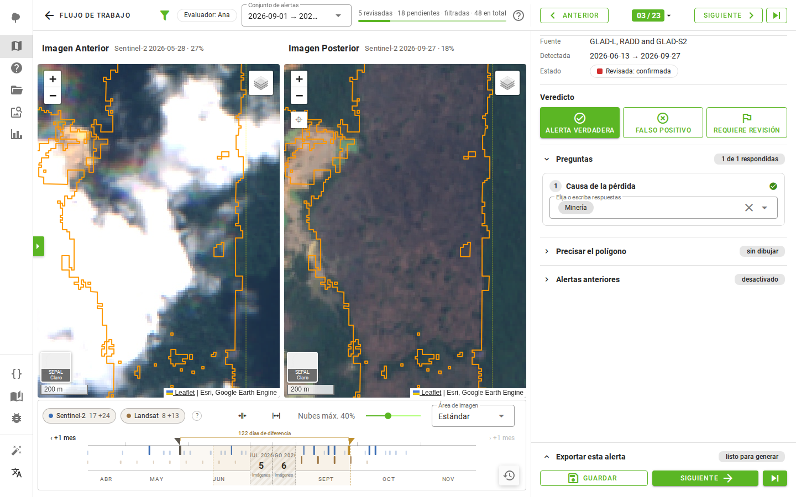

Cuando termina por el momento, Ana selecciona **Generar copia revisada** en el paso `Evaluación <defo-evaluation-return_>`_ ("5 / 23 de tus alertas revisadas") y devuelve el archivo ``__reviewed.zip``.

Integrar las revisiones de Ana
""""""""""""""""""""""""""""""

La coordinadora copia el archivo en su carpeta de SEPAL, selecciona **Integrar copia revisada…** y lo elige. La vista previa indica "Ana: 3 revisiones nuevas, 1 conflictos, 1 sin cambios, 0 ignoradas":

-   la revisión sin cambios es la alerta 3, que Ana dejó tal como la guardó la coordinadora; y
-   el conflicto es la alerta 5: la coordinadora la había confirmado como minería, mientras que Ana la marcó como falso positivo.

La coordinadora conserva el veredicto original con **Conservar las mías** y piensa revisar esa alerta otra vez con Ana. Después de **Integrar**, la tabla de evaluadores muestra a Ana con cinco de sus 23 alertas revisadas y la fecha de la integración (consulta `Integrar una copia revisada <defo-evaluation-merge_>`_).

Añadir una pregunta
^^^^^^^^^^^^^^^^^^^

El equipo también quiere registrar si cada desmonte tiene un camino de acceso cerca. En el paso `Cuestionario <defo-questionnaire_>`_, después de la pregunta predeterminada **Causa de la pérdida**, la coordinadora añade una segunda pregunta:

1.  **Añadir pregunta**;
2.  "¿Camino de acceso cerca?";
3.  **Una respuesta**, con las opciones Sí y No;
4.  **Obligatoria** activado; y
5.  que se haga solo para **Alerta verdadera** y **Requiere revisión**.

Como el cuestionario cambió después de generar los paquetes, sus iconos de nube en `Evaluación <defo-evaluation-packages_>`_ se vuelven ámbar. Los paquetes ya enviados se siguen integrando, por clave de pregunta. Para que la nueva pregunta llegue a los evaluadores, la coordinadora selecciona **Regenerar paquetes** y envía los nuevos.

A partir de entonces, una alerta verdadera o una alerta que requiere revisión recibe las dos respuestas (un falso positivo no recibe ninguna: las dos preguntas solo se hacen para los otros dos veredictos). Por ejemplo, la alerta 10 se guarda como **Alerta verdadera**, con **Expansión agrícola** como causa de la pérdida y "No" para el camino de acceso. Su estado indica **Revisada: confirmada**, y la sección **Preguntas** indica "2 de 2 respondidas".

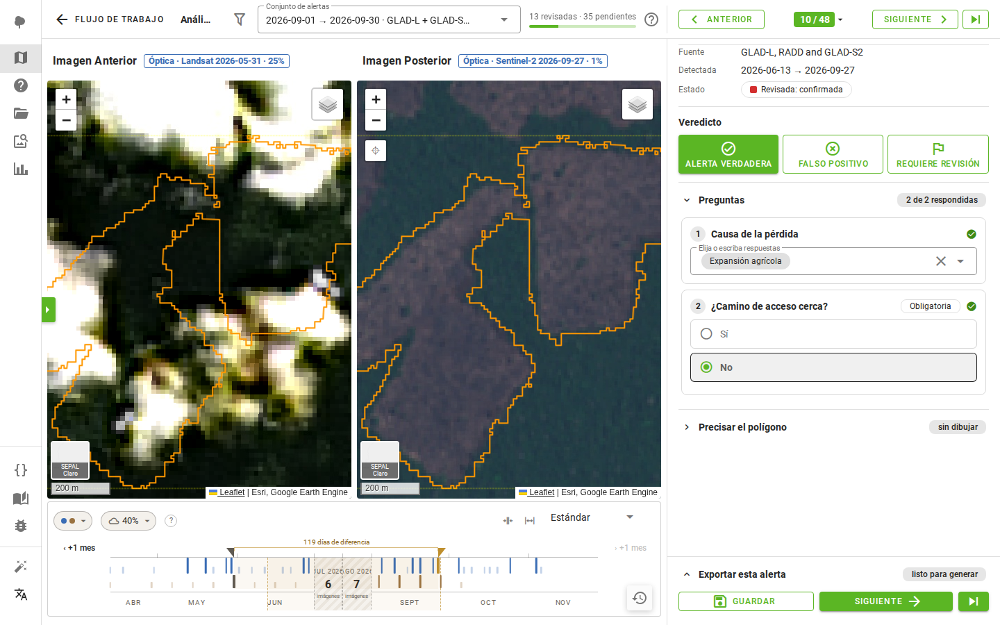

De vuelta en el flujo de trabajo, **Mostrar estas alertas en el mapa** en `Integrar y vectorizar <defo-integrate-map_>`_ dibuja el conjunto sobre el departamento. A este nivel de zoom, cada alerta es un punto coloreado según su estado de revisión:

-   gris para **No revisada**;
-   rojo para **Revisada: confirmada**;
-   verde para **Revisada: falso positivo**; y
-   ámbar para **Revisada: necesita revisión**.

Con 13 de las 48 alertas revisadas, la mayoría de los puntos siguen en gris. La mayoría de las alertas están en el sur del departamento.

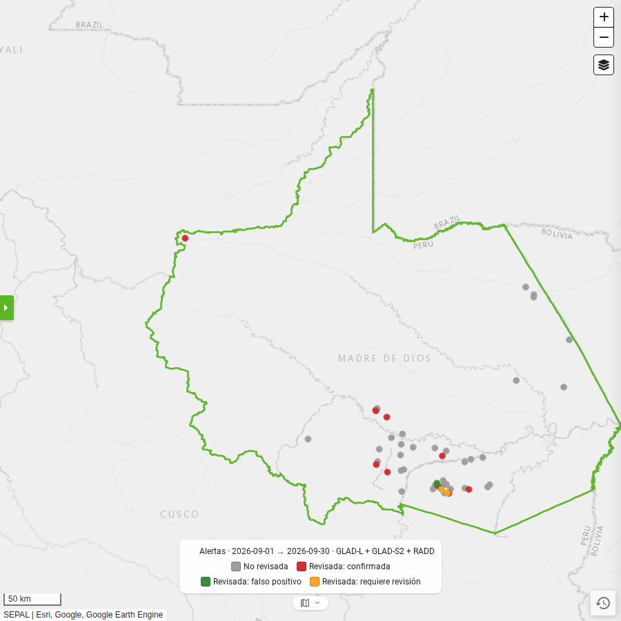

La ronda de octubre
^^^^^^^^^^^^^^^^^^^

Al empezar la ronda siguiente, la coordinadora selecciona **Nuevo período** en `Período de monitoreo <defo-period-add_>`_. El diálogo viene completado: del 2026-10-01 (el día siguiente al fin de septiembre) a hoy, con los 90 días de retrospección usados la vez anterior. La coordinadora fija el final en 2026-10-20, el día de esta ronda. **Añadir período** lo convierte en el período activo, con las opciones de máscara del período de septiembre y las tres fuentes marcadas con **Añadir a los nuevos períodos**.

Después:

-   el **Descargar** de cada fila en `Alertas <defo-alerts_>`_ descarga las tres fuentes para la nueva ventana, y el **Armonizar** de cada fila en `Armonizar <defo-harmonize_>`_ las armoniza; la cuadrícula y la máscara ya están listas.
-   En `Integrar y vectorizar <defo-integrate_>`_, la coordinadora usa los mismos ajustes que en septiembre (1 ha, las 48 alertas más grandes). Antes de agrupar los píxeles en alertas, la ejecución elimina todos los píxeles que caen dentro de las 48 alertas de septiembre, para que nada se reporte dos veces. El nuevo conjunto vuelve a contener 48 alertas, con 1177 ha. Ninguna toca una alerta confirmada en septiembre, así que la ejecución no vincula ninguna a una pérdida anterior (consulta `Crecimiento de una pérdida anterior <defo-integrate-growth_>`_).

El equipo las revisa como en septiembre; por ahora hay 16 revisadas, 11 de ellas como alertas verdaderas. Con **Mostrar estas alertas en el mapa** y **Mostrar conjuntos anteriores** activados, el mapa muestra las alertas de octubre junto a las de septiembre, que se dibujan con colores más tenues. Las alertas de octubre están en las mismas zonas del departamento que las de septiembre.

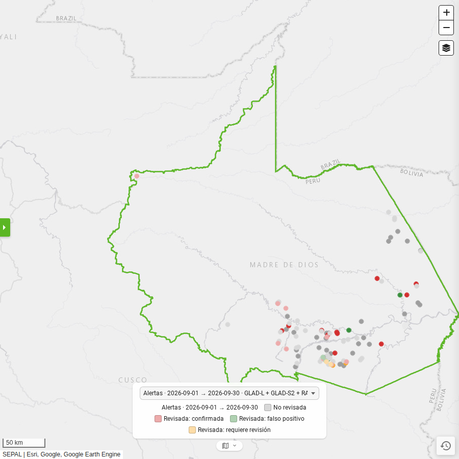

Leer las cifras
^^^^^^^^^^^^^^^

El `Resumen <defo-overview_>`_ sintetiza el conjunto de octubre. En **Superficie (ha)**:

-   **Pérdida confirmada**: 305 ha, con "▼ 780 menos que 2026-09-01 → 2026-09-30";
-   **Detectado en total**: 1177 ha;
-   **Revisadas**: 33 %, "16 de 48 alertas"; y
-   **Alerta más grande**: 31,9 ha, la "Alerta 0" de la tarjeta. El Resumen numera las alertas desde 0, en el orden del conjunto; el contador de Análisis empieza en 1, así que allí es la primera alerta.

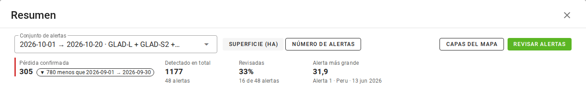

.. important::

    La comparación requiere cuidado. **Pérdida confirmada** solo cuenta las alertas revisadas como alertas verdaderas, y solo un tercio de las alertas de octubre están revisadas; la cifra de septiembre también cubre solo las alertas de septiembre revisadas hasta ahora. La flecha significa que por ahora se ha *confirmado* menos pérdida, no que se haya perdido menos bosque: la cifra crece a medida que el equipo sigue revisando.

**A lo largo de los períodos de seguimiento** muestra los dos períodos uno al lado del otro, con la parte aún en revisión rayada (2870 ha detectadas en septiembre, 1177 ha en octubre).

Más abajo:

-   la tarjeta de la pregunta sobre la causa de la pérdida divide la superficie revisada por respuesta (en octubre: primero Minería, luego Expansión agrícola); y
-   la tarjeta de la nueva pregunta la divide por sus respuestas (en octubre: todo "No", 358 ha, con 81,2 ha en "Sin respuesta").

Consulta `Las figuras <defo-overview-figures_>`_ para ver todas las tarjetas.

Compartir los resultados
^^^^^^^^^^^^^^^^^^^^^^^^

Todo el conjunto
""""""""""""""""

En la parte inferior del Resumen, la tarjeta **Exportar alertas** escribe el conjunto de octubre en un archivo. La coordinadora elige **Confirmadas** (11 alertas, 304,9 ha) y selecciona el mosaico **GeoPackage**. El archivo ``alerts_glad-l-glad-s2-radd_2026-10-01_2026-10-20_confirmed.gpkg`` contiene un polígono por alerta confirmada con sus atributos y las dos respuestas, listo para un SIG. El mosaico **Tabla CSV** escribe las mismas alertas como una tabla para una hoja de cálculo. Consulta `Todo el conjunto, desde el Resumen <defo-export-set_>`_.

Una alerta
""""""""""

Para informar sobre una alerta, la coordinadora la abre en Análisis, la guarda y selecciona **Generar archivos** en **Exportar esta alerta**. El resultado es un archivo .zip con el GeoPackage de la alerta y sus imágenes de antes y de después, y un informe de Word generado a partir de la plantilla del proyecto. Para una alerta verdadera, el mosaico **Secuencia temporal** también crea un GIF animado de las imágenes de antes a después. Consulta `Una alerta, desde Análisis <defo-export-alert_>`_.

Cada archivo también se guarda en la carpeta del conjunto de alertas del proyecto, en ``periods/2026-10-01_2026-10-20/sets/glad-l-glad-s2-radd/``.

El mes siguiente
^^^^^^^^^^^^^^^^

Para la ronda siguiente, el equipo prevé:

-   volver a seleccionar **Nuevo período**: las fechas continúan la serie, y la retrospección recupera los grupos descartados por demasiado pequeños el mes anterior, así que un desmonte que crece despacio se convierte en alerta en cuanto alcanza 1 ha, sin que ningún píxel se reporte dos veces;
-   revisar las alertas de octubre antes de la siguiente ejecución: una alerta confirmada para entonces puede convertirse en la pérdida anterior de la que crecen las alertas de noviembre, y un desmonte que sigue creciendo muestra su historial en Análisis y en el Resumen;
-   revisar el cuestionario antes de repartir: una pregunta añadida después de generar los paquetes requiere **Regenerar paquetes**;
-   revisar también las alertas que siguen como **No revisada** en los conjuntos anteriores, ya que la comparación del Resumen solo es tan completa como las revisiones que la respaldan; y
-   usar **Duplicar** en el diálogo `Proyecto <defo-project-duplicate_>`_ para monitorear un área vecina con las mismas fuentes, máscara y capas.
