Forest Cover Loss Alerts
========================
*Surveiller les alertes de perte de couvert forestier sur une zone d'intérêt, période après période*

.. labels-ok: Apps; Map; Forest Cover Loss Alerts

**Forest Cover Loss Alerts** est une application SEPAL de suivi de la perte de couvert forestier sur une zone d'intérêt (AOI, *area of interest*). L'application :

-   télécharge depuis Google Earth Engine (GEE) les alertes GLAD-L et GLAD-S2 du Global Land Analysis and Discovery (GLAD) et les alertes RADD (Radar for Detecting Deforestation), ainsi que vos propres sources d'alertes si vous en avez ;
-   les aligne sur une même grille ;
-   regroupe les pixels d'alerte qui se touchent en alertes, chacune indiquant toutes les sources qui l'ont signalée ;
-   vous permet d'examiner les alertes une par une sur des images satellite d'*avant* et d'*après*.

Pour chaque alerte, confirmez-la ou rejetez-la, répondez à vos propres questions à son sujet et redessinez son polygone à la main ou à l'aide de deux modèles de réseaux de neurones. L'examen peut être réparti entre plusieurs évaluateurs. Les résultats sont produits sous forme de fichiers GeoPackage, de tableaux CSV (valeurs séparées par des virgules), de rapports Word et d'images GIF animées.

Cet article s'adresse aux analystes du suivi forestier qui utilisent SEPAL. Il décrit chaque étape de l'application, dans l'ordre d'utilisation, et se termine par un exemple complet.

.. _defo-workflow:

Le flux de travail en un coup d'œil
-----------------------------------

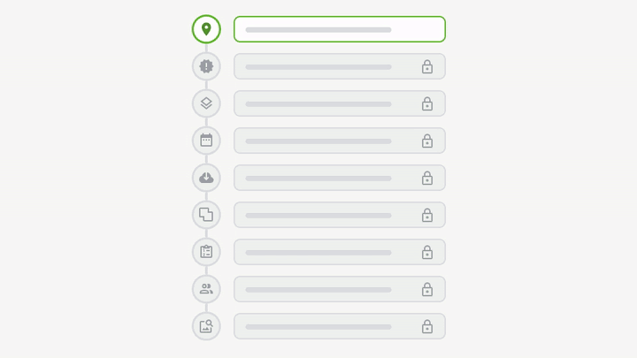

Le panneau **Flux de travail** range les étapes sur deux niveaux : **Préparer les alertes** construit un jeu d'alertes, et **Configurer la revue** prépare son examen. Les autres outils s'ouvrent depuis la barre latérale gauche (voir `La fenêtre de l'application <defo-window_>`_).

.. list-table::
    :header-rows: 1
    :widths: 20 30 50

    *   -   Niveau
        -   Sous-section
        -   À quoi elle sert
    *   -   –
        -   `Projet <defo-project_>`_
        -   Créer, ouvrir, importer ou supprimer un projet, le dossier qui contient tout votre travail.
    *   -   **Préparer les alertes**
        -   `Zone d'intérêt <defo-aoi_>`_
        -   Choisir la zone à surveiller.
    *   -
        -   `Période de suivi <defo-period_>`_
        -   Fixer les dates d'un cycle de suivi.
    *   -
        -   `Sources d'alertes <defo-alerts_>`_
        -   Choisir les jeux de données d'alertes de la période et les télécharger.
    *   -
        -   `Harmoniser <defo-harmonize_>`_
        -   Aligner les téléchargements sur une même grille et appliquer les masques.
    *   -
        -   `Intégrer et vectoriser <defo-integrate_>`_
        -   Combiner les sources en un jeu d'alertes, avec un polygone par alerte.
    *   -   **Configurer la revue**
        -   `Couches supplémentaires <defo-layers_>`_ (facultatif)
        -   Ajouter des couches de référence pour juger les alertes.
    *   -
        -   `Questionnaire <defo-questionnaire_>`_ (facultatif)
        -   Rédiger les questions posées pour chaque alerte et choisir le modèle de rapport.
    *   -
        -   `Évaluation <defo-evaluation_>`_
        -   Examiner seul, ou répartir les alertes entre des évaluateurs.
    *   -   –
        -   `Analyse <defo-analysis_>`_
        -   Examiner chaque alerte sur des images d'avant et d'après.
    *   -   –
        -   `Aperçu <defo-overview_>`_
        -   Consulter les chiffres d'un jeu d'alertes.
    *   -   –
        -   `Export <defo-export_>`_
        -   Exporter les fichiers d'une alerte, ou les alertes de tout un jeu.

**Configurer la revue** reste verrouillé tant que le projet n'a pas de jeu d'alertes : construisez-en d'abord un dans **Préparer les alertes**.

Pour un exemple complet, du début à la fin, consultez `Cas d'usage : examen des alertes à Madre de Dios, au Pérou <defo-use-case_>`_.

.. _defo-setup:

Mise en route
-------------

Prérequis :

-   un compte SEPAL ;
-   un compte GEE connecté à SEPAL ;
-   pour les images *Planet* de la frise chronologique d'Analyse, l'accès aux mosaïques tropicales Planet NICFI (Norway's International Climate and Forest Initiative) dans GEE.

Pour lancer l'application, allez sur le tableau de bord **Apps** de SEPAL et sélectionnez **Forest Cover Loss Alerts**.

L'application s'exécute dans votre session SEPAL et conserve vos projets dans votre dossier personnel SEPAL, sous ``module_results/deforestation_alerts/``.

.. note::

    Le lancement peut prendre plusieurs minutes.

.. _defo-window:

La fenêtre de l'application
^^^^^^^^^^^^^^^^^^^^^^^^^^^

La carte occupe toute la fenêtre. Le panneau **Flux de travail**, à droite, contient les étapes. Une étroite barre d'icônes court le long du côté gauche.

L'en-tête du panneau **Flux de travail** reste visible pendant que l'étape en dessous défile :

-   Une bande montre les deux niveaux côte à côte, **Préparer les alertes** et **Configurer la revue**, chacun avec son nom au-dessus d'une barre par étape. Une barre pleine a des résultats (une AOI, des périodes, des sources…), une barre grise est encore vide et une barre hachurée est verrouillée : survolez-la pour lire pourquoi (p. ex. « Construisez d'abord un jeu d'alertes. »). Les deux étapes facultatives, **Couches supplémentaires** et **Questionnaire**, ont une barre en pointillés. Le nom d'un niveau reçoit une coche dès que sa dernière étape obligatoire a des résultats. Sélectionnez une barre pour ouvrir son étape.
-   Sous la bande, la position de l'étape dans son niveau (p. ex. « 3 / 5 »), son nom et ce qu'elle contient (« 3 sources »). Une étape facultative encore vide n'affiche aucun décompte : sa barre en pointillés la signale déjà comme facultative. Sélectionnez le nom pour passer à une autre étape depuis une liste, ou utilisez les flèches de chaque côté pour aller à l'étape précédente ou suivante.
-   Sous le nom, une ligne dit quoi faire dans l'étape (p. ex. « Définissez la période de surveillance. »). Le bouton d'information à droite de cette ligne ouvre l'aide de l'étape.

Pour utiliser la barre latérale gauche :

-   Survolez une icône pour voir son nom.
-   Sélectionnez la flèche au bord de la barre pour la déployer et afficher les noms. Sélectionnez son épingle pour la garder déployée. Une barre déployée sans épingle se replie quand vous cliquez sur la carte, sur l'écran principal comme sur les cartes d'Analyse.

.. note::

    Tant qu'une boîte de dialogue est ouverte, la barre ne répond pas. Fermez d'abord la boîte de dialogue avec sa croix.

De haut en bas, la barre contient :

-   **Map** : affiche la carte sans boîte de dialogue par-dessus ;
-   **À propos** : une courte description de l'application (les sources qu'elle télécharge, comment les alertes sont examinées et exportées, et où vos projets sont enregistrés) ;
-   **Projet** : ouvre la boîte de dialogue `Projet <defo-project_>`_ ;
-   **Analyse** : ouvre l'écran `Analyse <defo-analysis_>`_ ;
-   **Aperçu** : ouvre la boîte de dialogue `Aperçu <defo-overview_>`_.

En bas de la barre se trouvent trois liens vers le dépôt GitHub de l'application (son code source, sa documentation et un formulaire pour signaler un bogue), puis deux boutons :

-   Le bouton de thème passe, à chaque clic, du thème sombre (icône de lune) au thème clair (icône de soleil) puis à un thème automatique qui suit le réglage de votre système.
-   Le sélecteur de langue affiche le code de la langue actuelle. Sélectionnez-le pour choisir l'anglais, l'espagnol, le français ou le portugais. Les libellés de l'application changent aussitôt. Au départ, l'application suit la langue du navigateur si c'est l'une de ces quatre, et l'anglais sinon.

Le navigateur retient le thème et la langue pour la session suivante.

.. _defo-project:

Projet
------

Tout le travail se fait dans un *projet* : une AOI, ses sources d'alertes, ses périodes de suivi et tous les jeux d'alertes construits à partir d'elles. Un projet est un dossier de votre dossier personnel SEPAL. L'application l'enregistre automatiquement après chaque modification : il n'y a pas de bouton **Enregistrer**.

Utilisez la boîte de dialogue **Projet** pour créer, ouvrir, importer, copier et supprimer des projets. Elle s'ouvre d'elle-même au démarrage de l'application. Par la suite, sélectionnez **Projet** dans la barre latérale gauche.

Quand aucun projet n'est ouvert
^^^^^^^^^^^^^^^^^^^^^^^^^^^^^^^

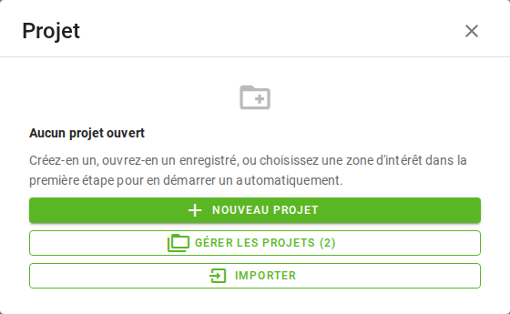

S'il y a des projets enregistrés, la boîte de dialogue propose le dernier modifié sous **Reprendre là où vous vous étiez arrêté**, avec ses nombres, son AOI et la date de sa modification : sélectionnez **Reprendre** pour l'ouvrir. Sans projet enregistré, elle indique **Aucun projet ouvert**. En dessous, trois boutons :

.. list-table::
    :header-rows: 1
    :widths: 25 75

    *   -   Bouton
        -   Description
    *   -   **Nouveau projet**
        -   Demande un nom et crée un projet vide.
    *   -   **Gérer les projets**
        -   Liste les projets enregistrés dans votre dossier SEPAL, pour en ouvrir ou en supprimer un. Le bouton indique combien il y en a et reste désactivé tant qu'il n'y en a aucun.
    *   -   **Importer**
        -   Importe un paquet de révision préparé par un collègue (voir `Importer un paquet de révision <defo-project-import_>`_).

.. tip::

    Il n'est pas nécessaire de créer d'abord un projet. Passez directement à l'étape `AOI <defo-aoi_>`_ et sélectionnez une zone : l'application crée un projet nommé d'après la zone et la date du jour (par exemple ``PER_Madre_De_Dios_20261019``).

Quand un projet est ouvert
^^^^^^^^^^^^^^^^^^^^^^^^^^

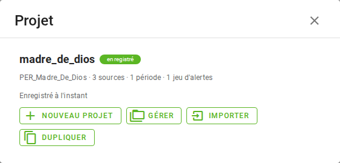

La boîte de dialogue affiche :

-   le nom du projet avec une pastille : **enregistré** une fois le projet écrit sur le disque, ou **échec de l'enregistrement** en rouge lorsque le dernier enregistrement automatique n'a pas abouti (une ligne en dessous en donne la raison ; les modifications sont toujours dans l'application, alors corrigez la cause, le plus souvent un disque plein, avant de fermer l'onglet du navigateur) ;
-   un résumé : l'AOI (ou « pas encore d'AOI ») et le nombre de sources, de périodes et de jeux d'alertes ;
-   le moment du dernier enregistrement du projet (par exemple « Enregistré il y a 3 minutes »).

L'icône crayon à côté du nom renomme le projet et l'icône de copie le duplique. Les boutons en dessous sont les mêmes que sans projet ouvert : **Nouveau projet**, **Gérer les projets** et **Importer**.

.. _defo-project-create:

Créer un projet
^^^^^^^^^^^^^^^

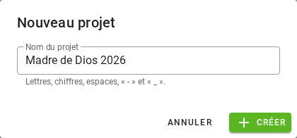

Pour créer un projet :

1.  Sélectionnez **Nouveau projet**.
2.  Saisissez un nom dans le champ **Nom du projet**.
3.  Sélectionnez **Créer** (ou appuyez sur **Entrée**).

.. labels-ok: Entrée

Le **Nom du projet** n'accepte que des lettres, des chiffres, des espaces, des traits d'union (``-``) et des traits de soulignement (``_``). Il ne doit pas être vide et doit être différent de tous les dossiers de projet déjà présents dans votre dossier SEPAL (sans tenir compte des majuscules et des minuscules).

Le nom est vérifié pendant la saisie. S'il correspond à un projet enregistré, le formulaire propose un lien tel que **Ouvrir Madre de Dios 2026 à la place**.

Le nouveau projet s'ouvre sur l'étape `AOI <defo-aoi_>`_, toujours la première étape du flux de travail.

Ouvrir, rechercher et supprimer des projets
^^^^^^^^^^^^^^^^^^^^^^^^^^^^^^^^^^^^^^^^^^^

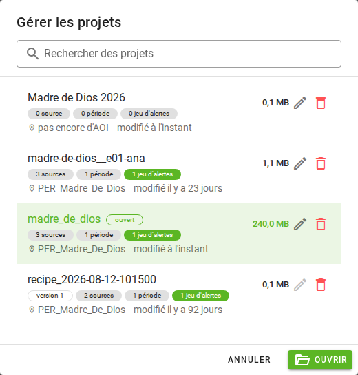

**Gérer les projets** liste chaque projet enregistré avec :

-   de petites pastilles indiquant son nombre de sources, de périodes et de jeux d'alertes (la pastille des jeux d'alertes est colorée quand le projet a des résultats à examiner) ;
-   son AOI (ou « pas encore d'AOI ») et le moment de sa dernière modification (par exemple « modifié il y a 2 jours ») ;
-   sa taille sur le disque, mesurée à l'ouverture de la boîte de dialogue ;
-   une pastille **ouvert** sur le projet ouvert en ce moment.

Pour ouvrir un projet :

1.  Saisissez du texte dans le champ **Rechercher des projets** pour ne garder que les projets dont le nom le contient.
2.  Sélectionnez un projet.
3.  Sélectionnez **Ouvrir**.

Pour renommer un projet :

1.  Sélectionnez l'icône crayon de sa ligne (ou à côté du nom du projet ouvert).
2.  Saisissez le nouveau nom. Il suit les mêmes règles que le nom d'un nouveau projet.
3.  Sélectionnez **Renommer**.

Un projet ne peut pas être renommé tant qu'une tâche écrit encore dedans.

Pour supprimer un projet :

1.  Sélectionnez l'icône de corbeille rouge de sa ligne. La boîte de dialogue de confirmation indique la taille du dossier du projet.
2.  Saisissez exactement le nom du projet dans le champ de confirmation.
3.  Sélectionnez **Supprimer**.

.. attention::

    La suppression efface tout le dossier du projet : téléchargements, jeux d'alertes, révisions et rapports. Elle est irréversible.

    -   Supprimer le projet ouvert le ferme d'abord.
    -   Un projet ne peut pas être supprimé tant qu'une tâche (un téléchargement, une exécution d'**Intégrer et vectoriser** ou l'enregistrement d'une révision) y écrit encore. Attendez la fin de la tâche.

.. _defo-project-duplicate:

Dupliquer un projet
^^^^^^^^^^^^^^^^^^^

**Dupliquer** copie le projet ouvert sous un nouveau nom. La copie conserve l'AOI, les sources, les masques, les couches et la grille, la rétrospection et le modèle de rapport, sans les périodes ni les jeux d'alertes. La copie s'ouvre sur son étape AOI.

Servez-vous-en pour :

-   démarrer un nouveau cycle de suivi avec la même configuration ;
-   surveiller une autre zone une fois l'AOI d'un projet verrouillée (voir `Zone d'intérêt <defo-aoi_>`_).

.. note::

    Les questions du questionnaire ne sont pas copiées : la copie démarre avec les questions par défaut. Ajoutez à nouveau les vôtres dans son étape `Questionnaire <defo-questionnaire_>`_.

**Dupliquer** n'est pas proposé pour une copie de révision.

.. _defo-project-import:

Importer un paquet de révision
^^^^^^^^^^^^^^^^^^^^^^^^^^^^^^

Quand le créateur d'un projet répartit les alertes entre plusieurs évaluateurs (voir `Évaluation <defo-evaluation_>`_), chaque évaluateur reçoit un *paquet de révision* : un fichier .zip.

Pour travailler sur un paquet de révision :

1.  Copiez le fichier .zip dans votre dossier SEPAL.
2.  Dans la boîte de dialogue **Projet**, sélectionnez **Importer**.
3.  Dans la boîte de dialogue **Importer un paquet de révision**, sélectionnez le fichier dans **Paquet de révision (.zip)**. L'import démarre dès que le fichier est sélectionné.

Le paquet devient un nouveau projet, une *copie de révision*, nommée d'après le projet d'origine et l'évaluateur (par exemple ``madre-de-dios__e01-ana``). Elle s'ouvre directement sur l'écran `Analyse <defo-analysis_>`_, filtrée sur les alertes attribuées à cet évaluateur. Dans une copie de révision, les étapes de configuration sont verrouillées, et un bandeau indique : « Copie de revue pour (évaluateur), issue de (projet). La configuration est verrouillée. »

Si le même paquet a déjà été importé, la boîte de dialogue **Déjà importé** propose deux options :

-   **Ouvrir la copie existante** : ouvre la copie existante, avec ses révisions ;
-   **Importer comme nouvelle copie** : importe à nouveau le paquet comme un projet distinct. La copie existante n'est jamais écrasée.

.. important::

    Une *copie révisée* (le fichier qu'un évaluateur renvoie) ne peut pas être importée ici. Le créateur du projet la fusionne dans l'étape `Évaluation <defo-evaluation_>`_ du projet d'origine.

Où se trouvent les fichiers
^^^^^^^^^^^^^^^^^^^^^^^^^^^

Chaque projet est un dossier nommé d'après le projet, sous ``module_results/deforestation_alerts/`` dans votre dossier personnel SEPAL :

.. list-table::
    :header-rows: 1
    :widths: 30 70

    *   -   Dans le dossier du projet
        -   Contenu
    *   -   ``project.json``
        -   Les paramètres et l'historique du projet. L'application l'écrit à chaque enregistrement.
    *   -   ``aoi.geojson``
        -   L'AOI, lorsqu'il s'agit d'une forme dessinée, d'un fichier vectoriel ou d'un fichier de points. Une zone administrative ou un asset GEE est lu directement dans GEE.
    *   -   ``masks/``
        -   Les masques de `Harmoniser <defo-harmonize_>`_, alignés sur la grille du projet.
    *   -   ``imagery/``
        -   L'index des scènes satellite utilisées sur l'écran Analyse.
    *   -   ``periods/<start>_<end>/``
        -   Un dossier par période de suivi : les téléchargements dans ``raw/``, les rasters harmonisés dans ``harmonized/``, et ``sets/`` avec un dossier par jeu d'alertes.

.. note::

    Ne touchez pas à ces fichiers pendant que l'application tourne. Utilisez les outils d'`export <defo-export_>`_ de l'application pour en sortir les résultats.

.. _defo-aoi:

Zone d'intérêt
--------------

.. labels-ok: Methode de selection d'AOI; Pays/Province; Niveau administratif 1; Niveau administratif 2; Fichier de vecteur; Dessiner une forme; Fichier de point; Nom de l'Asset; Selectionner cet AOI; Selectionner un nom d'AOI; Selectionner un Asset; colonne; valeur; Utiliser toutes les features; Fichier de tableau; Id; latitude; longitude; Column; Value

L'AOI est la zone que le projet surveille :

-   chaque téléchargement d'alertes y est découpé ;
-   la couverture de chaque source d'alertes y est mesurée ;
-   la grille du projet est construite autour d'elle.

Ouvrez l'étape **AOI**, la première étape du panneau **Flux de travail**. L'étape est toujours disponible, même sans projet ouvert.

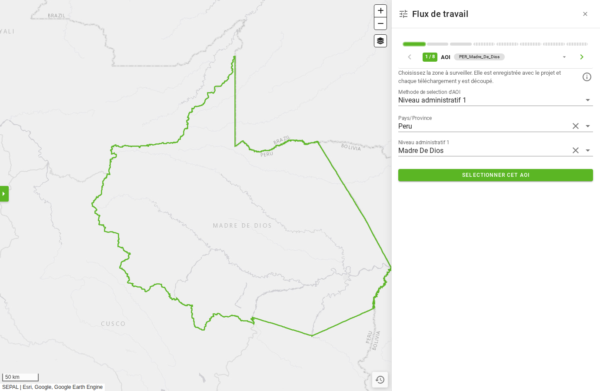

Sélectionner la zone
^^^^^^^^^^^^^^^^^^^^

Pour sélectionner l'AOI :

1.  Choisissez une méthode dans le menu déroulant **Methode de selection d'AOI**.
2.  Remplissez ses champs.
3.  Sélectionnez **Selectionner cet AOI**.

La zone est dessinée sur la carte et enregistrée aussitôt avec le projet.

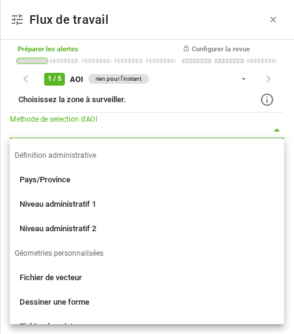

.. list-table::
    :header-rows: 1
    :widths: 20 40 40

    *   -   Méthode
        -   Ce que vous fournissez
        -   Remarques
    *   -   **Pays/Province**
        -   Un pays.
        -   Les limites administratives proviennent du jeu de données GAUL (Global Administrative Unit Layers) de l'Organisation des Nations unies pour l'alimentation et l'agriculture (FAO).
    *   -   **Niveau administratif 1**
        -   Un pays, puis une unité de premier niveau (une région, un État ou un département).
        -   Chaque liste se remplit une fois le niveau supérieur choisi.
    *   -   **Niveau administratif 2**
        -   Un pays, une unité de premier niveau, puis une unité de deuxième niveau (une province ou un district).
        -
    *   -   **Fichier de vecteur**
        -   Un fichier .shp, .geojson, .gpkg ou .kml de votre dossier SEPAL.
        -   Gardez toutes les entités, ou choisissez une **colonne** et une **valeur** pour ne garder que les entités correspondantes.
    *   -   **Dessiner une forme**
        -   Des formes dessinées sur la carte avec les outils de dessin qui apparaissent, et un nom facultatif dans **Selectionner un nom d'AOI**.
        -   Toutes les formes dessinées forment ensemble l'AOI. Sans nom, elle s'appelle ``drawn_`` suivi de la date et de l'heure.
    *   -   **Fichier de point**
        -   Un tableau .csv ou .txt avec une colonne **Id**, une colonne **latitude** et une colonne **longitude**.
        -   Construit l'AOI à partir de points. Les points n'ont pas de surface : pour le suivi, préférez une méthode qui fournit des polygones.
    *   -   **Nom de l'Asset**
        -   Une table GEE (feature collection) ou une image que vous pouvez lire, choisie dans **Selectionner un Asset** ou collée sous forme d'identifiant complet.
        -   Pour une table, ne gardez que les entités dont la **Column** a une **Value** donnée.

Une fois la sélection faite, l'application confirme : « AOI enregistrée : (nom) ». Le panneau **Flux de travail** affiche le nom de l'AOI dans l'en-tête, et l'étape `Période <defo-period_>`_ se déverrouille.

.. tip::

    Une AOI nationale fonctionne, mais tout ce qui suit (téléchargements, grille, vectorisation) croît avec la superficie. Commencez par une province ou un district le temps de prendre en main l'application.

Ce qui se passe quand une zone est sélectionnée
^^^^^^^^^^^^^^^^^^^^^^^^^^^^^^^^^^^^^^^^^^^^^^^

Quand une zone est sélectionnée :

-   Si aucun projet n'est ouvert, un projet est créé et nommé d'après l'AOI et la date du jour (par exemple ``PER_Madre_De_Dios_20261019``). Une zone administrative est nommée d'après le code ISO du pays et le nom de l'unité.
-   La couverture de chaque source d'alertes sur la nouvelle zone est vérifiée une fois et enregistrée dans le projet. L'étape `Alertes <defo-alerts_>`_ l'affiche.
-   Si le projet avait déjà une autre AOI, tous les téléchargements, rasters harmonisés et masques produits pour l'ancienne zone sont supprimés, puisqu'ils y étaient découpés. La grille du projet est réinitialisée, pour être reconstruite autour de la nouvelle zone.

Quand l'AOI est verrouillée
^^^^^^^^^^^^^^^^^^^^^^^^^^^

Dès que le projet a un jeu d'alertes, son AOI ne peut plus changer : une nouvelle zone invaliderait tous les téléchargements et toutes les empreintes d'alertes. L'étape affiche alors « Ce projet a déjà des jeux d'alertes, donc son AOI est verrouillée. Dupliquez le projet (boîte de dialogue Projet) pour surveiller une autre zone. » et le sélecteur est désactivé.

Pour surveiller une autre zone avec les mêmes sources, masques, couches et grille, sélectionnez **Dupliquer** dans la boîte de dialogue `Projet <defo-project-duplicate_>`_, puis sélectionnez la nouvelle zone dans la copie.

Dans une copie de révision (voir `Importer un paquet de révision <defo-project-import_>`_), l'étape n'affiche que le nom de l'AOI : la zone est celle choisie par le créateur du projet.

.. important::

    L'AOI ne peut pas changer tant qu'une tâche écrit dans le projet (un téléchargement ou une exécution d'**Intégrer et vectoriser**). L'application affiche : « Une tâche écrit dans ce projet ; modifiez l'AOI une fois celle-ci terminée. » Attendez la fin de la tâche, puis sélectionnez à nouveau la zone.

.. _defo-period:

Période de suivi
----------------

Une *période* est un cycle de suivi, en général d'un mois. Pour chaque période, l'application télécharge les sources d'alertes de la période sur ses dates plus une *rétrospection* qui les précède, et construit les jeux d'alertes de cette période. Un projet contient généralement une série de périodes consécutives.

Les deux dates d'une période sont incluses : une période du 1er au 31 janvier garde les alertes datées du 1er et du 31. Il en va de même pour sa fenêtre de recherche.

Ouvrez l'étape **Période** du panneau **Flux de travail**. Elle se déverrouille dès que le projet a une `AOI <defo-aoi_>`_.

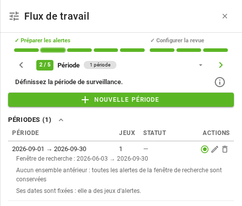

.. _defo-period-tracking:

Une perte sur plusieurs périodes
^^^^^^^^^^^^^^^^^^^^^^^^^^^^^^^^

Chaque période est traitée à part, mais la perte de forêt ne s'en tient pas aux dates de la période. Une partie de la perte pourrait échapper au suivi entre deux périodes :

-   un défrichement qui commence trop petit pour être une alerte ;
-   des alertes que les fournisseurs publient en retard, après le traitement de leur période ; ou
-   un défrichement qui continue de s'étendre au bord d'une alerte signalée dans une période antérieure.

L'application suit cette perte d'une période à l'autre, et ne signale jamais deux fois la même perte :

.. list-table::
    :header-rows: 1
    :widths: 35 65

    *   -   Cas
        -   Ce que fait l'application
    *   -   Une perte déjà signalée par une période antérieure
        -   Ses pixels (l'*empreinte* du jeu d'alertes antérieur) sont retirés de l'exécution de la nouvelle période : elle n'est donc pas signalée de nouveau.
    *   -   Un groupe trop petit pour être une alerte, ou une alerte publiée en retard
        -   La `rétrospection <defo-period-lookback_>`_ remonte dans la période antérieure : les pixels mis de côté reviennent et peuvent rejoindre de nouveaux pixels pour former une alerte.
    *   -   Un défrichement qui s'étend à côté d'une alerte examinée
        -   La nouvelle alerte est `liée à l'alerte antérieure <defo-period-growth_>`_ comme *alerte d'extension*, et conservée même sous la taille minimale.

.. _defo-period-lookback:

La fenêtre de recherche et la rétrospection
"""""""""""""""""""""""""""""""""""""""""""

Un défrichement commence souvent petit et s'étend au fil des semaines suivantes. Dans la période où il commence, son groupe de pixels d'alerte est encore plus petit que la **Taille minimale de groupe** d'`Intégrer et vectoriser <defo-integrate_>`_ : il ne devient donc pas une alerte, et ses pixels sont mis de côté comme *non analysables*.

La rétrospection garde ces pixels en jeu :

-   Chaque période cherche dans une *fenêtre de recherche* plus large : ses propres dates plus les jours de rétrospection qui précèdent son début.
-   Les pixels mis de côté par la période antérieure reviennent dans l'exécution et rejoignent les nouveaux pixels qui les touchent.
-   Si le groupe qu'ils forment ensemble atteint la taille minimale, il devient une alerte. Sa date de première détection est celle de son pixel le plus ancien, dans la période antérieure.

Pour ne pas signaler deux fois la même perte, tout pixel déjà signalé par un jeu d'alertes d'une période *antérieure* est retiré avant la construction des alertes de la nouvelle période : seul ce qui a été mis de côté revient. La rétrospection rattrape aussi les alertes que les fournisseurs ont publiées en retard, après le traitement de la période antérieure.

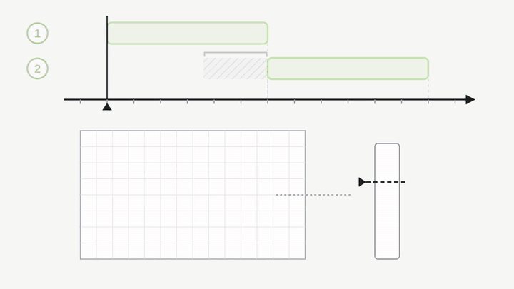

.. note::

    La première période n'a pas de jeu antérieur auquel se comparer : toutes les alertes de sa fenêtre de recherche sont donc conservées. Sa ligne indique **Aucun ensemble antérieur : toutes les alertes de la fenêtre de recherche sont conservées**. Avec une rétrospection, cela inclut des alertes datées d'avant le début de la période.

    La première période d'un nouveau projet démarre sans rétrospection : elle ne cherche donc que dans ses propres dates, sauf si une rétrospection est définie. Un projet créé avec **Dupliquer** conserve la rétrospection du projet dont il est la copie.

.. _defo-period-growth:

Extension à côté d'alertes antérieures
""""""""""""""""""""""""""""""""""""""

Les pixels d'une alerte signalée font partie de l'empreinte : la rétrospection ne les fait donc pas revenir. Mais un défrichement continue souvent de s'étendre au bord d'une alerte signalée dans une période antérieure. Les nouveaux pixels forment alors leur propre groupe, souvent plus petit que la **Taille minimale de groupe**, qui serait mis de côté comme tout petit groupe.

Quand l'alerte antérieure a été enregistrée comme **Alerte réelle** ou **À réexaminer**, `Intégrer et vectoriser <defo-integrate-growth_>`_ garde cette extension en vue :

-   Une nouvelle alerte qui touche l'alerte antérieure, ou se trouve à un pixel de la grille au plus, est une *alerte d'extension*, liée à celle-ci.
-   Un groupe sous la taille minimale est conservé s'il touche l'alerte antérieure : c'est une alerte d'extension *sous la surface minimale* (sauf si **Garder les groupes plus petits qui touchent une perte confirmée antérieure** est décoché). Un petit groupe qui ne touche rien est mis de côté, et la rétrospection peut encore le faire revenir à la période suivante.
-   L'exécution cherche les alertes antérieures dans toutes les périodes antérieures, quelle que soit la rétrospection.

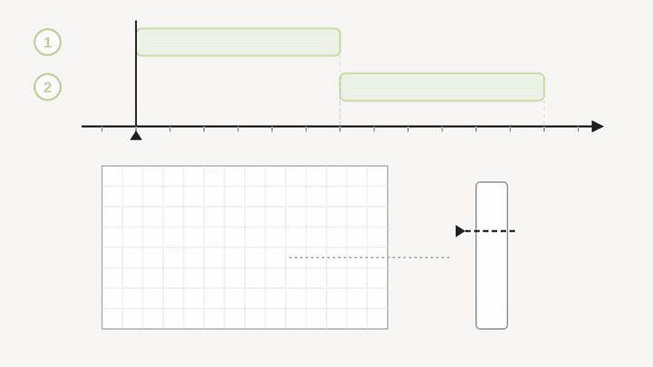

Les alertes liées entre elles, toutes périodes confondues, forment l'*historique* d'un défrichement. Analyse l'affiche sur chaque alerte (voir `Alertes précédentes <defo-analysis-earlier_>`_), et l'`Aperçu <defo-overview-growth_>`_ en fait la synthèse.

.. tip::

    Seules comptent les révisions enregistrées au lancement d'`Intégrer et vectoriser <defo-integrate_>`_. Examinez les alertes d'une période avant de lancer la suivante, pour que leur extension soit liée. Une alerte examinée plus tard peut encore être liée à la main dans `Alertes précédentes <defo-analysis-earlier_>`_.

La liste des périodes
^^^^^^^^^^^^^^^^^^^^^

Chaque ligne de **Périodes** affiche :

.. list-table::
    :header-rows: 1
    :widths: 20 80

    *   -   Colonne
        -   Description
    *   -   **Période**
        -   Les dates de la période (« début → fin »), avec des notes en dessous : sa fenêtre de recherche et les éventuels avertissements.
    *   -   **Jeux**
        -   Le nombre de jeux d'alertes construits pour cette période.
    *   -   Colonne **Statut**
        -   **obsolète** quand un téléchargement de source ou un jeu d'alertes ne correspond plus aux paramètres actuels (relancez-le dans `Alertes <defo-alerts_>`_, `Harmoniser <defo-harmonize_>`_ ou `Intégrer et vectoriser <defo-integrate_>`_) ; **manquante** quand les fichiers d'un jeu d'alertes ont disparu ; un tiret quand tout est à jour.

Les icônes à droite de chaque ligne :

-   le bouton radio rend la période *active* : `Alertes <defo-alerts_>`_, `Harmoniser <defo-harmonize_>`_ et `Intégrer et vectoriser <defo-integrate_>`_ travaillent sur la période active ;
-   l'icône de crayon change ses dates ou sa rétrospection ;
-   l'icône de corbeille supprime la période.

.. _defo-period-add:

Ajouter une période
^^^^^^^^^^^^^^^^^^^

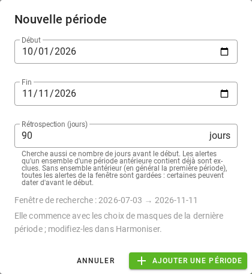

Sélectionnez **Nouvelle période**. La boîte de dialogue est pré-remplie pour que la nouvelle période prolonge la série.

.. list-table::
    :header-rows: 1
    :widths: 20 35 45

    *   -   Champ
        -   Description
        -   Valeur par défaut et limites
    *   -   **Début**
        -   Le premier jour de la période.
        -   Le lendemain de la fin de la dernière période. Pour la première période, le premier jour du mois en cours.
    *   -   **Fin**
        -   Le dernier jour de la période.
        -   Aujourd'hui. Doit être postérieure au **Début**. Deux périodes ne peuvent pas avoir les mêmes dates.
    *   -   **Rétrospection (jours)**
        -   Le nombre de jours avant le **Début** qui sont aussi parcourus.
        -   0 (pas de rétrospection) pour la première période d'un nouveau projet (un projet dupliqué conserve la rétrospection de son original), puis la dernière valeur utilisée. Un nombre entier de 0 à 3650.

Sous les champs, la boîte de dialogue donne un aperçu de la fenêtre de recherche (« Fenêtre de recherche : début → fin »). Sélectionnez **Ajouter une période** : la période est créée et devient la période active.

Une nouvelle période démarre avec les choix de masques de la dernière période. Modifiez-les dans `Harmoniser <defo-harmonize_>`_. Ses sources d'alertes sont celles marquées **Ajouter aux nouvelles périodes** dans `Alertes <defo-alerts-new-periods_>`_ ; ajoutez-y ou retirez-y des sources.

.. tip::

    Pour que les groupes mis de côté reviennent, la rétrospection doit remonter jusque dans la période précédente. Avec une rétrospection de 0, la fenêtre de recherche commence le premier jour de la période elle-même et rien de ce qui a été mis de côté auparavant n'est réexaminé.

    Un groupe qui reste trop petit reste en jeu dans les périodes suivantes tant que leur rétrospection remonte jusqu'à ses pixels. Une rétrospection plus longue laisse plus de temps à un défrichement qui s'étend lentement pour atteindre la taille minimale, mais alourdit chaque téléchargement (voir `Ce que les périodes antérieures ont déjà signalé <defo-integrate-earlier_>`_).

Modifier une période
^^^^^^^^^^^^^^^^^^^^

Pour une période sans jeu d'alertes, l'icône de crayon ouvre une boîte de dialogue pour changer ses dates. De nouvelles dates donnent à la période une nouvelle identité : ses téléchargements et ses fichiers harmonisés sont supprimés, puisqu'ils avaient été produits pour l'ancienne fenêtre.

Une période qui a des jeux d'alertes a des dates fixes (sa note indique **Ses dates sont fixées : elle a des jeux d'alertes.**). L'icône de crayon ouvre alors une boîte de dialogue où seule la rétrospection peut changer. Les téléchargements de la période apparaissent ensuite comme obsolètes.

Supprimer une période
^^^^^^^^^^^^^^^^^^^^^

Sélectionnez l'icône de corbeille. La boîte de dialogue de confirmation liste ce qui est supprimé : les téléchargements et fichiers harmonisés de la période, ainsi que ses jeux d'alertes avec leurs alertes examinées.

.. important::

    Une période qui a des jeux d'alertes ne peut être supprimée que si c'est la dernière période. Les jeux d'une période antérieure forment l'empreinte à partir de laquelle les jeux ultérieurs ont été construits : supprimez donc d'abord les périodes ultérieures. Les périodes ne peuvent être ni modifiées ni supprimées tant qu'une tâche écrit dans le projet.

.. _defo-alerts:

Sources d'alertes
-----------------

Une *source d'alertes* est un jeu de données d'alertes de perte forestière. Chaque pixel d'alerte est *confirmé* (confiance élevée) ou *probable* (confiance faible) et porte le jour de sa première détection.

L'étape **Alertes** liste les sources de la `période <defo-period_>`_ active, montre quelle part de l'AOI et de la période chacune couvre, et les télécharge. Chaque période a ses propres sources : une source ajoutée ici n'est ajoutée qu'à la période active.

Ouvrez l'étape **Alertes** du panneau **Flux de travail**. Elle se déverrouille dès que le projet a une `période <defo-period_>`_. Elle porte sur la période active : pour travailler sur une autre période, rendez-la d'abord active à l'étape `Période <defo-period_>`_. L'encadré en haut de l'étape nomme la période et sa fenêtre de recherche, par exemple « Période 2026-09-01 → 2026-09-30 · fenêtre de recherche depuis le 2026-06-03 (90 jours de rétrospection) ».

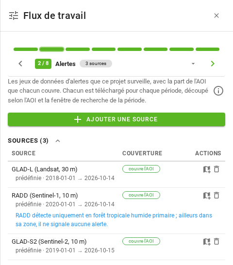

La liste des sources
^^^^^^^^^^^^^^^^^^^^

Chaque ligne de **Sources** affiche :

.. list-table::
    :header-rows: 1
    :widths: 20 80

    *   -   Partie de la ligne
        -   Description
    *   -   **Source**
        -   Le nom de la source, puis une ligne qui dit ce que contient la ligne du tableau (« téléchargée le 2026-10-20 · 4,7 Mo ») ou pourquoi elle doit être téléchargée (par exemple « la fenêtre de recherche a changé (…) : télécharger à nouveau »), et deux pastilles :

            -   **AOI** : la part de l'AOI située dans l'emprise de la source, par exemple « AOI : 100 % ». Une source qui ne couvre qu'une partie de l'AOI ne donne aucune alerte sur le reste.
            -   Les dates : « ✓ données jusqu'au 2026-10-30 » (en vert) quand la source a des données jusqu'à la fin de la fenêtre de recherche, « données jusqu'au … seulement » (en orange) quand ses données s'arrêtent dans la fenêtre, ou « ✗ fin des données le … » (en rouge) quand elle n'en a aucune dans la fenêtre.
    *   -   **État**
        -   L'état de la ligne, ou un bouton pour la télécharger (voir `Télécharger les sources <defo-alerts-download_>`_).
    *   -   Icône de carte
        -   Affiche la source sur la carte : les alertes de la fenêtre de recherche de la période active. Une source GeoTIFF n'est affichée qu'une fois harmonisée.
    *   -   Icône d'information
        -   Ouvre les **Détails** de la source (voir `La boîte de dialogue Détails <defo-harmonize-details_>`_), avec la case **Ajouter aux nouvelles périodes** et, pour une source personnalisée, le bouton **Modifier**.
    *   -   **Télécharger à nouveau**
        -   Télécharge à nouveau la source (voir plus bas).
    *   -   **Retirer de cette période**
        -   Retire la source de la période active (voir `Retirer une source d'une période <defo-alerts-remove_>`_).

La couverture est vérifiée une fois, au choix de l'AOI, et enregistrée dans le projet. Si la vérification a échoué (par exemple parce que GEE était injoignable), un bouton **Vérifier à nouveau** apparaît sous la liste.

Ajouter une source
^^^^^^^^^^^^^^^^^^

Sélectionnez **Ajouter une source** pour ouvrir la boîte de dialogue **Ajouter une source d'alertes**, puis choisissez le **Type de source** :

-   **Prédéfinie ou du projet** : l'une des sources du catalogue, ou une source du projet qui n'est pas dans cette période (par exemple une source utilisée dans une période antérieure) ;
-   **Personnalisée (0 sur 6)** : votre propre image GEE, collection d'images ou GeoTIFF. Le compteur indique combien des six emplacements personnalisés de la période sont occupés.

Une période contient au plus trois sources prédéfinies et six sources personnalisées. Le projet conserve toutes les sources qu'il a utilisées, sans limite.

.. _defo-alerts-new-periods:

Sous la source, la case **Ajouter aux nouvelles périodes** (cochée par défaut) décide si les périodes créées plus tard démarrent avec cette source. Elle ne modifie jamais les périodes existantes. Pour la changer plus tard, ouvrez les **Détails** de la source avec son icône d'information.

Sources prédéfinies
"""""""""""""""""""

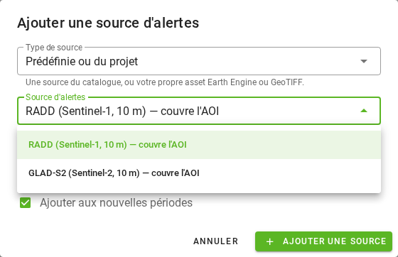

Choisissez une source dans le menu déroulant **Source d'alertes**, puis sélectionnez **Ajouter une source**. La liste contient les sources prédéfinies et les propres sources du projet qui ne sont pas encore dans cette période. Chaque entrée indique sa couverture de l'AOI. Une source qui ne couvre pas du tout l'AOI apparaît désactivée, avec la raison.

.. list-table::
    :header-rows: 1
    :widths: 25 30 45

    *   -   Source
        -   Capteur et taille de pixel
        -   Couverture
    *   -   **GLAD-L (Landsat, 30 m)**
        -   Landsat, environ 30 m.
        -   Les terres de ses quatre tuiles régionales (Asie, Afrique, Amérique centrale et Amérique du Sud), entre environ 35°S et 35°N.
    *   -   **RADD (Sentinel-1, 10 m)**
        -   Radar Sentinel-1, 10 m. Voit à travers les nuages.
        -   Les tropiques humides d'Afrique, d'Asie du Sud-Est et d'Amérique centrale et du Sud. Elle ne détecte que dans la forêt tropicale humide primaire ; ailleurs dans sa zone, elle ne signale aucune alerte.
    *   -   **GLAD-S2 (Sentinel-2, 10 m)**
        -   Sentinel-2, 10 m.
        -   90°O–30°O, 20°S–20°N.

Quand toutes les sources sont dans la période, la boîte de dialogue indique : « Toutes les sources sont déjà dans cette période. »

Sources personnalisées
""""""""""""""""""""""

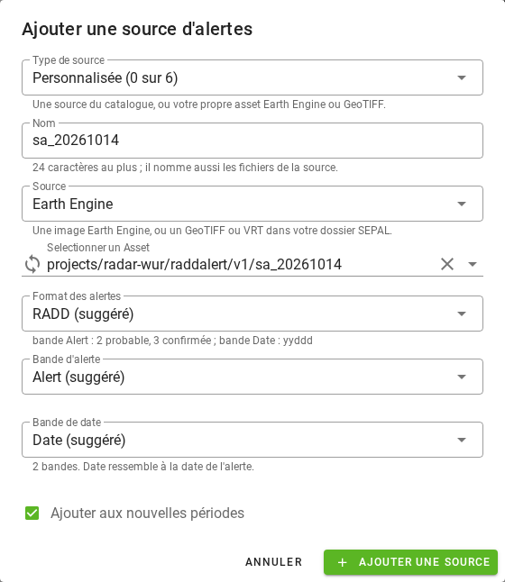

Une source personnalisée lit votre propre raster d'alertes selon l'un des quatre formats prédéfinis. Le formulaire se lit de haut en bas : le nom, la provenance du raster, le raster lui-même, puis ses bandes. Les bandes sont lues dès que le raster est choisi (« Lecture des bandes… »), et les champs qui en dépendent n'apparaissent qu'une fois qu'elles sont lues.

.. list-table::
    :header-rows: 1
    :widths: 20 40 40

    *   -   Champ
        -   Description
        -   Valeur par défaut et limites
    *   -   **Nom**
        -   Le nom de la source dans les listes, les légendes et les noms de fichiers.
        -   Proposé à partir du nom de l'asset ou du fichier. 24 caractères au plus, au moins une lettre ou un chiffre, unique dans le projet. GLAD-L, RADD et GLAD-S2 sont réservés.
    *   -   **Source**
        -   L'endroit d'où le raster est lu : **Earth Engine** (un asset) ou **GeoTIFF / VRT** (un fichier de votre dossier SEPAL : un GeoTIFF, ou un VRT, un raster virtuel GDAL lu comme les GeoTIFF vers lesquels il pointe).
        -   **Earth Engine**.
    *   -   Asset ou **GeoTIFF / VRT**
        -   L'image ou la collection d'images GEE, ou le fichier .tif.
        -   Une collection d'images est utilisée en entier, l'image la plus récente au-dessus. Pour une collection d'instantanés hebdomadaires (comme celle de RADD), indiquez plutôt l'identifiant de la dernière image. Le GeoTIFF doit avoir un système de référence de coordonnées.
    *   -   **Format des alertes**
        -   La façon dont les bandes sont lues (voir plus bas). Affiché quand le raster a deux bandes ou plus. Un raster à une bande n'a pas de format à choisir : le formulaire indique « Une bande (…) : lue comme la date de l'alerte. » et la source est lue en **Date seule**.
        -   Proposé à partir des noms des bandes quand l'application les reconnaît, et marqué « (suggéré) ».
    *   -   **Bande d'alerte**
        -   La bande qui contient la classe d'alerte.
        -   Uniquement pour **RADD**, **Alertes CCDC SEPAL** et **Alertes PyEO SEPAL**. Démarre sur la bande que le format attend ; quand le raster n'a pas cette bande, l'aide indique « Choisissez la bande qui contient le niveau de l'alerte. »
    *   -   **Bande de date**
        -   La bande qui contient la date de détection.
        -   Toujours obligatoire. Démarre sur la bande que le format attend, et son aide la nomme (par exemple « 3 bandes. Date ressemble à la date de l'alerte. »), ou vous demande de la choisir.
    *   -   **Encodage de date**
        -   La façon dont la date est écrite : **yymm (année et mois ; l'alerte est datée au 1er)**, **yyddd (année et jour de l'année)**, **yyyyddd (année et jour de l'année)** ou **année décimale**.
        -   Uniquement pour **Date seule**. Proposé à partir des valeurs de la bande de date (voir plus bas).

Pour une source **Date seule**, l'application lit les valeurs la plus basse et la plus haute de la bande de date sur l'AOI (« Lecture des valeurs de date… ») et propose l'encodage qui leur correspond, par exemple « Valeurs de 24001 à 24366 : elles se lisent comme yyddd. » Vérifiez la proposition : l'application ne lit que les deux bornes de la plage. Quand les valeurs ne ressemblent pas à des dates (« … ne ressemblent pas à des dates. Vérifiez la bande de date. »), ou quand aucun pixel de l'AOI n'a de date (« Aucun pixel daté dans l'AOI : choisissez l'encodage. »), choisissez vous-même l'encodage.

Les quatre formats :

.. list-table::
    :header-rows: 1
    :widths: 25 75

    *   -   Format des alertes
        -   Comment un pixel devient une alerte
    *   -   **RADD**
        -   Bande d'alerte : 2 est probable, 3 est confirmé. Bande de date en ``yyddd``.
    *   -   **Alertes CCDC SEPAL**
        -   Sorties de CCDC (Continuous Change Detection and Classification). ``detection_count`` : une ou deux détections sont probables, trois ou plus sont confirmées. ``first_detection_date`` en années fractionnaires.
    *   -   **Alertes PyEO SEPAL**
        -   Sorties de la détection de changements de PyEO (Python for Earth Observation), lues comme celles de CCDC. ``total_changes`` : un ou deux changements sont probables, trois ou plus sont confirmés. ``first_change_date_above_threshold`` en années fractionnaires.
    *   -   **Date seule**
        -   Une seule bande de date, dans l'encodage choisi. Chaque pixel daté est une alerte confirmée.

Quand **Ajouter une source** est sélectionné, l'application vérifie le raster : les bandes existent et sont numériques, les dates sont lisibles et la source couvre l'AOI. Un problème s'affiche en rouge dans la boîte de dialogue, qui reste ouverte pour les corrections. Pendant la vérification, le bouton indique **Annuler** et permet de l'arrêter.

Modifier une source personnalisée
"""""""""""""""""""""""""""""""""

Ouvrez les **Détails** de la source avec son icône d'information, puis sélectionnez **Modifier** pour rouvrir le formulaire, intitulé avec le nom de la source. Le nom est fixe ; le raster, le format et les bandes peuvent changer. Le formulaire garde le format et les bandes enregistrés jusqu'à ce qu'un autre raster soit choisi.

Dès qu'un jeu d'alertes utilise la source, elle ne peut plus être modifiée : retirez-la et ajoutez-en une nouvelle.

.. _defo-alerts-download:

Télécharger les sources
^^^^^^^^^^^^^^^^^^^^^^^

Chaque source est téléchargée sur la fenêtre de recherche de la période, dans sa propre projection et découpée selon l'AOI. Une source GeoTIFF n'est pas téléchargée : elle est lue depuis son fichier. Le téléchargement n'harmonise pas la source : c'est l'étape suivante, `Harmoniser <defo-harmonize_>`_, qui ne s'exécute que lorsque vous la lancez.

La colonne **État** indique :

.. list-table::
    :header-rows: 1
    :widths: 25 75

    *   -   État
        -   Signification
    *   -   « Téléchargée »
        -   Téléchargée pour la fenêtre de recherche actuelle. La ligne sous le nom donne la date du téléchargement et la taille sur le disque.
    *   -   **Télécharger**
        -   La source n'est pas encore téléchargée pour la fenêtre de recherche de cette période, ou son téléchargement est obsolète. Sélectionnez le bouton pour la télécharger.
    *   -   **Lire fichier**
        -   La même chose pour une source GeoTIFF, qui est lue depuis son fichier.
    *   -   **Réessayer**
        -   Le dernier téléchargement a échoué. Son erreur s'affiche en rouge sous la ligne.
    *   -   « Chargement 42 % », « Lecture », « En attente »
        -   La ligne est en cours, ou attend son tour (« en attente de la ligne du dessus »).
    *   -   « non couverte », « aucune donnée »
        -   La source ne peut pas s'exécuter pour cette période : elle ne couvre pas l'AOI, ou n'a pas de données pour la fenêtre de recherche (sa pastille de dates est rouge).
    *   -   « Sans fichier »
        -   Le fichier d'une source GeoTIFF a disparu (voir `Messages fréquents <defo-harmonize-messages_>`_).

Un bouton bleu exécute une ligne pour la première fois ; un bouton orange refait un fichier obsolète. La ligne sous le nom dit alors pourquoi : par exemple « la fenêtre de recherche a changé (…) : télécharger à nouveau » ou « l'AOI a changé : télécharger à nouveau ». Dans la `copie d'examen <defo-evaluation-return_>`_ d'un évaluateur, rien ne s'exécute : la colonne indique « À charger » au lieu d'un bouton.

.. note::

    Une ligne téléchargée n'a pas de bouton : une source déjà téléchargée pour la fenêtre de recherche de la période n'est pas retéléchargée d'elle-même. Pour récupérer les dernières alertes d'un catalogue qui continue d'ajouter des alertes à des dates passées, utilisez **Télécharger à nouveau**. L'application demande d'abord, avec la fenêtre et la date du fichier qu'elle remplace. Il n'est pas proposé pour une source GeoTIFF (« Rien à télécharger à nouveau : lue depuis un fichier »).

Chaque ligne se télécharge avec son propre bouton. Sélectionnez les boutons de plusieurs lignes pour toutes les télécharger : chacun lance sa propre tâche, et elles se mettent en file, une ligne à la fois. Les lignes qui indiquent « non couverte » ou « aucune donnée » n'ont pas de bouton ; une ligne qui échoue affiche son erreur en rouge en dessous. La ligne en cours affiche sa propre barre de progression ; une ligne lancée ne peut pas être arrêtée.

Le téléchargement apparaît aussi comme une notification de tâche intitulée **Téléchargement**, avec la source en cours et son pourcentage.

.. _defo-alerts-remove:

Retirer une source d'une période
^^^^^^^^^^^^^^^^^^^^^^^^^^^^^^^^

Sélectionnez l'icône de corbeille (**Retirer de cette période**), puis confirmez. Les fichiers téléchargés et harmonisés de la source pour cette période sont supprimés. Les jeux d'alertes de cette période qui l'utilisaient déjà conservent leurs alertes et apparaissent comme obsolètes.

La source reste dans le projet : les autres périodes la conservent, et elle peut être ajoutée de nouveau avec **Ajouter une source**. Une source n'est jamais supprimée de tout le projet.

Messages fréquents
^^^^^^^^^^^^^^^^^^

« Cette source ne couvre pas l'AOI. »
    L'emprise du raster ne recouvre pas la zone : vérifiez l'asset ou l'AOI.

« Une bande associée est manquante. » ou « Une bande associée n'est pas numérique. »
    Choisissez d'autres bandes ou un autre format.

« Cet asset CCDC stocke ses dates en jours juliens ou en temps Unix … »
    Seules les sorties CCDC datées en années fractionnaires sont prises en charge.

« Cette période a déjà 6 sources personnalisées. »
    Retirez une source personnalisée de la période avant d'en ajouter une autre.

« Une tâche écrit dans ce projet ; … »
    Les sources ne peuvent pas changer pendant un téléchargement ou une exécution d'**Intégrer et vectoriser**. Attendez qu'il se termine.

.. _defo-harmonize:

Harmoniser
----------

Cette étape place toutes les entrées de la `période <defo-period_>`_ active sur une grille commune. Chaque source téléchargée dans `Alertes <defo-alerts-download_>`_ est *harmonisée* : alignée sur la grille du projet et découpée par les masques de la période. Rien ne s'exécute deux fois si ses entrées n'ont pas changé.

Ouvrez l'étape **Harmoniser** du panneau **Flux de travail**. Elle se déverrouille dès qu'au moins une source de la période active est téléchargée (ou est une source GeoTIFF). Elle porte sur la période active : pour harmoniser une autre période, rendez-la d'abord active à l'étape `Période <defo-period_>`_.

De haut en bas, l'étape comporte trois parties : la **Grille du projet**, les **Masques** et les **Sources de cette période**.

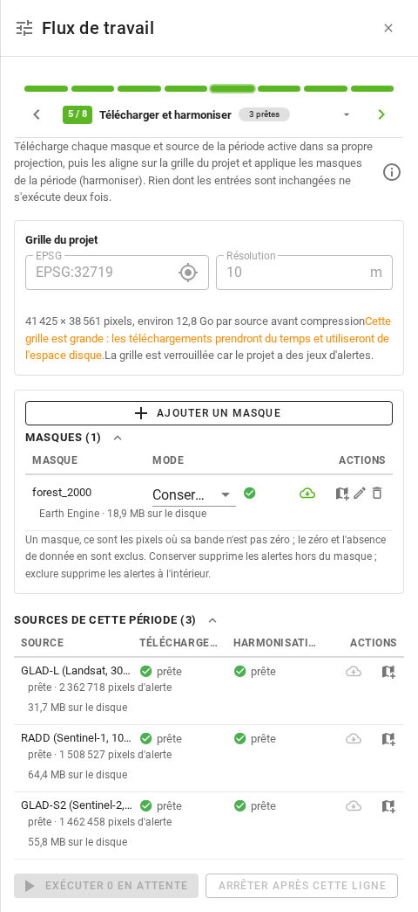

La grille du projet
^^^^^^^^^^^^^^^^^^^

Tous les rasters du projet sont alignés sur une même grille : une projection en mètres et une taille de pixel, sur l'AOI. Les alertes de sources aux tailles de pixel différentes peuvent alors être combinées pixel par pixel, et la taille minimale d'alerte en hectares devient un nombre de pixels.

.. list-table::
    :header-rows: 1
    :widths: 15 40 45

    *   -   Champ
        -   Description
        -   Valeur par défaut et limites
    *   -   **EPSG**
        -   La projection de la grille, sous forme de code EPSG (European Petroleum Survey Group). Le bouton cible au bout du champ y inscrit la zone UTM (Mercator transverse universelle) de l'AOI.
        -   La zone UTM du centre de l'AOI. Doit être un système projeté en mètres : un système géographique (comme 4326) ou un système en pieds est refusé.
    *   -   **Résolution**
        -   La taille du pixel, en mètres.
        -   La taille de pixel la plus fine parmi les sources du projet : 10 m avec RADD ou GLAD-S2, 30 m avec GLAD-L seule, la taille de pixel propre d'une source personnalisée, ou 30 m quand rien n'est connu. Doit être supérieure à 0.

Sous les champs, la taille de la grille est annoncée : « largeur × hauteur pixels, environ … par source avant compression ». Au-delà de 2 Go par source, un avertissement indique **Cette grille est grande : les téléchargements prendront du temps et utiliseront de l'espace disque.** (il ne bloque pas l'étape).

Sélectionnez **Enregistrer la grille**. Les masques et le tableau des sources n'apparaissent qu'une fois une grille enregistrée.

La grille peut changer jusqu'à la création du premier jeu d'alertes. Une nouvelle grille ne fait que réharmoniser les sources à partir des fichiers déjà téléchargés ; elle ne les télécharge pas à nouveau. Dès que le projet a un jeu d'alertes, la carte indique **La grille est verrouillée car le projet a des jeux d'alertes.**

.. note::

    Modifier l'`AOI <defo-aoi_>`_ efface la grille et supprime tous les téléchargements et fichiers harmonisés du projet, qui avaient été produits pour l'ancienne zone. Enregistrez à nouveau la grille ici, puis relancez les lignes.

Masques
^^^^^^^

Un *masque* limite l'endroit où les alertes sont conservées. C'est un raster défini une fois pour le projet : une image ou une collection d'images GEE, ou un GeoTIFF, à une bande. Un pixel est dans le masque là où cette bande n'est pas nulle ; les pixels à zéro ou sans donnée sont hors du masque.

Chaque période choisit un **Mode** pour chaque masque :

.. list-table::
    :header-rows: 1
    :widths: 20 80

    *   -   Mode
        -   Effet sur les alertes de la période
    *   -   **Inactif**
        -   Le masque n'est pas utilisé dans cette période.
    *   -   **Conserver**
        -   Les alertes *hors* du masque sont retirées (par exemple : ne garder que les alertes à l'intérieur d'un masque forestier).
    *   -   **Exclure**
        -   Les alertes *dans* le masque sont retirées (par exemple : écarter les alertes situées dans des plantations ou dans l'eau).

Quand plusieurs masques sont actifs, ils s'appliquent tous. Les masques agissent sur les sources harmonisées : un changement de **Mode** rend donc obsolètes les sources de la période. Le bouton **Harmoniser** de chaque ligne les réharmonise alors sans les télécharger. Une nouvelle période démarre avec les choix de masques de la dernière période.

Ajouter un masque
"""""""""""""""""

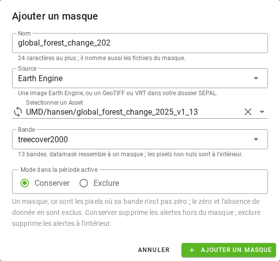

Sélectionnez **Ajouter un masque** pour ouvrir la boîte de dialogue **Ajouter un masque**. Les bandes sont lues dès que le raster est choisi.

.. list-table::
    :header-rows: 1
    :widths: 20 40 40

    *   -   Champ
        -   Description
        -   Valeur par défaut et limites
    *   -   **Nom**
        -   Le nom du masque dans les listes, les légendes et les noms de fichiers.
        -   Proposé à partir du nom de l'asset ou du fichier. 24 caractères au plus, au moins une lettre ou un chiffre, unique parmi les masques du projet.
    *   -   **Source**
        -   **Earth Engine** (un asset) ou **GeoTIFF / VRT** (un fichier de votre dossier SEPAL).
        -   **Earth Engine**.
    *   -   Asset ou **GeoTIFF / VRT**
        -   L'image ou la collection d'images GEE, ou le fichier .tif.
        -
    *   -   **Bande**
        -   La bande qui définit le masque. Affichée quand le raster a deux bandes ou plus ; avec une bande, le formulaire indique « Une bande (…) : le masque est fait à partir d'elle. »
        -   La bande dont le nom ressemble à un masque (par exemple ``datamask``), nommée dans l'aide (« … ressemble à un masque ; les pixels non nuls sont à l'intérieur. »), sinon aucune : choisissez-la.
    *   -   **Mode dans la période active**
        -   **Conserver** ou **Exclure**.
        -   **Conserver**. Le masque n'est activé que dans la période active ; toutes les autres périodes le laissent inactif jusqu'à ce qu'il y soit activé.

Quand **Ajouter un masque** est sélectionné, l'application vérifie le raster et sa bande. Un problème s'affiche en rouge dans la boîte de dialogue, qui reste ouverte pour les corrections.

La liste des masques
""""""""""""""""""""

Chaque ligne de **Masques** affiche :

.. list-table::
    :header-rows: 1
    :widths: 20 80

    *   -   Colonne
        -   Description
    *   -   **Masque**
        -   Le nom du masque. La ligne en dessous donne sa source et sa taille sur le disque une fois prêt (« Earth Engine · 18,9 MB »), ou la raison pour laquelle il doit être exécuté (« pas encore téléchargée », « la grille a changé (…) : aligner à nouveau »). Elle se termine par « Inactif » quand le masque est inactif dans la période active.
    *   -   **Mode**
        -   Le mode du masque dans la période active : **Inactif**, **Conserver** ou **Exclure**. Un changement s'applique tout de suite ; les sources de la période deviennent alors obsolètes.
    *   -   **État**
        -   « Prête », ou un bouton pour la prochaine exécution du masque : **Télécharger** (un masque GEE pas encore téléchargé) ou **Aligner** (sur la grille). Un bouton orange refait un fichier obsolète. Pendant une exécution, la cellule indique « Chargement 42 % », « Alignement » ou « En attente ».

Les icônes à droite de chaque ligne :

-   l'icône de carte affiche le masque sur la carte : un masque GEE peut être prévisualisé avant d'être téléchargé, un masque GeoTIFF une fois aligné ;
-   l'icône d'information ouvre ses **Détails** (voir `La boîte de dialogue Détails <defo-harmonize-details_>`_) ;
-   le menu **Plus d'actions** (trois points) contient :

    -   **Télécharger à nouveau** (masques GEE uniquement), pour un asset qui a changé. L'application demande d'abord : « Ceci récupère le masque à nouveau depuis Earth Engine, remplace son téléchargement, puis l'aligne. » ;
    -   **Modifier**, qui ouvre **Modifier le masque** *nom* : le raster et la bande peuvent changer, le nom non. Dès qu'un jeu d'alertes a utilisé le masque, il ne peut plus être modifié (**Un jeu d'alertes utilise déjà ce masque : ajoutez-en un nouveau à la place.**) ;
    -   **Supprimer le masque…**, qui supprime le masque après confirmation. Son téléchargement et son fichier aligné sont supprimés, et toutes les périodes cessent de l'utiliser. Les jeux d'alertes qui l'utilisaient conservent leurs alertes et apparaissent comme obsolètes.

Un masque est téléchargé et aligné une seule fois pour tout le projet, quelle que soit la période qui l'exécute.

.. _defo-harmonize-sources:

Sources de cette période
^^^^^^^^^^^^^^^^^^^^^^^^

Le tableau a une ligne par source d'alertes de la période active, avec deux colonnes :

.. list-table::
    :header-rows: 1
    :widths: 20 80

    *   -   Colonne
        -   Description
    *   -   **Source**
        -   Le nom de la source. La ligne en dessous dit ce que contient la ligne du tableau ou ce qu'elle attend (voir plus bas). Les avertissements, comme une couverture partielle, et les erreurs s'affichent en lignes sous la ligne du tableau.
    *   -   **État**
        -   L'état de la ligne, ou un bouton pour sa prochaine exécution.

La colonne **État** indique :

.. list-table::
    :header-rows: 1
    :widths: 25 75

    *   -   État
        -   Signification
    *   -   « Prête »
        -   Téléchargée et harmonisée avec les entrées actuelles. La ligne sous le nom donne la date du téléchargement, la taille sur le disque et ce que le fichier harmonisé a trouvé : « téléchargée le 2026-10-20 · 31,7 MB · 2 362 718 pixels d'alerte ».
    *   -   **Harmoniser**
        -   Le téléchargement est à jour, mais le fichier harmonisé manque ou est obsolète (un nouveau téléchargement, une nouvelle grille, un changement de masque). Sélectionnez le bouton pour exécuter la ligne : il aligne les masques de la période qui en ont besoin, puis harmonise la source, sans la télécharger.
    *   -   « Téléchargez-la ou lisez-la d'abord dans Alertes »
        -   La source n'est pas téléchargée pour la fenêtre de recherche de cette période, ou son téléchargement est obsolète. La ligne n'a pas de bouton : téléchargez-la d'abord dans `Alertes <defo-alerts-download_>`_.
    *   -   **Réessayer**
        -   La dernière exécution de la ligne a échoué. Son erreur s'affiche en rouge sous la ligne.
    *   -   « Chargement 42 % », « Traitement », « En attente »
        -   La ligne est en cours, ou attend son tour dans une exécution (« en attente de la ligne du dessus »). Une ligne en cours de téléchargement dans Alertes apparaît aussi en cours ici, et ne peut pas être harmonisée avant la fin de son téléchargement.
    *   -   « non couverte », « aucune donnée »
        -   La source ne peut pas s'exécuter pour cette période : elle ne couvre pas l'AOI, ou n'a pas de données pour la fenêtre de recherche. La ligne sous le nom en donne la raison. Pour la couverture, voir `Sources d'alertes <defo-alerts_>`_.
    *   -   « Sans fichier »
        -   Le fichier d'une source GeoTIFF a disparu (voir `Messages fréquents <defo-harmonize-messages_>`_).

Dans la `copie d'examen <defo-evaluation-return_>`_ d'un évaluateur, rien ne s'exécute : au lieu d'un bouton, la colonne indique « À harmoniser » ou « À aligner ».

Un bouton bleu exécute une ligne pour la première fois ; un bouton orange refait un fichier obsolète. La ligne sous le nom dit alors pourquoi : par exemple « la grille a changé (EPSG:32719 · 30 m → EPSG:32719 · 10 m) : harmoniser à nouveau », « elle a été téléchargée à nouveau depuis : harmoniser à nouveau » ou « le masque forest_2000 a changé : harmoniser à nouveau ».

Les icônes à droite de chaque ligne :

-   l'icône de carte (**Afficher sur la carte**) affiche les alertes harmonisées sur la carte ;
-   l'icône d'information ouvre les **Détails** de la ligne (voir plus bas) ;
-   **Supprimer le fichier harmonisé** retire le fichier harmonisé de la source pour cette période, après confirmation. Le téléchargement reste : harmonisez à nouveau la source dans cette étape pour reconstruire le fichier. Les jeux d'alertes de cette période construits à partir de la source deviennent obsolètes ; leurs alertes et leurs revues sont conservées.

.. _defo-harmonize-details:

La boîte de dialogue Détails
""""""""""""""""""""""""""""

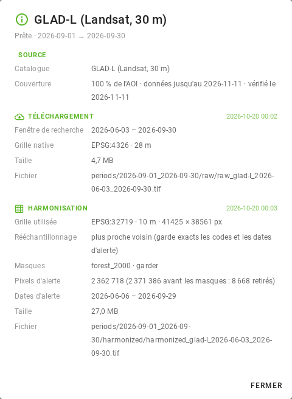

L'icône d'information d'une source ou d'un masque ouvre un résumé en lecture seule de ce avec quoi ses fichiers ont été produits. Il commence par l'état de la ligne et, pour une source, la période. Quand la ligne est obsolète, une ligne orange **Pourquoi :** dit ce qui a changé.

Dans `Alertes <defo-alerts_>`_, l'icône d'information d'une source ouvre la même boîte de dialogue, avec deux commandes de plus : la case **Ajouter aux nouvelles périodes** (voir `Ajouter une source <defo-alerts-new-periods_>`_) et, pour une source personnalisée, **Modifier**.

.. list-table::
    :header-rows: 1
    :widths: 25 75

    *   -   Section
        -   Ce qu'elle liste
    *   -   **Source**
        -   Une source prédéfinie : son **Catalogue** et sa **Couverture** de l'AOI, avec la dernière date de données et le jour de la vérification. Une source personnalisée : son **Type**, sa **Référence**, son **Format**, son **Codage des dates**, ses **Bandes** et sa **Grille native**. Un masque : sa **Référence**, sa **Bande**, sa **Grille native** et les périodes où il est utilisé (**Utilisé dans**).
    *   -   **Téléchargement** (**Lecture du fichier** pour une source GeoTIFF)
        -   La **Fenêtre de recherche**, la **Grille native** dans laquelle le fichier a été téléchargé, sa **Taille** et son **Fichier** dans le dossier du projet.
    *   -   **Harmonisation** (**Alignement** pour un masque)
        -   La **Grille utilisée**, avec la grille actuelle quand elle a changé depuis, le **Rééchantillonnage**, les **Masques** appliqués avec leur mode, les **Pixels d'alerte** conservés (et combien les masques en ont retiré), les **Dates d'alerte** trouvées, la **Taille** et le **Fichier**. Pour un masque : ses **Pixels du masque**.

Chaque section donne la date et l'heure d'écriture de son fichier, ou indique « Pas encore exécuté ». Sélectionnez **Fermer**, ou appuyez sur **Échap**, pour fermer la boîte de dialogue.

.. labels-ok: Échap

Exécuter plusieurs lignes
"""""""""""""""""""""""""

Chaque ligne s'exécute avec son propre bouton. Le bouton **Harmoniser** d'une source aligne d'abord les masques activés dans la période qui en ont besoin, puis harmonise la source ; le bouton **Aligner** d'un masque n'aligne que ce masque. Sélectionnez les boutons de plusieurs lignes pour toutes les exécuter : chacun lance sa propre tâche, et elles se mettent en file, une ligne à la fois :

-   les lignes qui indiquent « non couverte » ou « aucune donnée », et les lignes encore à télécharger, n'ont pas de bouton ;
-   une ligne qui échoue affiche son erreur en rouge en dessous, et la ligne suivante continue ;
-   pendant que la tâche d'une source aligne un masque, le bouton **Harmoniser** d'une autre source qui a besoin du même masque affiche « En attente » et démarre une fois le masque aligné.

La ligne en cours affiche sa propre barre de progression, qui défile sans fin tant qu'elle n'a pas de pourcentage. Une ligne lancée ne peut pas être arrêtée ; les lignes déjà faites le restent.

L'exécution apparaît aussi comme une notification de tâche intitulée **Harmoniser**, avec la ligne en cours (par exemple « Harmonisation de GLAD-L »).

.. tip::

    Chaque ligne a besoin d'espace disque libre pour ses fichiers. L'application le vérifie avant d'écrire et arrête la ligne avec un message quand le disque est trop plein. La ligne de taille de la grille donne une idée du volume que peut atteindre une source.

.. _defo-harmonize-messages:

Messages fréquents
^^^^^^^^^^^^^^^^^^

« Espace disque libre insuffisant : ceci nécessite … Go dans …, et … Go sont libres. »
    Libérez de l'espace dans votre dossier SEPAL, ou utilisez une grille plus grossière.

« Une ligne de cette exécution est déjà en préparation … »
    Le masque dont vous avez sélectionné **Aligner** est en cours d'alignement par une autre exécution (celle d'une autre période, ou le bouton **Harmoniser** d'une source), ou la ligne tourne encore. Relancez-la une fois celle-ci terminée.

« La géométrie de l'AOI est encore en cours de récupération ; relancez cette ligne dans un instant. »
    Les sources et masques GeoTIFF ont besoin de la forme de l'AOI. Patientez un instant. Si elle n'a pas pu être récupérée, sélectionnez **Vérifier à nouveau** sous le tableau, puis exécutez-les.

« Le masque … ne couvre aucune partie de l'AOI : en masque de conservation, toutes les alertes seraient supprimées. »
    Le masque ne recouvre pas la zone. Vérifiez son asset ou sa bande, ou désactivez-le.

« Une tâche écrit dans ce projet ; enregistrez la grille une fois celle-ci terminée. »
    La grille, les masques et les sources ne peuvent pas changer pendant un téléchargement ou une exécution d'**Intégrer et vectoriser**.

« Sans fichier », avec « manquante : fichier introuvable : … » sous la ligne, ou « Masque … : fichier introuvable (…). Remettez le fichier à cet emplacement pour utiliser le masque. »
    Une source ou un masque GeoTIFF a été déplacé, renommé ou supprimé de votre dossier SEPAL. Remettez le fichier à l'emplacement indiqué, ou modifiez la source ou le masque pour pointer vers son nouvel emplacement.

« Un masque activé dans cette période n'est pas encore aligné sur la grille actuelle ; Harmoniser sur une source aligne d'abord les masques. »
    Une source ne peut pas être harmonisée avant que les masques de la période soient alignés. Sélectionnez le bouton **Harmoniser** de la source, ou d'abord le bouton **Aligner** du masque.

« Masque … : sa grille native (projection et échelle) est inconnue ; modifiez le masque. »
    L'application ne sait pas comment télécharger ce masque GEE. Ouvrez-le avec **Modifier** dans son menu **Plus d'actions** et enregistrez-le à nouveau, pour que son raster soit revérifié.

.. _defo-integrate:

Intégrer et vectoriser
----------------------

Cette étape transforme les sources harmonisées de la période active en un *jeu d'alertes* : la liste des alertes à examiner dans `Analyse <defo-analysis_>`_. Elle :

-   combine les sources pixel par pixel ;
-   retire ce que les périodes antérieures ont déjà signalé ;
-   regroupe les pixels d'alerte voisins en *groupes* ;
-   dessine un polygone par groupe. Chaque groupe conservé est une alerte du jeu.

Ouvrez l'étape **Intégrer et vectoriser** du panneau **Flux de travail**. Elle se déverrouille dès qu'au moins une source de la période active est prête dans `Harmoniser <defo-harmonize_>`_.

Le formulaire suit l'exécution, en trois cartes encadrées : les sources à combiner, les réglages des groupes et les couches d'attributs. Le bouton **Intégrer et vectoriser** est sous elles. Sous les sources, des lignes grises disent ce que l'exécution fait aussi d'elle-même, sans réglage :

-   « Retire les pixels déjà présents dans N jeux d'alertes antérieurs » (voir `Ce que les périodes antérieures ont déjà signalé <defo-integrate-earlier_>`_) ; et
-   « Reprend les pixels non analysables de N jeux antérieurs dans la rétrospection », comptés pour les sources sélectionnées.

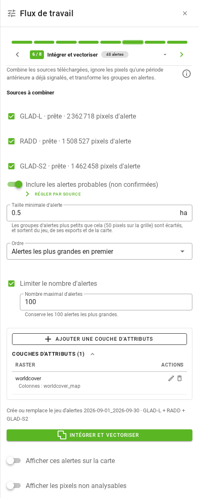

Qu'est-ce qu'une alerte
^^^^^^^^^^^^^^^^^^^^^^^

Une alerte est un *groupe* : un ensemble de pixels d'alerte qui se touchent, par un côté ou par un coin, quelle que soit la source qui a signalé chaque pixel. Là où des pixels GLAD-L et RADD se touchent, ils forment *une seule* alerte qui mentionne les deux sources. Une alerte n'est jamais scindée en une alerte par source.

Chaque alerte conserve :

-   les sources qui l'ont détectée ;
-   ses dates de première et de dernière détection (la date la plus ancienne et la plus récente parmi ses pixels) ;
-   sa superficie en hectares ;
-   une statistique des bandes de chaque couche d'attributs (voir plus bas).

Un groupe plus petit que la **Taille minimale de groupe** (voir `Les options <defo-integrate-options_>`_) ne devient pas une alerte : ses pixels sont mis de côté comme *non analysables*.

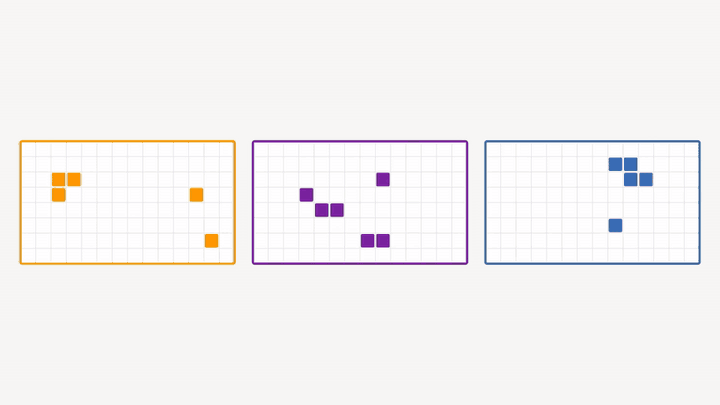

.. _defo-integrate-earlier:

Ce que les périodes antérieures ont déjà signalé
""""""""""""""""""""""""""""""""""""""""""""""""

Les pixels situés dans les alertes d'un jeu d'une période *antérieure* (son *empreinte*) sont retirés avant la formation des groupes. Ainsi, la `rétrospection <defo-period-lookback_>`_ ne signale jamais deux fois la même perte.

Les pixels qui ne sont pas devenus des alertes (un groupe sous la taille minimale, ou au-delà du nombre maximal d'alertes) sont conservés comme *non analysables*. Ils ne font pas partie de l'empreinte : les récupérer est le rôle de la `rétrospection <defo-period-lookback_>`_.

L'exécution d'une période ultérieure réintègre ces pixels quand les deux conditions sont remplies :

-   sa rétrospection remonte jusque dans la période antérieure (cette période se termine le jour où commence la nouvelle fenêtre de recherche, ou après) ;
-   les deux périodes partagent une source.

Les pixels reviennent quelle que soit leur date de détection dans la fenêtre de recherche propre au jeu antérieur. Ils rejoignent les nouveaux pixels qui les touchent, et un groupe qui atteint désormais la taille minimale devient une alerte. Ses dates de détection peuvent être antérieures à sa propre période et à sa rétrospection. Avec une rétrospection de 0, la fenêtre de recherche commence le premier jour de la période elle-même : rien de ce qui a été mis de côté n'est donc réexaminé.

.. _defo-integrate-growth:

Extension d'une perte antérieure
""""""""""""""""""""""""""""""""

Un défrichement continue souvent de s'étendre d'un mois à l'autre. L'exécution relie chaque nouvelle alerte à la *perte antérieure* dont elle est l'extension : les alertes des jeux des périodes antérieures enregistrées comme **Alerte réelle** ou **À réexaminer**. La forme d'une alerte antérieure est le polygone dessiné pour elle dans `Affiner le polygone <defo-analysis-refine_>`_, ou à défaut son groupe détecté.

-   Un nouveau groupe situé à un pixel de la grille au plus de la forme d'une alerte antérieure, de bord à bord, est une *alerte d'extension*, liée à chaque alerte antérieure aussi proche. Un groupe séparé par un pixel vide compte encore ; un écart d'un pixel en diagonale est plus loin. Une alerte sans lien est une *nouvelle* alerte.
-   Avec **Garder les groupes plus petits qui touchent une perte confirmée antérieure** coché (par défaut), un groupe plus petit que la **Taille minimale de groupe** est conservé s'il est aussi proche d'une perte antérieure : c'est une alerte d'extension *sous la surface minimale*. Décoché, tout petit groupe est mis de côté. Un petit groupe qui ne touche rien est toujours mis de côté comme *non analysable*.
-   Les alertes d'extension sont triées et limitées avec les autres : **Limiter le nombre de groupes** peut les écarter.
-   Les jeux créés avant cette portée d'un pixel gardent leurs liens d'origine jusqu'à leur prochaine exécution.
-   Seules les révisions enregistrées au lancement de l'exécution comptent. Une alerte antérieure confirmée ensuite n'est pas liée, mais elle peut l'être à la main dans `Alertes précédentes <defo-analysis-earlier_>`_.

Les alertes liées entre elles, toutes périodes confondues, forment l'*historique* d'un défrichement. Analyse l'affiche sur chaque alerte, et l'`Aperçu <defo-overview-growth_>`_ en fait la synthèse.

.. _defo-integrate-options:

Les options
^^^^^^^^^^^

Le formulaire s'ouvre avec les paramètres du jeu d'alertes actif (tous sauf les sources), ou avec les valeurs par défaut ci-dessous s'il n'y en a pas.

.. list-table::
    :header-rows: 1
    :widths: 20 50 30

    *   -   Option
        -   Description
        -   Valeur par défaut et limites
    *   -   Sources
        -   Les sources dont les alertes entrent dans le jeu, dans la première carte. Chaque source prête est listée avec ce que son fichier harmonisé a trouvé. Une source qui ne couvre pas l'AOI, ou qui n'a pas de données pour la période, apparaît désactivée, avec la raison.
        -   Toutes les sources prêtes. Au moins une.
    *   -   **Inclure les alertes probables (non confirmées)**
        -   Affiché seulement si au moins une source cochée a une classe *probable* (confiance faible). Un seul interrupteur pour toutes ces sources. Désactivé, leurs pixels probables sont écartés avant tout le reste, et seuls leurs pixels confirmés comptent. Avec deux sources de ce type ou plus, **Régler par source** déplie un interrupteur par source (voir plus bas).
        -   Activé.
    *   -   **Taille minimale de groupe**
        -   Les groupes plus petits sont écartés, sauf si l'option suivante les garde. L'aide donne cette taille en pixels de la grille (à 10 m, 0,5 ha correspond à « 50 pixels sur la grille »).
        -   0,5 ha. N'importe quel nombre d'hectares, 0 ou plus. Même à 0, un groupe fait au moins un pixel.
    *   -   **Garder les groupes plus petits qui touchent une perte confirmée antérieure**
        -   Garde un groupe sous la taille minimale quand il se trouve à un pixel au plus d'une alerte antérieure examinée comme **Alerte réelle** ou **À réexaminer** (voir `Extension d'une perte antérieure <defo-integrate-growth_>`_). Une ligne en dessous indique quand l'exécution n'a rien à quoi lier : « Aucune période antérieure n'a encore de jeu d'alertes : rien ne se lie lors de cette exécution. » ou « Aucune alerte d'une période antérieure n'est encore examinée : rien ne se lie lors de cette exécution. »
        -   Coché.
    *   -   **Ordre**
        -   L'ordre des groupes dans le jeu, qui est l'ordre d'examen : **Groupes les plus grands en premier**, **Groupes les plus petits en premier**, **Groupes les plus récents en premier** (selon la date de dernière détection) ou **Groupes les plus anciens en premier** (selon la date de première détection).
        -   **Groupes les plus grands en premier**.
    *   -   **Limiter le nombre de groupes**
        -   Coché, affiche **Nombre maximal de groupes** : seuls les premiers groupes selon l'**Ordre** choisi sont conservés. Son aide indique lesquelles (par exemple « Conserve les 100 groupes les plus grands. » ou « Conserve les 100 groupes les plus récents. »). Décoché, tous les groupes sont conservés.
        -   Décoché. Une fois coché, la limite part de 100. Ce doit être un nombre entier supérieur à 0.
    *   -   **Couches d'attributs**
        -   Des rasters dont les statistiques de bandes sont ajoutées à chaque alerte (voir plus bas).
        -   Aucune.

Alertes probables par source
""""""""""""""""""""""""""""

Avec deux sources cochées ou plus qui ont une classe probable, sélectionnez **Régler par source** sous **Inclure les alertes probables (non confirmées)** pour donner à chacune son propre interrupteur, au nom de la source :

-   Une source cochée sans classe probable (une source personnalisée qui n'a que des dates de détection) apparaît comme « (source) : dates seules, pas de niveau probable ».
-   Quand les interrupteurs des sources diffèrent, l'interrupteur principal est désactivé, la note **Mixte : les sources ci-dessous diffèrent.** remplace **Régler par source**, et les interrupteurs par source restent dépliés.
-   Activer ou désactiver l'interrupteur principal règle toutes les sources d'un coup.

.. _defo-integrate-attributes:

Couches d'attributs
"""""""""""""""""""

Une *couche d'attributs* ajoute à chaque alerte des informations tirées d'un raster (par exemple la classe d'occupation du sol majoritaire sous l'alerte, ou son altitude moyenne). Les valeurs sont des colonnes de la table des alertes : elles sont exportées avec les alertes, et les colonnes de classes peuvent servir dans le filtre d'Analyse.

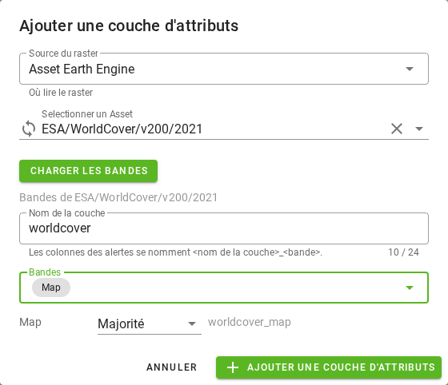

Pour ajouter une couche d'attributs :

1.  Sélectionnez **Ajouter une couche d'attributs** pour ouvrir la boîte de dialogue **Ajouter une couche d'attributs**.
2.  Vérifiez le **Nom de la couche**, proposé à partir du raster une fois celui-ci choisi. Les colonnes se nomment *nom de la couche*\_\ *bande*.
3.  Choisissez la **Source** (**Earth Engine**, une image, ou **GeoTIFF / VRT**, un fichier de votre dossier SEPAL), puis choisissez le raster. Ses bandes sont lues aussitôt.
4.  Avec une bande, le formulaire indique « Une bande (…) : sa statistique est ajoutée à chaque groupe. » Avec deux ou plus, sélectionnez-en une ou plusieurs dans **Bandes**.
5.  Pour chaque bande, choisissez la statistique calculée sur l'alerte : **Majorité** (pour des classes), **Moyenne**, **Minimum**, **Maximum** ou **Médiane**. Elle démarre sur **Majorité** quand le nom de la bande ressemble à des classes (par exemple ``landcover``), et sur **Moyenne** sinon, marquée « (suggéré) ». Le nom de la colonne s'affiche à côté.
6.  Sélectionnez **Ajouter une couche d'attributs**.

Règles :

-   Une couche doit avoir au moins une bande (**Conservez au moins une bande.**).
-   Deux couches ne peuvent pas lire le même raster (**Une autre couche d'attributs lit déjà ce raster.**).
-   Les noms de colonnes ne reprennent jamais le nom d'une colonne d'alerte ni celui d'une colonne d'une autre couche : en cas de conflit, un suffixe est ajouté.

La liste sous **Couches d'attributs** affiche chaque couche avec ses colonnes. L'icône de crayon modifie une couche et l'icône de corbeille la retire. Les couches appartiennent à ce formulaire jusqu'à son exécution : elles sont alors enregistrées avec le jeu d'alertes.

Exécuter l'étape
^^^^^^^^^^^^^^^^

La ligne grise au-dessus du bouton nomme le jeu que l'exécution produit : « Crée ou remplace le jeu d'alertes (période) · (sources) ». Un jeu d'alertes est identifié par sa période et ses sources :

-   une nouvelle combinaison de sources produit un nouveau jeu : une période peut contenir plusieurs jeux (par exemple un avec GLAD-L seule et un avec les trois sources) ;
-   la même combinaison, relancée, *remplace* le jeu.

Sélectionnez **Intégrer et vectoriser**. Le bouton reste désactivé tant qu'aucune source n'est cochée et, lorsque **Limiter le nombre de groupes** est coché, tant que la limite n'est pas valide (« Saisissez un nombre entier supérieur à 0. » sous le champ).

L'exécution passe par « Combinaison des sources », « Vectorisation des groupes », « Enregistrement des groupes », « Écriture de l'empreinte » et « Construction des tuiles de carte ». À la fin, un message indique « N groupes prêts à être examinés », suivi de « N groupes liés à des pertes antérieures (M sous la surface minimale) » quand elle a trouvé des `alertes d'extension <defo-integrate-growth_>`_, et le nouveau jeu devient le *jeu actif* : celui sur lequel travaillent `Questionnaire <defo-questionnaire_>`_, `Évaluation <defo-evaluation_>`_, `Analyse <defo-analysis_>`_ et `Aperçu <defo-overview_>`_. L'étape reste ouverte.

S'il ne reste aucun groupe, le jeu est tout de même créé, vide : le message indique « Aucun nouveau groupe dans cette période : le jeu d'alertes est vide. » et donne la raison pour chaque source (par exemple « GLAD-L : les 56 pixels d'alerte supprimés par les masques » ou « RADD : les alertes probables (non confirmées) ont été écartées »).

.. _defo-integrate-replace:

Remplacer un jeu
""""""""""""""""

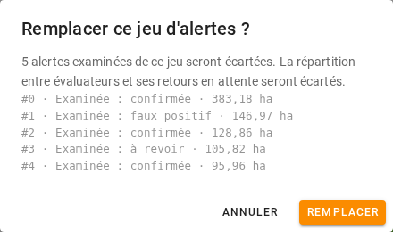

Quand le jeu sur le point d'être remplacé a des alertes examinées ou une `répartition entre évaluateurs <defo-evaluation_>`_, la boîte de dialogue **Remplacer ce jeu d'alertes ?** liste ce qui serait perdu : les alertes examinées (jusqu'à 20, puis « … et N de plus »), ainsi que la répartition avec les révisions que les évaluateurs n'ont pas encore renvoyées. Quand des alertes de périodes ultérieures sont l'extension de ce jeu, elle ajoute « N groupes de périodes ultérieures sont liés à ce jeu ; leurs liens seront rompus. » : après l'exécution, ces liens apparaissent comme « l'ensemble précédent a été relancé » (voir `Alertes précédentes <defo-analysis-earlier_>`_). Sélectionnez **Remplacer** pour continuer. Un jeu qui n'a rien à perdre est remplacé sans confirmation.

.. attention::

    Remplacer un jeu écarte ses révisions. Pour essayer d'autres paramètres sans perdre de révisions, choisissez une autre combinaison de sources, qui produit un jeu distinct.

.. _defo-integrate-outdated:

Quand le jeu actif est obsolète
"""""""""""""""""""""""""""""""

Si les entrées du jeu actif ont changé depuis sa création (une source téléchargée à nouveau, un masque modifié, la rétrospection de la période, l'AOI ou la grille changées), une ligne orange indique : « Le jeu actif (…) a été construit à partir d'entrées qui ont changé depuis. » Relancez **Intégrer et vectoriser** pour le reconstruire, ce qui écarte ses révisions.

Si les fichiers du jeu ont été supprimés du dossier du projet, la ligne indique : « Les fichiers du jeu actif (…) sont manquants dans le dossier du projet. »

.. _defo-integrate-map:

Voir les alertes sur la carte
^^^^^^^^^^^^^^^^^^^^^^^^^^^^^

Dès que le projet a un jeu, un titre sous le bouton compte les alertes du jeu actif (« Résultat · 48 groupes »), et des interrupteurs dessous dessinent le jeu sur la carte :

.. list-table::
    :header-rows: 1
    :widths: 35 65

    *   -   Interrupteur
        -   Description
    *   -   **Afficher ces alertes sur la carte**
        -   Les alertes du jeu actif, colorées selon leur état d'examen. Cliquez sur une alerte pour voir « Alerte (id) · (état) · (superficie) ha ». Son bouton **Examiner** l'ouvre dans Analyse.
    *   -   **Afficher les pixels non analysables**
        -   Les pixels d'alerte qui ne sont pas devenus des alertes : **Trop petit** ou **Au-delà du plafond d'alertes**.
    *   -   **Afficher les jeux antérieurs**
        -   Les alertes des jeux des périodes antérieures, pour le contexte.

La carte les garde dans les autres étapes. Désactivez-les ici.

Messages fréquents
^^^^^^^^^^^^^^^^^^

« … n'est pas téléchargée et harmonisée pour cette période ; téléchargez-la d'abord dans Alertes et harmonisez-la dans Harmoniser. »
    Les fichiers d'une source sont obsolètes. Téléchargez-la dans `Alertes <defo-alerts-download_>`_, puis harmonisez-la dans `Harmoniser <defo-harmonize_>`_.

« L'empreinte du jeu antérieur … est manquante ; relancez d'abord Intégrer et vectoriser sur ce jeu. »
    Les fichiers d'une période antérieure ont été supprimés. Rendez cette période active et relancez son jeu.

« Espace disque libre insuffisant : … »
    L'exécution écrit quelques rasters de la taille de la grille. Libérez de l'espace.

« La période, la zone d'intérêt ou la grille du projet ont changé pendant l'exécution, donc le jeu d'alertes n'a pas été enregistré. »
    Relancez-la.

« tippecanoe n'est pas installé : la carte affichera les points d'alerte sans polygones. »
    Le jeu est créé ; la carte affiche ses alertes sous forme de points au lieu de polygones.

« Les tuiles de carte n'ont pas pu être affichées (…) : affichage des points d'alerte sans polygones. »
    Le jeu est créé, mais sa couche cartographique n'a pas pu être construite. La carte affiche ses alertes sous forme de points.

« La base d'alertes de … est manquante ; relancez Intégrer et vectoriser pour cette période. »
    Avec **Afficher les jeux antérieurs**, le fichier d'alertes d'un jeu antérieur a disparu du dossier du projet. Rendez cette période active et relancez son jeu.

.. _defo-layers:

Couches supplémentaires
-----------------------

Les couches de visualisation appuient l'examen des alertes : une carte d'occupation du sol, une référence forestière, une mosaïque récente. Elles ne modifient jamais les alertes. Une couche est une image Earth Engine ou un GeoTIFF. Elle peut être affichée sur la carte principale et, avec **Afficher dans Analyse** coché, sur les deux cartes de l'écran `Analyse <defo-analysis_>`_.

Ouvrez l'étape **Couches supplémentaires** du panneau **Flux de travail**, la première étape de **Configurer la revue**. Elle se déverrouille dès que le projet a un jeu d'alertes (voir `Intégrer et vectoriser <defo-integrate_>`_).

L'étape est facultative : passez-la et revenez-y à tout moment. Sa barre dans l'en-tête est en pointillés, et l'étape n'affiche aucun décompte tant qu'elle n'a pas de couche.

.. note::

    Les mosaïques Planet NICFI ne sont pas une couche supplémentaire : si votre compte GEE a accès à NICFI, elles arrivent avec les images *Planet* de la `frise chronologique d'Analyse <defo-analysis-timeline_>`_.

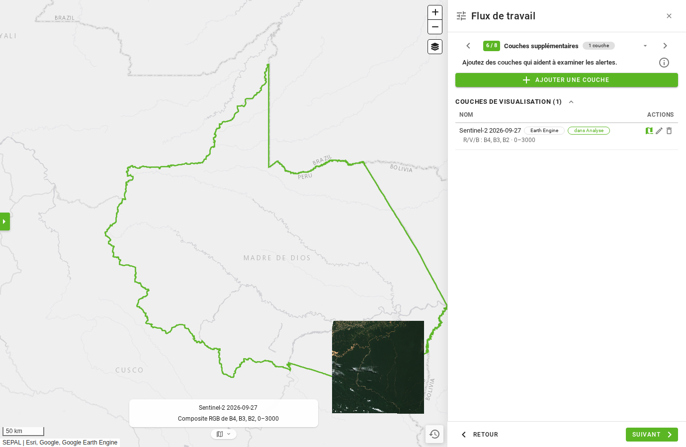

La liste des couches
^^^^^^^^^^^^^^^^^^^^

Chaque ligne de **Couches de visualisation** affiche :

-   le **Nom** de la couche ;
-   une pastille avec sa source (**Earth Engine** ou **GeoTIFF / VRT**) ;
-   une pastille **dans Analyse** lorsqu'elle est affichée sur les cartes d'Analyse ;
-   une note avec ses bandes et sa plage de valeurs ou, pour une couche catégorielle, sa bande et son nombre de classes (« bande Map · 9 classes »).

Les icônes à droite de chaque ligne :

-   l'icône de carte affiche la couche sur la carte principale, avec sa légende ;
-   l'icône de crayon l'ouvre pour la modifier (**Modifier la couche** *nom*) ;
-   l'icône de corbeille la supprime. La couche est retirée du projet ; son fichier ou son asset n'est pas touché.

Ajouter une couche
^^^^^^^^^^^^^^^^^^

Sélectionnez **Ajouter une couche** pour ouvrir la boîte de dialogue **Ajouter une couche de visualisation**. Le formulaire se lit de haut en bas : le nom, la source, l'image, puis la façon d'afficher ses bandes. Les bandes sont lues dès que l'image est choisie (« Lecture des bandes… »), et chaque choix suivant est un menu déroulant.

.. list-table::
    :header-rows: 1
    :widths: 20 40 40

    *   -   Champ
        -   Description
        -   Valeur par défaut et limites
    *   -   **Nom**
        -   Le nom de la couche dans la liste, sur les cartes et dans la légende.
        -   Laissé vide, il est repris du nom de l'asset ou du fichier, suivi de la bande ou de la combinaison. 24 caractères au plus, unique dans le projet.
    *   -   **Source**
        -   **Earth Engine** (un asset d'image) ou **GeoTIFF / VRT** (un fichier de votre dossier SEPAL).
        -   **Earth Engine**.
    *   -   Asset ou **GeoTIFF / VRT**
        -   Une *image* GEE (pas une collection), ou un fichier .tif.
        -   Le dossier du GeoTIFF doit être accessible en écriture : l'application écrit un fichier de pyramides à côté pour que la couche s'affiche rapidement.

La suite dépend du nombre de bandes de l'image :

-   Une bande : le formulaire la nomme (« Une bande (…) : elle est dessinée seule. »).
-   Deux bandes : choisissez celle à afficher dans **Bande**. Le RVB demande trois bandes ou plus.
-   Trois bandes ou plus : **Bandes** demande **Sélectionner une bande** (puis **Bande**) ou **Composite RVB**. **Composite RVB** est suggéré quand les noms des bandes donnent le rouge, le vert et le bleu (par exemple ``B4``, ``B3`` et ``B2`` de Sentinel-2). **Bande** démarre sur la première bande.

Une bande
"""""""""

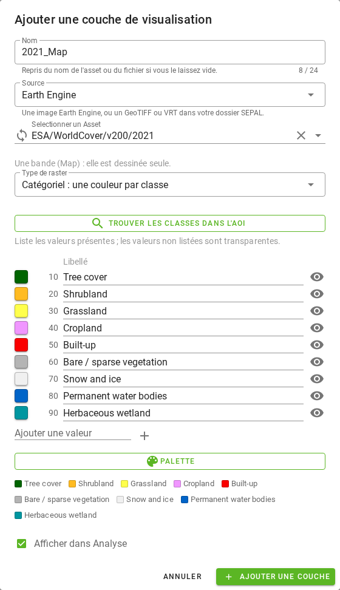

Une bande seule prend un **Type de raster** :

-   **Continu : une rampe de couleurs** pour des valeurs mesurées (réflectance, altitude, couvert arboré) ;
-   **Catégoriel : une couleur par classe** pour des classes en nombres entiers (une carte d'occupation du sol, un masque forestier, une année de perte). Il est suggéré quand le nom de la bande ressemble à des classes (par exemple ``landcover``, ``class``, ``lossyear``, ``datamask``).

Un aperçu de la légende de la couche apparaît sous les champs.

.. list-table::
    :header-rows: 1
    :widths: 20 40 40

    *   -   Champ
        -   Description
        -   Valeur par défaut et limites
    *   -   **Rampe de couleurs**
        -   *Continu* : les couleurs, de **Min** à **Max** : **Niveaux de gris**, **Bleus**, **Verts**, **Oranges**, **Froid–chaud**, **Viridis**, **Terrain**, **Chaleur** ou **Magma**.
        -   **Niveaux de gris**.
    *   -   **Inverser**
        -   *Continu* : inverse la rampe.
        -   Désactivé.
    *   -   **Min**, **Max**
        -   *Continu* : la plage de valeurs étirée sur les couleurs.
        -   0 et 1. Les deux doivent être des nombres, **Min** inférieur à **Max**.
    *   -   **Étirer sur l'AOI (2–98 %)**
        -   *Continu* : remplit **Min** et **Max** avec les centiles 2 et 98 de la bande sur le rectangle englobant de l'AOI.
        -
    *   -   **Trouver les classes dans l'AOI**
        -   *Catégoriel* : liste les valeurs entières présentes sur l'AOI, chacune avec une couleur, sa valeur, un **Libellé** et une icône d'œil qui la masque ou l'affiche. Quand l'image nomme ses classes et leurs couleurs (comme ESA WorldCover), les classes les reprennent ; sinon, chaque classe est libellée avec sa valeur.
        -   50 classes au plus. Les valeurs non listées et les classes masquées sont transparentes.
    *   -   **Ajouter une valeur**
        -   *Catégoriel* : ajoute une classe à la main. Tapez le nombre entier, puis appuyez sur **Entrée** ou sélectionnez l'icône plus.
        -   Chaque valeur une seule fois.
    *   -   **Palette**
        -   *Catégoriel* : recolore toutes les classes à partir d'une palette : **Set1**, **Set2**, **Tab10** ou **Paired**. Sélectionnez le carré de couleur d'une classe pour choisir sa couleur à la main.
        -

.. labels-ok: Entrée

Quand une bande ne contient que 0 et 1 sur l'AOI, les classes trouvées nomment 1 d'après la bande et démarrent avec 0 masqué : « Seulement 0 et 1 dans l'AOI : 1 prend le nom de la bande et 0 est d'abord masqué (transparent). » Sélectionnez l'icône d'œil de 0 pour l'afficher aussi.

Composite RVB
"""""""""""""

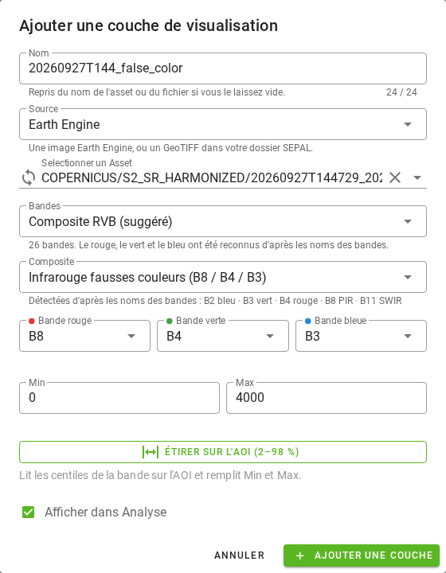

.. labels-ok: Couleurs naturelles; Infrarouge fausses couleurs; SWIR / PIR / rouge

.. list-table::
    :header-rows: 1
    :widths: 20 40 40

    *   -   Champ
        -   Description
        -   Valeur par défaut et limites
    *   -   **Composite**
        -   Une combinaison standard, nommée avec ses bandes (par exemple « Couleurs naturelles (B4 / B3 / B2) ») : **Couleurs naturelles**, **Infrarouge fausses couleurs** (proche infrarouge, rouge, vert) ou **SWIR / PIR / rouge** (infrarouge à ondes courtes, proche infrarouge, rouge) ; ou **Personnalisé : choisissez les bandes**. L'aide liste les rôles de bandes détectés d'après les noms des bandes (« Détectées d'après les noms des bandes : … »).
        -   La première combinaison que les noms des bandes permettent. Une combinaison dont les bandes n'ont pas toutes été reconnues indique « (bandes introuvables) » et ne peut pas être choisie. Si aucun nom de bande n'est reconnu, les trois premières bandes servent de rouge, vert et bleu.
    *   -   **Bande rouge**, **Bande verte**, **Bande bleue**
        -   Les bandes affichées en rouge, en vert et en bleu.
        -   Remplies par le **Composite**. Il faut trois bandes différentes. Des bandes choisies à la main qui correspondent à une combinaison la sélectionnent ; les autres sélectionnent **Personnalisé : choisissez les bandes**.
    *   -   **Min**, **Max**
        -   La plage de valeurs étirée sur les couleurs, la même pour les trois bandes.
        -   0 et 1. Les deux doivent être des nombres, **Min** inférieur à **Max**.
    *   -   **Étirer sur l'AOI (2–98 %)**
        -   Remplit **Min** et **Max** avec une seule plage pour les trois bandes, à partir de leurs centiles 2 et 98 sur le rectangle englobant de l'AOI.
        -

.. tip::

    Réglez **Min** et **Max** sur la plage réelle des données (par exemple de 0 à 3000 pour une image Sentinel-2 en réflectance de surface), ou sélectionnez **Étirer sur l'AOI (2–98 %)**. Avec la plage par défaut de 0 à 1, la plupart des images s'affichent toutes blanches.

Afficher dans Analyse
"""""""""""""""""""""

**Afficher dans Analyse** ajoute la couche aux deux cartes de l'écran `Analyse <defo-analysis_>`_, désactivée. Activez-la là-bas depuis le menu des couches. Les cartes d'Analyse n'affichent pas sa légende.

Enregistrer une couche
^^^^^^^^^^^^^^^^^^^^^^

Sélectionnez **Ajouter une couche** (ou **Enregistrer** lors d'une modification). L'application vérifie les bandes, la plage ou les classes et, pour un GeoTIFF, le dossier. Un problème s'affiche en rouge dans la boîte de dialogue, qui reste ouverte. Pendant la vérification, le bouton indique **Annuler** et permet de l'arrêter.

Les couches enregistrées avant l'arrivée des styles de visualisation gardent exactement leur apparence.

Messages fréquents
^^^^^^^^^^^^^^^^^^

« Choisissez une image Earth Engine. »
    Les collections d'images ne sont pas acceptées comme couches. Exportez d'abord une image unique.

« Choisissez trois bandes différentes pour le rouge, le vert et le bleu. »
    Choisissez une bande différente pour chaque couleur.

« Cette bande a des valeurs non entières : dessinez-la en Continu. »
    **Trouver les classes dans l'AOI** a trouvé des valeurs décimales : la bande n'est pas un ensemble de classes. Réglez **Type de raster** sur **Continu : une rampe de couleurs**.

« Plus de 50 valeurs : cette bande semble continue. »
    Affichez la bande en **Continu : une rampe de couleurs**, ou ajoutez à la main les classes nécessaires avec **Ajouter une valeur**.

« Aucune valeur dans l'AOI. » ou « La bande n'a pas d'étendue de valeurs dans l'AOI. »
    La bande n'a pas de données sur l'AOI, ou a la même valeur partout. Vérifiez l'image et la bande, ou saisissez vous-même **Min** et **Max**.

« Trouvez les classes ou ajoutez une valeur. » ou « Affichez au moins une classe. »
    Une couche catégorielle a besoin d'au moins une classe, et d'au moins une classe non masquée.

« Le dossier … n'est pas accessible en écriture, donc les pyramides de la couche ne peuvent pas être construites. »
    Déplacez le GeoTIFF dans un dossier à vous dans SEPAL.

« Le fichier … n'existe plus. »
    Le fichier d'une couche GeoTIFF a été déplacé ou supprimé. Modifiez la couche et choisissez à nouveau le fichier.

.. _defo-questionnaire:

Questionnaire
-------------

Le *questionnaire* contient les questions auxquelles on répond pour chaque alerte dans `Analyse <defo-analysis_>`_, après son verdict. Les réponses sont :

-   enregistrées avec l'alerte (une colonne par question) ;
-   exportées avec elle ;
-   représentées en graphiques dans l'`Aperçu <defo-overview_>`_ ;
-   disponibles pour le rapport Word de l'alerte.

Cette étape permet aussi de choisir le modèle de rapport.

Ouvrez l'étape **Questionnaire** du panneau **Flux de travail**, dans **Configurer la revue**. Elle se déverrouille dès que le projet a un jeu d'alertes (voir `Intégrer et vectoriser <defo-integrate_>`_). Le questionnaire appartient au projet : tous les jeux d'alertes du projet sont examinés avec lui. L'étape est facultative : sans modification, Analyse pose la question par défaut.

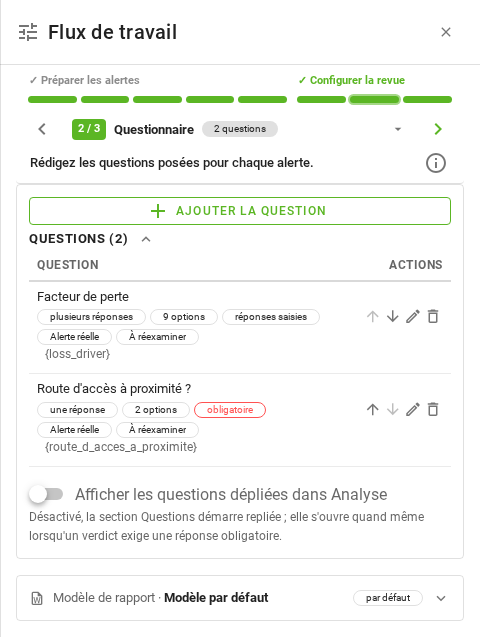

La liste des questions
^^^^^^^^^^^^^^^^^^^^^^

Un nouveau projet démarre avec une seule question, **Facteur de perte** :

-   plusieurs réponses ;
-   neuf options : **Expansion agricole**, **Pâturage du bétail**, **Exploitation forestière**, **Expansion urbaine**, **Agriculture itinérante**, **Exploitation minière**, **Feux de forêt**, **Ouragans** et **Autre** ;
-   réponses saisies autorisées ;
-   posée pour **Alerte réelle** et **À réexaminer** (pas pour un faux positif).

Modifiez-la ou supprimez-la comme n'importe quelle autre question.

Chaque ligne de **Questions** affiche la question et des pastilles qui la résument : **une réponse** ou **plusieurs réponses**, le nombre d'options, **réponses saisies**, **obligatoire**, et les verdicts pour lesquels elle est posée (ou **tous les verdicts**). La note en dessous est sa balise de rapport, par exemple ``{loss_driver}``.

Les icônes à droite de chaque ligne :

-   les flèches font monter ou descendre la question : Analyse pose les questions dans cet ordre ;
-   l'icône de crayon la modifie ;
-   l'icône de corbeille la supprime.

Sans aucune question, la liste indique **Aucune question : Analyse ne demandera que le verdict.**

**Afficher les questions dépliées dans Analyse** (désactivé par défaut) ouvre la section **Questions** d'Analyse sur chaque alerte. Désactivé, la section démarre repliée ; elle s'ouvre tout de même quand un verdict exige une réponse obligatoire.

Ajouter ou modifier une question
^^^^^^^^^^^^^^^^^^^^^^^^^^^^^^^^

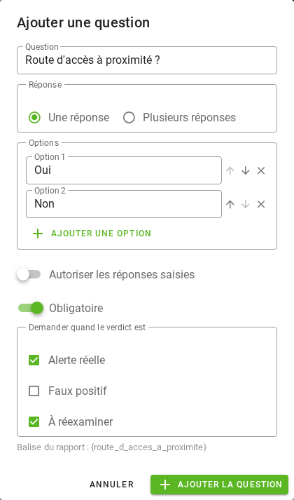

Sélectionnez **Ajouter la question** (ou l'icône de crayon d'une question) pour ouvrir la boîte de dialogue **Ajouter une question** (ou **Modifier la question**).

.. list-table::
    :header-rows: 1
    :widths: 20 45 35

    *   -   Champ
        -   Description
        -   Valeur par défaut et limites
    *   -   **Question**
        -   Le texte affiché dans Analyse.
        -   Obligatoire.
    *   -   **Réponse**
        -   **Une réponse** ou **Plusieurs réponses**. Avec plusieurs réponses, elles sont enregistrées ensemble, séparées par des virgules.
        -   **Une réponse**.
    *   -   **Options**
        -   Les réponses parmi lesquelles choisir. **Ajouter une option** en ajoute une ; les flèches les réordonnent ; la croix en retire une.
        -   Au moins une option, sauf si les réponses saisies sont autorisées. Une option ne peut pas être vide, contenir de virgule ni répéter une autre option.
    *   -   **Autoriser les réponses saisies**
        -   Permet à l'évaluateur de saisir une réponse qui ne figure pas parmi les options.
        -   Désactivé.
    *   -   **Obligatoire**
        -   La révision ne peut pas être enregistrée sans réponse (pour les verdicts où la question est posée).
        -   Désactivé.
    *   -   **Demander quand le verdict est**
        -   Les verdicts pour lesquels la question est posée : **Alerte réelle**, **Faux positif**, **À réexaminer**. Pour les autres verdicts, elle est masquée.
        -   Les trois. Au moins un.

La dernière ligne affiche la balise de rapport de la question (par exemple « Balise du rapport : {route_d_acces_a_proximite} »). Elle est formée à partir du texte de la question lors de sa création et ne change plus ensuite, même si la question est renommée.

Sélectionnez **Ajouter la question** (ou **Enregistrer**). La boîte de dialogue indique en rouge ce qui manque tant que la question ne peut pas être enregistrée.

.. note::

    Renommer une question ou l'une de ses options conserve les réponses déjà enregistrées : elles sont stockées sous le nom de balise de la question et sous le code propre à chaque option, pas sous leur texte.

Supprimer une question
^^^^^^^^^^^^^^^^^^^^^^

Sélectionnez l'icône de corbeille. La boîte de dialogue de confirmation indique combien d'alertes du jeu actif ont répondu à la question. Les réponses déjà enregistrées restent dans la table des alertes, mais elles ne sont plus affichées, exportées ni représentées en graphiques.

.. _defo-questionnaire-template:

Le modèle de rapport
^^^^^^^^^^^^^^^^^^^^

Dans Analyse, chaque alerte examinée peut être exportée avec un rapport Word (voir `Export <defo-export_>`_). Le rapport est construit à partir d'un modèle .docx dans lequel des *balises* telles que ``{area_loss}`` sont remplacées par les valeurs de l'alerte.

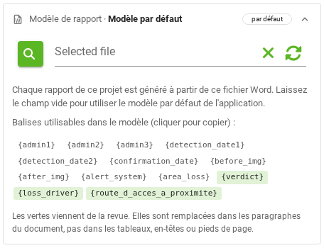

La ligne **Modèle de rapport** nomme le modèle utilisé, avec une pastille : **par défaut** (le modèle propre à l'application), **personnalisé** (votre fichier) ou **introuvable** (votre fichier a été déplacé ou supprimé). Dépliez-la avec la flèche à droite :

-   **Modèle de rapport (.docx)** : choisissez un fichier Word dans votre dossier SEPAL. Tous les rapports de ce projet sont alors construits à partir de lui. Videz le champ pour revenir au modèle par défaut, qui est dans la langue de l'application (anglais, espagnol, français ou portugais).
-   **Balises utilisables dans le modèle (cliquer pour copier) :** sélectionnez une pastille pour copier sa balise, puis collez-la dans le modèle.

.. list-table::
    :header-rows: 1
    :widths: 40 60

    *   -   Balise
        -   Remplacée par
    *   -   ``{admin1}``, ``{admin2}``, ``{admin3}``
        -   Les zones administratives dans lesquelles se trouve l'alerte.
    *   -   ``{detection_date1}``, ``{detection_date2}``
        -   Les dates de première et de dernière détection de l'alerte.
    *   -   ``{confirmation_date}``
        -   Le jour où le rapport est généré.
    *   -   ``{before_img}``, ``{after_img}``
        -   Les noms des images d'avant et d'après choisies pendant l'examen.
    *   -   ``{alert_system}``
        -   Les sources qui ont détecté l'alerte.
    *   -   ``{area_loss}``
        -   La superficie de l'alerte, en hectares (celle du groupe, pour un groupe).
    *   -   ``{centroid}``
        -   Le centre de l'alerte (du contour du groupe, pour un groupe) en latitude, longitude, en degrés décimaux (« -12.345678, -69.123456 »).
    *   -   ``{centroid_lat}``, ``{centroid_lon}``
        -   La même latitude et la même longitude, chacune seule (« -12.345678 », « -69.123456 »).
    *   -   ``{group_size}``, ``{group_alerts}``
        -   Pour une alerte examinée en groupe : le nombre d'alertes du groupe et leurs numéros (« 12, 15, 16 »). Sinon « 1 » et le numéro de l'alerte elle-même.
    *   -   ``{verdict}`` (en vert)
        -   Le verdict, dans la langue de l'application.
    *   -   Une par question (en vert)
        -   La réponse à cette question ; vide quand la question n'est pas posée pour le verdict de l'alerte.

Les balises vertes proviennent de l'examen. Les balises sont remplacées dans les paragraphes et les tableaux du document, pas dans les en-têtes ni les pieds de page.

Images dans le rapport
""""""""""""""""""""""

Le rapport contient aussi six vues de l'alerte, découpées dans les images d'avant et d'après choisies pendant l'examen. Elles ne figurent pas dans la liste des pastilles : le modèle indique l'emplacement de chacune par un paragraphe qui ne contient que son marqueur, de ``[Placeholder for Image 1]`` à ``[Placeholder for Image 6]``. Ce paragraphe est remplacé en entier par l'image (250 pt de large, ou moins pour tenir dans sa cellule de tableau) : n'y mettez donc rien d'autre.

.. list-table::
    :header-rows: 1
    :widths: 60 40

    *   -   Marqueur
        -   Image
    *   -   ``[Placeholder for Image 1]``, ``[Placeholder for Image 4]``
        -   L'image d'avant.
    *   -   ``[Placeholder for Image 2]``, ``[Placeholder for Image 5]``
        -   L'image d'après.
    *   -   ``[Placeholder for Image 3]``, ``[Placeholder for Image 6]``
        -   L'image d'après avec le contour de l'alerte en rouge.
    *   -   ``[Placeholder for Centroid QR]``
        -   Un code QR qui ouvre le centroïde de l'alerte dans Google Maps (80 pt de large, ou moins pour tenir dans sa cellule de tableau). Sans centroïde, le marqueur est supprimé.

Les images 1 à 3 sont en fausses couleurs (proche infrarouge, rouge, vert) et les images 4 à 6 en couleurs naturelles (rouge, vert, bleu). Une image Sentinel-1 donne des images radar, quel que soit leur nom dans le modèle : en couleurs naturelles, le rouge, le vert et le bleu montrent VV, VH et le rapport VV/VH ; en fausses couleurs, VV, VV et VH. Elles gardent la résolution de la plus fine des deux images (Sentinel-2 10 m, Sentinel-1 10 m, Landsat 15 m, Planet 4,77 m). Le modèle par défaut les dispose en une grille de trois colonnes (avant, après, après avec le contour) et deux lignes (couleurs naturelles, fausses couleurs), et place le code QR à côté des détails de l'alerte. Un modèle sans ces marqueurs donne un rapport sans images.

.. tip::

    Pour créer un modèle personnalisé, partez d'une copie du modèle par défaut. Laissez chaque marqueur seul dans son paragraphe ; dans une cellule de tableau, une légende peut le suivre dans son propre paragraphe.

Le modèle peut afficher deux messages :

-   « … n'est pas un fichier Word (.docx) de votre dossier SEPAL ; le modèle de rapport n'a pas été changé. » : choisissez un fichier .docx.
-   **introuvable**, avec « Le fichier a disparu : choisissez-le de nouveau, ou videz le champ pour utiliser le modèle par défaut. » : la carte reste ouverte jusqu'à ce que le fichier soit choisi à nouveau ou que le champ soit vidé.

.. tip::

    Quand les alertes sont réparties entre des évaluateurs, leurs paquets de révision emportent le questionnaire et le modèle de rapport. Si le questionnaire change après la génération des paquets, générez-les à nouveau (voir `Évaluation <defo-evaluation_>`_).

Passez ensuite à l'étape `Évaluation <defo-evaluation_>`_, où **Lancer l'analyse** commence l'examen.

.. _defo-evaluation:

Évaluation
----------

Cette étape détermine qui examine les alertes du jeu actif :

-   examinez-les toutes vous-même ; ou
-   répartissez-les entre plusieurs évaluateurs. Chaque évaluateur reçoit un *paquet de révision*, examine ses propres alertes dans son propre compte SEPAL et renvoie une *copie révisée*, qui est ensuite fusionnée dans le projet.

Ouvrez l'étape **Évaluation** du panneau **Flux de travail**, la dernière étape de **Configurer la revue**. Elle se déverrouille dès que le projet a un jeu d'alertes (voir `Intégrer et vectoriser <defo-integrate_>`_). Elle porte sur le jeu actif : une répartition appartient à un seul jeu d'alertes.

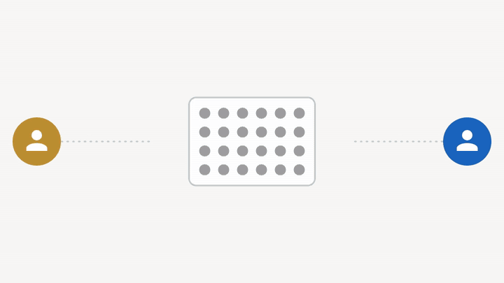

Dans l'animation, le rouge signale une perte confirmée et le vert un faux positif.

Mode de revue
^^^^^^^^^^^^^

Sous **Mode de revue**, cochez l'une des deux cases :

.. list-table::
    :header-rows: 1
    :widths: 30 70

    *   -   **Mode de revue**
        -   Description
    *   -   **Individuelle**
        -   Vous examinez vous-même toutes les alertes. Rien d'autre à configurer : sélectionnez **Lancer l'analyse**.
    *   -   **Plusieurs évaluateurs**
        -   Les alertes sont réparties entre des évaluateurs, et chacun reçoit un paquet de révision. Le tableau des évaluateurs apparaît en dessous.

Un projet démarre sans case cochée. La note en dessous indique « Choisissez qui examine les alertes : vous seul ou plusieurs évaluateurs. », et l'étape **Évaluation** du panneau **Flux de travail** reste vide.

-   Cocher une case décoche l'autre ; décocher la case cochée ne laisse plus aucun mode choisi.
-   **Individuelle** termine l'étape (son badge indique « 1 évaluateur »).
-   **Plusieurs évaluateurs** termine l'étape une fois les alertes réparties.
-   Tant qu'une répartition existe, les deux cases restent désactivées sur **Plusieurs évaluateurs** (**Supprimez la répartition pour passer en évaluation individuelle.**).

.. _defo-evaluation-group:

Réviser ensemble les alertes proches
""""""""""""""""""""""""""""""""""""

Dans sa propre carte, sous le mode de revue (et sous le tableau des évaluateurs avec **Plusieurs évaluateurs**), la case **Réviser ensemble les alertes proches** permet à `Analyse <defo-analysis-nearby_>`_ d'examiner des alertes voisines comme un seul groupe : « Dans Analyse, les alertes à cette distance peuvent être révisées avec un seul verdict, un seul jeu de réponses et un seul polygone. » Elle fonctionne dans les deux modes. Une fois cochée :

.. list-table::
    :header-rows: 1
    :widths: 30 45 25

    *   -   Champ
        -   Description
        -   Valeur par défaut et limites
    *   -   **Distance (m)**
        -   La distance maximale, de bord à bord, à laquelle une alerte est proposée dans le groupe.
        -   300. De 10 à 5 000.
    *   -   **Inclure les alertes déjà révisées**
        -   Propose aussi les alertes examinées avant l'activation du regroupement. « Décochée, les alertes révisées avant l'activation du regroupement ne sont jamais proposées. »
        -   Décochée.

Certaines modifications sont verrouillées :

-   Une fois des groupes enregistrés, le regroupement ne peut plus être désactivé et la distance ne peut plus changer : « 2 groupes sont enregistrés : supprimez-les pour désactiver le regroupement. »
-   Une répartition fige les trois réglages : « Les alertes ont été réparties avec regroupement : supprimez la répartition pour le modifier. » (ou « sans regroupement »).
-   Dans une copie de révision, ils sont « Défini par le créateur du projet. »

.. _defo-evaluation-split:

Répartir les alertes
^^^^^^^^^^^^^^^^^^^^

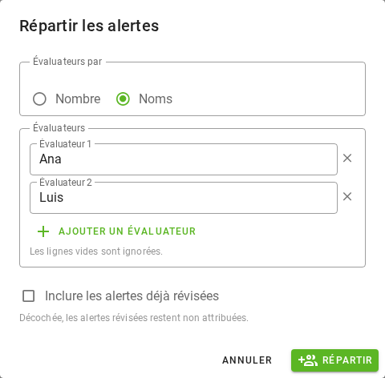

Avec **Plusieurs évaluateurs** coché, sélectionnez **Répartir les alertes…** sous le mode de revue pour ouvrir la boîte de dialogue **Répartir les alertes** :

.. list-table::
    :header-rows: 1
    :widths: 25 45 30

    *   -   Champ
        -   Description
        -   Valeur par défaut et limites
    *   -   **Répartir par**
        -   **Nombre** : les évaluateurs sont nommés « Évaluateur 1 », « Évaluateur 2 »… **Noms** : saisissez leurs noms.
        -   **Nombre**.
    *   -   **Nombre d'évaluateurs**
        -   Avec **Nombre**.
        -   2. De 1 à 50.
    *   -   **Évaluateur 1**, **Évaluateur 2**…
        -   Avec **Noms** : une ligne par évaluateur. **Ajouter un évaluateur** ajoute une ligne ; la croix en retire une.
        -   Deux lignes vides. Les lignes vides sont ignorées ; deux lignes ne peuvent pas porter le même nom ; 50 au plus.
    *   -   **Inclure les alertes déjà révisées**
        -   Distribue aussi les alertes déjà examinées. Décochée, elles restent non attribuées.
        -   Décochée.

Sélectionnez **Répartir**. Les alertes sont distribuées une à une dans l'ordre du jeu (l'**Ordre** choisi dans `Intégrer et vectoriser <defo-integrate-options_>`_), comme des cartes : la première à l'évaluateur 1, la deuxième à l'évaluateur 2, et ainsi de suite en faisant le tour de la liste. Chaque évaluateur reçoit à peu près le même nombre d'alertes, réparties sur tout l'ordre.

Avec **Réviser ensemble les alertes proches** coché, la répartition ne sépare jamais un groupe. Les alertes situées à la distance choisie les unes des autres, de bord à bord, s'enchaînent en un groupe d'alertes proches. Chaque groupe va entier à l'évaluateur qui a le moins d'alertes jusque-là. Quand un groupe contient plus qu'une part équitable, la boîte de dialogue prévient : « Un groupe d'alertes proches contient 30 alertes, plus qu'une part équitable. »

Le tableau des évaluateurs
""""""""""""""""""""""""""

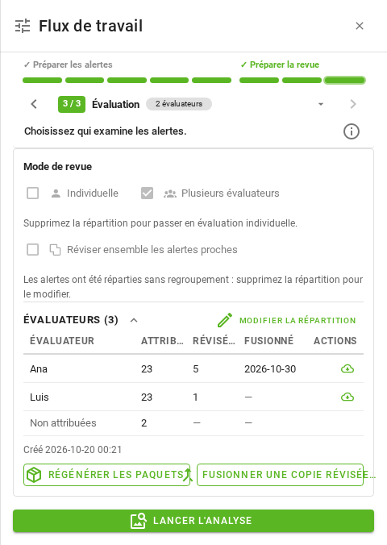

.. list-table::
    :header-rows: 1
    :widths: 20 80

    *   -   Colonne
        -   Description
    *   -   **Évaluateur**
        -   Le nom de l'évaluateur. Une dernière ligne, **Non attribuées**, compte les alertes qu'aucun évaluateur n'a reçues.
    *   -   **Attribuées**
        -   Le nombre d'alertes de l'évaluateur.
    *   -   Colonne **Révisées**
        -   Combien d'entre elles sont examinées dans *votre* projet (par vous, ou fusionnées depuis l'évaluateur).
    *   -   **Fusionné**
        -   La date de la dernière fusion de sa copie révisée, ou un tiret.

L'icône de nuage de chaque ligne télécharge le paquet de cet évaluateur une fois qu'il est généré.

Modifier ou supprimer la répartition
""""""""""""""""""""""""""""""""""""

**Modifier la répartition** (à la place de **Répartir les alertes…**) rouvre la boîte de dialogue sous le titre **Modifier la répartition des alertes** :

-   **Répartir à nouveau** redistribue les alertes avec les nouveaux noms ou le nouveau nombre. C'est une nouvelle répartition : les révisions déjà fusionnées restent, mais les paquets déjà envoyés pour l'ancienne répartition ne peuvent plus être fusionnés (la boîte de dialogue prévient : **Les paquets déjà envoyés pour cette répartition ne pourront plus être fusionnés.**).
-   **Supprimer la répartition** efface toutes les attributions. Les révisions restent.

.. attention::

    Relancer `Intégrer et vectoriser <defo-integrate-replace_>`_ sur le même jeu le remplace : ses révisions et sa répartition sont écartées, et les copies révisées de l'ancien jeu ne peuvent plus être fusionnées.

.. _defo-evaluation-packages:

Paquets de révision
^^^^^^^^^^^^^^^^^^^

Sélectionnez **Générer les paquets**. L'application crée un fichier .zip par évaluateur dans le dossier du jeu d'alertes (le bouton indique « Création 1 / 2… »). Chaque paquet contient :

-   les alertes du jeu avec leurs attributions ;
-   le questionnaire ;
-   l'AOI ;
-   la liste des scènes satellite déjà trouvées ;
-   les alertes antérieures auxquelles les alertes du jeu peuvent être liées (voir `Alertes précédentes <defo-analysis-earlier_>`_), telles qu'elles sont au moment de la génération des paquets ; et
-   le modèle de rapport, quand un modèle personnalisé a été choisi.

Une fois prêts, « Créé (date et heure) » s'affiche sous le tableau et l'icône de nuage de chaque ligne devient un lien de téléchargement.

Pour partager les paquets :

1.  Téléchargez le paquet de chaque évaluateur et envoyez-le-lui (par courriel, par un espace partagé…).
2.  L'évaluateur le copie dans son dossier SEPAL et l'importe avec **Importer** dans la boîte de dialogue `Projet <defo-project-import_>`_.

Le paquet s'ouvre comme copie de révision dans Analyse, filtré sur les alertes de l'évaluateur, avec les étapes de configuration verrouillées.

Un paquet a besoin de la forme de l'AOI. Tant qu'elle n'est pas chargée, l'étape indique **Les paquets attendent la géométrie de l'AOI : ouvrez l'étape AOI pour la charger.**

Si le `questionnaire <defo-questionnaire_>`_ change après la génération des paquets, les icônes de nuage passent à l'ambre (« Créé avant la modification du questionnaire : générez de nouveau les paquets. »). Sélectionnez **Régénérer les paquets** et envoyez les nouveaux.

.. _defo-evaluation-return:

Ce que fait l'évaluateur
^^^^^^^^^^^^^^^^^^^^^^^^

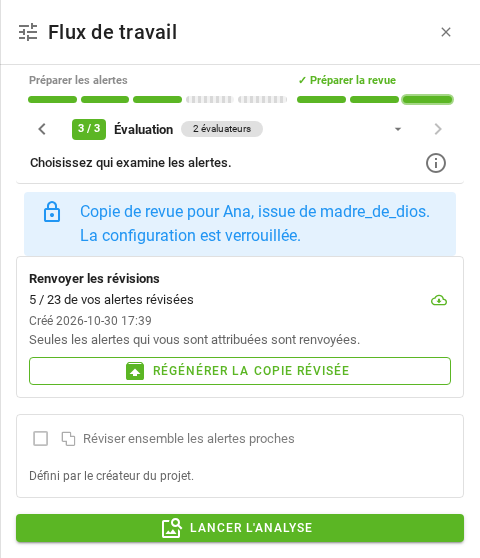

Dans une copie de révision, l'étape **Évaluation** affiche à la place **Renvoyer les révisions** : le nombre d'alertes de l'évaluateur qui sont examinées (« 5 / 23 de vos alertes révisées ») et **Générer la copie révisée**.

L'évaluateur :

1.  examine ses alertes dans `Analyse <defo-analysis_>`_ ;
2.  sélectionne **Générer la copie révisée**, puis la télécharge avec l'icône de nuage (un fichier .zip dont le nom se termine par ``__reviewed.zip``) ; et
3.  la renvoie au créateur du projet.

Seules les alertes attribuées à l'évaluateur et qu'il a examinées sont renvoyées, avec les liens vers des alertes antérieures qu'il a cochés. Une copie révisée contient les révisions telles qu'elles étaient au moment de sa création : après en avoir examiné d'autres, sélectionnez **Régénérer la copie révisée**. L'évaluateur peut envoyer des copies aussi souvent que nécessaire. Quand une copie plus récente est fusionnée, les alertes déjà fusionnées puis examinées autrement depuis apparaissent comme des conflits : choisissez **Prendre les leurs** pour retenir les dernières révisions de l'évaluateur.

.. _defo-evaluation-merge:

Fusionner une copie révisée
^^^^^^^^^^^^^^^^^^^^^^^^^^^

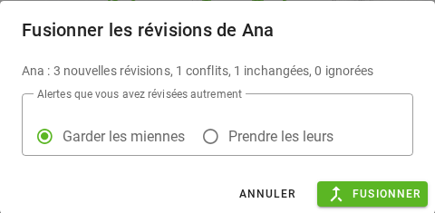

Pour fusionner une copie révisée :

1.  Copiez la copie révisée dans votre dossier SEPAL.
2.  Sélectionnez **Fusionner une copie révisée…** et choisissez-la dans **Copie révisée (.zip)**. Choisissez une seule copie à la fois.
3.  Lisez l'aperçu, intitulé avec le nom de l'évaluateur et affiché avant toute modification (voir le tableau ci-dessous).
4.  En cas de conflits, choisissez sous **Alertes que vous avez révisées autrement** : **Garder les miennes** (par défaut) ou **Prendre les leurs**.
5.  Sélectionnez **Fusionner**.

.. list-table::
    :header-rows: 1
    :widths: 20 80

    *   -   Compteur
        -   Description
    *   -   nouvelles révisions
        -   Les alertes examinées par l'évaluateur qui ne sont pas examinées dans votre projet. Elles sont reprises.
    *   -   conflits
        -   Les alertes qui ont aussi été examinées dans votre projet (par vous ou par une fusion antérieure), avec un résultat différent. Un lien différent vers une alerte antérieure compte comme une différence.
    *   -   inchangées
        -   Les alertes dont la révision est la même des deux côtés.
    *   -   ignorées
        -   Les alertes qui ne sont pas attribuées à cet évaluateur. Elles ne sont jamais reprises.

Avec le regroupement activé, chaque compteur donne aussi son nombre de groupes (« 3 nouvelles révisions (1 groupe) »). Un groupe est fusionné entier : quand l'une de ses alertes est en conflit, tout le groupe est un conflit.

Après la fusion, les alertes du jeu sont mises à jour, un message indique « N révisions de (évaluateur) fusionnées. », et la colonne **Fusionné** affiche la date.

L'aperçu peut aussi avertir que « Le questionnaire a changé depuis la création des paquets ; les réponses sont fusionnées par clé de question. », ou lister des colonnes qu'il ignore. Si l'alerte ouverte dans Analyse fait partie des alertes fusionnées, elle est rechargée.

.. tip::

    Dans `Analyse <defo-analysis_>`_, le filtre peut afficher les alertes d'un évaluateur (ou celles qui ne sont pas attribuées) grâce à son attribut **Évaluateur**.

Messages fréquents
^^^^^^^^^^^^^^^^^^

« Cette copie concerne le jeu … ; activez-le pour la fusionner. »
    Choisissez d'abord ce jeu dans le sélecteur de jeux d'Analyse ou de l'Aperçu.

« Le jeu a été relancé depuis la création de cette copie. » ou « Cette copie a été faite pour une répartition antérieure. »
    La copie ne correspond plus aux alertes du jeu. Elle ne peut pas être fusionnée.

« Ce zip est un paquet de révision, pas une copie révisée. »
    Choisissez le fichier que l'évaluateur a renvoyé.

« Ce retour casserait un groupe d'alertes : rien n'a été fusionné. Choisissez Garder les miennes, ou demandez à l'évaluateur de mettre à jour l'application et de renvoyer la révision. »
    Reprendre les révisions de l'évaluateur scinderait un groupe enregistré dans votre projet. Choisissez **Garder les miennes**, ou demandez une copie révisée faite avec une application à jour.

« Une copie de révision ne peut pas fusionner de copies révisées ; ouvrez le projet du créateur. »
    Fusionnez dans le projet d'origine.

« Ce jeu a un attribut nommé 'evaluator' ; renommez cette couche d'attributs et relancez le jeu. »
    La table des alertes du jeu a déjà une colonne ``evaluator``, issue d'une couche d'attributs : le jeu ne peut donc pas être réparti. Dans `Intégrer et vectoriser <defo-integrate-attributes_>`_, donnez un autre nom à cette couche et relancez le jeu (ce qui remplace le jeu et ses révisions).

« Les alertes de cet ensemble portent des attributions d'évaluateurs, mais le projet n'a aucune répartition enregistrée. Supprimez la répartition pour recommencer. »
    Une répartition a été écrite dans les alertes mais pas dans le projet (par exemple, le projet a été fermé à ce moment-là). Ouvrez **Modifier la répartition**, sélectionnez **Supprimer la répartition**, puis répartissez à nouveau.

« Ce jeu d'alertes a été réécrit pendant la répartition : rien n'a donc été modifié. Réessayez. »
    Une révision a été enregistrée ou une copie fusionnée au même moment. Répartissez à nouveau.

« Ce jeu d'alertes est en cours de relance dans Intégrer et vectoriser. Réessayez une fois terminé. » (lors de la répartition)
    Attendez la fin de l'exécution.

« Aucune alerte à attribuer. » (lors de la répartition)
    Toutes les alertes sont peut-être déjà examinées : cochez **Inclure les alertes déjà révisées**.

.. _defo-analysis:

Analyse
-------

.. labels-ok: Google; Esri; Entrée

Utilisez l'écran Analyse pour examiner les alertes du jeu actif, une à une. Pour chaque alerte :

1.  Comparez une image satellite d'*avant* et une image d'*après*.
2.  Donnez un verdict.
3.  Répondez aux questions du projet.
4.  Enregistrez.

Le polygone de l'alerte peut aussi être redessiné, à la main ou à l'aide de deux modèles de détection automatique, et les fichiers de l'alerte exportés.

Ouvrir l'écran
^^^^^^^^^^^^^^

L'écran s'ouvre sur le jeu d'alertes actif, depuis l'un de ces points d'accès :

-   **Lancer l'analyse**, en bas de l'étape `Évaluation <defo-evaluation_>`_ ;
-   **Analyse**, dans la barre latérale gauche ; ou
-   **Réviser les alertes** dans l'`Aperçu <defo-overview_>`_, ou le bouton **Examiner** d'une alerte cliquée sur la carte principale (voir `Voir les alertes sur la carte <defo-integrate-map_>`_).

Il a besoin d'un jeu d'alertes : tant qu'`Intégrer et vectoriser <defo-integrate_>`_ n'en a pas produit un, le compteur indique « Aucun lot d'alertes n'est chargé ». Un jeu s'ouvre sur l'alerte en cours d'examen lorsque l'écran a été quitté pour la dernière fois (la position est enregistrée avec le projet).

**Flux de travail**, en haut à gauche, ramène aux étapes du flux de travail. La barre latérale gauche reste utilisable sur cet écran : un clic sur une carte la replie quand elle est déployée sans épingle, et une barre épinglée et déployée décale l'écran à sa droite au lieu de couvrir les cartes.

L'écran
^^^^^^^

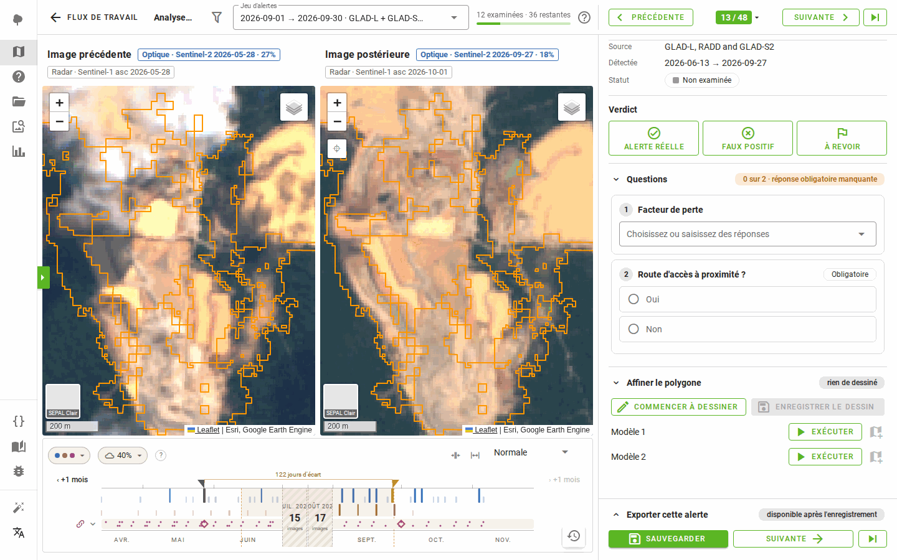

.. list-table::
    :header-rows: 1
    :widths: 20 80

    *   -   Partie
        -   Contenu
    *   -   Barre du haut
        -   Le filtre, le jeu d'alertes, l'avancement de l'examen, l'aide et la navigation.
    *   -   Les deux cartes
        -   L'image d'*avant* à gauche, l'image d'*après* à droite. Elles bougent ensemble : déplacez ou zoomez l'une, l'autre suit.
    *   -   La frise chronologique
        -   Sous les cartes : toutes les images de la zone de l'alerte, sur un même axe de dates. Ses deux poignées choisissent l'image d'avant et l'image d'après.
    *   -   Le panneau d'examen
        -   À droite : ce que la table des alertes dit de l'alerte, le verdict, les questions, les outils de dessin, les alertes précédentes à proximité, puis un pied de panneau qui reste en bas avec la section d'export et les boutons d'enregistrement. Seul ce panneau défile.

L'icône d'aide de la barre du haut ouvre **À propos de l'analyse**, un bref résumé de cette sous-section.

.. _defo-analysis-topbar:

La barre du haut
^^^^^^^^^^^^^^^^

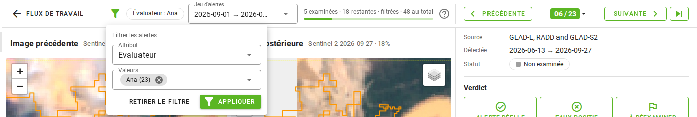

De gauche à droite :

.. list-table::
    :header-rows: 1
    :widths: 25 75

    *   -   Commande
        -   Description
    *   -   Entonnoir
        -   Ouvre le filtre (voir plus bas). Quand un filtre est actif, l'entonnoir est plein et une pastille le nomme (par exemple « Évaluateur : Ana »). La croix de la pastille retire le filtre.
    *   -   **Jeu d'alertes**
        -   Le jeu en cours d'examen : « période · sources · N alertes · N examinées », du plus récent au plus ancien. Choisir un autre jeu en fait le jeu actif du projet, y compris pour les autres étapes et pour l'Aperçu.
    *   -   Avancement
        -   « 12 examinées · 36 restantes » au-dessus d'une barre.
    *   -   **Précédente** / **Suivante**
        -   L'alerte précédente ou suivante dans l'ordre du jeu. Elles s'arrêtent à la première et à la dernière alerte.
    *   -   Compteur
        -   Le numéro de l'alerte dans le jeu (« 13 / 48 »). Sélectionnez-le pour ouvrir **Aller au numéro d'alerte** : saisissez un numéro et sélectionnez **Aller**, ou appuyez sur **Entrée**.
    *   -   Icône **Prochaine alerte non révisée**
        -   Passe à l'alerte suivante sans verdict, en reprenant depuis le début après la dernière. Désactivée quand il ne reste aucune autre alerte à examiner.

Quand l'alerte à l'écran a des modifications non enregistrées, chaque moyen de passer à une autre alerte demande d'abord (voir `Enregistrer la révision <defo-analysis-save_>`_).

L'ordre des alertes est l'**Ordre** choisi dans `Intégrer et vectoriser <defo-integrate-options_>`_.

Filtrer les alertes
"""""""""""""""""""

Le filtre retient certaines valeurs d'un attribut et masque les autres alertes de la navigation. Pour filtrer les alertes :

1.  Sélectionnez l'entonnoir pour ouvrir **Filtrer les alertes**.
2.  Dans **Attribut**, choisissez ce sur quoi filtrer. La liste propose **Évaluateur** (quand le jeu est `réparti <defo-evaluation-split_>`_), **Statut**, **Type** (quand le jeu a des `alertes d'extension <defo-integrate-growth_>`_ : choisissez **Extension** pour les examiner ensemble), chaque question du questionnaire, puis les autres colonnes du jeu qui comptent entre 2 et 50 valeurs différentes, comme les colonnes d'une `couche d'attributs <defo-integrate-attributes_>`_. Si le jeu n'en a aucune, le menu indique « Aucun attribut pour filtrer ».
3.  Dans **Valeurs**, sélectionnez une ou plusieurs valeurs, chacune avec son nombre d'alertes (par exemple « Ana (24) »). Une alerte correspond quand elle a l'une d'entre elles. Les cellules vides sont listées comme **Non attribuée** pour l'évaluateur et **(vide)** pour les autres colonnes.
4.  Sélectionnez **Appliquer**.

**Retirer le filtre** supprime le filtre.

Quand un filtre est actif :

-   **Précédente**, **Suivante** et l'icône **Prochaine alerte non révisée** ne parcourent que les alertes correspondantes ;
-   le compteur compte les correspondances (« 06 / 24 »), ou indique « – / 24 » tant que l'alerte à l'écran n'en fait pas partie, et la ligne d'avancement se termine par « filtrées · 48 au total » ;
-   le menu de saut prend toujours le numéro de l'alerte dans le jeu entier, mais refuse un numéro que le filtre masque (« L'alerte 12 n'est pas dans le filtre actuel ») ; et
-   quand rien ne correspond, le compteur indique « Aucune alerte ne correspond à ce filtre ».

Quand un filtre est appliqué, l'écran reste sur l'alerte affichée si elle correspond, sinon passe à la première correspondance non examinée, sinon à la première correspondance. Les alertes gardent leurs numéros : un filtre ne les renumérote jamais.

Le filtre reste actif jusqu'à ce qu'il soit retiré ou qu'un autre jeu d'alertes soit choisi. Il n'est pas enregistré avec le projet. Une `copie de révision <defo-evaluation-return_>`_ s'ouvre déjà filtrée sur les alertes de l'évaluateur.

Les cartes
^^^^^^^^^^

Les deux cartes se centrent sur l'alerte à son ouverture. Un cadre jaune en pointillés marque l'étendue de l'alerte.

.. list-table::
    :header-rows: 1
    :widths: 20 25 55

    *   -   Commande
        -   Emplacement
        -   Description
    *   -   **Couches**
        -   En haut à droite de chaque carte
        -   Les couches de la carte, en trois sections. Sélectionnez une couche pour l'afficher sur cette carte uniquement.
    *   -   **Fond de carte**
        -   En bas à gauche de chaque carte
        -   Survolez la vignette pour choisir le fond de carte : Google, Esri (tous deux en imagerie satellite), **SEPAL Clair** ou **SEPAL Sombre**. Le choix s'applique aux deux cartes. Le fond par défaut suit le thème de l'application : **SEPAL Clair**, ou **SEPAL Sombre** avec le thème sombre. Changer de thème les échange ; un fond satellite reste en place.
    *   -   **Zoomer sur l'alerte**
        -   En haut à gauche de la carte d'après
        -   Recentre les deux cartes sur l'alerte.
    *   -   Barre d'échelle
        -   En bas à gauche de chaque carte, sous la vignette du fond de carte
        -   L'échelle de la carte, en mètres ou en kilomètres.

Le menu **Couches** liste :

.. list-table::
    :header-rows: 1
    :widths: 25 75

    *   -   Section
        -   Couches
    *   -   **Imagerie**
        -   *True Color* (activée) et *False Color* (proche infrarouge, rouge et vert ; désactivée) : l'image choisie pour cette carte.
    *   -   **Alertes**
        -   *Original alert* : le contour du polygone de l'alerte issu d'`Intégrer et vectoriser <defo-integrate_>`_, et celui des autres alertes de son groupe (voir `Alertes proches <defo-analysis-nearby_>`_), activée par défaut et masquée pendant le dessin. *All alerts* : les pixels d'alerte de tout le jeu, en semi-transparence (désactivée). *Alert BB* : le cadre de l'alerte. *Defo Layer* : le polygone enregistré pour l'alerte (voir `Affiner le polygone <defo-analysis-refine_>`_). *Alertes précédentes* (voir `Alertes précédentes <defo-analysis-earlier_>`_). *Nearby alerts*, seulement quand les alertes proches sont révisées ensemble.
    *   -   **Couches supplémentaires**
        -   Les `couches supplémentaires <defo-layers_>`_ marquées **Afficher dans Analyse**, désactivées.

Une carte affiche « Les images n'ont pas pu être chargées » quand les tuiles de son image ne se chargent pas.

.. _defo-analysis-timeline:

Choisir les images : la frise chronologique
^^^^^^^^^^^^^^^^^^^^^^^^^^^^^^^^^^^^^^^^^^^

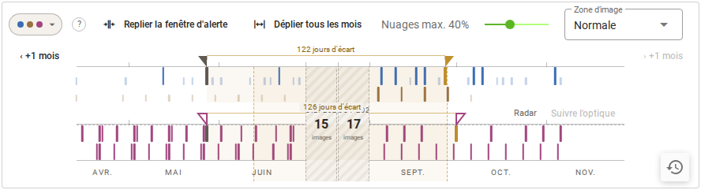

La frise montre toutes les images qui couvrent l'alerte, d'environ deux mois avant sa première détection à deux mois après sa dernière détection. Chaque source d'images activée dans le menu **Sources d'images** (voir plus bas) a sa propre bande :

-   les traits *Sentinel-2* en haut ;
-   *Landsat* au milieu ;
-   *Planet* (la mosaïque mensuelle NICFI), sous forme de barre couvrant son mois, seulement quand votre compte GEE a accès à NICFI et que vous l'avez activée ; et
-   le radar *Sentinel-1*, seulement quand vous l'avez activé, avec une bande par passage (*Sentinel-1 asc* et *Sentinel-1 desc*).

Un trait estompé, à mi-hauteur, est une image au-dessus de la limite de nuages. La bande dorée est la *fenêtre de l'alerte* : les dates sur lesquelles l'alerte a été détectée. Sur une `alerte d'extension <defo-integrate-growth_>`_, une bande grise derrière elle marque les dates de détection de chaque alerte antérieure à laquelle elle est liée : choisissez une image d'avant prise après le défrichement antérieur pour ne voir que la nouvelle perte.

Deux poignées au-dessus de la piste choisissent les images : celle de gauche l'image d'avant, celle de droite l'image d'après. L'accolade entre elles indique leur écart en jours (« 49 jours d'écart »), ou prévient « la même image des deux côtés ».

Pour déplacer une poignée, utilisez l'une de ces méthodes :

-   Faites glisser une poignée et relâchez-la sur l'image voulue. La poignée d'avant ne peut pas dépasser celle d'après.
-   Cliquez sur un trait : la poignée appropriée la plus proche s'y place. Les images au-dessus de la limite de nuages ne peuvent pas être sélectionnées.
-   Au clavier : appuyez sur **Tab** pour atteindre une poignée, parcourez les dates avec les flèches gauche et droite, sautez à la première ou à la dernière image avec **Début** et **Fin**, et choisissez avec **Entrée**.

À l'ouverture d'une alerte, l'application choisit l'image la plus proche *avant* la fenêtre de l'alerte et l'image la plus proche *après*, parmi les images sous la limite de nuages. Elle ne choisit jamais une image située dans la fenêtre de l'alerte (elle ne montrerait qu'une partie de la coupe), une mosaïque Planet ni une image radar Sentinel-1, mais toutes peuvent être choisies à la main. Un côté sans image sous la limite de nuages reste « non défini ». Une alerte examinée s'ouvre sur les images avec lesquelles elle a été enregistrée. Si l'une d'elles n'est plus disponible, le titre de sa carte indique « Image enregistrée indisponible ; choisie automatiquement ».

Le titre de chaque carte nomme son image : « Image précédente · Sentinel-2 2026-07-28 · 3% » (collection, date, couverture nuageuse). Quand l'autre collection a une image du même jour, un bouton dans le titre (« ⇄ Landsat ») permet de basculer vers elle.

La barre d'outils au-dessus de la piste :

.. labels-ok: Tab; Début; Fin

.. list-table::
    :header-rows: 1
    :widths: 25 55 20

    *   -   Commande
        -   Description
        -   Par défaut
    *   -   Bouton **Sources d'images**
        -   Ouvre le menu des sources d'images, en deux groupes : **Optique** (Sentinel-2, Landsat, Planet) et **Radar** (Sentinel-1). Le bouton porte un point de couleur pour chaque source activée. Chaque ligne a une case à cocher, le point et le nom de la source et, à droite, le nombre de ses images dans la vue actuelle ; une seconde ligne (« 3 au-dessus de la limite de nuages ») apparaît quand la limite de nuages en masque. Planet est grisée, avec « Pas d'accès avec ce compte », quand votre compte GEE n'a pas accès à NICFI. Le choix est enregistré avec le projet (sur une copie de révision, il ne dure que la session), et l'ouverture d'une alerte dont l'image enregistrée vient d'une source désactivée active cette source.
        -   Sentinel-2 et Landsat activées ; Planet et Sentinel-1 désactivées.
    *   -   Bouton **?**
        -   Affiche ou masque une courte légende de la frise. Cette section la décrit en entier.
        -   Masquée.
    *   -   **Replier la fenêtre d'alerte**
        -   Replie les mois entièrement compris dans la fenêtre de l'alerte en blocs qui indiquent leur nombre d'images. Sélectionnez un bloc pour déplier son mois ; sélectionnez le nom d'un mois sur l'axe pour le replier. Sur une longue alerte, les mois repliés occupent moins de la moitié de la piste, si bien que les mois d'avant et d'après la fenêtre gardent leur place. Quand ils deviennent trop étroits pour être lus, les mois repliés de chaque semestre forment un seul bloc (« janv. – juin 2024 ») avec l'année sur l'axe en dessous ; sélectionnez-le pour le scinder en un bloc par mois.
        -   Repliée à l'ouverture d'une alerte.
    *   -   **Déplier tous les mois**
        -   Déplie tous les mois.
        -
    *   -   **Nuages max.**
        -   La limite de nuages, de 0 à 100 % par pas de 5. Les images au-dessus sont estompées et jamais choisies automatiquement. Les mosaïques Planet et les images radar Sentinel-1 n'ont pas de couverture nuageuse : la limite ne les masque donc jamais.
        -   40 %.
    *   -   **Zone d'image**
        -   Jusqu'où les images s'étendent autour de l'alerte : **Normale**, **Grande** ou **Très grande** (100 m, 1 km ou 2,5 km autour d'elle). Les zones plus grandes sont plus longues à charger et à exporter. Enregistrer la revue enregistre la zone : l'alerte s'ouvre de nouveau sur elle, et ses fichiers et son GIF sont faits avec elle. Une alerte jamais enregistrée s'ouvre sur **Normale**.
        -   **Normale**.
    *   -   **+1 mois** (à gauche et à droite de la piste)
        -   Ajoute un mois avant ou après la vue. Celui de droite s'arrête au mois en cours.
        -

Les images radar Sentinel-1 sont traitées autrement que les images optiques :

-   Elles ne sont récupérées qu'une fois Sentinel-1 activé pour le projet : tant que ses images ne sont pas listées, son compte indique « – ».
-   Les deux passages sont affichés, une bande par passage, étiquetées « Sentinel-1 asc » et « Sentinel-1 desc ».
-   Elles sont affichées brutes, sans filtre de chatoiement (speckle), sous la forme de VV, VH et du rapport VV/VH en rouge, vert et bleu. Dans le volet de la carte, une image radar a une seule couche « Radar », sans bascule entre couleurs naturelles et fausses couleurs.
-   Le radar voit à travers les nuages : la limite de nuages ne masque jamais ces images, et le choix automatique ne les retient jamais. Sélectionnez-en une à la main.
-   Avec une image Sentinel-1 choisie, les fichiers et le rapport sont construits à partir de l'image radar (10 m). Le modèle a besoin d'images optiques des deux côtés : il la refuse et demande une image Sentinel-2, Landsat ou Planet à la place. Le GIF n'utilise que les images optiques autour de l'image radar choisie (les images Planet choisies apparaissent toujours dans les GIF) ; s'il n'y en a aucune, le GIF est omis et l'avertissement sous **Générer les fichiers** en donne la raison.

Les images proviennent d'un index des images de la zone du projet, conservé sur le disque et rafraîchi au bout de 24 heures. Pendant son chargement, la barre d'outils indique « Chargement de l'index des images… » ; un index de plus d'un jour affiche « Index du (date) ». Si un rafraîchissement échoue, l'index affiché continue de fonctionner, et **Réessayer** relance la tentative.

.. _defo-analysis-panel:

Le panneau d'examen
^^^^^^^^^^^^^^^^^^^

Le haut du panneau montre ce que dit la table des alertes :

.. list-table::
    :header-rows: 1
    :widths: 20 80

    *   -   Ligne
        -   Description
    *   -   **Source**
        -   Les sources qui ont détecté l'alerte.
    *   -   **Détectée**
        -   Ses dates de première et de dernière détection.
    *   -   Ligne **Statut**
        -   Son état d'examen, avec sa couleur : **Non examinée**, **Examinée : confirmée**, **Examinée : faux positif** ou **Examinée : à revoir**.
    *   -   **Groupe**
        -   Pour une alerte examinée avec des alertes proches : « groupe de 4 ». Masquée sinon.
    *   -   **Type**
        -   Si l'alerte est l'extension d'une perte antérieure (voir `Extension d'une perte antérieure <defo-integrate-growth_>`_) : **Extension** (une pastille violette), **Extension · sous la surface minimale**, ou **Nouvelle · sous la surface minimale** (une petite alerte dont tous les liens ont été retirés). Masquée pour une nouvelle alerte.
    *   -   **Historique**
        -   Pour une alerte liée à une perte antérieure : les alertes de son historique et la superficie qu'elles confirment, par exemple « 3 alertes · 2,1 ha confirmés depuis août 2026 (+0,3 ha non examinés) ». La superficie est comptée une seule fois là où les formes se chevauchent. Masquée quand l'alerte n'a pas d'historique.

Si le jeu actif est obsolète ou si ses fichiers sont manquants, une ligne orange au-dessus le signale, comme dans l'`Aperçu <defo-overview_>`_. L'examen reste possible.

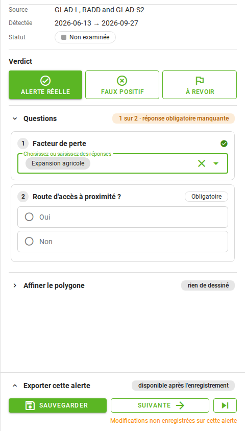

Verdict
"""""""

Sous **Verdict**, sélectionnez l'un des boutons :

.. list-table::
    :header-rows: 1
    :widths: 20 30 50

    *   -   Bouton
        -   Statut enregistré
        -   Quand l'utiliser
    *   -   **Alerte réelle**
        -   **Examinée : confirmée**
        -   Les images montrent une perte forestière à l'endroit de l'alerte.
    *   -   **Faux positif**
        -   **Examinée : faux positif**
        -   Elles ne montrent aucune perte forestière : nuages, ombres, changement saisonnier…
    *   -   **À réexaminer**
        -   **Examinée : à revoir**
        -   Aucune décision n'est encore possible, ou l'alerte mérite un second regard.

Une alerte non examinée s'ouvre sans verdict : rien n'est choisi automatiquement. Une alerte examinée s'ouvre sur son verdict et ses réponses enregistrés.

Questions
"""""""""

La section **Questions** contient les questions du `questionnaire <defo-questionnaire_>`_, dans leur ordre et numérotées. Une fois un verdict choisi, elle n'affiche que les questions posées pour ce verdict. Le badge de la section compte les réponses (« 1 sur 2 répondues ») et passe à l'orange quand une question obligatoire est sans réponse (« 1 sur 2 · réponse obligatoire manquante »).

-   Une question à une seule réponse présente ses options sous forme de tuiles : sélectionnez-en une.
-   Une question à plusieurs réponses les présente sous forme de pastilles : sélectionnez chacune de celles qui s'appliquent.
-   Une question qui autorise les réponses saisies est une liste qui accepte aussi la saisie (**Choisissez ou saisissez des réponses**).

Si le projet n'a aucune question, la section indique « Ce projet ne pose aucune question : ajoutez-en à l'étape Questionnaire. » ; si le verdict choisi n'en pose aucune, « Aucune question n'est posée pour ce verdict. »

Une étiquette **Obligatoire** marque une question à laquelle il faut répondre avant d'enregistrer. La section démarre ouverte ou fermée selon le réglage **Afficher les questions dépliées dans Analyse** du questionnaire. Elle s'ouvre d'elle-même quand le verdict choisi pose une question obligatoire encore sans réponse, et quand un enregistrement est refusé pour cette raison.

.. _defo-analysis-refine:

Affiner le polygone
"""""""""""""""""""

Le polygone de l'alerte provient des pixels d'alerte. Dans **Affiner le polygone**, dessinez à la place la zone réellement perdue. Le polygone enregistré est stocké avec la révision, affiché comme *Defo Layer* sur les cartes, et sa superficie devient celle de l'alerte. Le badge de la section indique « rien de dessiné » ou, par exemple, « 2 formes · 1,3 ha ».

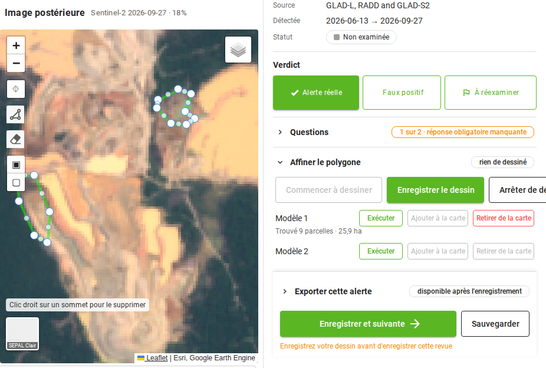

Pour affiner le polygone :

1.  Sélectionnez **Commencer à dessiner**. Les deux cartes passent en mode dessin, le cadre de l'alerte est masqué et le polygone enregistré (s'il existe) devient le dessin, en bleu. **Arrêter de dessiner** prend la place du bouton.
2.  Modifiez le dessin sur l'une ou l'autre carte ; l'autre suit :

    -   Le bouton polygone en haut à gauche dessine une nouvelle forme : cliquez sur ses sommets, puis sur le premier pour la fermer.
    -   Faites glisser un sommet pour le déplacer, cliquez sur le petit repère au milieu d'un côté pour ajouter un sommet, et faites un clic droit sur un sommet pour le supprimer. Une modification qui ferait se croiser une forme est annulée.
    -   Le bouton corbeille supprime la forme sur laquelle vous cliquez ensuite. Ses actions **Sélectionner une zone** (tracez un cadre autour des formes à supprimer) et **Tout effacer** demandent d'abord confirmation (« Supprimer 2 formes ? », **Annuler** / **Supprimer**), les formes concernées apparaissant en rouge. Appuyez sur **Échap** pour annuler.
    -   **Combler les trous** supprime les trous de la forme sélectionnée, ou de toutes les formes si aucune n'est sélectionnée. **Supprimer un trou** : cliquez à l'intérieur d'un trou pour le supprimer ; appuyez sur **Échap** ou sélectionnez à nouveau le bouton pour arrêter.

3.  Sélectionnez **Enregistrer le dessin**. Le dessin devient le polygone de l'alerte. Un dessin sans forme supprime le polygone.
4.  Sélectionnez **Arrêter de dessiner** pour quitter le mode dessin. Si le dessin a des modifications non enregistrées avec **Enregistrer le dessin**, la boîte de dialogue **Abandonner le dessin non enregistré ?** le demande d'abord : **Continuer à dessiner**, **Enregistrer et arrêter** ou **Abandonner les modifications**.

.. important::

    **Enregistrer le dessin** n'enregistre pas la révision : sélectionnez ensuite **Sauvegarder**. Tant que le dessin n'est pas enregistré, le pied du panneau indique « Enregistrez votre dessin avant d'enregistrer cette revue » et la révision ne peut pas être enregistrée.

Les deux modèles
################

Sous les boutons de dessin, deux réseaux de neurones convolutifs (CNN) peuvent trouver la perte sur les images d'avant et d'après affichées : **Modèle 1** (« Modèle plus petit et rapide ») et **Modèle 2** (« Modèle plus grand mais plus lent »).

Pour utiliser un modèle :

1.  Sélectionnez **Exécuter** sur la ligne d'un modèle. L'application télécharge les deux images (la zone fixée par **Zone d'image**) et exécute le modèle. Cela prend un moment ; l'exécution apparaît dans la liste des tâches.
2.  Lisez le résultat sur la ligne (par exemple « Trouvé 3 parcelles · 2,1 ha »). Les parcelles plus petites que la **Taille minimale de groupe** du jeu sont écartées. Quand le modèle n'a rien trouvé, une icône d'avertissement rouge apparaît à la place (« Le modèle n'a trouvé aucune perte »).
3.  Sélectionnez l'icône de carte avec un signe plus (**Ajouter à la carte**) pour ajouter les parcelles au dessin (en passant en mode dessin si nécessaire) : en vert citron pour le **Modèle 1**, en violet pour le **Modèle 2**. L'icône prend alors un signe moins (**Retirer de la carte**), qui les retire.
4.  Modifiez le résultat comme n'importe quel dessin, puis sélectionnez **Enregistrer le dessin**.

Choisir d'autres images ou une autre **Zone d'image** efface les résultats des modèles : relancez-les. Si une autre alerte est ouverte pendant qu'un modèle tourne, son résultat n'est pas ajouté (« Le modèle a terminé après votre passage à une autre alerte : sa prédiction n'a pas été ajoutée. »).

.. _defo-analysis-earlier:

Alertes précédentes
"""""""""""""""""""

Cette section apparaît quand la période du jeu actif est précédée de périodes ayant des jeux d'alertes. Elle liste la perte antérieure proche de l'alerte : les alertes des périodes antérieures examinées comme **Examinée : confirmée** ou **Examinée : à revoir**, dans la distance fixée par **Dans un rayon de**, en mètres (100 m par défaut, de 10 m à 50 km), ainsi que toutes les alertes liées à celle-ci, quelle que soit leur distance. Servez-vous-en pour vérifier si une alerte prolonge une coupe déjà signalée, et pour la lier à cette coupe.

Les alertes sont regroupées par période, de la plus récente à la plus ancienne. Chaque ligne affiche :

-   une barre à la couleur de la période ;
-   une case, cochée quand l'alerte est liée à celle-ci ;
-   le numéro et la superficie de l'alerte antérieure (« #12 · 3,4 ha »), et son statut ; et
-   son rapport avec cette alerte : « touche » (liée par `Intégrer et vectoriser <defo-integrate-growth_>`_), « touche · non liée » (le lien a été retiré) ou sa distance (« 40 m »).

Sélectionnez le numéro d'une alerte pour zoomer les deux cartes sur elle.

Pour lier ou délier une alerte, cochez ou décochez sa case. La modification fait partie de la révision : le pied du panneau indique « Modifications non enregistrées sur cette alerte », et **Sauvegarder** l'enregistre avec le verdict. Cocher une alerte d'une période antérieure fait de cette alerte une alerte d'extension, même si elle ne la touche pas.

Une alerte d'extension plus petite que la **Taille minimale de groupe** n'est dans le jeu que grâce à son lien. Décocher son dernier lien demande d'abord (**Délier de l'alerte antérieure ?**) : par exemple « L'alerte #14 fait 0,2 ha, sous le minimum de 0,5 ha. Elle n'est une alerte que parce qu'elle est liée à #12. » Sélectionnez **Délier** pour retirer le lien : l'alerte reste dans le jeu comme **Nouvelle · sous la surface minimale**.

Certaines lignes n'ont pas de case :

-   « par #12 » : l'alerte appartient à l'historique par un autre lien (ici, l'alerte 12). Décocher la case de l'alerte 12 la retire aussi.
-   « l'ensemble précédent a été relancé » : le jeu de l'alerte antérieure a été refait dans `Intégrer et vectoriser <defo-integrate-replace_>`_, si bien que le lien ne désigne plus la même alerte. La ligne est grisée, n'est pas comptée dans l'historique, et le lien est supprimé au prochain enregistrement de cette alerte.

Une alerte liée examinée ensuite comme faux positif reste cochée avec « désormais faux positif ». Elle est grisée et exclue de l'historique ; décochez sa case pour retirer le lien.

Activez **Afficher sur les cartes** pour tracer le contour des alertes listées sur les deux cartes. La couleur est celle de la période, et une petite légende liste les périodes affichées, avec « continu : confirmée · tirets : à réviser · épais : liée ». L'interrupteur démarre activé pour une alerte d'extension ; sur les autres alertes, il garde votre dernier choix. Quand la liste couvre plusieurs périodes, le menu **Périodes** en masque certaines. Le badge indique « désactivé », « aucune à moins de 100 m » ou, par exemple, « 4 à moins de 100 m · liens : 1 ».

Dans une `copie de révision <defo-evaluation-return_>`_, la liste provient d'un instantané des alertes antérieures pris lors de la génération des paquets : la section indique « Alertes précédentes au (date) », ou « Aucune alerte précédente dans cette copie » pour un paquet créé par une ancienne version de l'application.

.. _defo-analysis-nearby:

Alertes proches
"""""""""""""""

Cette section n'apparaît que si **Réviser ensemble les alertes proches** est coché dans `Évaluation <defo-evaluation-group_>`_. Un même défrichement produit souvent plusieurs petites alertes côte à côte. Examinez-les ensemble : un seul verdict, un seul jeu de réponses, une seule paire d'images et un seul polygone pour toutes.

La section liste les alertes situées à la distance fixée dans **Évaluation**, mesurée de bord à bord depuis l'alerte à l'écran : d'abord les alertes cochées, puis les plus proches des autres, 50 au plus (« 12 autres dans le rayon, non listées »). Chaque ligne affiche :

-   une case, cochée quand l'alerte fait partie du prochain enregistrement ;
-   le numéro de l'alerte (sélectionnez-le pour zoomer les deux cartes sur elle), sa date de première détection et sa superficie ;
-   sa distance (« 40 m »), ou « dans ce groupe » ;
-   « groupe n° 12 » quand elle appartient à un autre groupe ;
-   son statut ; et
-   dans un jeu réparti, « attribuée à Ana », grisée et sans case, pour une alerte d'un autre évaluateur.

La liste propose les alertes non examinées et les alertes examinées dans un groupe. Les alertes examinées avant l'activation du regroupement ne sont proposées qu'avec **Inclure les alertes déjà révisées**.

Le contour des alertes listées est tracé sur les deux cartes (couche *Nearby alerts*). Cliquez sur une carte près d'un contour pour cocher ou décocher cette alerte. **Tout sélectionner** coche toutes les alertes listées et **Effacer** les décoche. Le badge indique « 3 sélectionnées », « 5 à moins de 300 m » ou « aucune à moins de 300 m ». Quand une alerte cochée se trouve hors des images, une ligne indique « Certaines alertes sélectionnées sont hors de la zone d’image : choisissez une zone plus grande sur la frise. »

Pour examiner un groupe :

1.  Cochez les alertes qui montrent le même défrichement.
2.  Donnez le verdict, répondez aux questions, choisissez les images et dessinez le polygone comme pour une seule alerte.
3.  Sélectionnez **Sauvegarder**, qui indique alors « Sauvegarder pour 4 alertes ».

Quand l'enregistrement modifie d'autres révisions, la boîte de dialogue **Sauvegarder ce groupe ?** les liste d'abord, par exemple :

-   « #15 (Examinée : confirmée) : son examen est remplacé » ;
-   « #16 (Examinée : confirmée) : quitte le groupe n° 9 » ou « rejoint le groupe n° 9 » (tout un groupe le rejoint quand son alerte principale est cochée) ; et
-   « #17 (Non examinée) : quitte le groupe et redevient non examinée » (une alerte de ce groupe laissée décochée).

Sélectionnez **Sauvegarder** ou **Annuler**.

Chaque alerte du groupe reçoit le même verdict, les mêmes réponses, les mêmes images et les mêmes liens vers des alertes antérieures. L'alerte à l'écran lors du premier enregistrement du groupe est son alerte *principale* : elle garde le polygone dessiné. Quand le groupe a un dessin, les autres alertes reçoivent une superficie de 0, pour que la perte ne compte qu'une fois.

Une alerte d'un groupe enregistré s'ouvre avec le bandeau « Examinée en groupe de 4 (alerte principale #12) », et la ligne **Groupe** du panneau indique « groupe de 4 ». La couche *Original alert* trace le contour de tout le groupe. Sur une alerte autre que la principale, **Retirer du groupe** la sort du groupe : confirmez avec **Retirer**. L'alerte redevient non examinée.

Un groupe n'a qu'un seul évaluateur : « Ces alertes sont attribuées à des évaluateurs différents : un groupe n’en a qu’un. » Dans une copie de révision, seules vos propres alertes peuvent le rejoindre : « Certaines de ces alertes ne vous sont pas attribuées. »

.. _defo-analysis-save:

Enregistrer la révision
^^^^^^^^^^^^^^^^^^^^^^^

Le *dock* reste en bas du panneau : la section **Exporter cette alerte**, puis les boutons, puis une ligne d'état.

.. list-table::
    :header-rows: 1
    :widths: 25 75

    *   -   Bouton
        -   Description
    *   -   **Sauvegarder**
        -   Enregistre la révision et reste sur l'alerte. Avec des alertes proches cochées, il indique « Sauvegarder pour 4 alertes ».
    *   -   **Suivante**
        -   Ouvre l'alerte suivante (la correspondance suivante sous un filtre).
    *   -   Icône **Prochaine alerte non révisée**
        -   Ouvre l'alerte suivante sans verdict, comme dans la barre du haut.

Le bouton plein indique l'étape suivante : **Sauvegarder** tant que l'alerte a des modifications non enregistrées ou aucune révision enregistrée, **Suivante** une fois la révision enregistrée.

Avec des modifications non enregistrées, **Suivante**, l'icône et, dans la barre du haut, **Précédente**, **Suivante**, **Aller** et l'icône demandent d'abord. Les boutons laissent la place à « Cette alerte a des modifications non enregistrées » : **Abandonner** supprime les modifications et passe à une autre alerte, **Rester** vous garde sur l'alerte.

La ligne d'état indique « Modifications non enregistrées sur cette alerte », « Enregistrez votre dessin avant d'enregistrer cette revue » ou « Enregistrée à 14:32 ».

Un enregistrement écrit dans le jeu d'alertes :

-   le verdict, comme statut de l'alerte ;
-   les réponses aux questions posées pour ce verdict (les autres restent vides) ;
-   les images d'avant et d'après choisies, pour que l'alerte se rouvre sur elles ;
-   le polygone enregistré dans **Affiner le polygone**, avec sa superficie comme superficie de l'alerte ;
-   les alertes antérieures cochées dans `Alertes précédentes <defo-analysis-earlier_>`_, comme liens de l'alerte ;
-   avec des alertes proches cochées, le groupe (voir `Alertes proches <defo-analysis-nearby_>`_) ; et
-   les noms des zones administratives sous l'alerte, d'après les limites FAO GAUL 2015 dans GEE (cela prend quelques secondes).

Les révisions apparaissent aussitôt dans la barre d'avancement, dans le sélecteur de jeux et dans l'`Aperçu <defo-overview_>`_. Une révision peut changer à tout moment : ouvrez l'alerte, modifiez-la et enregistrez à nouveau.

Exporter l'alerte
^^^^^^^^^^^^^^^^^

**Exporter cette alerte**, en haut du dock, génère les fichiers de l'alerte une fois celle-ci enregistrée : un fichier .zip avec son GeoPackage et ses images, un rapport Word et, pour une alerte réelle, un GIF animé. Voir `Une alerte, depuis Analyse <defo-export-alert_>`_.

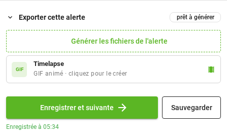

Clavier
^^^^^^^

L'écran n'a pas de raccourcis clavier globaux. Les touches qui fonctionnent :

.. labels-ok: Échap; ←; →; ?

.. list-table::
    :header-rows: 1
    :widths: 30 20 50

    *   -   Touche
        -   Emplacement
        -   Action
    *   -   **Tab**, **←** **→**, **Début**, **Fin**, **Entrée**
        -   Poignées de la frise
        -   Atteindre une poignée, la déplacer le long des dates, sauter à la première ou à la dernière image, choisir l'image.
    *   -   **Entrée**
        -   Menu de saut
        -   Équivaut à **Aller**.
    *   -   **Échap**
        -   Cartes
        -   Annule **Sélectionner une zone** ou une confirmation de suppression ; arrête **Supprimer un trou**.

Messages fréquents
^^^^^^^^^^^^^^^^^^

« Répondez sous « Verdict » avant d'enregistrer. »
    Choisissez d'abord un verdict.

« Répondez à « (question) » avant d'enregistrer. »
    Une question obligatoire est sans réponse ; la section **Questions** s'ouvre dessus.

« Un faux positif ne peut pas avoir de polygone de déforestation dessiné : supprimez le polygone ou changez la réponse. »
    Retirez le polygone dans **Affiner le polygone** (un dessin vide, puis **Enregistrer le dessin**), ou choisissez un autre verdict.

« Enregistrez votre dessin avant d'enregistrer cette revue. »
    Sélectionnez **Enregistrer le dessin**, ou arrêtez de dessiner et abandonnez les modifications.

« Ce jeu d'alertes a été reconstruit pendant votre revue : les alertes à l'écran ne sont plus à jour et cette révision n'a donc pas été enregistrée. »
    Le jeu a été relancé dans `Intégrer et vectoriser <defo-integrate_>`_. Examinez les alertes reconstruites.

« Le jeu d'alertes actif a changé pendant l'enregistrement : cette révision n'a donc pas été enregistrée. » ou « Ces alertes appartiennent à un autre jeu d'alertes que le jeu actif : elles n'y ont donc pas été enregistrées. »
    Un autre jeu est devenu actif entre-temps. Rouvrez l'alerte et enregistrez.

« Enregistré, mais vous avez modifié cette alerte pendant l'enregistrement : enregistrez à nouveau pour conserver ces modifications. »
    Enregistrez à nouveau.

« Les images avant et après de cette alerte ne sont pas toutes les deux prêtes : le modèle n'a rien sur quoi s'exécuter. »
    Choisissez les deux images et laissez les deux cartes finir de les afficher.

« Aucune image ne couvre cette alerte dans cette fenêtre. »
    Ajoutez des mois avec **+1 mois**, ou relevez **Nuages max.**

« Toutes les images de cette fenêtre proviennent de sources que vous avez désactivées. »
    Réactivez la source dans le menu **Sources d'images**.

« Impossible d'afficher l'image avant : … » ou « Impossible d'afficher l'image après : … »
    Choisissez à nouveau l'image, ou une autre.

.. _defo-overview:

Aperçu
------

L'Aperçu résume un jeu d'alertes, ou toutes les périodes à la fois : combien d'alertes il contient, combien sont examinées, et quelle perte a été confirmée, où et quand ; comment les pixels des sources sont devenus des alertes ; et les fichiers à télécharger. Ses chiffres suivent les révisions à mesure qu'elles sont enregistrées.

Ouvrir l'Aperçu
^^^^^^^^^^^^^^^

Sélectionnez **Aperçu** dans la barre latérale gauche. Il s'ouvre dans une grande boîte de dialogue par-dessus la carte ; fermez-la avec sa croix. Il affiche le jeu d'alertes actif, ou « Aucun jeu d'alertes pour l'instant. Lancez Intégrer et vectoriser pour en produire un. » quand le projet n'en a pas.

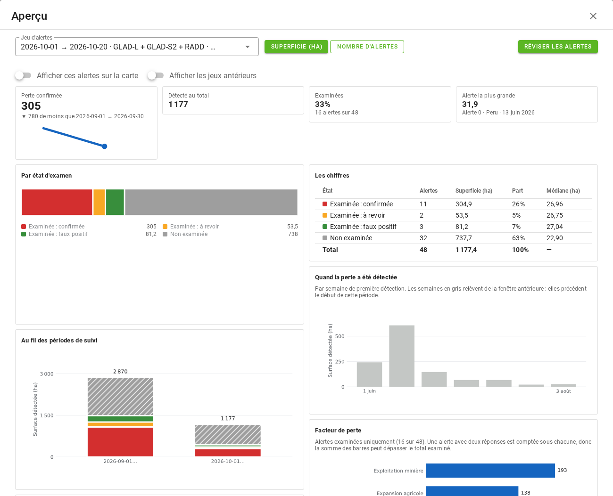

L'en-tête
^^^^^^^^^

.. list-table::
    :header-rows: 1
    :widths: 25 55 20

    *   -   Commande
        -   Description
        -   Par défaut
    *   -   **Jeu d'alertes**
        -   Le jeu résumé. En choisir un autre en fait le jeu actif du projet, comme dans `Analyse <defo-analysis-topbar_>`_. Son premier élément, « Toutes les périodes · 3 ensembles · 133 alertes », additionne plutôt le jeu le plus récent de chaque période, et laisse le jeu actif tel quel.
        -   Le jeu actif.
    *   -   **Superficie (ha)** / **Nombre d'alertes**
        -   Exprime tous les chiffres de la page en hectares ou en nombre d'alertes.
        -   **Superficie (ha)**.
    *   -   **Réviser les alertes**
        -   Ferme l'Aperçu et ouvre `Analyse <defo-analysis_>`_ sur ce jeu. Désactivé quand le jeu n'a pas d'alertes, et pour **Toutes les périodes** (« Choisissez une période pour en examiner les alertes »).
        -

Si le jeu est obsolète ou si ses fichiers sont manquants, une ligne orange le signale (« Ce jeu a été construit à partir d'entrées qui ont changé depuis… » ou « Les fichiers de ce jeu sont manquants dans le dossier du projet… »). Les chiffres montrent toujours ce que contient le jeu. Relancez `Intégrer et vectoriser <defo-integrate-outdated_>`_ pour le reconstruire, ce qui écarte ses révisions.

Les chiffres clés
^^^^^^^^^^^^^^^^^

.. list-table::
    :header-rows: 1
    :widths: 25 75

    *   -   Chiffre
        -   Contenu
    *   -   **Perte confirmée**
        -   La superficie (ou le nombre) des alertes examinées comme **Examinée : confirmée**. S'il existe une période antérieure, elle se compare à celle-ci, dans la mesure de la page (« ▼ 780 de moins que 2026-09-01 → 2026-09-30 », ou « ▲ … de plus que … »). **Toutes les périodes** n'a pas de comparaison.
    *   -   **Détecté au total**
        -   La superficie (ou le nombre) de toutes les alertes du jeu, quel que soit leur statut.
    *   -   **Examinées**
        -   La part des alertes qui ont un verdict, et « 16 alertes sur 48 ». Elle compte toujours des alertes.
    *   -   **Alerte la plus grande**
        -   La superficie de la plus grande alerte, son numéro, son pays (une fois examinée) et sa date. Elle compte toujours des hectares. Le numéro est la ligne de l'alerte dans le jeu, c'est-à-dire le numéro du compteur d'Analyse moins un.

.. _defo-overview-layers:

Couches de la carte
^^^^^^^^^^^^^^^^^^^

Le bouton **Couches de la carte**, à côté de **Réviser les alertes**, ouvre la liste des couches que l'Aperçu peut dessiner sur la carte principale, groupées par période. Cochez une couche pour la dessiner : l'Aperçu se ferme, pour montrer la carte. Décochez-la pour retirer la couche. Chaque couche porte sa période dans son nom (« Alertes · 2026-01-01 → 2026-01-31 »), dans la liste, sur la carte et dans la légende.

-   **Cet ensemble** : les **Alertes** du jeu sélectionné, colorées selon leur statut, et ses pixels non analysables (trop petits, ou au-delà du plafond d'alertes), si l'exécution du jeu les a enregistrés.
-   **Autres périodes** : les alertes du jeu le plus récent de chaque autre période, de la plus récente à la plus ancienne, chacune à part. Quand il y en a plusieurs, **Tout afficher** et **Tout masquer** les dessinent ou les retirent ensemble.
-   Avec **Toutes les périodes** sélectionné, **Toutes les périodes** liste les alertes et les pixels non analysables du jeu le plus récent de chaque période.

La case d'une couche est grisée pendant que la couche se construit.

.. _defo-overview-figures:

Les onglets
^^^^^^^^^^^

Les chiffres sont regroupés en onglets, chacun avec deux cartes côte à côte.

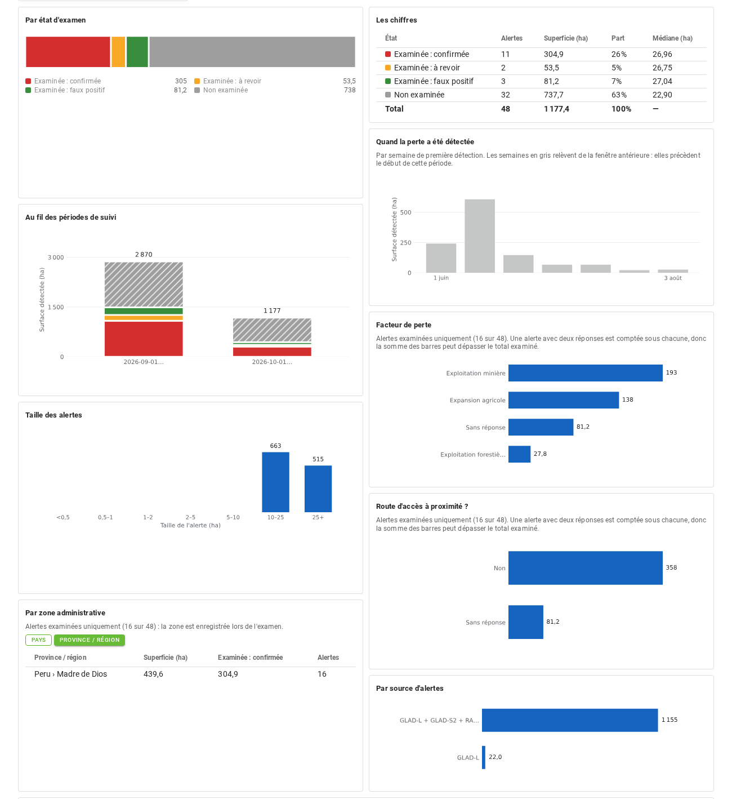

.. list-table::
    :header-rows: 1
    :widths: 20 80

    *   -   Onglet
        -   Cartes
    *   -   **Statut**
        -   **Par état d'examen** : une barre découpée par statut, puis un tableau donnant, par statut, le nombre d'alertes, leur superficie, leur part de la mesure et la taille médiane des alertes, avec une ligne **Total**. **Taille des alertes** : les alertes par taille, de moins de 0,5 ha à 25 ha ou plus.
    *   -   **Dans le temps**
        -   **Au fil des périodes de suivi** : une colonne par période de suivi du projet, découpée par statut, d'après son jeu d'alertes le plus récent ; une période encore en cours d'examen montre sa part non examinée hachurée. Avec une seule période, la carte indique « Ce projet n'a qu'une seule période de suivi. Ajoutez-en une seconde et sa tendance sera tracée ici. » **Quand la perte a été détectée** : les alertes par semaine de première détection, découpées par statut. Les semaines hachurées relèvent de la rétrospection : elles précèdent le début de la période (voir `Ce que les périodes antérieures ont déjà signalé <defo-integrate-earlier_>`_).
    *   -   **Lieu et source**
        -   **Par zone administrative** : les alertes examinées par zone, jusqu'à huit, en commençant par la plus forte perte confirmée : leur **Superficie (ha)**, les hectares **Examinée : confirmée** et le nombre d'**Alertes**. **Pays** ou **Province / région** choisit le niveau ; une province est affichée avec son pays (« Peru › Madre de Dios »). Les zones viennent des limites FAO GAUL, enregistrées au moment où l'alerte est enregistrée, donc seules les alertes examinées comptent ; une alerte sans zone enregistrée est comptée comme **Non renseigné**, et une alerte à cheval sur une frontière est listée sous chaque zone où elle se trouve. **Par source d'alertes** : les alertes selon la combinaison de sources qui les a détectées.
    *   -   **Réponses**
        -   Une carte par `question <defo-questionnaire_>`_, avec les réponses données aux alertes examinées : les cinq plus fréquentes, puis **Autres** et **Sans réponse**. Une alerte avec deux réponses compte pour chacune. Affiché seulement si le projet a des questions ; l'onglet indique leur nombre.
    *   -   **Pixels**
        -   Comment les pixels des sources sont devenus les pixels des alertes (voir plus bas).
    *   -   **Amas**
        -   Comment ces pixels sont devenus des alertes, les alertes proches et les alertes liées à des pertes antérieures (voir plus bas). L'onglet indique le nombre d'alertes.
    *   -   **Fichiers**
        -   La carte **Exporter les alertes** (voir `Tout le jeu, depuis l'Aperçu <defo-export-set_>`_) et, avec **Toutes les périodes** sélectionné, le **Résumé de toutes les périodes** (voir plus bas).

Quand un graphique ne peut pas être tracé, sa carte indique « Cette figure n'a pas pu être tracée ; ses chiffres sont ci-dessous. » et les liste.

Pixels
""""""

La carte **Des pixels des sources aux pixels d’alerte** suit les pixels étape par étape, chacun avec une barre, un nombre et ses hectares :

-   **Pixels d’alerte des sources** : les pixels signalés par les sources dans la période, toutes sources confondues ;
-   **Retirés par les masques** et **Gardés par les masques** : ce que les masques d'`Harmoniser <defo-harmonize_>`_ ont retiré et laissé ;
-   **Combinés, recouvrements une fois** : les pixels une fois les sources combinées, un pixel signalé par deux sources n'étant compté qu'une fois ;
-   **Trop petits pour être analysés** et **Au-delà de la limite d’alertes** : les pixels des amas sous la surface minimale, et des amas écartés par la limite d'alertes d'`Intégrer et vectoriser <defo-integrate_>`_ ; et
-   **Dans les alertes** : les pixels des alertes du jeu.

La carte **Par source** donne les mêmes comptes par source (**Px d’alerte**, **Masqués**, **Gardés**), chacun avec un œil qui dessine le raster de la source sur la carte, ainsi que les **Masques utilisés** avec leur **Mode**.

Un compte affiche « — » quand le jeu a été produit avant que l'application ne l'enregistre : « — : non enregistré pour cet ensemble. Relancez Intégrer et vectoriser pour le compter. »

.. _defo-overview-growth:

Amas
""""

La carte **Des amas aux alertes** compte les **Amas formés** par des pixels d'alerte connectés, ceux **Sous la taille minimale** et **Au-delà de la limite d’alertes**, les **Alertes** produites à partir du reste, et combien sont **Examinées**.

En dessous, **Alertes proches** montre comment les alertes du jeu s'enchaînent en groupes : les alertes situées à la distance de **Réviser ensemble les alertes proches** (voir `Évaluation <defo-evaluation-group_>`_), de bord à bord, forment un groupe. Son tableau a deux lignes :

-   **Trouvées par distance** : les groupes que forme la distance, et leurs alertes (« 20 sur 48 · le plus grand 5 ») ; et
-   **Enregistrées en groupe d'examen** : les groupes enregistrés dans Analyse, et leurs alertes.

Quand le regroupement est désactivé, la carte utilise la distance du projet et ajoute « La vérification groupée est désactivée · activez-la dans Évaluation. »

La carte **Liées à des pertes antérieures** suit les `alertes d'extension <defo-integrate-growth_>`_ : les nouvelles alertes qui touchent un défrichement confirmé lors d'une période antérieure (dessinez les jeux antérieurs depuis `Couches de la carte <defo-overview-layers_>`_). Son titre donne les alertes d'extension et leur superficie (« 3 alertes d’extension · 4,2 ha », ou seulement leur nombre avec **Nombre d'alertes**) ; la ligne en dessous les répartit (« Extension : 2 · Sous la surface minimale : 1 ») et indique combien sont examinées. Sans aucune, elle indique « Aucune alerte n’est liée à une perte antérieure. »

Son tableau liste les historiques qui comprennent une alerte de ce jeu, la plus grande superficie confirmée en premier :

.. list-table::
    :header-rows: 1
    :widths: 25 75

    *   -   Colonne
        -   Contenu
    *   -   **Périodes de suivi**
        -   La première et la dernière période de l'historique.
    *   -   **Alertes**
        -   Le nombre d'alertes de l'historique, toutes périodes confondues.
    *   -   **Confirmés (ha)**
        -   La superficie des alertes de l'historique examinées comme **Examinée : confirmée** ou **Examinée : à revoir**, comptée une seule fois là où leurs formes se chevauchent.
    *   -   **Apport de cet ensemble (ha)**
        -   La superficie des alertes de ce jeu dans l'historique, faux positifs exclus.
    *   -   **Examiner**
        -   Ferme l'Aperçu et ouvre l'alerte de ce jeu appartenant à l'historique dans `Analyse <defo-analysis_>`_.

Résumé de toutes les périodes
"""""""""""""""""""""""""""""

Avec **Toutes les périodes** sélectionné, l'onglet **Fichiers** se termine par un tableau de toutes les périodes, une ligne chacune : ses **Alertes**, ses **ha confirmés**, sa part **Examinées**, ses **Px des sources**, ses **Amas**, ses **Groupes** d'examen et ses alertes **Liées** à des pertes antérieures. La tuile **CSV de résumé** en dessous écrit le même tableau dans ``periods_summary.csv``, dans le dossier du projet ; sélectionnez-la à nouveau pour télécharger le fichier. Quand les chiffres ont changé depuis (examens enregistrés, jeu reconstruit), la tuile indique « Les chiffres ont changé depuis » et un bouton **Mettre à jour** l'écrit à nouveau.

Toutes les périodes
^^^^^^^^^^^^^^^^^^^

Choisissez **Toutes les périodes** dans le sélecteur **Jeu d'alertes** pour additionner le jeu le plus récent de chaque période : les chiffres clés, les onglets et l'export les couvrent alors toutes. Les hectares et les alertes s'additionnent ; un compte de pixels qu'un jeu n'a pas enregistré affiche « — ». **Couches de la carte** liste les couches de toutes les périodes (voir `Couches de la carte <defo-overview-layers_>`_) ; **Réviser les alertes** a besoin d'un seul jeu : il est donc désactivé. Dans l'onglet **Fichiers**, la carte **Exporter les alertes** écrit les alertes de toutes les périodes dans un seul fichier, avec une colonne ``period`` (voir `Tout le jeu, depuis l'Aperçu <defo-export-set_>`_).

Messages fréquents
^^^^^^^^^^^^^^^^^^

« Aucun jeu d'alertes pour l'instant. Lancez Intégrer et vectoriser pour en produire un. »
    Le projet n'a aucun jeu : lancez `Intégrer et vectoriser <defo-integrate_>`_.

« Ce jeu ne contient aucune alerte. »
    Le jeu a été créé mais n'a trouvé aucune alerte ; rien n'est représenté.

« Les alertes de ce jeu n'ont pas pu être lues : … »
    Les fichiers du jeu sont endommagés ou manquants. Relancez `Intégrer et vectoriser <defo-integrate_>`_.

« Aucune alerte revue n'a encore répondu. » ou « Aucune alerte n'a encore été examinée, donc aucune zone administrative n'est enregistrée. »
    Examinez des alertes dans `Analyse <defo-analysis_>`_ pour remplir ces cartes.

.. _defo-export:

Export
------

L'application exporte les alertes de deux façons :

-   les fichiers d'une alerte examinée, depuis l'écran Analyse ; et
-   les alertes de tout un jeu, ou de toutes les périodes, depuis l'Aperçu.

Chaque fichier est écrit dans le dossier du jeu d'alertes, dans le projet (``periods/<start>_<end>/sets/<set>/``, voir `Projet <defo-project_>`_) : il se retrouve donc aussi plus tard à cet endroit, dans le navigateur de fichiers de SEPAL. Les fichiers de **Toutes les périodes** vont dans le dossier du projet.

.. _defo-export-alert:

Une alerte, depuis Analyse
^^^^^^^^^^^^^^^^^^^^^^^^^^

La section **Exporter cette alerte** se trouve en haut du dock du panneau d'examen d'`Analyse <defo-analysis-save_>`_. Elle porte sur l'alerte affichée, une fois sa révision enregistrée : son badge indique « disponible après l'enregistrement », puis « prêt à générer », puis « 3 fichiers prêts ».

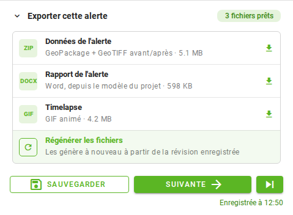

.. list-table::
    :header-rows: 1
    :widths: 25 75

    *   -   Tuile
        -   Description
    *   -   **Générer les fichiers**
        -   Génère les données et le rapport de l'alerte à partir de la révision enregistrée (« Génère les fichiers ci-dessus à partir de la révision enregistrée »). Elle reste désactivée tant que la révision affichée n'est pas enregistrée : elle indique alors « Enregistrez d'abord cette alerte », ou « Enregistrez d'abord vos modifications » s'il y a des modifications non enregistrées. Une alerte examinée, ouverte sur les images avec lesquelles elle a été enregistrée, est prête aussitôt. Elle s'exécute dans la liste des tâches (« Génération des fichiers… ») et prend un moment : elle télécharge les images d'avant et d'après.
    *   -   **Données de l'alerte**
        -   Télécharge un fichier .zip : le GeoPackage de l'alerte, ses images d'avant et d'après réunies dans un seul GeoTIFF et, pour une alerte réelle, son GIF.
    *   -   **Rapport de l'alerte**
        -   Télécharge le rapport Word de l'alerte.
    *   -   **Régénérer les fichiers**
        -   Génère à nouveau les fichiers (par exemple après une modification de la révision).
    *   -   **Timelapse**
        -   Crée et télécharge un GIF animé de l'alerte (voir plus bas). Pour une alerte qui n'est pas enregistrée comme alerte réelle, elle indique « Alertes réelles uniquement ».

Les fichiers sont nommés d'après la ligne de l'alerte dans le jeu (le numéro du compteur moins un) :

.. list-table::
    :header-rows: 1
    :widths: 40 60

    *   -   Fichier
        -   Contenu
    *   -   ``alert_<n>.gpkg``
        -   L'alerte sous forme d'une entité unique, avec ses attributs et ses réponses (les réponses dans la langue actuelle de l'application). Sa géométrie est le polygone dessiné dans `Affiner le polygone <defo-analysis-refine_>`_, ou à défaut le rectangle englobant de l'alerte.
    *   -   ``alert_<n>_<before>_<after>.tif``
        -   Les images d'avant et d'après, découpées selon la **Zone d'image**. Les deux parties de date indiquent la collection de chaque image (``s`` Sentinel-2, ``l`` Landsat, ``p`` Planet) et sa date.
    *   -   ``alert_<n>_<before>_<after>.gif``
        -   Le timelapse, s'il a été créé, nommé comme le GeoTIFF.
    *   -   ``alert_<n>.zip``
        -   Le GeoPackage, le GeoTIFF et, pour une alerte réelle, le GIF.
    *   -   ``alert_<n>.docx``
        -   Le rapport Word.

Pour une alerte d'un groupe (voir `Alertes proches <defo-analysis-nearby_>`_), les fichiers décrivent tout le groupe : le GeoPackage contient une seule entité avec la superficie cumulée du groupe, ses dates de première et de dernière détection, ses sources, ``group_size`` (le nombre d'alertes) et ``group_alerts`` (leurs numéros, par exemple « 12, 15, 16 »), et le GIF trace le contour de chaque alerte du groupe.

Les liens des tuiles valent pour la révision affichée. Choisir d'autres images, enregistrer à nouveau l'alerte ou changer le modèle de rapport les masque : générez à nouveau les fichiers.

Le rapport
""""""""""

Le rapport est construit à partir du modèle Word du projet, choisi à l'étape `Questionnaire <defo-questionnaire-template_>`_, ou à partir du modèle par défaut de l'application quand le projet n'en a pas. Les balises du modèle sont remplies avec les attributs de l'alerte, ses réponses et ses images. La liste figure dans `Le modèle de rapport <defo-questionnaire-template_>`_.

Le timelapse
""""""""""""

La tuile **Timelapse** crée un GIF animé qui fait défiler les images de la zone de l'alerte, d'avant en après, avec le contour de l'alerte par-dessus. Chaque image reste 2 secondes et est légendée avec sa collection et sa date. Les images d'avant et d'après indiquent aussi leur côté (« Avant · Sentinel-2 2026-07-28 »).

Il n'est proposé que pour une alerte réelle : la tuile est active quand l'alerte est enregistrée comme **Examinée : confirmée** et que les images affichées sont celles avec lesquelles elle a été enregistrée. Sinon, elle indique « Enregistrez-la comme alerte réelle, avec les images affichées, pour le créer ».

Les images du GIF sont :

-   les images d'avant et d'après choisies pendant l'examen ; et
-   jusqu'à deux images précédant l'image d'avant et deux suivant l'image d'après, trouvées dans un délai de douze mois, sous la limite **Nuages max.** de la frise et jamais une mosaïque Planet.

Le GIF est enregistré à côté des autres fichiers et, quand les fichiers de l'alerte sont générés, ajouté au fichier .zip.

.. _defo-export-set:

Tout le jeu, depuis l'Aperçu
^^^^^^^^^^^^^^^^^^^^^^^^^^^^

La carte **Exporter les alertes**, dans l'onglet **Fichiers** de l'`Aperçu <defo-overview_>`_, écrit les alertes du jeu affiché dans un seul fichier. Sa première ligne résume les alertes qu'écrit la pastille **Alertes** choisie, avec les sources et les dates du jeu (par exemple « 11 alertes · 304,9 ha · GLAD-L + GLAD-S2 + RADD · 2026-10-01 – 2026-10-20 » pour **Confirmées**). La pastille de dossier à côté copie le chemin du dossier quand elle est sélectionnée.

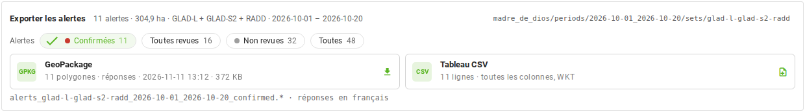

Pour exporter le jeu :

1.  Choisissez les alertes à écrire avec les pastilles **Alertes** : **Confirmées**, **Toutes revues**, **Non revues** ou **Toutes**. Chaque pastille indique son nombre d'alertes ; une pastille qui n'en a aucune est désactivée. **Confirmées** est choisie d'emblée quand le jeu a des alertes confirmées, **Toutes** sinon.
2.  Sélectionnez une tuile de format pour écrire le fichier. Elle indique « Écriture de 11 alertes… » pendant le travail, et la liste des tâches affiche **Exportation des alertes**.
3.  Sélectionnez à nouveau la tuile, devenue un lien de téléchargement avec l'heure d'écriture, pour télécharger le fichier.

.. list-table::
    :header-rows: 1
    :widths: 25 75

    *   -   Tuile
        -   Contenu
    *   -   **GeoPackage**
        -   Un polygone par alerte, avec ses attributs et ses réponses. La géométrie est le polygone de l'alerte issu d'`Intégrer et vectoriser <defo-integrate_>`_, pas celui dessiné dans Analyse.
    *   -   **Tableau CSV**
        -   Une ligne par alerte avec toutes les colonnes, les géométries écrites sous forme de texte (WKT, *well-known text*), y compris le polygone dessiné dans Analyse.

Les deux fichiers ajoutent trois colonnes sur l'`extension <defo-integrate-growth_>`_ :

-   ``kind`` : ``new``, ``growth``, ``growth_small`` ou ``new_small`` (voir **Type** dans `Le panneau d'examen <defo-analysis-panel_>`_) ;
-   ``grows_from`` : les liens de l'alerte, séparés par « ; », chacun écrit sous la forme *jeu*\ ``#``\ *numéro de l'alerte*\ ``@``\ *exécution de ce jeu* ; et
-   ``history_area_ha`` : la superficie confirmée de l'historique de l'alerte, 0 pour une alerte qui n'en a pas.

Le fichier est nommé d'après les sources du jeu, sa période et les alertes choisies (par exemple ``alerts_glad-l-glad-s2-radd_2026-08-01_2026-09-30_confirmed.gpkg``) : ``_reviewed`` pour **Toutes revues**, ``_unreviewed`` pour **Non revues**, et sans suffixe pour **Toutes**. La dernière ligne de la carte affiche ce nom. Les réponses sont écrites dans la langue actuelle de l'application.

Avec **Toutes les périodes** choisi dans le sélecteur **Jeu d'alertes**, la carte écrit les alertes de toutes les périodes dans un seul fichier, dans le dossier du projet, avec une colonne ``period`` donnant la période de chaque alerte. Son nom réunit les sources de tous les jeux et va du début de la première période à la fin de la dernière (par exemple ``alerts_glad-l_2026-08-01_2026-10-23.gpkg``).

Quand des révisions sont enregistrées après l'écriture d'un fichier, sa tuile indique **Revues modifiées depuis**, avec un bouton **Mettre à jour**. Sélectionnez-le pour écrire à nouveau le fichier.

Messages fréquents
^^^^^^^^^^^^^^^^^^

« Les images avant et après de cette alerte ne sont pas toutes les deux prêtes : ses fichiers ne peuvent pas être générés. »
    Choisissez les deux images sur la frise et laissez les deux cartes finir de les afficher.

« Aucun jeu d'alertes n'est actif : il n'y a donc nulle part où enregistrer les fichiers de l'alerte dans le projet. Lancez d'abord Intégrer et vectoriser. »
    Lancez `Intégrer et vectoriser <defo-integrate_>`_.

« Le modèle de rapport … a disparu. Choisissez-le à nouveau à l'étape Questionnaire, ou videz le champ pour utiliser le modèle par défaut. »
    Le modèle du projet a été déplacé ou supprimé : voir `Le modèle de rapport <defo-questionnaire-template_>`_.

« Les fichiers de l'alerte sont prêts, mais le GIF n'a pas pu être créé : le zip ne le contient pas. »
    Essayez la tuile **Timelapse** seule.

« Les images avant et après sont la même image : le GIF ne montrerait aucun changement. »
    Choisissez deux images différentes sur la frise.

« Moins de deux images ont pu être rendues pour cette alerte : aucun GIF n'a été créé. »
    Choisissez d'autres images d'avant et d'après, puis réessayez.

« Les fichiers de l'alerte ont fini d'être générés après votre passage à une autre alerte : ils n'ont pas été proposés au téléchargement ici. »
    Revenez à l'alerte : les fichiers sont dans le dossier du jeu.

.. _defo-use-case:

Cas d'usage : examen des alertes à Madre de Dios, au Pérou
----------------------------------------------------------

.. labels-ok: Niveau administratif 1; Selectionner cet AOI; Couleurs naturelles

Ce cas d'usage suit une petite équipe de suivi forestier pendant deux cycles mensuels dans le département de Madre de Dios, en Amazonie péruvienne, aux frontières du Brésil et de la Bolivie. L'orpaillage et l'extension de l'agriculture pèsent tous deux sur sa forêt : l'équipe veut donc savoir chaque mois où la forêt a été perdue, et pourquoi.

L'équipe compte :

-   une coordinatrice, qui configure le projet et examine des alertes ; et
-   deux évaluateurs, Ana et Luis, qui examinent leur part des alertes depuis leurs propres comptes SEPAL.

.. note::

    Les valeurs de ce cas d'usage proviennent du projet de démonstration dont sont tirées les captures d'écran de cet article. Les verdicts et les réponses montrent comment l'application enregistre un examen ; ce sont des exemples, pas une évaluation vérifiée de la forêt de Madre de Dios.

Configurer le projet
^^^^^^^^^^^^^^^^^^^^

La coordinatrice configure le projet comme suit :

1.  **Projet** : dans l'application, sélectionnez **Nouveau projet** et nommez-le ``madre_de_dios`` (voir `Créer un projet <defo-project-create_>`_).
2.  **AOI** : à l'étape `AOI <defo-aoi_>`_, choisissez **Niveau administratif 1**, puis le Pérou, puis « Madre De Dios » (tel que la liste l'écrit), et sélectionnez **Selectionner cet AOI**. La zone est enregistrée sous le nom ``PER_Madre_De_Dios``. Un département entier est une grande zone : chaque étape suivante prend plus de temps que pour un district.

Le cycle de septembre
^^^^^^^^^^^^^^^^^^^^^

Période
"""""""

Dans `Période de suivi <defo-period_>`_, la coordinatrice :

1.  sélectionne **Nouvelle période** ;
2.  fixe les dates du 2026-09-01 au 2026-09-30 ;
3.  saisit 90 dans **Rétrospection (jours)** (la première période d'un nouveau projet démarre à 0) ; et
4.  sélectionne **Ajouter une période**.

La fenêtre de recherche va du 2026-06-03 au 2026-09-30 : les groupes qui ont commencé entre juin et août, ainsi que les alertes que les sources ont publiées en retard, sont donc trouvés aussi. Comme première période, elle n'a pas de jeu antérieur : toutes les alertes de sa fenêtre de recherche sont conservées.

Alertes
"""""""

Dans `Sources d'alertes <defo-alerts_>`_, la coordinatrice ajoute les trois sources prédéfinies : **GLAD-L (Landsat, 30 m)**, **RADD (Sentinel-1, 10 m)** et **GLAD-S2 (Sentinel-2, 10 m)**, chacune avec **Ajouter aux nouvelles périodes** laissé coché, pour que les périodes suivantes démarrent avec elles. Chacune couvre toute l'AOI. Sous RADD, l'application précise qu'elle ne détecte que dans la forêt tropicale humide primaire : ailleurs dans le département, seules GLAD-L et GLAD-S2 peuvent signaler des alertes. Puis le bouton **Télécharger** de chaque ligne télécharge les trois sources sur la fenêtre de recherche.

Harmoniser
""""""""""

Dans `Harmoniser <defo-harmonize_>`_, la coordinatrice :

1.  garde la grille proposée, la zone UTM du département (``EPSG:32719``) à 10 m, et sélectionne **Enregistrer la grille**. La grille fait 41425 × 38561 pixels, soit environ 12,8 Go par source avant compression : l'application prévient donc que les téléchargements prendront du temps ;
2.  ajoute un masque pour que seules les alertes en forêt comptent : **Ajouter un masque**, l'image Hansen Global Forest Change ``UMD/hansen/global_forest_change_2025_v1_13``, bande ``treecover2000``, nommée ``forest_2000``, mode **Conserver** ; et
3.  sélectionne le bouton **Aligner** du masque puis, une fois que le masque indique « Prête », **Harmoniser** sur la ligne de chaque source, qui harmonise les trois sources.

Le téléchargement et l'harmonisation ont pris environ 15 minutes. Le masque et chaque source indiquent alors « Prête » : GLAD-L avec 2362718 pixels d'alerte, RADD avec 1508527 et GLAD-S2 avec 1462458.

Intégrer et vectoriser
""""""""""""""""""""""

Dans `Intégrer et vectoriser <defo-integrate_>`_, la coordinatrice :

-   garde les trois sources et **Inclure les alertes probables (non confirmées)** activé ;
-   règle la **Taille minimale de groupe** sur 1 ha et l'**Ordre** sur **Groupes les plus grands en premier** ; et
-   coche **Limiter le nombre de groupes**, avec un **Nombre maximal de groupes** de 48 : l'équipe peut examiner environ 48 alertes par mois, elle commence donc par les plus grandes.

L'exécution produit le jeu d'alertes « 2026-09-01 → 2026-09-30 · GLAD-L + GLAD-S2 + RADD » de 48 alertes, de 383,18 ha à 27,84 ha : 2870 ha au total.

Les groupes au-delà du plafond sont conservés comme non analysables. La période suivante ne les réexamine que si sa rétrospection remonte jusqu'en septembre et qu'elle utilise les mêmes sources. C'est le cas de la rétrospection de 90 jours d'octobre (voir `Ce que les périodes antérieures ont déjà signalé <defo-integrate-earlier_>`_).

Couches supplémentaires
"""""""""""""""""""""""

Une fois le jeu d'alertes construit, **Configurer la revue** se déverrouille. Pour juger les alertes au regard d'une image récente, la coordinatrice ajoute une `couche supplémentaire <defo-layers_>`_ : une image Sentinel-2 **Earth Engine** du 27 septembre 2026 (tuile 19LDF, à l'est de Puerto Maldonado), affichée en **Composite RVB** en **Couleurs naturelles** (B4, B3, B2), **Min** 0 et **Max** 3000, nommée ``Sentinel-2 2026-09-27``, et **Afficher dans Analyse** coché.

.. note::

    Les mosaïques mensuelles Planet NICFI couvriraient tout le département, mais le compte utilisé pour cet article n'a pas accès à NICFI. C'est pourquoi Planet est grisée dans le menu **Sources d'images** de la frise d'Analyse des captures d'écran ci-dessous.

Examiner seule, puis à plusieurs
^^^^^^^^^^^^^^^^^^^^^^^^^^^^^^^^

Premiers examens
""""""""""""""""

Avant de partager le travail, la coordinatrice ouvre `Analyse <defo-analysis_>`_ et examine les deux plus grandes alertes :

-   l'alerte 1 (383,18 ha) comme **Alerte réelle**, avec le facteur de perte **Exploitation minière** ; et
-   l'alerte 2 (146,97 ha) comme **Faux positif**.

Répartir les alertes
""""""""""""""""""""

Dans `Évaluation <defo-evaluation_>`_, la coordinatrice coche **Plusieurs évaluateurs**, sélectionne **Répartir les alertes…**, choisit **Noms**, saisit Ana et Luis, et sélectionne **Répartir**. Les alertes sont distribuées à tour de rôle : Ana et Luis en reçoivent 23 chacun, et les deux alertes déjà examinées restent **Non attribuées**.

Avant les paquets
"""""""""""""""""

La coordinatrice continue d'examiner dans le projet d'origine une fois la répartition faite :

-   l'alerte 3 comme **Alerte réelle**, avec **Expansion agricole** ;
-   l'alerte 4 comme **À réexaminer**, avec **Exploitation forestière** ; et
-   l'alerte 5 comme **Alerte réelle**, avec **Exploitation minière**.

Ces verdicts voyagent dans les paquets, si bien que les évaluateurs les voient ; les alertes 3 et 5 font partie de celles d'Ana. La coordinatrice sélectionne ensuite **Générer les paquets** et envoie à chaque évaluateur son fichier .zip.

La copie de révision d'Ana
""""""""""""""""""""""""""

Ana copie le paquet dans son dossier SEPAL et l'importe avec **Importer** dans la boîte de dialogue `Projet <defo-project-import_>`_. Il s'ouvre comme projet ``madre-de-dios__e01-ana``, sur l'écran Analyse, déjà filtré sur ses alertes (« Évaluateur : Ana »).

Ana les parcourt avec **Sauvegarder** et **Suivante** :

-   la barre du haut affiche « 5 examinées · 18 restantes · filtrées · 48 au total » (les deux examens de ses alertes faits par la coordinatrice et trois des siens) ;
-   le compteur numérote ses alertes de 1 à 23 ; et
-   sa troisième alerte, par exemple, est enregistrée comme **Alerte réelle** avec **Exploitation minière** : l'image d'après montre un sol nu et sableux avec un bassin vert en lisière de forêt, qui ressemble aux fosses que laisse l'orpaillage alluvial.

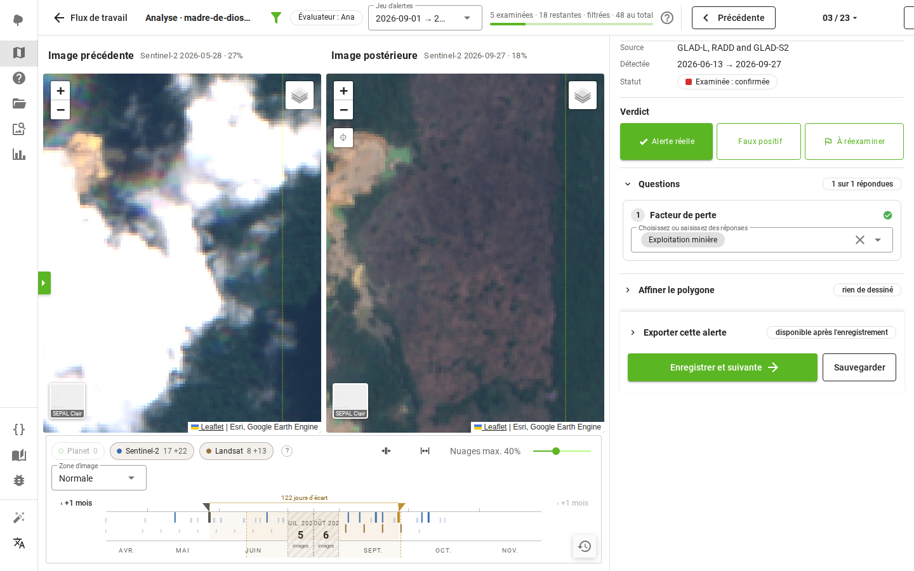

Quand elle a fini pour le moment, Ana sélectionne **Générer la copie révisée** à l'étape `Évaluation <defo-evaluation-return_>`_ (« 5 / 23 de vos alertes révisées ») et renvoie le fichier ``__reviewed.zip``.

Fusionner les révisions d'Ana
"""""""""""""""""""""""""""""

La coordinatrice copie le fichier dans le dossier SEPAL, sélectionne **Fusionner une copie révisée…** et le choisit. L'aperçu indique « Ana : 3 nouvelles révisions, 1 conflits, 1 inchangées, 0 ignorées » :

-   la révision inchangée est celle de l'alerte 3, qu'Ana a laissée telle que la coordinatrice l'avait enregistrée ; et
-   le conflit porte sur l'alerte 5 : la coordinatrice l'avait confirmée comme exploitation minière, alors qu'Ana l'a marquée comme faux positif.

La coordinatrice garde le verdict d'origine avec **Garder les miennes** et prévoit de revoir cette alerte avec Ana. Après **Fusionner**, le tableau des évaluateurs montre Ana avec cinq de ses 23 alertes examinées et la date de la fusion (voir `Fusionner une copie révisée <defo-evaluation-merge_>`_).

Ajouter une question
^^^^^^^^^^^^^^^^^^^^

L'équipe veut aussi noter si chaque coupe a une route d'accès à proximité. À l'étape `Questionnaire <defo-questionnaire_>`_, après la question par défaut **Facteur de perte**, la coordinatrice ajoute une deuxième question :

1.  **Ajouter la question** ;
2.  « Route d'accès à proximité ? » ;
3.  **Une réponse**, avec les options Oui et Non ;
4.  **Obligatoire** activé ; et
5.  posée uniquement pour **Alerte réelle** et **À réexaminer**.

Comme le questionnaire a changé après la génération des paquets, leurs icônes de nuage passent à l'ambre dans `Évaluation <defo-evaluation-packages_>`_. Les paquets déjà envoyés se fusionnent toujours, par clé de question. Pour que la nouvelle question parvienne aux évaluateurs, la coordinatrice sélectionne **Régénérer les paquets** et envoie les nouveaux.

Dès lors, une alerte réelle ou une alerte à réexaminer reçoit les deux réponses (un faux positif n'en reçoit aucune : les deux questions ne sont posées que pour les deux autres verdicts). L'alerte 10, par exemple, est enregistrée comme **Alerte réelle**, avec **Expansion agricole** comme facteur de perte et « Non » pour la route d'accès. Son statut indique **Examinée : confirmée**, et la section **Questions** indique « 2 sur 2 répondues ».

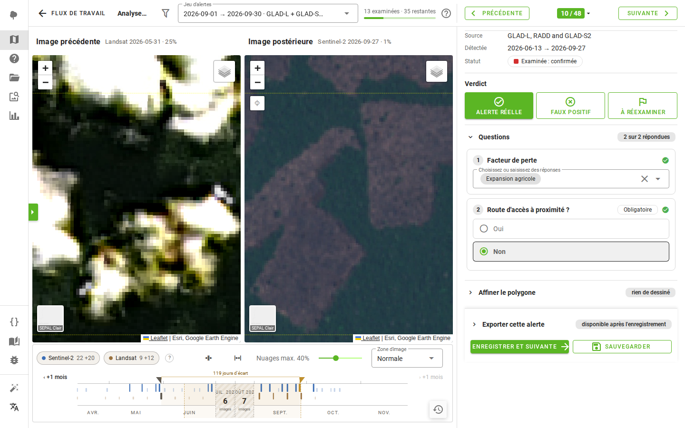

De retour dans le flux de travail, **Afficher ces alertes sur la carte** dans `Intégrer et vectoriser <defo-integrate-map_>`_ dessine le jeu sur le département. À ce niveau de zoom, chaque alerte est un point coloré selon son état d'examen :

-   gris pour **Non examinée** ;
-   rouge pour **Examinée : confirmée** ;
-   vert pour **Examinée : faux positif** ; et
-   ambre pour **Examinée : à revoir**.

Avec 13 des 48 alertes examinées, la plupart des points sont encore gris. La plupart des alertes se trouvent dans le sud du département.

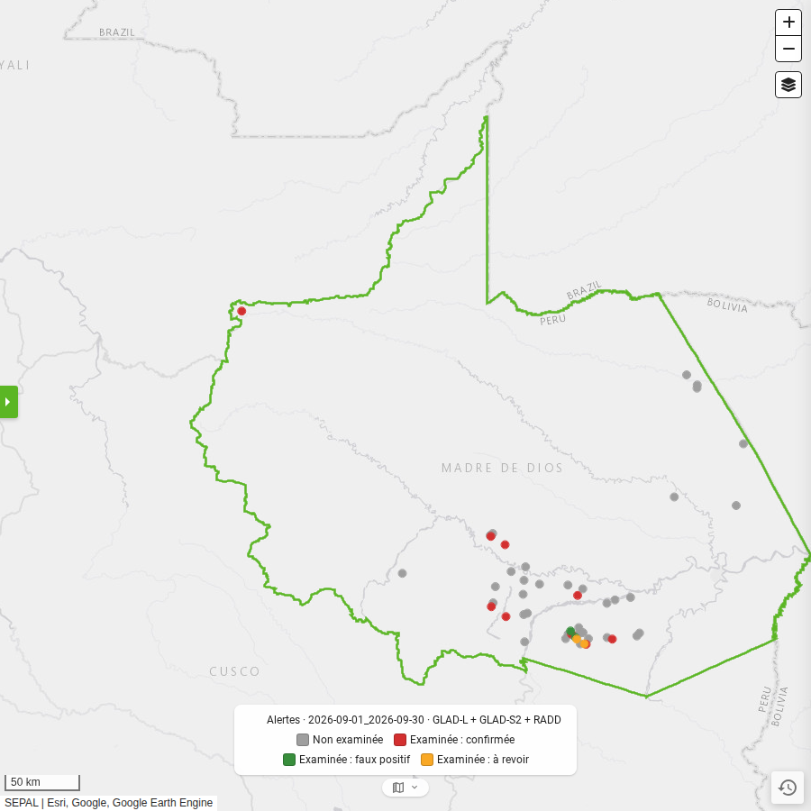

Le cycle d'octobre
^^^^^^^^^^^^^^^^^^

Au début du cycle suivant, la coordinatrice sélectionne **Nouvelle période** dans `Période de suivi <defo-period-add_>`_. La boîte de dialogue est pré-remplie : du 2026-10-01 (le lendemain de la fin de septembre) à aujourd'hui, avec les 90 jours de rétrospection utilisés la fois précédente. La coordinatrice fixe la fin au 2026-10-20, le jour de ce cycle. **Ajouter une période** en fait la période active, avec les choix de masques de la période de septembre et les trois sources marquées **Ajouter aux nouvelles périodes**.

Ensuite :

-   le bouton **Télécharger** de chaque ligne dans `Alertes <defo-alerts_>`_ télécharge les trois sources pour la nouvelle fenêtre, et le bouton **Harmoniser** de chaque ligne dans `Harmoniser <defo-harmonize_>`_ les harmonise ; la grille et le masque sont déjà là.
-   Dans `Intégrer et vectoriser <defo-integrate_>`_, la coordinatrice reprend les réglages de septembre (1 ha, les 48 plus grandes alertes). Avant de regrouper les pixels en alertes, l'exécution retire tous les pixels situés dans les 48 alertes de septembre, si bien que rien n'est signalé deux fois. Le nouveau jeu contient de nouveau 48 alertes, pour 1177 ha. Aucune ne touche une alerte confirmée en septembre : l'exécution n'en lie donc aucune à une perte antérieure (voir `Extension d'une perte antérieure <defo-integrate-growth_>`_).

L'équipe les examine comme en septembre ; 16 sont examinées à ce stade, dont 11 comme alertes réelles. Avec **Afficher ces alertes sur la carte** et **Afficher les jeux antérieurs** tous deux activés, la carte montre les alertes d'octobre à côté de celles de septembre, dessinées en couleurs plus pâles. Les alertes d'octobre se situent dans les mêmes parties du département que celles de septembre.

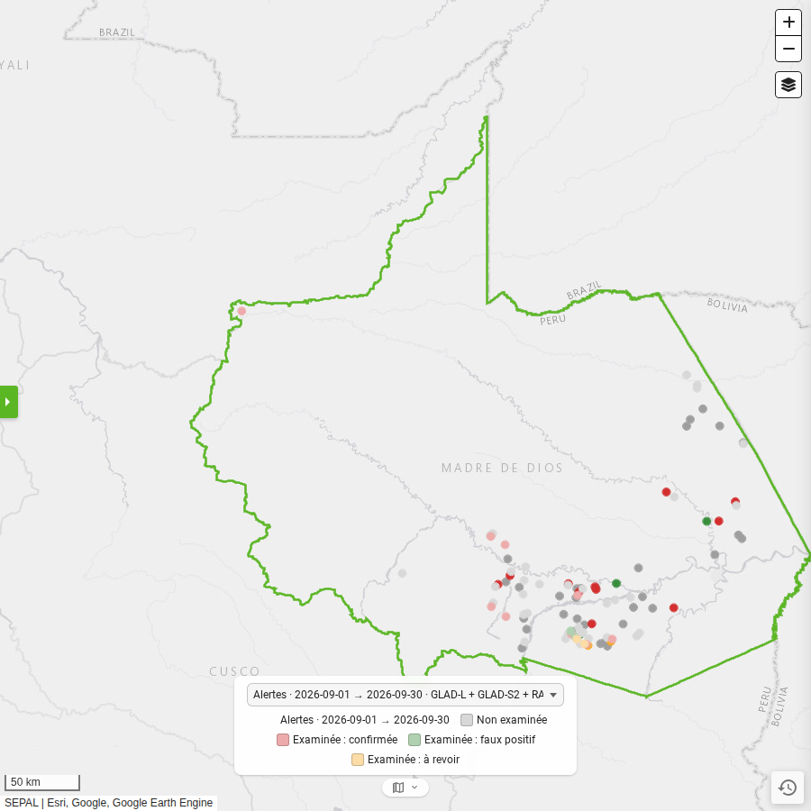

Lire les chiffres
^^^^^^^^^^^^^^^^^

L'`Aperçu <defo-overview_>`_ résume le jeu d'octobre. En **Superficie (ha)** :

-   **Perte confirmée** : 305 ha, avec « ▼ 780 de moins que 2026-09-01 → 2026-09-30 » ;
-   **Détecté au total** : 1177 ha ;
-   **Examinées** : 33 %, « 16 alertes sur 48 » ; et
-   **Alerte la plus grande** : 31,9 ha, l'« Alerte 0 » de la tuile. L'Aperçu numérote les alertes à partir de 0, dans l'ordre du jeu ; le compteur d'Analyse commence à 1 : c'est donc la première alerte dans Analyse.

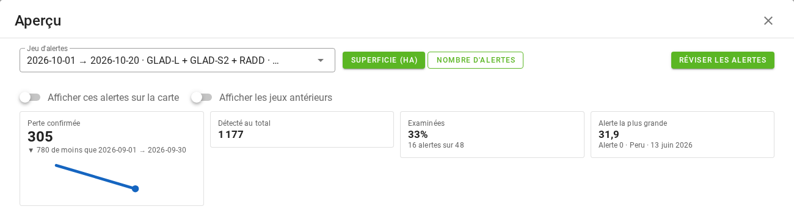

.. important::

    La comparaison demande de la prudence. **Perte confirmée** ne compte que les alertes examinées comme alertes réelles, et seul un tiers des alertes d'octobre est examiné ; le chiffre de septembre, lui aussi, ne porte que sur les alertes de septembre examinées jusqu'ici. La flèche indique que moins de perte est *confirmée* à ce stade, non que moins de forêt a été perdue : le chiffre augmente à mesure que l'équipe poursuit l'examen.

Dans l'onglet **Dans le temps**, **Au fil des périodes de suivi** présente les deux périodes côte à côte, avec la part encore en cours d'examen hachurée (2870 ha détectés en septembre, 1177 ha en octobre).

Dans l'onglet **Réponses** :

-   la carte de la question sur le facteur de perte répartit la superficie examinée par réponse (en octobre : l'exploitation minière d'abord, puis l'expansion agricole) ; et
-   la carte de la nouvelle question la répartit selon ses réponses (en octobre : uniquement « Non », 358 ha, avec 81,2 ha sous « Sans réponse »).

Voir `Les onglets <defo-overview-figures_>`_ pour le détail de chaque carte.

Partager les résultats
^^^^^^^^^^^^^^^^^^^^^^

Tout le jeu
"""""""""""

Dans l'onglet **Fichiers** de l'Aperçu, la carte **Exporter les alertes** écrit le jeu d'octobre dans un fichier. La coordinatrice choisit **Confirmées** (11 alertes, 304,9 ha) et sélectionne la tuile **GeoPackage**. Le fichier ``alerts_glad-l-glad-s2-radd_2026-10-01_2026-10-20_confirmed.gpkg`` contient un polygone par alerte confirmée, avec ses attributs et ses deux réponses, prêt pour un SIG. La tuile **Tableau CSV** écrit les mêmes alertes sous forme de tableau pour un tableur. Voir `Tout le jeu, depuis l'Aperçu <defo-export-set_>`_.

Une alerte
""""""""""

Pour faire un rapport sur une alerte seule, la coordinatrice l'ouvre dans Analyse, l'enregistre et sélectionne **Générer les fichiers** sous **Exporter cette alerte**. Le résultat est un fichier .zip avec le GeoPackage de l'alerte et ses images d'avant et d'après, ainsi qu'un rapport Word construit à partir du modèle du projet. Pour une alerte réelle, la tuile **Timelapse** crée aussi un GIF animé des images, d'avant en après. Voir `Une alerte, depuis Analyse <defo-export-alert_>`_.

Chaque fichier est aussi conservé dans le dossier du jeu d'alertes du projet, sous ``periods/2026-10-01_2026-10-20/sets/glad-l-glad-s2-radd/``.

Le mois suivant
^^^^^^^^^^^^^^^

Pour le cycle suivant, l'équipe prévoit de :

-   sélectionner de nouveau **Nouvelle période** : les dates prolongent la série, et la rétrospection ramène les groupes mis de côté comme trop petits le mois précédent ; un défrichement qui s'étend lentement devient ainsi une alerte dès qu'il atteint 1 ha, sans qu'aucun pixel soit signalé deux fois ;
-   examiner les alertes d'octobre avant la prochaine exécution : une alerte confirmée d'ici là peut devenir la perte antérieure dont les alertes de novembre sont l'extension, et un défrichement qui continue de s'étendre montre son historique dans Analyse et dans l'Aperçu ;
-   vérifier le questionnaire avant de répartir : une question ajoutée après la génération des paquets impose **Régénérer les paquets** ;
-   examiner aussi les alertes encore **Non examinée** des jeux antérieurs, puisque la comparaison de l'Aperçu n'est complète que dans la mesure des examens qui la sous-tendent ; et
-   utiliser **Dupliquer** dans la boîte de dialogue `Projet <defo-project-duplicate_>`_ pour surveiller une zone voisine avec les mêmes sources, le même masque et les mêmes couches.
