Forest Cover Loss Alerts
========================
*Monitore os alertas de perda de cobertura florestal numa área de interesse, período após período*

.. labels-ok: Apps; Map; Forest Cover Loss Alerts

**Forest Cover Loss Alerts** é um app do SEPAL para monitorar a perda de cobertura florestal numa área de interesse (AOI, do inglês *area of interest*). O app:

-   baixa do Google Earth Engine (GEE) os alertas GLAD-L e GLAD-S2 do Global Land Analysis and Discovery (GLAD) e os alertas do Radar for Detecting Deforestation (RADD), além das suas próprias fontes de alertas, se você tiver;
-   alinha todos eles numa mesma grade;
-   agrupa os pixels de alerta que se tocam em alertas, cada um com todas as fontes que o detectaram; e
-   permite revisar os alertas um a um sobre imagens de satélite de *antes* e de *depois*.

Para cada alerta, confirme-o ou descarte-o, responda às suas próprias perguntas sobre ele e redesenhe o polígono dele à mão ou com dois modelos de redes neurais. A revisão pode ser dividida entre vários avaliadores. Os resultados saem como arquivos GeoPackage, tabelas de valores separados por vírgulas (CSV), relatórios do Word e imagens GIF animadas.

Este artigo é destinado a analistas de monitoramento florestal que usam o SEPAL. Ele descreve cada etapa do app, na ordem de uso, e termina com um exemplo completo.

.. _defo-workflow:

O fluxo de trabalho num relance
-------------------------------

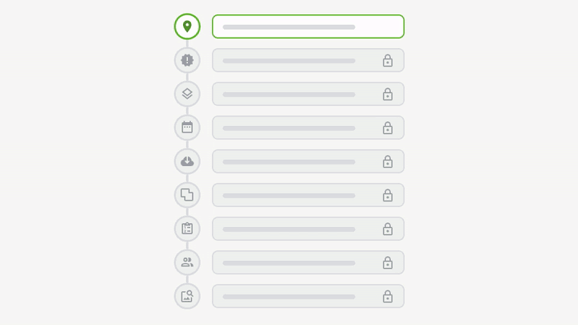

O painel **Fluxo de trabalho** organiza as etapas em dois níveis: **Preparar alertas** cria um conjunto de alertas, e **Preparar a revisão** prepara a revisão dele. As outras ferramentas abrem pela barra lateral esquerda (veja `A janela do app <defo-window_>`_).

.. list-table::
    :header-rows: 1
    :widths: 20 30 50

    *   -   Nível
        -   Subseção
        -   Para que serve
    *   -   –
        -   `Projeto <defo-project_>`_
        -   Criar, abrir, importar ou excluir um projeto, a pasta que guarda todo o seu trabalho.
    *   -   **Preparar alertas**
        -   `Área de interesse <defo-aoi_>`_
        -   Escolher a área a monitorar.
    *   -
        -   `Período de monitoramento <defo-period_>`_
        -   Definir as datas de uma rodada de monitoramento.
    *   -
        -   `Fontes de alertas <defo-alerts_>`_
        -   Escolher os conjuntos de dados de alertas do período e baixá-los.
    *   -
        -   `Harmonizar <defo-harmonize_>`_
        -   Alinhar os downloads numa mesma grade e aplicar as máscaras.
    *   -
        -   `Integrar e vetorizar <defo-integrate_>`_
        -   Combinar as fontes num conjunto de alertas, com um polígono por alerta.
    *   -   **Preparar a revisão**
        -   `Camadas adicionais <defo-layers_>`_ (opcional)
        -   Adicionar camadas de referência para avaliar os alertas.
    *   -
        -   `Questionário <defo-questionnaire_>`_ (opcional)
        -   Escrever as perguntas feitas para cada alerta e escolher o modelo de relatório.
    *   -
        -   `Avaliação <defo-evaluation_>`_
        -   Revisar sozinho ou dividir os alertas entre avaliadores.
    *   -   –
        -   `Análise <defo-analysis_>`_
        -   Revisar cada alerta sobre imagens de antes e depois.
    *   -   –
        -   `Visão geral <defo-overview_>`_
        -   Ver os números de um conjunto de alertas.
    *   -   –
        -   `Exportação <defo-export_>`_
        -   Exportar os arquivos de um alerta ou os alertas de um conjunto inteiro.

**Preparar a revisão** fica bloqueado até o projeto ter um conjunto de alertas: crie um antes em **Preparar alertas**.

Para um exemplo completo, do início ao fim, veja `Caso de uso: revisão de alertas em Madre de Dios, Peru <defo-use-case_>`_.

.. _defo-setup:

Configuração
------------

Requisitos:

-   uma conta do SEPAL;
-   uma conta do GEE vinculada ao SEPAL; e
-   para as imagens *Planet* da linha do tempo da Análise, acesso aos mosaicos tropicais Planet NICFI (Norway's International Climate and Forest Initiative) no GEE.

Para iniciar o app, acesse o painel **Apps** do SEPAL e selecione **Forest Cover Loss Alerts**.

O app roda na sua sessão do SEPAL e guarda seus projetos na sua pasta pessoal do SEPAL, em ``module_results/deforestation_alerts/``.

.. note::

    A inicialização pode levar vários minutos.

.. _defo-window:

A janela do app
^^^^^^^^^^^^^^^

O mapa ocupa a janela inteira. O painel **Fluxo de trabalho**, à direita, contém as etapas. Uma barra estreita de ícones percorre o lado esquerdo.

O cabeçalho do painel **Fluxo de trabalho** fica visível enquanto a etapa abaixo dele rola:

-   Uma faixa mostra os dois níveis lado a lado, **Preparar alertas** e **Preparar a revisão**, cada um com seu nome sobre uma barra por etapa. Uma barra preenchida tem resultados (uma AOI, períodos, fontes…), uma barra cinza ainda está vazia e uma barra listrada está bloqueada: passe o mouse sobre ela para ler o motivo (por exemplo, "Crie primeiro um conjunto de alertas."). As duas etapas opcionais, **Camadas adicionais** e **Questionário**, têm uma barra tracejada. O nome de um nível ganha uma marca de verificação assim que sua última etapa obrigatória tem resultados. Selecione uma barra para abrir a etapa dela.
-   Abaixo da faixa, a posição da etapa no nível dela (por exemplo, "3 / 5"), o nome dela e o que ela contém ("3 fontes"). Uma etapa opcional ainda vazia não mostra nenhuma contagem: a barra tracejada dela já a marca como opcional. Selecione o nome para ir a outra etapa a partir de uma lista, ou use as setas de cada lado para ir à etapa anterior ou à seguinte.
-   Abaixo do nome, uma linha diz o que fazer na etapa (por exemplo, "Defina o período de monitoramento."). O botão de informação no lado direito dessa linha abre a ajuda da etapa.

Para usar a barra lateral esquerda:

-   Passe o mouse sobre um ícone para ver o nome dele.
-   Selecione a seta na borda da barra para expandi-la e mostrar os nomes. Selecione o alfinete dela para mantê-la expandida. Uma barra expandida e não fixada se recolhe quando você clica no mapa, tanto na tela principal quanto nos mapas da Análise.

.. note::

    Enquanto uma janela de diálogo está aberta, a barra não responde. Feche antes a janela com o X.

De cima para baixo, a barra tem:

-   **Map**: mostra o mapa sem nenhuma janela por cima;
-   **Sobre**: uma breve descrição do app (as fontes que ele baixa, como os alertas são revisados e exportados e onde os seus projetos são salvos);
-   **Projeto**: abre a janela `Projeto <defo-project_>`_;
-   **Análise**: abre a tela de `Análise <defo-analysis_>`_; e
-   **Visão geral**: abre a janela `Visão geral <defo-overview_>`_.

Na parte de baixo da barra ficam três links para o repositório do app no GitHub (o código-fonte, a documentação e um formulário para relatar um bug) e depois dois botões:

-   O botão de tema alterna, a cada clique, entre o tema escuro (ícone de lua), o tema claro (ícone de sol) e um tema automático que segue a configuração do seu sistema.
-   O seletor de idioma mostra o código do idioma atual. Selecione-o para escolher inglês, espanhol, francês ou português. Os rótulos do app mudam na hora. No início, o app segue o idioma do navegador quando é um desses quatro e, caso contrário, o inglês.

O navegador lembra o tema e o idioma para a próxima sessão.

.. _defo-project:

Projeto
-------

Todo o trabalho acontece dentro de um *projeto*: uma AOI, suas fontes de alertas, seus períodos de monitoramento e todos os conjuntos de alertas gerados a partir deles. Um projeto é uma pasta na sua pasta pessoal do SEPAL. O app o salva automaticamente após cada alteração: não existe botão **Salvar**.

Use a janela **Projeto** para criar, abrir, importar, copiar e excluir projetos. Ela abre sozinha quando o app inicia. Depois, selecione **Projeto** na barra lateral esquerda.

Quando nenhum projeto está aberto
^^^^^^^^^^^^^^^^^^^^^^^^^^^^^^^^^

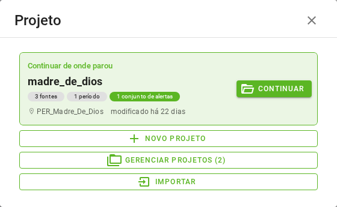

A janela mostra **Nenhum projeto aberto** e oferece três botões:

.. list-table::
    :header-rows: 1
    :widths: 25 75

    *   -   Botão
        -   Descrição
    *   -   **Novo projeto**
        -   Pede um nome e cria um projeto vazio.
    *   -   **Gerenciar projetos**
        -   Lista os projetos salvos na sua pasta do SEPAL, para abrir ou excluir um deles. O botão mostra quantos são e fica desativado enquanto não houver nenhum.
    *   -   **Importar**
        -   Importa um pacote de revisão preparado por um colega (veja `Importar um pacote de revisão <defo-project-import_>`_).

.. tip::

    Não é obrigatório criar um projeto antes. Vá direto para a etapa `AOI <defo-aoi_>`_ e selecione uma área: o app cria um projeto com o nome da área e a data de hoje (por exemplo ``PER_Madre_De_Dios_20261019``).

Quando há um projeto aberto
^^^^^^^^^^^^^^^^^^^^^^^^^^^

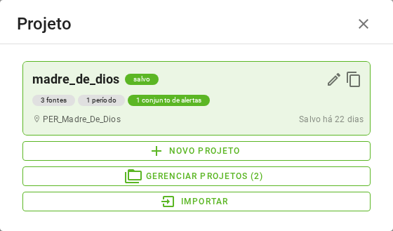

A janela mostra:

-   o nome do projeto com uma etiqueta: **salvo** quando o projeto já está gravado em disco, ou **falha ao salvar**, em vermelho, quando o último salvamento automático não funcionou (uma linha abaixo explica o motivo; as alterações continuam no app, então resolva a causa, geralmente disco cheio, antes de fechar a aba do navegador);
-   um resumo: a AOI (ou "ainda sem AOI") e o número de fontes, períodos e conjuntos de alertas; e
-   quando o projeto foi salvo pela última vez (por exemplo "Salvo há 3 minutos").

Os botões são **Novo projeto**, **Gerenciar**, **Importar** e **Duplicar**.

.. _defo-project-create:

Criar um projeto
^^^^^^^^^^^^^^^^

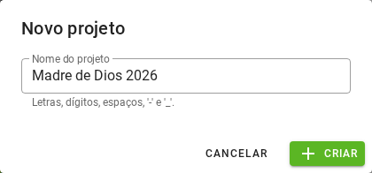

Para criar um projeto:

1.  Selecione **Novo projeto**.
2.  Digite um nome no campo **Nome do projeto**.
3.  Selecione **Criar** (ou pressione **Enter**).

O **Nome do projeto** aceita somente letras, algarismos, espaços, hífens (``-``) e sublinhados (``_``). Ele não pode ficar vazio e precisa ser diferente de todas as pastas de projeto que já existem na sua pasta do SEPAL (sem diferenciar maiúsculas de minúsculas).

O nome é verificado enquanto você digita. Se ele coincidir com um projeto salvo, o formulário oferece um link como **Abrir Madre de Dios 2026 em vez disso**.

O novo projeto abre na etapa `AOI <defo-aoi_>`_, que é sempre a primeira etapa do fluxo de trabalho.

Abrir, pesquisar e excluir projetos
^^^^^^^^^^^^^^^^^^^^^^^^^^^^^^^^^^^

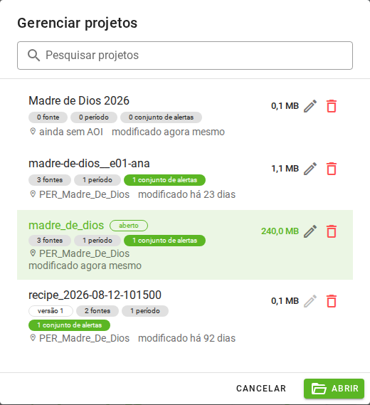

**Gerenciar** (ou **Gerenciar projetos**, quando nada está aberto) lista todos os projetos salvos com:

-   pequenas etiquetas com o número de fontes, períodos e conjuntos de alertas (a etiqueta dos conjuntos de alertas fica colorida quando o projeto tem resultados a revisar);
-   quando ele foi alterado pela última vez (por exemplo "modificado há 2 dias"); e
-   uma etiqueta **aberto** no projeto que está aberto no momento.

Para abrir um projeto:

1.  Digite um texto no campo **Pesquisar projetos** para manter apenas os projetos cujo nome o contém.
2.  Selecione um projeto.
3.  Selecione **Abrir**.

Para excluir um projeto:

1.  Selecione o ícone vermelho de lixeira na linha dele. A janela de confirmação mostra o tamanho da pasta do projeto.
2.  Digite exatamente o nome do projeto no campo de confirmação.
3.  Selecione **Excluir**.

.. attention::

    A exclusão apaga a pasta inteira do projeto: downloads, conjuntos de alertas, revisões e relatórios. Não é possível desfazê-la.

    -   Excluir o projeto aberto primeiro o fecha.
    -   Um projeto não pode ser excluído enquanto uma tarefa (um download, uma execução de **Integrar e vetorizar** ou o salvamento de uma revisão) ainda estiver gravando nele. Espere a tarefa terminar.

.. _defo-project-duplicate:

Duplicar um projeto
^^^^^^^^^^^^^^^^^^^

**Duplicar** copia o projeto aberto com um novo nome. A cópia mantém a AOI, as fontes, as máscaras, as camadas e a grade, a busca retroativa e o modelo de relatório, sem períodos nem conjuntos de alertas. A cópia abre na etapa AOI.

Use esse recurso para:

-   começar uma nova rodada de monitoramento com a mesma configuração; ou
-   monitorar outra área depois que a AOI de um projeto estiver bloqueada (veja `Área de interesse <defo-aoi_>`_).

.. note::

    As perguntas do questionário não são copiadas: a cópia começa com as perguntas padrão. Adicione as suas de novo na etapa `Questionário <defo-questionnaire_>`_ dela.

**Duplicar** não é oferecido para uma cópia de revisão.

.. _defo-project-import:

Importar um pacote de revisão
^^^^^^^^^^^^^^^^^^^^^^^^^^^^^

Quando o criador de um projeto divide os alertas entre vários avaliadores (veja `Avaliação <defo-evaluation_>`_), cada avaliador recebe um *pacote de revisão*: um arquivo .zip.

Para trabalhar num pacote de revisão:

1.  Copie o arquivo .zip para a sua pasta do SEPAL.
2.  Na janela **Projeto**, selecione **Importar**.
3.  Na janela **Importar um pacote de revisão**, selecione o arquivo em **Pacote de revisão (.zip)**. A importação começa assim que o arquivo é selecionado.

O pacote vira um novo projeto, uma *cópia de revisão*, com o nome do projeto original e do avaliador (por exemplo ``madre-de-dios__e01-ana``). Ele abre direto na tela de `Análise <defo-analysis_>`_, filtrado para os alertas atribuídos a esse avaliador. Numa cópia de revisão, as etapas de configuração ficam bloqueadas, e um aviso diz: "Cópia de revisão para (avaliador), de (projeto). A configuração está bloqueada."

Se o mesmo pacote já tiver sido importado, a janela **Já importado** oferece duas opções:

-   **Abrir a cópia existente**: abre a cópia existente, com as suas revisões; ou
-   **Importar como nova cópia**: importa o pacote de novo como um projeto separado. A cópia existente nunca é sobrescrita.

.. important::

    Uma *cópia revisada* (o arquivo que um avaliador devolve) não pode ser importada aqui. O criador do projeto a mescla na etapa `Avaliação <defo-evaluation_>`_ do projeto original.

Onde ficam os arquivos
^^^^^^^^^^^^^^^^^^^^^^

Cada projeto é uma pasta com o nome do projeto, em ``module_results/deforestation_alerts/`` na sua pasta pessoal do SEPAL:

.. list-table::
    :header-rows: 1
    :widths: 30 70

    *   -   Dentro da pasta do projeto
        -   Conteúdo
    *   -   ``project.json``
        -   As configurações e o histórico do projeto. O app grava esse arquivo a cada salvamento.
    *   -   ``aoi.geojson``
        -   A AOI, quando ela é uma forma desenhada, um arquivo vetorial ou um arquivo de pontos. Uma área administrativa ou um recurso do GEE é lido diretamente do GEE.
    *   -   ``masks/``
        -   As máscaras de `Harmonizar <defo-harmonize_>`_, alinhadas à grade do projeto.
    *   -   ``imagery/``
        -   O índice das cenas de satélite usadas na tela de Análise.
    *   -   ``periods/<start>_<end>/``
        -   Uma pasta por período de monitoramento: downloads em ``raw/``, rasters em ``harmonized/`` e ``sets/``, com uma pasta por conjunto de alertas.

.. note::

    Não mexa nesses arquivos enquanto o app estiver em execução. Use as ferramentas de `exportação <defo-export_>`_ do app para extrair os resultados.

.. _defo-aoi:

Área de interesse
-----------------

.. labels-ok: AOI selection method; Country/Province; Admin level 1; Admin level 2; Vector file; Drawn shapes; Point file; GEE Asset name; Select AOI; Select an AOI name; Select an asset; column; value; Use all features; Table file; id; latitude; longitude; Column; Value

A AOI é a área que o projeto monitora:

-   todo download de alertas é recortado por ela;
-   a cobertura de cada fonte de alertas é medida sobre ela; e
-   a grade do projeto é construída em torno dela.

Abra a etapa **AOI**, a primeira etapa do painel **Fluxo de trabalho**. A etapa está sempre disponível, mesmo sem nenhum projeto aberto.

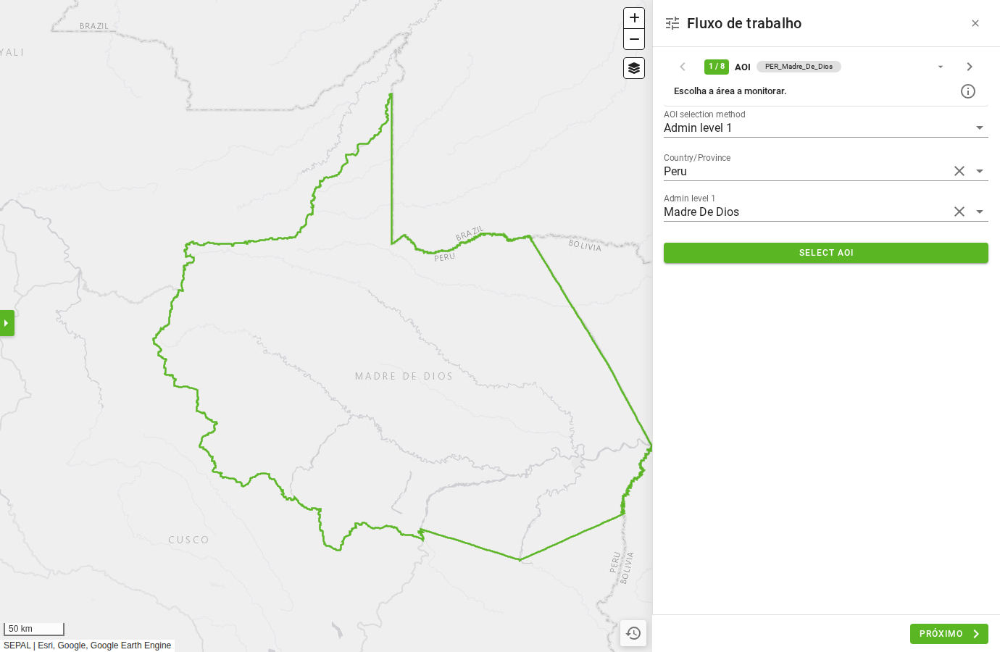

Selecionar a área
^^^^^^^^^^^^^^^^^

.. translation-only

O seletor de AOI vem do SEPAL e, por enquanto, aparece em inglês, por isso seus rótulos estão citados em inglês abaixo.

Para selecionar a AOI:

1.  Escolha um método no menu suspenso **AOI selection method**.
2.  Preencha os campos dele.
3.  Selecione **Select AOI**.

A área é desenhada no mapa e salva no projeto na mesma hora.

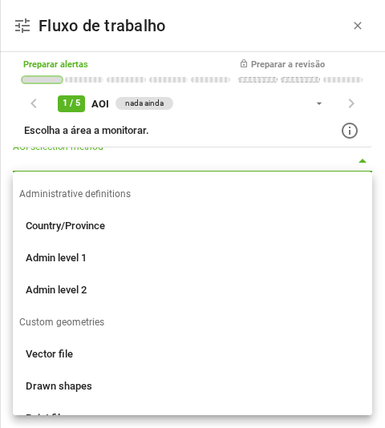

.. list-table::
    :header-rows: 1
    :widths: 20 40 40

    *   -   Método
        -   Entrada
        -   Observações
    *   -   **Country/Province**
        -   Um país.
        -   Os limites administrativos vêm do conjunto de dados Global Administrative Unit Layers (GAUL) da Organização das Nações Unidas para a Alimentação e a Agricultura (FAO).
    *   -   **Admin level 1**
        -   Um país e, em seguida, uma unidade de primeiro nível (uma região, um estado ou um departamento).
        -   Cada lista é preenchida assim que o nível acima é escolhido.
    *   -   **Admin level 2**
        -   Um país, uma unidade de primeiro nível e, em seguida, uma unidade de segundo nível (uma província ou um distrito).
        -
    *   -   **Vector file**
        -   Um arquivo .shp, .geojson, .gpkg ou .kml na sua pasta do SEPAL.
        -   Mantenha todas as feições ou escolha uma **column** e um **value** para manter só as feições correspondentes.
    *   -   **Drawn shapes**
        -   Formas desenhadas no mapa com as ferramentas de desenho que aparecem, e um nome opcional em **Select an AOI name**.
        -   Todas as formas desenhadas juntas formam a AOI. Sem nome, ela se chama ``drawn_`` seguido da data e da hora.
    *   -   **Point file**
        -   Uma tabela .csv ou .txt com uma coluna **id**, uma **latitude** e uma **longitude**.
        -   Constrói a AOI a partir de pontos. Pontos não têm superfície; para o monitoramento, prefira um método que gere polígonos.
    *   -   **GEE Asset name**
        -   Uma tabela (feature collection) ou uma imagem do GEE que você possa ler, escolhida em **Select an asset** ou colada com o ID completo.
        -   Numa tabela, mantenha só as feições cuja **Column** tem um determinado **Value**.

Quando a seleção termina, o app confirma: "AOI salva: (nome)". O painel **Fluxo de trabalho** mostra o nome da AOI no cabeçalho, e a etapa `Período <defo-period_>`_ é liberada.

.. tip::

    Uma AOI nacional funciona, mas tudo o que vem depois (downloads, a grade, a vetorização) cresce com a área. Comece com uma província ou um distrito enquanto aprende a usar o app.

O que acontece quando uma área é selecionada
^^^^^^^^^^^^^^^^^^^^^^^^^^^^^^^^^^^^^^^^^^^^

Quando uma área é selecionada:

-   Se nenhum projeto estiver aberto, um projeto é criado com o nome da AOI e a data de hoje (por exemplo ``PER_Madre_De_Dios_20261019``). Uma área administrativa recebe o código ISO do país e o nome da unidade.
-   A cobertura de cada fonte de alertas sobre a nova área é verificada uma vez e salva no projeto. A etapa `Alertas <defo-alerts_>`_ a exibe.
-   Se o projeto já tinha outra AOI, todos os downloads, rasters harmonizados e máscaras feitos para a área antiga são apagados, porque foram recortados por ela. A grade do projeto é redefinida, para ser construída de novo em torno da nova área.

Quando a AOI está bloqueada
^^^^^^^^^^^^^^^^^^^^^^^^^^^

Assim que o projeto tem um conjunto de alertas, a AOI dele não pode mais mudar: uma nova área invalidaria todos os downloads e todos os contornos de alertas. A etapa então mostra "Este projeto já tem conjuntos de alertas, então sua AOI está bloqueada. Duplique o projeto (janela Projeto) para monitorar outra área." e o seletor fica desativado.

Para monitorar outra área com as mesmas fontes, máscaras, camadas e grade, selecione **Duplicar** na janela `Projeto <defo-project-duplicate_>`_ e depois selecione a nova área na cópia.

Numa cópia de revisão (veja `Importar um pacote de revisão <defo-project-import_>`_), a etapa mostra apenas o nome da AOI: a área é a que o criador do projeto escolheu.

.. important::

    A AOI não pode mudar enquanto uma tarefa estiver gravando no projeto (um download ou uma execução de **Integrar e vetorizar**). O app exibe: "Uma tarefa está gravando neste projeto; altere a AOI quando ela terminar." Espere a tarefa terminar e selecione a área de novo.

.. _defo-period:

Período de monitoramento
------------------------

Um *período* é uma rodada de monitoramento, normalmente um mês. Para cada período, o app baixa as fontes de alertas do período nas datas dele mais uma *busca retroativa* anterior a elas, e gera os conjuntos de alertas desse período. Um projeto costuma ter uma série de períodos consecutivos.

As duas datas de um período estão incluídas: um período de 1 a 31 de janeiro mantém os alertas datados do dia 1 e do dia 31. O mesmo vale para a janela de busca dele.

Abra a etapa **Período** do painel **Fluxo de trabalho**. Ela é liberada assim que o projeto tem uma `AOI <defo-aoi_>`_.

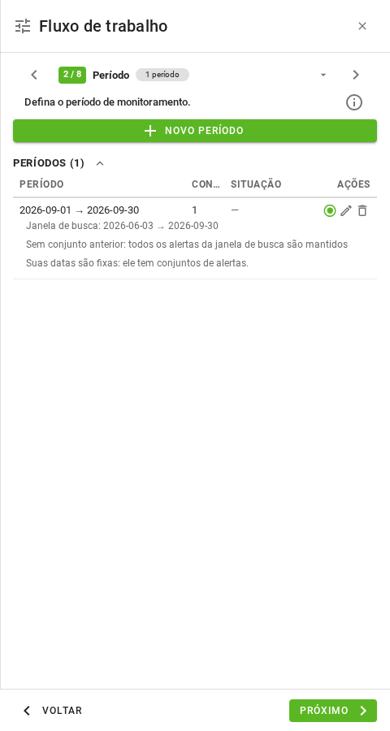

.. _defo-period-tracking:

Perdas que atravessam vários períodos
^^^^^^^^^^^^^^^^^^^^^^^^^^^^^^^^^^^^^

Cada período é processado separadamente, mas a perda florestal não respeita as datas do período. Parte da perda poderia escapar entre dois períodos:

-   um desmatamento que começa pequeno demais para ser um alerta;
-   alertas que os provedores publicam com atraso, depois de o período deles ser processado; ou
-   um desmatamento que continua crescendo na borda de um alerta reportado num período anterior.

O app acompanha essa perda de um período para o seguinte, e nunca reporta a mesma perda duas vezes:

.. list-table::
    :header-rows: 1
    :widths: 35 65

    *   -   Caso
        -   O que o app faz
    *   -   Perda já reportada por um período anterior
        -   Os pixels dela (a *pegada* do conjunto de alertas anterior) são removidos da execução do novo período, então ela não é reportada de novo.
    *   -   Um agrupamento pequeno demais para ser um alerta, ou um alerta publicado com atraso
        -   A `busca retroativa <defo-period-lookback_>`_ volta ao período anterior: os pixels deixados de lado voltam e podem se juntar a pixels novos para formar um alerta.
    *   -   Um desmatamento que cresce ao lado de um alerta revisado
        -   O alerta novo é `vinculado ao alerta anterior <defo-period-growth_>`_ como *alerta de crescimento*, e mantido mesmo quando está abaixo do tamanho mínimo.

.. _defo-period-lookback:

A janela de busca e a busca retroativa
""""""""""""""""""""""""""""""""""""""

Um desmatamento muitas vezes começa pequeno e cresce nas semanas seguintes. No período em que começa, o agrupamento de pixels de alerta dele ainda é menor que o **Tamanho mínimo do agrupamento** de `Integrar e vetorizar <defo-integrate_>`_, então não vira alerta: os pixels dele são deixados de lado como *não analisáveis*.

A busca retroativa mantém esses pixels em jogo:

-   Cada período busca numa *janela de busca* mais ampla: as próprias datas mais os dias de busca retroativa antes do início.
-   Os pixels que o período anterior deixou de lado voltam para a execução e se juntam aos pixels novos que os tocam.
-   Se o agrupamento que formam juntos atinge o tamanho mínimo, ele vira alerta. A primeira data de detecção dele é a do pixel mais antigo, no período anterior.

Para não reportar a mesma perda duas vezes, todo pixel já reportado por um conjunto de alertas de um período *anterior* é removido antes de os alertas do novo período serem gerados: só volta o que foi deixado de lado. A busca retroativa também capta os alertas que os provedores publicaram com atraso, depois de o período anterior ser processado.

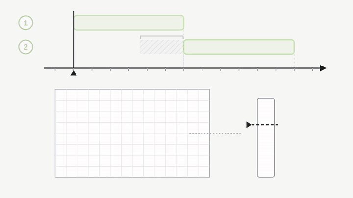

.. note::

    O primeiro período não tem nenhum conjunto anterior com que se comparar, então todos os alertas da sua janela de busca são mantidos. A linha dele diz **Sem conjunto anterior: todos os alertas da janela de busca são mantidos**. Com busca retroativa, isso inclui alertas datados antes do início do período.

    O primeiro período de um projeto novo começa sem busca retroativa, então busca apenas nas próprias datas, a menos que uma busca retroativa seja definida. Um projeto criado com **Duplicar** mantém a busca retroativa do projeto de onde foi copiado.

.. _defo-period-growth:

Crescimento ao lado de alertas anteriores
"""""""""""""""""""""""""""""""""""""""""

Os pixels de um alerta reportado fazem parte da pegada, então a busca retroativa não os traz de volta. Mas um desmatamento muitas vezes continua crescendo na borda de um alerta reportado num período anterior. Os pixels novos formam então um agrupamento próprio, muitas vezes menor que o **Tamanho mínimo do agrupamento**, que seria deixado de lado como qualquer agrupamento pequeno.

Quando o alerta anterior foi salvo como **Alerta verdadeiro** ou **Precisa de revisão**, `Integrar e vetorizar <defo-integrate-growth_>`_ não perde esse crescimento de vista:

-   Um alerta novo que encosta no alerta anterior, ou fica a até um pixel da grade dele, é um *alerta de crescimento*, vinculado a ele.
-   Um agrupamento abaixo do tamanho mínimo é mantido quando encosta no alerta anterior: ele é um alerta de crescimento *abaixo da área mínima* (a menos que **Manter os agrupamentos menores que tocam uma perda confirmada anterior** esteja desmarcado). Um agrupamento pequeno que não encosta em nada é deixado de lado, e a busca retroativa ainda pode trazê-lo de volta no período seguinte.
-   A execução procura alertas anteriores em todos os períodos anteriores, qualquer que seja a busca retroativa.

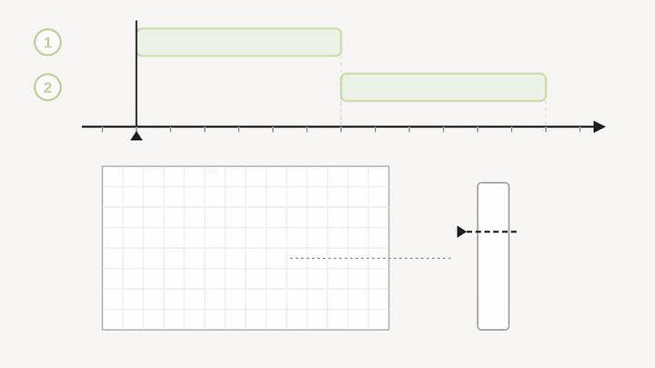

Os alertas vinculados entre si, ao longo de todos os períodos, formam o *histórico* de um desmatamento. A Análise o mostra em cada alerta (veja `Alertas anteriores <defo-analysis-earlier_>`_), e a `Visão geral <defo-overview-growth_>`_ o resume.

.. tip::

    Só contam as revisões salvas quando `Integrar e vetorizar <defo-integrate_>`_ começa. Revise os alertas de um período antes de executar o seguinte, para que o crescimento deles seja vinculado. Um alerta revisado depois ainda pode ser vinculado à mão em `Alertas anteriores <defo-analysis-earlier_>`_.

A lista de períodos
^^^^^^^^^^^^^^^^^^^

Cada linha de **Períodos** mostra:

.. list-table::
    :header-rows: 1
    :widths: 20 80

    *   -   Coluna
        -   Descrição
    *   -   **Período**
        -   As datas do período ("início → fim"), com notas abaixo: a janela de busca e eventuais avisos.
    *   -   **Conjuntos**
        -   O número de conjuntos de alertas gerados para este período.
    *   -   Coluna **Situação**
        -   **desatualizado** quando o download de uma fonte ou um conjunto de alertas não corresponde mais às configurações atuais (execute-o de novo em `Alertas <defo-alerts_>`_, `Harmonizar <defo-harmonize_>`_ ou `Integrar e vetorizar <defo-integrate_>`_); **faltando** quando os arquivos de um conjunto de alertas sumiram; um traço quando está tudo em dia.

Os ícones à direita de cada linha:

-   o botão de opção torna o período *ativo*: `Alertas <defo-alerts_>`_, `Harmonizar <defo-harmonize_>`_ e `Integrar e vetorizar <defo-integrate_>`_ trabalham sobre o período ativo;
-   o ícone de lápis altera as datas ou a busca retroativa; e
-   o ícone de lixeira exclui o período.

.. _defo-period-add:

Adicionar um período
^^^^^^^^^^^^^^^^^^^^

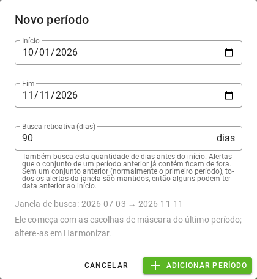

Selecione **Novo período**. A janela já vem preenchida para que o novo período dê continuidade à série.

.. list-table::
    :header-rows: 1
    :widths: 20 35 45

    *   -   Campo
        -   Descrição
        -   Padrão e limites
    *   -   **Início**
        -   O primeiro dia do período.
        -   O dia seguinte ao fim do último período. Para o primeiro período, o primeiro dia do mês atual.
    *   -   **Fim**
        -   O último dia do período.
        -   Hoje. Precisa ser posterior ao **Início**. Dois períodos não podem ter as mesmas datas.
    *   -   **Busca retroativa (dias)**
        -   O número de dias antes do **Início** que também entram na busca.
        -   0 (sem busca retroativa) no primeiro período de um projeto novo (um projeto duplicado mantém a busca retroativa do original); depois, o último valor usado. Um número inteiro de 0 a 3650.

Abaixo dos campos, a janela mostra uma prévia da janela de busca ("Janela de busca: início → fim"). Selecione **Adicionar período**: o período é criado e passa a ser o período ativo.

Um novo período começa com as escolhas de máscara do último período. Altere-as em `Harmonizar <defo-harmonize_>`_. As fontes de alertas dele são as marcadas com **Adicionar aos novos períodos** em `Alertas <defo-alerts-new-periods_>`_; adicione ou remova fontes lá.

.. tip::

    Para que os agrupamentos deixados de lado voltem, a busca retroativa precisa alcançar o período anterior. Com uma busca retroativa de 0, a janela de busca começa no primeiro dia do próprio período e nada do que foi deixado de lado antes é reconsiderado.

    Um agrupamento que continua pequeno demais permanece em jogo nos períodos seguintes enquanto a busca retroativa deles alcançar os seus pixels. Uma busca retroativa mais longa dá mais tempo a um desmatamento que cresce devagar para atingir o tamanho mínimo, mas deixa cada download maior (veja `O que os períodos anteriores já reportaram <defo-integrate-earlier_>`_).

Alterar um período
^^^^^^^^^^^^^^^^^^

Para um período sem conjuntos de alertas, o ícone de lápis abre uma janela para alterar as datas dele. Novas datas dão ao período uma nova identidade: seus downloads e arquivos harmonizados são apagados, porque foram feitos para a janela antiga.

Um período com conjuntos de alertas tem datas fixas (a nota dele diz **Suas datas são fixas: ele tem conjuntos de alertas.**). O ícone de lápis abre então uma janela em que só a busca retroativa pode mudar. Os downloads do período passam então a aparecer como desatualizados.

Excluir um período
^^^^^^^^^^^^^^^^^^

Selecione o ícone de lixeira. A janela de confirmação lista o que é apagado: os downloads e arquivos harmonizados do período e os conjuntos de alertas dele, com os alertas revisados.

.. important::

    Um período com conjuntos de alertas só pode ser excluído quando é o último período. Os conjuntos de um período anterior são a pegada a partir da qual os conjuntos posteriores foram gerados, então exclua primeiro os períodos posteriores. Os períodos não podem ser alterados nem excluídos enquanto uma tarefa estiver gravando no projeto.

.. _defo-alerts:

Fontes de alertas
-----------------

Uma *fonte de alertas* é um conjunto de dados de alertas de perda florestal. Cada pixel de alerta é *confirmado* (alta confiança) ou *provável* (baixa confiança) e traz o dia em que foi detectado pela primeira vez.

A etapa **Alertas** lista as fontes do `período <defo-period_>`_ ativo, mostra quanto da AOI e do período cada uma cobre, e as baixa. Cada período tem as suas próprias fontes: uma fonte adicionada aqui é adicionada só ao período ativo.

Abra a etapa **Alertas** do painel **Fluxo de trabalho**. Ela é liberada assim que o projeto tem um `período <defo-period_>`_. Ela trabalha sobre o período ativo: para trabalhar sobre outro período, torne-o ativo antes na etapa `Período <defo-period_>`_. O quadro no topo da etapa nomeia o período e a janela de busca dele, por exemplo "Período 2026-09-01 → 2026-09-30 · janela de busca desde 2026-06-03 (90 dias de busca retroativa)".

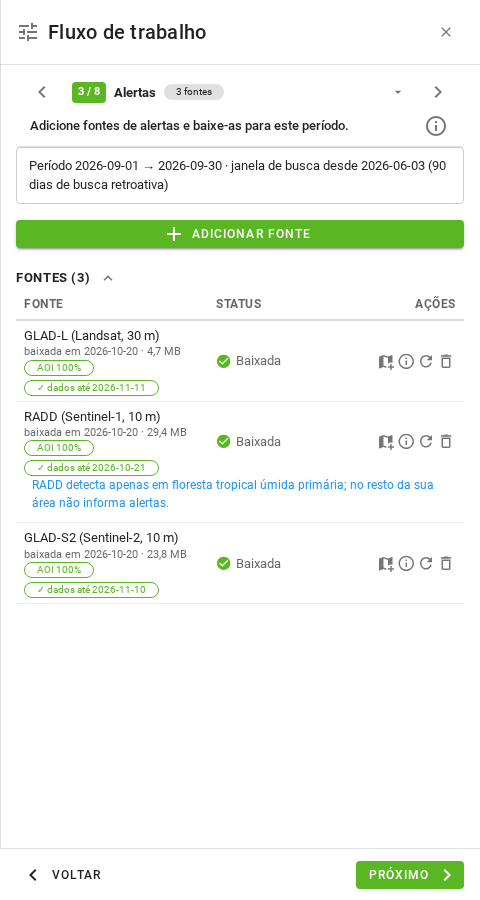

A lista de fontes
^^^^^^^^^^^^^^^^^

Cada linha de **Fontes** mostra:

.. list-table::
    :header-rows: 1
    :widths: 20 80

    *   -   Parte da linha
        -   Descrição
    *   -   **Fonte**
        -   O nome da fonte e, abaixo, uma linha com o que a linha contém ("baixada em 2026-10-20 · 4,7 MB") ou por que ela precisa de um download (por exemplo, "a janela de busca mudou (…): baixar de novo"), e dois chips:

            -   **AOI**: a parte da AOI que fica dentro da área de abrangência da fonte, por exemplo "AOI 100%". Uma fonte que cobre só parte da AOI não traz alertas para o restante dela.
            -   As datas: "✓ dados até 2026-10-30" (verde) quando a fonte tem dados até o fim da janela de busca, "dados só até …" (laranja) quando os dados dela param dentro da janela, ou "✗ os dados terminam em …" (vermelho) quando ela não tem nenhum dado na janela.
    *   -   **Status**
        -   O estado da linha, ou um botão para baixá-la (veja `Baixar as fontes <defo-alerts-download_>`_).
    *   -   Ícone de mapa
        -   Mostra a fonte no mapa: os alertas da janela de busca do período ativo. Uma fonte GeoTIFF só aparece depois de harmonizada.
    *   -   Ícone de informação
        -   Abre os **Detalhes** da fonte (veja `A janela de detalhes <defo-harmonize-details_>`_), com a caixa de seleção **Adicionar aos novos períodos** e, para uma fonte personalizada, o botão **Editar**.
    *   -   **Baixar novamente**
        -   Baixa a fonte de novo (veja abaixo).
    *   -   **Remover deste período**
        -   Remove a fonte do período ativo (veja `Remover uma fonte de um período <defo-alerts-remove_>`_).

A cobertura é verificada uma vez, quando a AOI é escolhida, e salva no projeto. Se a verificação falhou (por exemplo, porque o GEE não respondeu), aparece um botão **Verificar novamente** abaixo da lista.

Adicionar uma fonte
^^^^^^^^^^^^^^^^^^^

Selecione **Adicionar fonte** para abrir a janela **Adicionar uma fonte de alertas** e escolha o **Tipo de fonte**:

-   **Predefinida ou do projeto**: uma das fontes do catálogo, ou uma fonte do projeto que não está neste período (por exemplo, uma usada num período anterior); ou
-   **Personalizada (0 de 6)**: sua própria imagem ou coleção de imagens do GEE, ou um GeoTIFF. O contador mostra quantas das seis vagas personalizadas do período estão em uso.

Um período comporta no máximo três fontes predefinidas e seis personalizadas. O projeto guarda todas as fontes que já usou, sem limite.

.. _defo-alerts-new-periods:

Abaixo da fonte, a caixa de seleção **Adicionar aos novos períodos** (marcada por padrão) decide se os períodos criados depois começam com esta fonte. Ela nunca altera os períodos existentes. Para mudá-la depois, abra os **Detalhes** da fonte pelo ícone de informação dela.

Fontes predefinidas
"""""""""""""""""""

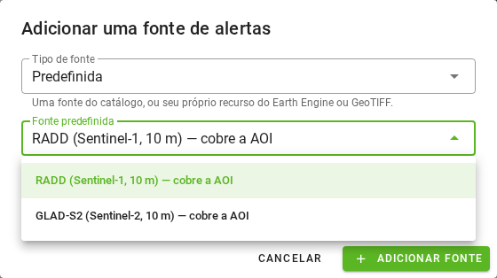

Escolha uma fonte no menu suspenso **Fonte de alertas** e selecione **Adicionar fonte**. A lista contém as fontes predefinidas e as fontes do próprio projeto que ainda não estão neste período. Cada item mostra a sua cobertura da AOI. Uma fonte que não cobre nada da AOI aparece desativada, com o motivo.

.. list-table::
    :header-rows: 1
    :widths: 25 30 45

    *   -   Fonte
        -   Sensor e tamanho do pixel
        -   Cobertura
    *   -   **GLAD-L (Landsat, 30 m)**
        -   Landsat, cerca de 30 m.
        -   As terras dos seus quatro blocos regionais (Ásia, África, América Central e América do Sul), entre cerca de 35°S e 35°N.
    *   -   **RADD (Sentinel-1, 10 m)**
        -   Radar Sentinel-1, 10 m. Enxerga através das nuvens.
        -   Os trópicos úmidos da África, do Sudeste Asiático e das Américas Central e do Sul. Detecta apenas em floresta tropical úmida primária; no resto da sua área, não informa alertas.
    *   -   **GLAD-S2 (Sentinel-2, 10 m)**
        -   Sentinel-2, 10 m.
        -   90°O–30°O, 20°S–20°N.

Quando todas as fontes já estão no período, a janela diz: "Todas as fontes já estão neste período."

Fontes personalizadas
"""""""""""""""""""""

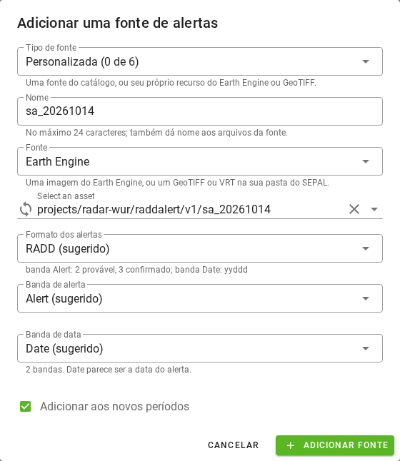

Uma fonte personalizada lê o seu próprio raster de alertas por meio de um de quatro formatos predefinidos. O formulário é lido de cima para baixo: o nome, de onde vem o raster, o próprio raster e depois as bandas dele. As bandas são lidas assim que o raster é escolhido ("Lendo as bandas…"), e os campos que dependem delas só aparecem depois que elas são lidas.

.. list-table::
    :header-rows: 1
    :widths: 20 40 40

    *   -   Campo
        -   Descrição
        -   Padrão e limites
    *   -   **Nome**
        -   O nome da fonte nas listas, legendas e nomes de arquivo.
        -   Sugerido a partir do nome do recurso ou do arquivo. No máximo 24 caracteres, pelo menos uma letra ou um algarismo, único no projeto. GLAD-L, RADD e GLAD-S2 são reservados.
    *   -   **Fonte**
        -   De onde o raster é lido: **Earth Engine** (um recurso) ou **GeoTIFF / VRT** (um arquivo na sua pasta do SEPAL).
        -   **Earth Engine**.
    *   -   Recurso ou **GeoTIFF / VRT**
        -   A imagem ou coleção de imagens do GEE, ou o arquivo .tif.
        -   Uma coleção de imagens é usada inteira, com a imagem mais recente por cima. Para uma coleção de instantâneos semanais (como a do próprio RADD), informe o ID da imagem mais recente. O GeoTIFF precisa ter um sistema de referência de coordenadas.
    *   -   **Formato dos alertas**
        -   Como as bandas são lidas (veja abaixo). Aparece quando o raster tem duas bandas ou mais. Um raster com uma banda não tem formato a escolher: o formulário diz "Uma banda (…): lida como a data do alerta." e a fonte é lida como **Somente data**.
        -   Sugerido a partir dos nomes das bandas quando o app os reconhece, e marcado "(sugerido)".
    *   -   **Banda de alerta**
        -   A banda com a classe do alerta.
        -   Apenas para **RADD**, **Alertas CCDC do SEPAL** e **Alertas PyEO do SEPAL**. Começa na banda que o formato espera; quando o raster não tem essa banda, a dica diz "Escolha a banda que contém o nível do alerta."
    *   -   **Banda de data**
        -   A banda com a data de detecção.
        -   Sempre obrigatória. Começa na banda que o formato espera, e a dica a nomeia (por exemplo, "3 bandas. Date parece ser a data do alerta."), ou pede que você a escolha.
    *   -   **Codificação da data**
        -   Como a data está escrita: **yymm (ano e mês; o alerta é datado no dia 1º)**, **yyddd (ano e dia do ano)**, **yyyyddd (ano e dia do ano)** ou **ano decimal**.
        -   Apenas para **Somente data**. Sugerida a partir dos valores da banda de data (veja abaixo).

Para uma fonte **Somente data**, o app lê os valores mínimo e máximo da banda de data sobre a AOI ("Lendo os valores de data…") e sugere a codificação que corresponde a eles, por exemplo "Valores de 24001 a 24366: são lidos como yyddd." Confira a sugestão: o app lê só os dois extremos do intervalo. Quando os valores não parecem datas ("… não parecem datas. Verifique a banda de data."), ou quando nenhum pixel da AOI tem data ("Nenhum pixel com data na AOI: escolha a codificação."), escolha você mesmo a codificação.

Os quatro formatos:

.. list-table::
    :header-rows: 1
    :widths: 25 75

    *   -   Formato dos alertas
        -   Como um pixel vira alerta
    *   -   **RADD**
        -   Banda de alerta: 2 é provável, 3 é confirmado. Banda de data em ``yyddd``.
    *   -   **Alertas CCDC do SEPAL**
        -   Saídas do Continuous Change Detection and Classification (CCDC). ``detection_count``: uma ou duas detecções são prováveis, três ou mais são confirmadas. ``first_detection_date`` em anos fracionários.
    *   -   **Alertas PyEO do SEPAL**
        -   Saídas da detecção de mudanças do Python for Earth Observation (PyEO), lidas como as do CCDC. ``total_changes``: uma ou duas mudanças são prováveis, três ou mais são confirmadas. ``first_change_date_above_threshold`` em anos fracionários.
    *   -   **Somente data**
        -   Uma única banda de data, na codificação escolhida. Todo pixel com data é um alerta confirmado.

Quando **Adicionar fonte** é selecionado, o app verifica o raster: se as bandas existem e são numéricas, se as datas podem ser lidas e se a fonte cobre a AOI. Um problema aparece em vermelho dentro da janela, que continua aberta para correções. Enquanto a verificação roda, o botão passa a ser **Cancelar** e a interrompe.

Editar uma fonte personalizada
""""""""""""""""""""""""""""""

Abra os **Detalhes** da fonte pelo ícone de informação dela e selecione **Editar** para reabrir o formulário, com o nome da fonte no título. O nome é fixo; o raster, o formato e as bandas podem mudar. O formulário mantém o formato e as bandas salvos até que outro raster seja escolhido.

Depois que um conjunto de alertas usa a fonte, ela não pode mais ser editada: remova-a e adicione uma nova.

.. _defo-alerts-download:

Baixar as fontes
^^^^^^^^^^^^^^^^

Cada fonte é baixada na janela de busca do período, na sua própria projeção e recortada pela AOI. Uma fonte GeoTIFF não é baixada: ela é lida do seu arquivo. Baixar não harmoniza a fonte: isso é a próxima etapa, `Harmonizar <defo-harmonize_>`_, que só roda quando você a inicia lá.

A coluna **Status** mostra:

.. list-table::
    :header-rows: 1
    :widths: 25 75

    *   -   Status
        -   Significado
    *   -   "Baixada"
        -   Baixada para a janela de busca atual. A linha abaixo do nome dá a data do download e o tamanho em disco.
    *   -   **Baixar**
        -   A fonte ainda não foi baixada para a janela de busca deste período, ou o download dela está desatualizado. Selecione o botão para baixá-la.
    *   -   **Ler arquivo**
        -   O mesmo para uma fonte GeoTIFF, que é lida do seu arquivo.
    *   -   **Repetir**
        -   O último download falhou. O erro aparece em vermelho abaixo da linha.
    *   -   "Baixando 42%", "Lendo", "Na fila"
        -   A linha está em execução, ou espera a vez dela ("aguardando a linha acima").
    *   -   "não coberta", "sem dados"
        -   A fonte não pode ser executada para este período: ela não cobre a AOI, ou não tem dados para a janela de busca (o chip de datas dela está vermelho).
    *   -   "Sem arquivo"
        -   O arquivo de uma fonte GeoTIFF sumiu (veja `Mensagens comuns <defo-harmonize-messages_>`_).

Um botão azul executa uma linha pela primeira vez; um laranja refaz um arquivo desatualizado. A linha abaixo do nome diz então o motivo: por exemplo "a janela de busca mudou (…): baixar de novo" ou "a AOI mudou: baixar de novo". Numa `cópia de revisão <defo-evaluation-return_>`_ de um avaliador, nada é executado: a coluna mostra "A baixar" em vez de um botão.

.. note::

    Uma linha baixada não tem botão: uma fonte já baixada para a janela de busca do período não é baixada de novo sozinha. Para buscar os alertas mais recentes de um catálogo que continua adicionando alertas a datas passadas, use **Baixar novamente**. O app pergunta antes, mostrando a janela e a data do arquivo que será substituído. Isso não é oferecido para uma fonte GeoTIFF ("Nada a baixar de novo: lida de um arquivo").

Cada linha é baixada com o próprio botão. Selecione os botões de várias linhas para baixar todas: cada um inicia a própria tarefa, e elas entram na fila, uma linha por vez. As linhas que mostram "não coberta" ou "sem dados" não têm botão; uma linha que falha mostra o erro em vermelho abaixo dela. A linha em execução mostra a própria barra de progresso; uma linha iniciada não pode ser parada.

O download também aparece como uma notificação de tarefa com o título **Download**, com a fonte em que está e a porcentagem.

.. _defo-alerts-remove:

Remover uma fonte de um período
^^^^^^^^^^^^^^^^^^^^^^^^^^^^^^^

Selecione o ícone de lixeira (**Remover deste período**) e confirme. Os arquivos baixados e harmonizados da fonte neste período são excluídos. Os conjuntos de alertas deste período que já a usaram mantêm seus alertas e aparecem como desatualizados.

A fonte continua no projeto: os outros períodos a mantêm, e ela pode ser adicionada de volta com **Adicionar fonte**. Uma fonte nunca é excluída do projeto inteiro.

Mensagens comuns
^^^^^^^^^^^^^^^^

"Esta fonte não cobre a AOI."
    A área de abrangência do raster não inclui a área: verifique o recurso ou a AOI.

"Falta uma banda mapeada." ou "Uma banda mapeada não é numérica."
    Escolha outras bandas ou outro formato.

"Este recurso CCDC armazena suas datas como dias julianos ou tempo Unix …"
    Só são aceitas saídas do CCDC datadas em anos fracionários.

"Este período já tem 6 fontes personalizadas."
    Remova uma fonte personalizada do período antes de adicionar outra.

"Uma tarefa está gravando neste projeto; …"
    As fontes não podem mudar durante um download ou uma execução de **Integrar e vetorizar**. Espere terminar.

.. _defo-harmonize:

Harmonizar
----------

Esta etapa coloca todas as entradas do `período <defo-period_>`_ ativo numa grade comum. Cada fonte baixada em `Alertas <defo-alerts-download_>`_ é *harmonizada*: alinhada à grade do projeto e recortada pelas máscaras do período. Nada cujas entradas não mudaram é executado duas vezes.

Abra a etapa **Harmonizar** do painel **Fluxo de trabalho**. Ela é liberada assim que pelo menos uma fonte do período ativo está baixada (ou é uma fonte GeoTIFF). Ela trabalha sobre o período ativo: para harmonizar outro período, torne-o ativo antes na etapa `Período <defo-period_>`_.

De cima para baixo, a etapa tem três partes: a **Grade do projeto**, as **Máscaras** e as **Fontes deste período**.

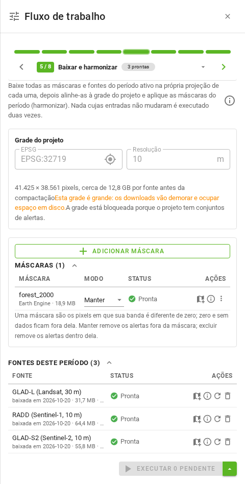

A grade do projeto
^^^^^^^^^^^^^^^^^^

Todos os rasters do projeto são alinhados a uma mesma grade: uma projeção em metros e um tamanho de pixel, sobre a AOI. Assim, alertas de fontes com tamanhos de pixel diferentes podem ser combinados pixel a pixel, e o tamanho mínimo de alerta em hectares se converte num número de pixels.

.. list-table::
    :header-rows: 1
    :widths: 15 40 45

    *   -   Campo
        -   Descrição
        -   Padrão e limites
    *   -   **EPSG**
        -   A projeção da grade, como um código do European Petroleum Survey Group (EPSG). O botão de mira no fim do campo preenche a zona Universal Transversa de Mercator (UTM) da AOI.
        -   A zona UTM do centro da AOI. Precisa ser um sistema projetado em metros: um sistema geográfico (como o 4326) ou um em pés é recusado.
    *   -   **Resolução**
        -   O tamanho do pixel, em metros.
        -   O menor tamanho de pixel entre as fontes do projeto: 10 m com RADD ou GLAD-S2, 30 m só com GLAD-L, o tamanho de pixel próprio de uma fonte personalizada, ou 30 m quando nada se sabe. Precisa ser maior que 0.

Abaixo dos campos aparece uma prévia do tamanho da grade: "largura × altura pixels, cerca de … por fonte antes da compactação". Acima de 2 GB por fonte, um aviso diz **Esta grade é grande: os downloads vão demorar e ocupar espaço em disco.** (isso não bloqueia a etapa).

Selecione **Salvar grade**. As máscaras e a tabela de fontes só aparecem depois que uma grade é salva.

A grade pode mudar até que o primeiro conjunto de alertas seja gerado. Uma nova grade apenas harmoniza as fontes de novo a partir dos arquivos já baixados; ela não as baixa outra vez. Assim que o projeto tem um conjunto de alertas, o cartão diz **A grade está bloqueada porque o projeto tem conjuntos de alertas.**

.. note::

    Mudar a `AOI <defo-aoi_>`_ apaga a grade e exclui todos os downloads e arquivos harmonizados do projeto, que foram feitos para a área antiga. Salve a grade de novo aqui e depois execute as linhas novamente.

Máscaras
^^^^^^^^

Uma *máscara* limita onde os alertas são mantidos. É um raster definido uma única vez para o projeto: uma imagem ou coleção de imagens do GEE, ou um GeoTIFF, com uma banda. Um pixel está dentro da máscara onde essa banda não é zero; os pixels com zero e sem dados ficam fora dela.

Cada período escolhe um **Modo** para cada máscara:

.. list-table::
    :header-rows: 1
    :widths: 20 80

    *   -   Modo
        -   Efeito sobre os alertas do período
    *   -   **Desligada**
        -   A máscara não é usada neste período.
    *   -   **Manter**
        -   Os alertas *fora* da máscara são removidos (por exemplo, manter apenas os alertas dentro de uma máscara de floresta).
    *   -   **Excluir**
        -   Os alertas *dentro* da máscara são removidos (por exemplo, descartar alertas em plantios ou na água).

Quando várias máscaras estão ligadas, todas se aplicam. As máscaras atuam sobre as fontes harmonizadas, então uma mudança de **Modo** deixa as fontes do período desatualizadas. O botão **Harmonizar** de cada linha então as harmoniza de novo, sem baixá-las. Um novo período começa com as escolhas de máscara do último período.

Adicionar uma máscara
"""""""""""""""""""""

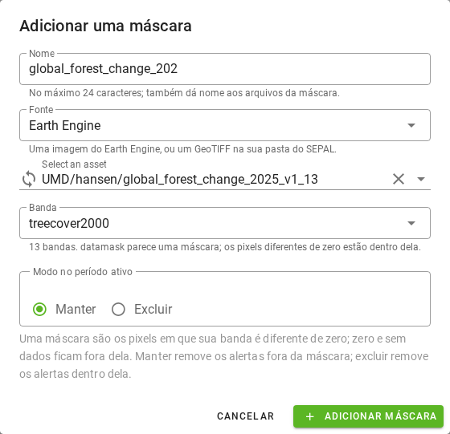

Selecione **Adicionar máscara** para abrir a janela **Adicionar uma máscara**. As bandas são lidas assim que o raster é escolhido.

.. list-table::
    :header-rows: 1
    :widths: 20 40 40

    *   -   Campo
        -   Descrição
        -   Padrão e limites
    *   -   **Nome**
        -   O nome da máscara nas listas, legendas e nomes de arquivo.
        -   Sugerido a partir do nome do recurso ou do arquivo. No máximo 24 caracteres, pelo menos uma letra ou um algarismo, único entre as máscaras do projeto.
    *   -   **Fonte**
        -   **Earth Engine** (um recurso) ou **GeoTIFF / VRT** (um arquivo na sua pasta do SEPAL).
        -   **Earth Engine**.
    *   -   Recurso ou **GeoTIFF / VRT**
        -   A imagem ou coleção de imagens do GEE, ou o arquivo .tif.
        -
    *   -   **Banda**
        -   A banda que define a máscara. Aparece quando o raster tem duas bandas ou mais; com uma banda, o formulário diz "Uma banda (…): a máscara é feita a partir dela."
        -   A banda cujo nome parece de máscara (por exemplo, ``datamask``), nomeada na dica ("… parece uma máscara; os pixels diferentes de zero estão dentro dela."); se não houver, escolha-a você.
    *   -   **Modo no período ativo**
        -   **Manter** ou **Excluir**.
        -   **Manter**. A máscara é ligada apenas no período ativo; todos os outros períodos a deixam desligada até que ela seja ligada neles.

Quando **Adicionar máscara** é selecionado, o app verifica o raster e a banda dele. Um problema aparece em vermelho dentro da janela, que continua aberta para correções.

A lista de máscaras
"""""""""""""""""""

Cada linha de **Máscaras** mostra:

.. list-table::
    :header-rows: 1
    :widths: 20 80

    *   -   Coluna
        -   Descrição
    *   -   **Máscara**
        -   O nome da máscara. A linha abaixo dele indica a fonte e o tamanho em disco quando ela está pronta ("Earth Engine · 18,9 MB"), ou por que ela precisa ser executada ("ainda não baixada", "a grade mudou (…): alinhar de novo"). Ela termina com "Desligada" quando a máscara está desligada no período ativo.
    *   -   **Modo**
        -   O modo da máscara no período ativo: **Desligada**, **Manter** ou **Excluir**. Uma mudança vale na hora; as fontes do período passam então a estar desatualizadas.
    *   -   **Status**
        -   "Pronta", ou um botão para a próxima execução da máscara: **Baixar** (uma máscara do GEE ainda não baixada) ou **Alinhar** (à grade). Um botão laranja refaz um arquivo desatualizado. Durante uma execução, a célula mostra "Baixando 42%", "Alinhando" ou "Na fila".

Os ícones à direita de cada linha:

-   o ícone de mapa mostra a máscara no mapa: uma máscara do GEE pode ser visualizada antes de ser baixada; uma máscara GeoTIFF, depois de alinhada;
-   o ícone de informação abre os **Detalhes** dela (veja `A janela de detalhes <defo-harmonize-details_>`_); e
-   o menu **Mais ações** (três pontos) contém:

    -   **Baixar novamente** (só para máscaras do GEE), para um recurso que mudou. O app pergunta antes: "Isto busca a máscara de novo no Earth Engine, substitui o download e depois a alinha.";
    -   **Editar**, que abre **Editar a máscara** *nome*: o raster e a banda podem mudar, o nome não. Depois que um conjunto de alertas usou a máscara, ela não pode mais ser editada (**Um conjunto de alertas já usa esta máscara: adicione uma nova em vez disso.**); e
    -   **Excluir máscara…**, que exclui a máscara depois que você confirma. O download e o arquivo alinhado dela são apagados, e todos os períodos deixam de usá-la. Os conjuntos de alertas que a usaram mantêm seus alertas e aparecem como desatualizados.

Uma máscara é baixada e alinhada uma única vez para o projeto todo, seja qual for o período que a execute.

.. _defo-harmonize-sources:

Fontes deste período
^^^^^^^^^^^^^^^^^^^^

A tabela tem uma linha por fonte de alertas do período ativo, com duas colunas:

.. list-table::
    :header-rows: 1
    :widths: 20 80

    *   -   Coluna
        -   Descrição
    *   -   **Fonte**
        -   O nome da fonte. A linha abaixo dele diz o que a linha da tabela contém ou o que ela espera (veja abaixo). Avisos, como uma cobertura parcial, e erros aparecem como linhas abaixo da linha da tabela.
    *   -   **Status**
        -   O estado da linha, ou um botão para a próxima execução dela.

A coluna **Status** mostra:

.. list-table::
    :header-rows: 1
    :widths: 25 75

    *   -   Status
        -   Significado
    *   -   "Pronta"
        -   Baixada e harmonizada com as entradas atuais. A linha abaixo do nome dá a data do download, o tamanho em disco e o que o arquivo harmonizado encontrou: "baixada em 2026-10-20 · 31,7 MB · 2.362.718 pixels de alerta".
    *   -   **Harmonizar**
        -   O download está em dia, mas o arquivo harmonizado está faltando ou desatualizado (um novo download, uma nova grade, uma mudança de máscara). Selecione o botão para executar a linha: ele alinha as máscaras do período que precisem disso e depois harmoniza a fonte, sem baixá-la.
    *   -   "Baixe-a ou leia-a primeiro em Alertas"
        -   A fonte não foi baixada para a janela de busca deste período, ou o download dela está desatualizado. A linha não tem botão: baixe-a antes em `Alertas <defo-alerts-download_>`_.
    *   -   **Repetir**
        -   A última execução da linha falhou. O erro aparece em vermelho abaixo da linha.
    *   -   "Baixando 42%", "Harmonizando", "Na fila"
        -   A linha está em execução, ou espera a vez dela numa execução ("aguardando a linha acima"). Uma linha que está sendo baixada em Alertas também aparece como em execução aqui, e não pode ser harmonizada até o download dela terminar.
    *   -   "não coberta", "sem dados"
        -   A fonte não pode ser executada neste período: ela não cobre a AOI, ou não tem dados para a janela de busca. A linha abaixo do nome dá o motivo. Veja `Fontes de alertas <defo-alerts_>`_ sobre a cobertura.
    *   -   "Sem arquivo"
        -   O arquivo de uma fonte GeoTIFF sumiu (veja `Mensagens comuns <defo-harmonize-messages_>`_).

Na `cópia de revisão <defo-evaluation-return_>`_ de um avaliador, nada é executado: em vez de um botão, a coluna mostra "A harmonizar" ou "A alinhar".

Um botão azul executa uma linha pela primeira vez; um laranja refaz um arquivo desatualizado. A linha abaixo do nome diz então o motivo: por exemplo, "a grade mudou (EPSG:32719 · 30 m → EPSG:32719 · 10 m): harmonizar de novo", "foi baixada de novo desde então: harmonizar de novo" ou "a máscara forest_2000 mudou: harmonizar de novo".

Os ícones à direita de cada linha:

-   o ícone de mapa (**Mostrar no mapa**) mostra os alertas harmonizados no mapa;
-   o ícone de informação abre os **Detalhes** da linha (veja abaixo); e
-   **Excluir arquivo harmonizado** remove o arquivo harmonizado da fonte neste período, depois que você confirma. O download continua: harmonize a fonte de novo nesta etapa para recriar o arquivo. Os conjuntos de alertas deste período feitos com a fonte passam a estar desatualizados; os alertas e as revisões deles são mantidos.

.. _defo-harmonize-details:

A janela de detalhes
""""""""""""""""""""

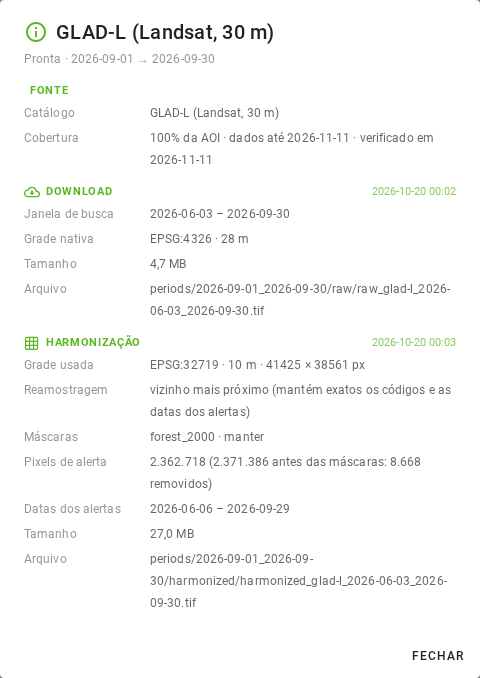

O ícone de informação de uma fonte ou de uma máscara abre um resumo somente leitura do que foi usado para fazer os arquivos dela. Ele começa com o estado da linha e, para uma fonte, o período. Quando a linha está desatualizada, uma linha laranja **Motivo:** diz o que mudou.

Em `Alertas <defo-alerts_>`_, o ícone de informação de uma fonte abre a mesma janela, com dois controles a mais: a caixa de seleção **Adicionar aos novos períodos** (veja `Adicionar uma fonte <defo-alerts-new-periods_>`_) e, para uma fonte personalizada, **Editar**.

.. list-table::
    :header-rows: 1
    :widths: 25 75

    *   -   Seção
        -   O que ela lista
    *   -   **Fonte**
        -   Uma fonte predefinida: o **Catálogo** e a **Cobertura** da AOI, com a última data de dados e o dia em que foi verificada. Uma fonte personalizada: o **Tipo**, a **Referência**, o **Formato**, a **Codificação das datas**, as **Bandas** e a **Grade nativa**. Uma máscara: a **Referência**, a **Banda**, a **Grade nativa** e os períodos em que é usada (**Usada em**).
    *   -   **Download** (**Leitura do arquivo** para uma fonte GeoTIFF)
        -   A **Janela de busca**, a **Grade nativa** em que o arquivo foi baixado, o **Tamanho** e o **Arquivo** dele na pasta do projeto.
    *   -   **Harmonização** (**Alinhamento** para uma máscara)
        -   A **Grade usada**, com a grade atual quando ela mudou desde então, a **Reamostragem**, as **Máscaras** aplicadas com o modo delas, os **Pixels de alerta** mantidos (e quantos as máscaras removeram), as **Datas dos alertas** encontradas, o **Tamanho** e o **Arquivo**. Para uma máscara: os **Pixels da máscara**.

Cada seção dá a data e a hora em que o arquivo dela foi gravado, ou mostra "Ainda não executado". Selecione **Fechar**, ou pressione **Esc**, para fechar a janela.

.. labels-ok: Esc

Executar várias linhas
""""""""""""""""""""""

Cada linha é executada com o próprio botão. O **Harmonizar** de uma fonte primeiro alinha as máscaras ativas no período que precisam disso e depois harmoniza a fonte; o **Alinhar** de uma máscara alinha só essa máscara. Selecione os botões de várias linhas para executar todas: cada um inicia a própria tarefa, e elas entram na fila, uma linha por vez:

-   as linhas que mostram "não coberta" ou "sem dados", e as linhas ainda a baixar, não têm botão;
-   uma linha que falha mostra o erro em vermelho logo abaixo, e a próxima linha segue;
-   enquanto a tarefa de uma fonte alinha uma máscara, o **Harmonizar** de outra fonte que precisa da mesma máscara mostra "Na fila" e começa quando a máscara estiver alinhada.

A linha em execução mostra a própria barra de progresso, que corre sem fim enquanto não tem porcentagem. Uma linha iniciada não pode ser parada; as linhas já concluídas continuam concluídas.

A execução também aparece como uma notificação de tarefa com o título **Harmonizar**, com a linha em que está (por exemplo, "Harmonizando GLAD-L").

.. tip::

    Cada linha precisa de espaço livre em disco para os seus arquivos. O app verifica isso antes de gravar e interrompe a linha com uma mensagem quando o disco está cheio demais. A linha com o tamanho da grade dá uma ideia de quanto uma fonte pode ocupar.

.. _defo-harmonize-messages:

Mensagens comuns
^^^^^^^^^^^^^^^^

"Espaço livre em disco insuficiente: são necessários … GB em … e há … GB livres."
    Libere espaço na sua pasta do SEPAL ou use uma grade mais grossa.

"Uma linha desta execução já está sendo preparada …"
    A máscara cujo **Alinhar** você selecionou está sendo alinhada por outra execução (a de outro período, ou o **Harmonizar** de uma fonte), ou a linha ainda está em execução. Execute de novo quando isso terminar.

"A geometria da AOI ainda está sendo obtida; execute esta linha novamente em instantes."
    As fontes e máscaras GeoTIFF precisam da forma da AOI. Espere um pouco. Se ela não pôde ser obtida, selecione **Verificar novamente** abaixo da tabela e depois execute-as.

"A máscara … não cobre nada da AOI: como máscara de manter, todos os alertas seriam removidos."
    A máscara não alcança a área. Verifique o recurso ou a banda dela, ou desligue-a.

"Uma tarefa está gravando neste projeto; salve a grade quando ela terminar."
    A grade, as máscaras e as fontes não podem mudar durante um download ou uma execução de **Integrar e vetorizar**.

"Sem arquivo", com "faltando: arquivo não encontrado: …" abaixo da linha, ou "Máscara …: arquivo não encontrado (…). Coloque o arquivo de volta neste caminho para usar a máscara."
    Uma fonte ou máscara GeoTIFF foi movida, renomeada ou apagada da sua pasta do SEPAL. Coloque o arquivo de volta no caminho indicado, ou edite a fonte ou a máscara para apontar para o novo local.

"Uma máscara ativa neste período ainda não está alinhada à grade atual; Harmonizar numa fonte alinha primeiro as máscaras."
    Uma fonte não pode ser harmonizada antes de as máscaras do período estarem alinhadas. Selecione o **Harmonizar** da fonte ou, antes, o botão **Alinhar** da máscara.

"Máscara …: sua grade nativa (projeção e escala) é desconhecida; edite a máscara."
    O app não sabe como baixar essa máscara do GEE. Abra-a com **Editar** no menu **Mais ações** dela e salve-a de novo, para que o raster seja verificado outra vez.

.. _defo-integrate:

Integrar e vetorizar
--------------------

Esta etapa transforma as fontes harmonizadas do período ativo num *conjunto de alertas*: a lista de alertas a revisar na `Análise <defo-analysis_>`_. Ela:

-   combina as fontes pixel a pixel;
-   remove o que os períodos anteriores já reportaram;
-   agrupa os pixels de alerta vizinhos em *agrupamentos*; e
-   desenha um polígono por agrupamento. Cada agrupamento que ela mantém é um alerta do conjunto.

Abra a etapa **Integrar e vetorizar** do painel **Fluxo de trabalho**. Ela é liberada assim que pelo menos uma fonte do período ativo está pronta em `Harmonizar <defo-harmonize_>`_.

O formulário segue a execução, em três cartões com borda: as fontes a combinar, as configurações dos agrupamentos e as camadas de atributos. O botão **Integrar e vetorizar** fica abaixo deles. Abaixo das fontes, linhas cinza dizem o que a execução também faz sozinha, sem nenhuma configuração:

-   "Remove os pixels já presentes em N conjuntos de alertas anteriores" (veja `O que os períodos anteriores já reportaram <defo-integrate-earlier_>`_); e
-   "Recupera os pixels não analisáveis de N conjuntos anteriores dentro da busca retroativa", contados para as fontes selecionadas.

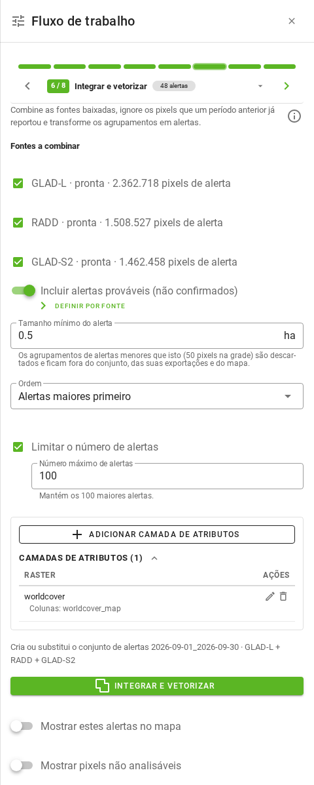

O que é um alerta
^^^^^^^^^^^^^^^^^

Um alerta é um *agrupamento*: um conjunto de pixels de alerta que se tocam, pelos lados ou pelos cantos, seja qual for a fonte que detectou cada pixel. Onde pixels do GLAD-L e do RADD se tocam, eles formam *um único* alerta que lista as duas fontes. Um alerta nunca é dividido em um alerta por fonte.

Cada alerta guarda:

-   as fontes que o detectaram;
-   a primeira e a última data de detecção (a data mais antiga e a mais recente entre os seus pixels);
-   a área em hectares; e
-   uma estatística das bandas de cada camada de atributos (veja abaixo).

Um agrupamento menor que o **Tamanho mínimo do agrupamento** (veja `As opções <defo-integrate-options_>`_) não vira alerta: os pixels dele são deixados de lado como *não analisáveis*.

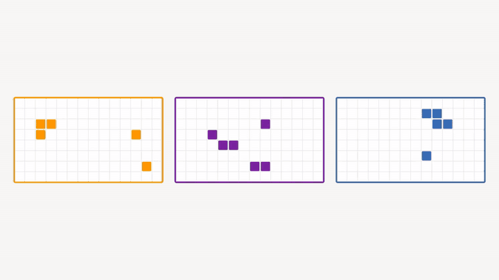

.. _defo-integrate-earlier:

O que os períodos anteriores já reportaram
""""""""""""""""""""""""""""""""""""""""""

Os pixels dentro dos alertas de um conjunto de alertas de um período *anterior* (a *pegada* dele) são removidos antes de os agrupamentos serem formados. Assim, a `busca retroativa <defo-period-lookback_>`_ nunca reporta a mesma perda duas vezes.

Os pixels que não viraram alertas (um agrupamento abaixo do tamanho mínimo, ou além do número máximo de alertas) são guardados como *não analisáveis*. Eles não fazem parte da pegada: trazê-los de volta é a função da `busca retroativa <defo-period-lookback_>`_.

A execução de um período posterior acrescenta esses pixels de novo quando as duas condições são atendidas:

-   a busca retroativa dele alcança o período anterior (esse período termina no dia em que começa a nova janela de busca ou depois); e
-   os dois períodos compartilham uma fonte.

Os pixels voltam seja qual for a data de detecção deles dentro da janela de busca do próprio conjunto anterior. Eles se juntam aos pixels novos que os tocam, e um agrupamento que agora atinge o tamanho mínimo vira alerta. As datas de detecção dele podem ser anteriores ao seu próprio período e à sua busca retroativa. Com uma busca retroativa de 0, a janela de busca começa no primeiro dia do próprio período, então nada do que foi deixado de lado é reconsiderado.

.. _defo-integrate-growth:

Crescimento de perdas anteriores
""""""""""""""""""""""""""""""""

Um desmatamento muitas vezes continua crescendo de um mês para o outro. A execução vincula cada alerta novo à *perda anterior* a partir da qual ele cresce: os alertas dos conjuntos de períodos anteriores que foram salvos como **Alerta verdadeiro** ou **Precisa de revisão**. A forma de um alerta anterior é o polígono desenhado para ele em `Refinar o polígono <defo-analysis-refine_>`_ ou, se não houver, o agrupamento detectado.

-   Um agrupamento novo que fica a até um pixel da grade da forma de um alerta anterior, de borda a borda, é um *alerta de crescimento*, vinculado a todos os alertas anteriores a essa distância. Um agrupamento a um pixel vazio de distância ainda conta; um intervalo diagonal de um pixel fica mais longe. Um alerta sem vínculo é um alerta *novo*.
-   Com **Manter os agrupamentos menores que tocam uma perda confirmada anterior** marcado (o padrão), um agrupamento menor que o **Tamanho mínimo do agrupamento** é mantido quando está a essa distância de uma perda anterior: ele é um alerta de crescimento *abaixo da área mínima*. Desmarcado, todo agrupamento pequeno é deixado de lado. Um agrupamento pequeno que não encosta em nada é sempre deixado de lado como *não analisável*.
-   Os alertas de crescimento são ordenados e limitados junto com os outros: **Limitar o número de agrupamentos** pode deixá-los de fora.
-   Os conjuntos gerados antes deste alcance de um pixel mantêm os vínculos com que foram gerados até serem executados de novo.
-   Só contam as revisões salvas quando a execução começa. Um alerta anterior confirmado depois disso não é vinculado, mas pode ser vinculado à mão em `Alertas anteriores <defo-analysis-earlier_>`_.

Os alertas vinculados entre si, ao longo de todos os períodos, formam o *histórico* de um desmatamento. A Análise o mostra em cada alerta, e a `Visão geral <defo-overview-growth_>`_ o resume.

.. _defo-integrate-options:

As opções
^^^^^^^^^

O formulário abre com as configurações do conjunto de alertas ativo (tudo menos as fontes) ou, se não houver nenhum, com os padrões abaixo.

.. list-table::
    :header-rows: 1
    :widths: 20 50 30

    *   -   Opção
        -   Descrição
        -   Padrão e limites
    *   -   Fontes
        -   As fontes cujos alertas entram no conjunto, no primeiro cartão. Cada fonte pronta aparece com o que o seu arquivo harmonizado encontrou. Uma fonte que não cobre a AOI, ou que não tem dados para o período, aparece desativada, com o motivo.
        -   Todas as fontes prontas. Pelo menos uma.
    *   -   **Incluir alertas prováveis (não confirmados)**
        -   Só aparece quando pelo menos uma fonte marcada tem uma classe *provável* (baixa confiança). Um único interruptor para todas essas fontes. Desligado, os pixels prováveis delas são descartados antes de tudo, e só os pixels confirmados contam. Com duas ou mais dessas fontes, **Definir por fonte** abre um interruptor por fonte (veja abaixo).
        -   Ligado.
    *   -   **Tamanho mínimo do agrupamento**
        -   Os agrupamentos menores que isso são descartados, a menos que a opção seguinte os mantenha. A dica mostra esse tamanho em pixels da grade (a 10 m, 0,5 ha equivale a "50 pixels na grade").
        -   0,5 ha. Qualquer número de hectares, 0 ou mais. Mesmo com 0, um agrupamento tem pelo menos um pixel.
    *   -   **Manter os agrupamentos menores que tocam uma perda confirmada anterior**
        -   Mantém um agrupamento abaixo do tamanho mínimo quando ele está a até um pixel de um alerta anterior revisado como **Alerta verdadeiro** ou **Precisa de revisão** (veja `Crescimento de perdas anteriores <defo-integrate-growth_>`_). Uma linha abaixo dela diz quando a execução não tem nada a que vincular: "Nenhum período anterior tem ainda um conjunto de alertas: nada se vincula nesta execução." ou "Nenhum alerta de um período anterior foi revisado ainda: nada se vincula nesta execução."
        -   Marcado.
    *   -   **Ordem**
        -   A ordem dos agrupamentos no conjunto, que é a ordem de revisão: **Agrupamentos maiores primeiro**, **Agrupamentos menores primeiro**, **Agrupamentos recentes primeiro** (pela última data de detecção) ou **Agrupamentos mais antigos primeiro** (pela primeira data de detecção).
        -   **Agrupamentos maiores primeiro**.
    *   -   **Limitar o número de agrupamentos**
        -   Quando marcado, mostra **Número máximo de agrupamentos**: só os primeiros agrupamentos na **Ordem** escolhida são mantidos. A dica diz quais (por exemplo "Mantém os 100 maiores agrupamentos." ou "Mantém os 100 agrupamentos mais recentes."). Quando desmarcado, todos os agrupamentos são mantidos.
        -   Desmarcado. Quando marcado, o limite começa em 100. Ele precisa ser um número inteiro maior que 0.
    *   -   **Camadas de atributos**
        -   Rasters cujas estatísticas de bandas são adicionadas a cada alerta (veja abaixo).
        -   Nenhuma.

Alertas prováveis por fonte
"""""""""""""""""""""""""""

Com duas ou mais fontes marcadas que têm uma classe provável, selecione **Definir por fonte**, abaixo de **Incluir alertas prováveis (não confirmados)**, para dar a cada uma o seu próprio interruptor, com o nome da fonte:

-   Uma fonte marcada sem classe provável (uma fonte personalizada que só tem datas de detecção) aparece como "(fonte): só datas, sem nível provável".
-   Quando os interruptores das fontes diferem, o interruptor principal aparece desligado, a nota **Misto: as fontes abaixo diferem.** substitui **Definir por fonte** e os interruptores por fonte continuam abertos.
-   Ligar ou desligar o interruptor principal ajusta todas as fontes de uma vez.

.. _defo-integrate-attributes:

Camadas de atributos
""""""""""""""""""""

Uma *camada de atributos* acrescenta a cada alerta informações de um raster (por exemplo, a classe de cobertura da terra predominante sob o alerta, ou a altitude média dele). Os valores são colunas da tabela de alertas: eles são exportados com os alertas, e as colunas de classes podem ser usadas no filtro da Análise.

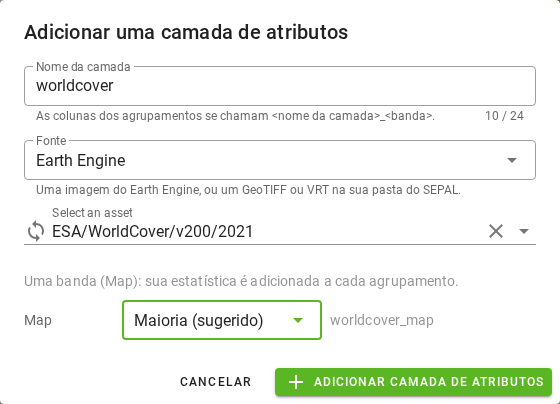

Para adicionar uma camada de atributos:

1.  Selecione **Adicionar camada de atributos** para abrir a janela **Adicionar uma camada de atributos**.
2.  Confira o **Nome da camada**, sugerido a partir do raster assim que ele é escolhido. As colunas se chamam *nome da camada*\_\ *banda*.
3.  Escolha a **Fonte** (**Earth Engine**, uma imagem, ou **GeoTIFF / VRT**, um arquivo na sua pasta do SEPAL) e depois escolha o raster. As bandas dele são lidas na hora.
4.  Com uma banda, o formulário diz "Uma banda (…): sua estatística é adicionada a cada agrupamento." Com duas ou mais, selecione uma ou mais em **Bandas**.
5.  Para cada banda, escolha a estatística calculada sobre o alerta: **Maioria** (para classes), **Média**, **Mínimo**, **Máximo** ou **Mediana**. Ela começa em **Maioria** quando o nome da banda parece de classes (por exemplo, ``landcover``) e em **Média** nos outros casos, marcada "(sugerido)". O nome da coluna aparece ao lado.
6.  Selecione **Adicionar camada de atributos**.

Regras:

-   Uma camada precisa de pelo menos uma banda (**Mantenha pelo menos uma banda.**).
-   Duas camadas não podem ler o mesmo raster (**Outra camada de atributos já lê este raster.**).
-   Os nomes de coluna nunca repetem o nome de uma coluna de alerta ou de uma coluna de outra camada: em caso de conflito, recebem um sufixo.

A lista em **Camadas de atributos** mostra cada camada com as suas colunas. O ícone de lápis edita uma camada e o ícone de lixeira a remove. As camadas pertencem a este formulário até que ele seja executado: elas são salvas com o conjunto de alertas.

Executar a etapa
^^^^^^^^^^^^^^^^

A linha cinza acima do botão indica o conjunto que a execução vai gerar: "Cria ou substitui o conjunto de alertas (período) · (fontes)". Um conjunto de alertas é identificado pelo período e pelas fontes:

-   uma nova combinação de fontes gera um novo conjunto: um período pode ter vários conjuntos (por exemplo, um só com o GLAD-L e outro com as três fontes); e
-   a mesma combinação, de novo, *substitui* o conjunto.

Selecione **Integrar e vetorizar**. O botão fica desativado até que pelo menos uma fonte esteja marcada e, quando **Limitar o número de agrupamentos** está marcado, até que o limite seja válido ("Digite um número inteiro maior que 0." abaixo do campo).

A execução passa por "Combinando as fontes", "Vetorizando os agrupamentos", "Salvando os agrupamentos", "Gravando a pegada" e "Gerando os blocos do mapa". Ao terminar, uma mensagem diz "N agrupamentos prontos para revisão", seguida de "N agrupamentos vinculados a perdas anteriores (M abaixo da área mínima)" quando ela encontra `alertas de crescimento <defo-integrate-growth_>`_, e o novo conjunto passa a ser o *conjunto ativo*: aquele sobre o qual trabalham o `Questionário <defo-questionnaire_>`_, a `Avaliação <defo-evaluation_>`_, a `Análise <defo-analysis_>`_ e a `Visão geral <defo-overview_>`_. A etapa continua aberta.

Se não sobrar nenhum agrupamento, o conjunto é gerado mesmo assim, vazio: a mensagem diz "Nenhum agrupamento novo neste período: o conjunto de alertas está vazio." e dá o motivo para cada fonte (por exemplo "GLAD-L: todos os 56 pixels de alerta removidos pelas máscaras" ou "RADD: os alertas prováveis (não confirmados) ficaram de fora").

.. _defo-integrate-replace:

Substituir um conjunto
""""""""""""""""""""""

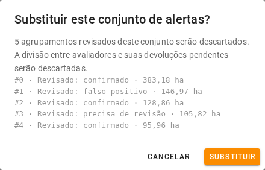

Quando o conjunto prestes a ser substituído tem alertas revisados ou uma `divisão entre avaliadores <defo-evaluation_>`_, a janela **Substituir este conjunto de alertas?** lista o que seria perdido: os alertas revisados (até 20, depois "… e mais N") e a divisão, com as revisões que os avaliadores ainda não devolveram. Quando alertas de períodos posteriores crescem a partir deste conjunto, ela acrescenta "N agrupamentos de períodos posteriores estão vinculados a este conjunto; seus vínculos serão rompidos.": depois da execução, esses vínculos aparecem como "o conjunto anterior foi executado de novo" (veja `Alertas anteriores <defo-analysis-earlier_>`_). Selecione **Substituir** para continuar. Um conjunto sem nada a perder é substituído sem confirmação.

.. attention::

    Substituir um conjunto descarta as revisões dele. Para testar outras configurações sem perder revisões, escolha outra combinação de fontes, que gera um conjunto separado.

.. _defo-integrate-outdated:

Quando o conjunto ativo está desatualizado
""""""""""""""""""""""""""""""""""""""""""

Se as entradas do conjunto ativo mudaram desde que ele foi gerado (uma fonte baixada de novo, uma máscara ligada ou desligada, a busca retroativa do período, a AOI ou a grade alteradas), uma linha laranja diz: "O conjunto ativo (…) foi gerado a partir de entradas que mudaram desde então." Execute **Integrar e vetorizar** de novo para reconstruí-lo, o que descarta as revisões dele.

Se os arquivos do conjunto foram apagados da pasta do projeto, a linha diz: "Os arquivos do conjunto ativo (…) estão faltando na pasta do projeto."

.. _defo-integrate-map:

Ver os alertas no mapa
^^^^^^^^^^^^^^^^^^^^^^

Assim que o projeto tem um conjunto, um título abaixo do botão conta os alertas do conjunto ativo ("Resultado · 48 agrupamentos"), e os interruptores abaixo dele desenham o conjunto no mapa:

.. list-table::
    :header-rows: 1
    :widths: 35 65

    *   -   Interruptor
        -   Descrição
    *   -   **Mostrar estes alertas no mapa**
        -   Os alertas do conjunto ativo, coloridos pelo status de revisão. Clique num alerta para ver "Alerta (id) · (status) · (área) ha". O botão **Revisar** dele o abre na Análise.
    *   -   **Mostrar pixels não analisáveis**
        -   Os pixels de alerta que não viraram alertas: **Pequeno demais** ou **Acima do limite de alertas**.
    *   -   **Mostrar conjuntos anteriores**
        -   Os alertas dos conjuntos de períodos anteriores, como contexto.

O mapa os mantém nas outras etapas. Desligue-os aqui.

Mensagens comuns
^^^^^^^^^^^^^^^^

"… não foi baixada e harmonizada para este período; baixe-a primeiro em Alertas e harmonize-a em Harmonizar."
    Os arquivos de uma fonte estão desatualizados. Baixe-a em `Alertas <defo-alerts-download_>`_ e depois harmonize-a em `Harmonizar <defo-harmonize_>`_.

"A área de cobertura do conjunto anterior … está faltando; execute Integrar e vetorizar nesse conjunto novamente primeiro."
    Os arquivos de um período anterior foram apagados. Torne esse período ativo e execute o conjunto dele de novo.

"Espaço livre em disco insuficiente: …"
    A execução grava alguns rasters do tamanho da grade. Libere espaço.

"O período, a área de interesse ou a grade do projeto mudou durante a execução, então o conjunto de alertas não foi registrado."
    Execute de novo.

"O tippecanoe não está instalado: o mapa mostrará os pontos dos alertas sem polígonos."
    O conjunto é gerado; o mapa mostra os alertas como pontos em vez de polígonos.

"Não foi possível exibir os blocos do mapa (…): mostrando os pontos dos alertas sem polígonos."
    O conjunto é gerado, mas a camada de mapa dele não pôde ser construída. O mapa mostra os alertas como pontos.

"A base de alertas de … está faltando; execute Integrar e vetorizar novamente para esse período."
    Com **Mostrar conjuntos anteriores**, o arquivo de alertas de um conjunto anterior sumiu da pasta do projeto. Torne esse período ativo e execute o conjunto dele de novo.

.. _defo-layers:

Camadas adicionais
------------------

As camadas de visualização apoiam a revisão dos alertas: um mapa de cobertura da terra, uma linha de base florestal, um mosaico recente. Elas nunca alteram os alertas. Uma camada é uma imagem do Earth Engine ou um GeoTIFF. Ela pode aparecer no mapa principal e, com **Mostrar na Análise** marcado, nos dois mapas da tela de `Análise <defo-analysis_>`_.

Abra a etapa **Camadas adicionais** do painel **Fluxo de trabalho**, a primeira etapa de **Preparar a revisão**. Ela é liberada assim que o projeto tem um conjunto de alertas (veja `Integrar e vetorizar <defo-integrate_>`_).

A etapa é opcional: pule-a e volte a qualquer momento. A barra dela no cabeçalho é tracejada, e a etapa não mostra nenhuma contagem até ter uma camada.

.. note::

    Os mosaicos Planet NICFI não são uma camada adicional: se a sua conta do GEE tem acesso ao NICFI, eles vêm com as imagens *Planet* da `linha do tempo da Análise <defo-analysis-timeline_>`_.

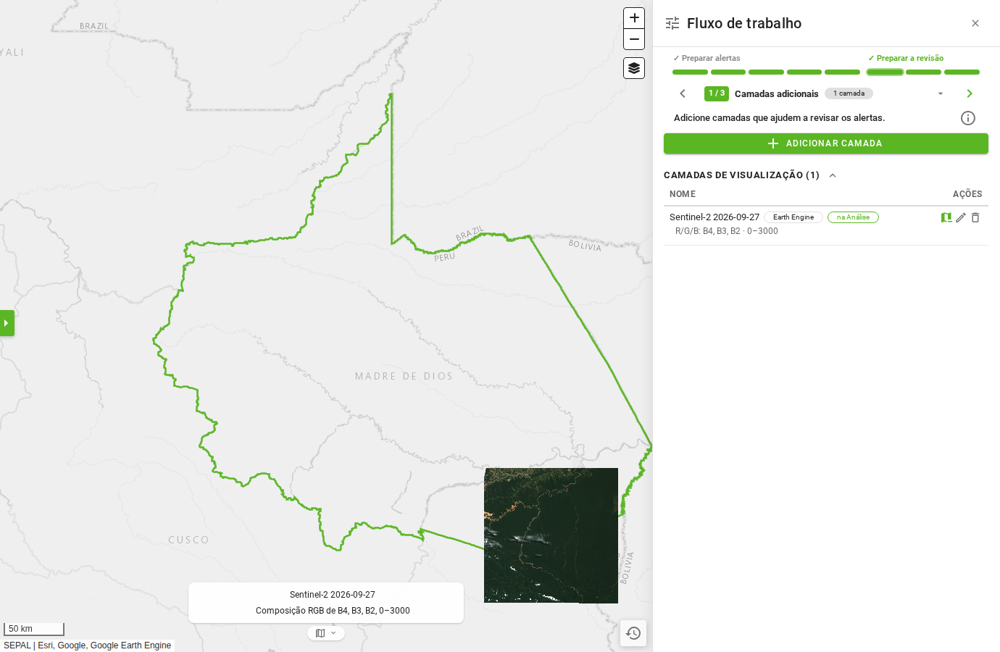

A lista de camadas
^^^^^^^^^^^^^^^^^^

Cada linha de **Camadas de visualização** mostra:

-   o **Nome** da camada;
-   uma etiqueta com a fonte (**Earth Engine** ou **GeoTIFF / VRT**);
-   uma etiqueta **na Análise** quando ela aparece nos mapas da Análise; e
-   uma nota com as bandas e o intervalo de valores ou, para uma camada categórica, a banda e o número de classes ("banda Map · 9 classes").

Os ícones à direita de cada linha:

-   o ícone de mapa mostra a camada no mapa principal, com a legenda;
-   o ícone de lápis a abre para edição (**Editar a camada** *nome*); e
-   o ícone de lixeira a exclui. A camada é retirada do projeto; o arquivo ou recurso dela não é alterado.

Adicionar uma camada
^^^^^^^^^^^^^^^^^^^^

Selecione **Adicionar camada** para abrir a janela **Adicionar uma camada de visualização**. O formulário é lido de cima para baixo: o nome, a fonte, a imagem e depois como as bandas dela são desenhadas. As bandas são lidas assim que a imagem é escolhida ("Lendo as bandas…"), e cada escolha seguinte é um menu suspenso.

.. list-table::
    :header-rows: 1
    :widths: 20 40 40

    *   -   Campo
        -   Descrição
        -   Padrão e limites
    *   -   **Nome**
        -   O nome da camada na lista, nos mapas e na legenda.
        -   Se ficar vazio, é preenchido com o nome do recurso ou do arquivo, mais a banda ou a combinação. No máximo 24 caracteres, único no projeto.
    *   -   **Fonte**
        -   **Earth Engine** (um recurso de imagem) ou **GeoTIFF / VRT** (um arquivo na sua pasta do SEPAL).
        -   **Earth Engine**.
    *   -   Recurso ou **GeoTIFF / VRT**
        -   Uma *imagem* do GEE (não uma coleção) ou um arquivo .tif.
        -   A pasta do GeoTIFF precisa permitir gravação: o app grava ao lado dele um arquivo de pirâmides para que a camada seja desenhada rapidamente.

O que vem a seguir depende do número de bandas da imagem:

-   Uma banda: o formulário a nomeia ("Uma banda (…): ela é desenhada sozinha.").
-   Duas bandas: escolha em **Banda** a que será desenhada. O RGB precisa de três bandas ou mais.
-   Três bandas ou mais: **Bandas** pede **Selecionar uma banda** (e depois **Banda**) ou **Composição RGB**. A **Composição RGB** é sugerida quando os nomes das bandas dão vermelho, verde e azul (por exemplo, ``B4``, ``B3`` e ``B2`` do Sentinel-2). **Banda** começa na primeira banda.

Uma banda
"""""""""

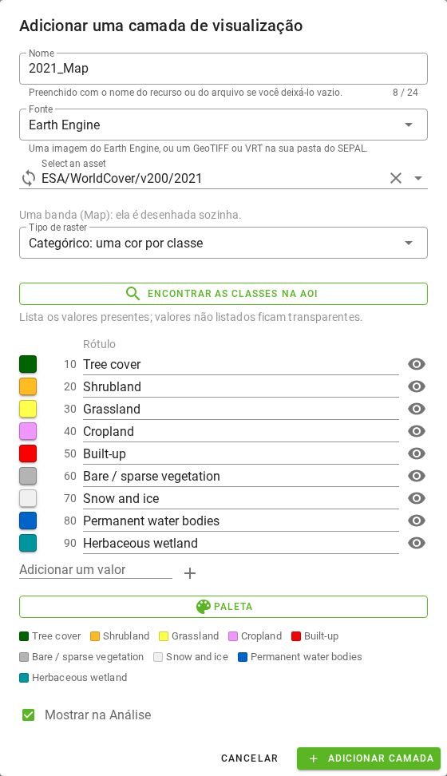

Uma banda sozinha recebe um **Tipo de raster**:

-   **Contínuo: uma rampa de cores** para valores medidos (reflectância, altitude, cobertura arbórea); ou
-   **Categórico: uma cor por classe** para classes de números inteiros (um mapa de cobertura da terra, uma máscara florestal, um ano de perda). É sugerido quando o nome da banda parece de classes (por exemplo, ``landcover``, ``class``, ``lossyear``, ``datamask``).

Uma prévia da legenda da camada aparece abaixo dos campos.

.. list-table::
    :header-rows: 1
    :widths: 20 40 40

    *   -   Campo
        -   Descrição
        -   Padrão e limites
    *   -   **Rampa de cores**
        -   *Contínuo*: as cores, de **Mín.** a **Máx.**: **Tons de cinza**, **Azuis**, **Verdes**, **Laranjas**, **Frio–quente**, **Viridis**, **Terreno**, **Calor** ou **Magma**.
        -   **Tons de cinza**.
    *   -   **Inverter**
        -   *Contínuo*: inverte a rampa.
        -   Desligado.
    *   -   **Mín.**, **Máx.**
        -   *Contínuo*: o intervalo de valores esticado sobre as cores.
        -   0 e 1. Os dois precisam ser números, com **Mín.** abaixo de **Máx.**
    *   -   **Ajustar à AOI (2–98 %)**
        -   *Contínuo*: preenche **Mín.** e **Máx.** com os percentis 2 e 98 da banda sobre o retângulo que envolve a AOI.
        -
    *   -   **Encontrar as classes na AOI**
        -   *Categórico*: lista os valores inteiros presentes sobre a AOI, cada um com uma cor, o valor, um **Rótulo** e um ícone de olho que o oculta ou mostra. Quando a imagem nomeia as classes e as cores dela (como o ESA WorldCover), as classes os recebem; senão, cada classe é rotulada com o valor.
        -   No máximo 50 classes. Valores não listados e classes ocultas ficam transparentes.
    *   -   **Adicionar um valor**
        -   *Categórico*: adiciona uma classe à mão. Digite o número inteiro e pressione **Enter** ou selecione o ícone de mais.
        -   Cada valor uma única vez.
    *   -   **Paleta**
        -   *Categórico*: recolore todas as classes a partir de uma paleta: **Set1**, **Set2**, **Tab10** ou **Paired**. Selecione o quadrado de cor de uma classe para escolher a cor dela à mão.
        -

.. labels-ok: Enter

Quando uma banda só tem 0 e 1 sobre a AOI, as classes encontradas nomeiam o 1 com o nome da banda e começam com o 0 oculto: "Só 0 e 1 na AOI: 1 recebe o nome da banda e 0 começa oculto (transparente)." Selecione o ícone de olho do 0 para desenhá-lo também.

Composição RGB
""""""""""""""

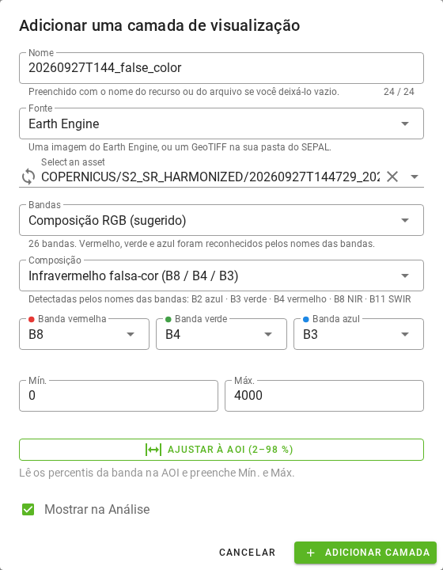

.. labels-ok: Cor verdadeira; Infravermelho falsa-cor; SWIR / NIR / vermelho

.. list-table::
    :header-rows: 1
    :widths: 20 40 40

    *   -   Campo
        -   Descrição
        -   Padrão e limites
    *   -   **Composição**
        -   Uma combinação padrão, nomeada com as bandas dela (por exemplo, "Cor verdadeira (B4 / B3 / B2)"): **Cor verdadeira**, **Infravermelho falsa-cor** (infravermelho próximo, vermelho, verde) ou **SWIR / NIR / vermelho** (infravermelho de ondas curtas, infravermelho próximo, vermelho); ou **Personalizada: escolha as bandas**. A dica lista os papéis de banda detectados pelos nomes das bandas ("Detectadas pelos nomes das bandas: …").
        -   A primeira combinação que os nomes das bandas permitem. Uma combinação cujas bandas não foram todas reconhecidas mostra "(bandas não encontradas)" e não pode ser escolhida. Se nenhum nome de banda for reconhecido, as três primeiras bandas são usadas como vermelho, verde e azul.
    *   -   **Banda vermelha**, **Banda verde**, **Banda azul**
        -   As bandas desenhadas em vermelho, verde e azul.
        -   Preenchidas pela **Composição**. Precisam ser três bandas diferentes. Bandas escolhidas à mão que correspondem a uma combinação a selecionam; as outras selecionam **Personalizada: escolha as bandas**.
    *   -   **Mín.**, **Máx.**
        -   O intervalo de valores esticado sobre as cores, o mesmo para as três bandas.
        -   0 e 1. Os dois precisam ser números, com **Mín.** abaixo de **Máx.**
    *   -   **Ajustar à AOI (2–98 %)**
        -   Preenche **Mín.** e **Máx.** com um único intervalo para as três bandas, a partir dos percentis 2 e 98 delas sobre o retângulo que envolve a AOI.
        -

.. tip::

    Ajuste **Mín.** e **Máx.** ao intervalo real dos dados (por exemplo, de 0 a 3000 para uma imagem Sentinel-2 de reflectância de superfície), ou selecione **Ajustar à AOI (2–98 %)**. Com o padrão de 0 a 1, a maioria das imagens aparece toda branca.

Mostrar na Análise
""""""""""""""""""

**Mostrar na Análise** adiciona a camada aos dois mapas da tela de `Análise <defo-analysis_>`_, desligada. Ative-a lá pelo menu de camadas. Os mapas da Análise não mostram legenda para ela.

Salvar uma camada
^^^^^^^^^^^^^^^^^

Selecione **Adicionar camada** (ou **Salvar**, ao editar). O app verifica as bandas, o intervalo ou as classes e, no caso de um GeoTIFF, a pasta. Um problema aparece em vermelho dentro da janela, que continua aberta. Enquanto a verificação roda, o botão passa a ser **Cancelar** e a interrompe.

As camadas salvas antes da chegada dos estilos de visualização mantêm exatamente a aparência que tinham.

Mensagens comuns
^^^^^^^^^^^^^^^^

"Escolha uma imagem do Earth Engine."
    Coleções de imagens não são aceitas como camadas. Exporte antes uma única imagem.

"Escolha três bandas diferentes para vermelho, verde e azul."
    Escolha uma banda diferente para cada cor.

"Esta banda tem valores não inteiros: desenhe-a como Contínua."
    **Encontrar as classes na AOI** encontrou valores decimais: a banda não é um conjunto de classes. Mude o **Tipo de raster** para **Contínuo: uma rampa de cores**.

"Mais de 50 valores: esta banda parece contínua."
    Desenhe a banda como **Contínuo: uma rampa de cores**, ou adicione à mão as classes de que precisa com **Adicionar um valor**.

"Não há valores na AOI." ou "A banda não tem dispersão de valores na AOI."
    A banda não tem dados sobre a AOI, ou tem o mesmo valor em toda parte. Verifique a imagem e a banda, ou digite você mesmo **Mín.** e **Máx.**

"Encontre as classes ou adicione um valor." ou "Mostre pelo menos uma classe."
    Uma camada categórica precisa de pelo menos uma classe, e de pelo menos uma classe que não esteja oculta.

"A pasta … não permite gravação, então as pirâmides da camada não podem ser geradas."
    Mova o GeoTIFF para uma pasta sua no SEPAL.

"O arquivo … não existe mais."
    O arquivo de uma camada GeoTIFF foi movido ou apagado. Edite a camada e escolha o arquivo de novo.

.. _defo-questionnaire:

Questionário
------------

O *questionário* contém as perguntas respondidas para cada alerta na `Análise <defo-analysis_>`_, depois do veredito. As respostas são:

-   salvas com o alerta (uma coluna por pergunta);
-   exportadas com ele;
-   exibidas em gráficos na `Visão geral <defo-overview_>`_; e
-   disponíveis para o relatório Word do alerta.

Esta etapa também define o modelo de relatório.

Abra a etapa **Questionário** do painel **Fluxo de trabalho**, em **Preparar a revisão**. Ela é liberada assim que o projeto tem um conjunto de alertas (veja `Integrar e vetorizar <defo-integrate_>`_). O questionário pertence ao projeto: todos os conjuntos de alertas do projeto são revisados com ele. A etapa é opcional: sem alterações, a Análise faz a pergunta padrão.

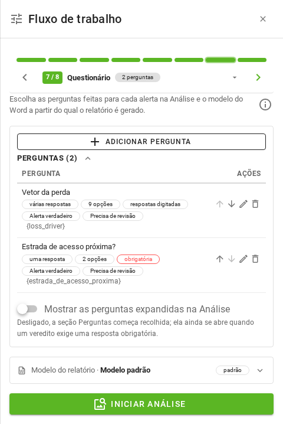

A lista de perguntas
^^^^^^^^^^^^^^^^^^^^

Um projeto novo começa com uma pergunta, **Vetor da perda**:

-   várias respostas;
-   nove opções: **Expansão agrícola**, **Pecuária**, **Extração de madeira**, **Expansão urbana**, **Agricultura itinerante**, **Mineração**, **Incêndios florestais**, **Furacões** e **Outro**;
-   respostas digitadas permitidas; e
-   feita para **Alerta verdadeiro** e **Precisa de revisão** (não para um falso positivo).

Edite-a ou exclua-a como qualquer outra pergunta.

Cada linha de **Perguntas** mostra a pergunta e etiquetas que a resumem: **uma resposta** ou **várias respostas**, o número de opções, **respostas digitadas**, **obrigatória** e os vereditos para os quais ela é feita (ou **todos os vereditos**). A nota abaixo dela é o marcador dela no relatório, como ``{loss_driver}``.

Os ícones à direita de cada linha:

-   as setas sobem ou descem a pergunta: a Análise faz as perguntas nesta ordem;
-   o ícone de lápis a edita; e
-   o ícone de lixeira a exclui.

Sem nenhuma pergunta, a lista diz **Nenhuma pergunta: a Análise pedirá apenas o veredito.**

**Mostrar as perguntas expandidas na Análise** (desligado por padrão) abre a seção **Perguntas** da Análise em todos os alertas. Quando desligado, a seção começa recolhida; ela ainda se abre quando um veredito exige uma resposta obrigatória.

Adicionar ou editar uma pergunta
^^^^^^^^^^^^^^^^^^^^^^^^^^^^^^^^

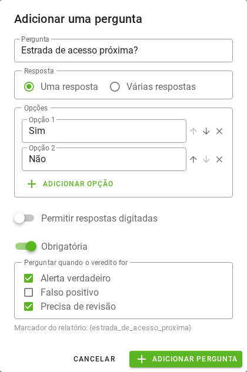

Selecione **Adicionar pergunta** (ou o ícone de lápis de uma pergunta) para abrir a janela **Adicionar uma pergunta** (ou **Editar pergunta**).

.. list-table::
    :header-rows: 1
    :widths: 20 45 35

    *   -   Campo
        -   Descrição
        -   Padrão e limites
    *   -   **Pergunta**
        -   O texto exibido na Análise.
        -   Obrigatório.
    *   -   **Resposta**
        -   **Uma resposta** ou **Várias respostas**. Com várias, as respostas são salvas juntas, separadas por vírgulas.
        -   **Uma resposta**.
    *   -   **Opções**
        -   As respostas para escolher. **Adicionar opção** acrescenta uma; as setas as reordenam; o X remove uma.
        -   Pelo menos uma opção, a menos que respostas digitadas sejam permitidas. Uma opção não pode ficar vazia, conter vírgula nem repetir outra opção.
    *   -   **Permitir respostas digitadas**
        -   Permite que o revisor digite uma resposta que não está entre as opções.
        -   Desligado.
    *   -   **Obrigatória**
        -   A revisão não pode ser salva sem uma resposta (para os vereditos em que a pergunta é feita).
        -   Desligado.
    *   -   **Perguntar quando o veredito for**
        -   Os vereditos para os quais a pergunta é feita: **Alerta verdadeiro**, **Falso positivo**, **Precisa de revisão**. Para os outros vereditos, ela fica oculta.
        -   Os três. Pelo menos um.

A última linha mostra o marcador da pergunta no relatório (por exemplo "Marcador do relatório: {estrada_de_acesso_proxima}"). Ele é gerado a partir do texto da pergunta quando ela é criada e nunca mais muda, mesmo que a pergunta seja renomeada.

Selecione **Adicionar pergunta** (ou **Salvar**). A janela mostra em vermelho o que falta até que a pergunta possa ser salva.

.. note::

    Renomear uma pergunta ou uma das suas opções preserva as respostas já salvas: elas ficam guardadas sob o nome do marcador da pergunta e o código próprio de cada opção, não sob o texto delas.

Excluir uma pergunta
^^^^^^^^^^^^^^^^^^^^

Selecione o ícone de lixeira. A janela de confirmação diz quantos alertas do conjunto ativo responderam à pergunta. As respostas já salvas continuam na tabela de alertas, mas deixam de ser exibidas, exportadas ou incluídas nos gráficos.

.. _defo-questionnaire-template:

O modelo de relatório
^^^^^^^^^^^^^^^^^^^^^

Na Análise, cada alerta revisado pode ser exportado com um relatório Word (veja `Exportação <defo-export_>`_). O relatório é gerado a partir de um modelo .docx em que *marcadores* como ``{area_loss}`` são substituídos pelos valores do alerta.

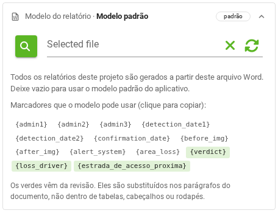

A linha **Modelo do relatório** indica o modelo em uso, com uma etiqueta: **padrão** (o modelo do próprio app), **personalizado** (o seu arquivo) ou **não encontrado** (o seu arquivo foi movido ou apagado). Abra-a com a seta à direita:

-   **Modelo de relatório (.docx)**: escolha um arquivo Word na sua pasta do SEPAL. Todos os relatórios deste projeto passam a ser gerados a partir dele. Limpe o campo para voltar ao modelo padrão.
-   **Marcadores que o modelo pode usar (clique para copiar):** selecione uma etiqueta para copiar o marcador e depois cole-o no modelo.

.. list-table::
    :header-rows: 1
    :widths: 40 60

    *   -   Marcador
        -   Substituído por
    *   -   ``{admin1}``, ``{admin2}``, ``{admin3}``
        -   As áreas administrativas em que o alerta se encontra.
    *   -   ``{detection_date1}``, ``{detection_date2}``
        -   A primeira e a última data de detecção do alerta.
    *   -   ``{confirmation_date}``
        -   O dia em que o relatório é gerado.
    *   -   ``{before_img}``, ``{after_img}``
        -   Os nomes das imagens de antes e depois escolhidas na revisão.
    *   -   ``{alert_system}``
        -   As fontes que detectaram o alerta.
    *   -   ``{area_loss}``
        -   A área do alerta, em hectares (a do grupo, para um grupo).
    *   -   ``{group_size}``, ``{group_alerts}``
        -   Para um alerta revisado num grupo: o número de alertas do grupo e os números deles ("12, 15, 16"). Nos outros casos, "1" e o número do próprio alerta.
    *   -   ``{verdict}`` (verde)
        -   O veredito, no idioma do app.
    *   -   Um por pergunta (verde)
        -   A resposta a essa pergunta; vazio quando a pergunta não é feita para o veredito do alerta.

Os marcadores verdes vêm da revisão. Os marcadores são substituídos nos parágrafos do documento, não dentro de tabelas, cabeçalhos ou rodapés.

Imagens no relatório
""""""""""""""""""""

O relatório também traz seis figuras do alerta, recortadas das imagens de antes e depois escolhidas na revisão. Elas não estão na lista de etiquetas: o modelo indica onde vai cada uma com um parágrafo que contém apenas o seu indicador, de ``[Placeholder for Image 1]`` a ``[Placeholder for Image 6]``. Esse parágrafo inteiro é substituído pela figura (com 250 pt de largura), então não coloque mais nada nele.

.. list-table::
    :header-rows: 1
    :widths: 60 40

    *   -   Indicador
        -   Figura
    *   -   ``[Placeholder for Image 1]``, ``[Placeholder for Image 4]``
        -   A imagem de antes.
    *   -   ``[Placeholder for Image 2]``, ``[Placeholder for Image 5]``
        -   A imagem de depois.
    *   -   ``[Placeholder for Image 3]``, ``[Placeholder for Image 6]``
        -   A imagem de depois com o contorno do alerta em vermelho.

As imagens 1–3 mostram as imagens numa combinação de bandas, e as imagens 4–6, em outra. O modelo padrão as coloca sob as suas legendas, em inglês ("Image 1: Pre-deforestation …", "Image 2: Post-deforestation …" e "Image 3: Deforestation alert generated."), duas figuras por legenda. Um modelo sem esses indicadores gera um relatório sem figuras.

.. tip::

    Para criar um modelo personalizado, organize-o como o padrão: o texto com os marcadores acima e, depois, cada legenda seguida dos indicadores das suas imagens, cada indicador sozinho no seu parágrafo.

O modelo pode mostrar duas mensagens:

-   "… não é um arquivo Word (.docx) na sua pasta do SEPAL; o modelo de relatório não foi alterado.": escolha um arquivo .docx.
-   **não encontrado**, com "O arquivo não existe mais: escolha-o novamente ou limpe o campo para usar o modelo padrão.": o cartão continua aberto até que o arquivo seja escolhido de novo ou o campo seja limpo.

.. tip::

    Quando os alertas são divididos entre avaliadores, os pacotes de revisão deles levam o questionário e o modelo de relatório. Se o questionário mudar depois de os pacotes serem gerados, gere-os de novo (veja `Avaliação <defo-evaluation_>`_).

Em seguida, vá para a etapa `Avaliação <defo-evaluation_>`_, onde **Iniciar análise** começa a revisão.

.. _defo-evaluation:

Avaliação
---------

Esta etapa define quem revisa os alertas do conjunto ativo:

-   revise todos você mesmo; ou
-   divida-os entre vários avaliadores. Cada avaliador recebe um *pacote de revisão*, revisa os próprios alertas na sua própria conta do SEPAL e devolve uma *cópia revisada*, que é então mesclada no projeto.

Abra a etapa **Avaliação** do painel **Fluxo de trabalho**, a última etapa de **Preparar a revisão**. Ela é liberada assim que o projeto tem um conjunto de alertas (veja `Integrar e vetorizar <defo-integrate_>`_). Ela trabalha sobre o conjunto ativo: uma divisão pertence a um conjunto de alertas.

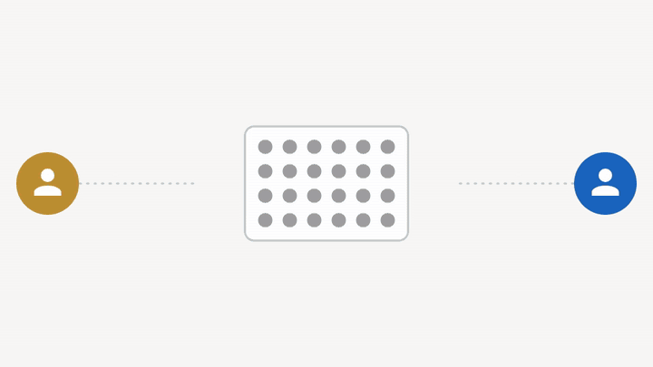

Na animação, o vermelho indica uma perda confirmada e o verde, um falso positivo.

Modo de revisão
^^^^^^^^^^^^^^^

Em **Modo de revisão**, marque uma de duas caixas de seleção:

.. list-table::
    :header-rows: 1
    :widths: 30 70

    *   -   **Modo de revisão**
        -   Descrição
    *   -   **Individual**
        -   Você revisa todos os alertas. Não há mais nada a configurar: selecione **Iniciar análise**.
    *   -   **Vários avaliadores**
        -   Os alertas são divididos entre avaliadores, e cada um recebe um pacote de revisão. A tabela de avaliadores aparece logo abaixo.

Um projeto começa sem nenhuma das caixas marcada. A nota abaixo delas diz "Escolha quem revisa os alertas: só você ou vários avaliadores.", e a etapa **Avaliação** do painel **Fluxo de trabalho** fica vazia.

-   Marcar uma caixa desmarca a outra; desmarcar a caixa marcada volta a deixar o modo indefinido.
-   **Individual** conclui a etapa (o indicador dela mostra "1 avaliador").
-   **Vários avaliadores** conclui a etapa assim que os alertas são divididos.
-   Enquanto existir uma divisão, as duas caixas ficam desativadas em **Vários avaliadores** (**Remova a divisão para passar para o modo individual.**).

.. _defo-evaluation-group:

Revisar juntos os alertas próximos
""""""""""""""""""""""""""""""""""

No próprio cartão, abaixo do modo de revisão (e abaixo da tabela de avaliadores com **Vários avaliadores**), a caixa de seleção **Revisar juntos os alertas próximos** permite que a `Análise <defo-analysis-nearby_>`_ revise alertas vizinhos como um único grupo: "Na Análise, os alertas dentro desta distância podem ser revisados com um único veredito, um único conjunto de respostas e um único polígono." Ela funciona nos dois modos. Depois que ela é marcada:

.. list-table::
    :header-rows: 1
    :widths: 30 45 25

    *   -   Campo
        -   Descrição
        -   Padrão e limites
    *   -   **Distância (m)**
        -   A que distância, de borda a borda, um alerta precisa estar para ser oferecido no grupo.
        -   300. De 10 a 5.000.
    *   -   **Incluir os alertas já revisados**
        -   Oferece também os alertas revisados antes de o agrupamento ser ativado. "Desmarcado, os alertas revisados antes de ativar o agrupamento nunca são oferecidos."
        -   Desmarcado.

Algumas alterações ficam bloqueadas:

-   Depois que grupos são salvos, o agrupamento não pode ser desativado e a distância não pode mudar: "2 grupos estão salvos: remova-os para desativar o agrupamento."
-   Uma divisão fixa as três configurações: "Os alertas foram divididos com agrupamento: remova a divisão para alterá-lo." (ou "sem agrupamento").
-   Numa cópia de revisão, elas aparecem como "Definido pelo criador do projeto."

.. _defo-evaluation-split:

Dividir os alertas
^^^^^^^^^^^^^^^^^^

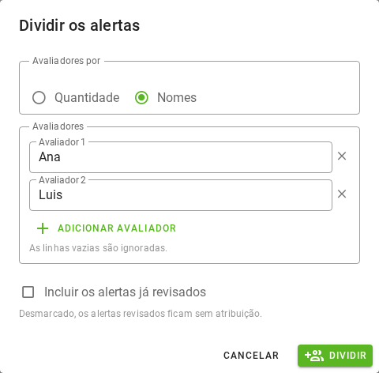

Com **Vários avaliadores** marcado, selecione **Dividir alertas…** acima da tabela de avaliadores para abrir a janela **Dividir os alertas**:

.. list-table::
    :header-rows: 1
    :widths: 25 45 30

    *   -   Campo
        -   Descrição
        -   Padrão e limites
    *   -   **Avaliadores por**
        -   **Quantidade**: os avaliadores recebem os nomes "Avaliador 1", "Avaliador 2"… **Nomes**: digite os nomes deles.
        -   **Quantidade**.
    *   -   **Número de avaliadores**
        -   Com **Quantidade**.
        -   2. De 1 a 50.
    *   -   **Avaliador 1**, **Avaliador 2**…
        -   Com **Nomes**: uma linha por avaliador. **Adicionar avaliador** acrescenta uma linha; o X remove uma.
        -   Duas linhas vazias. As linhas vazias são ignoradas; duas linhas não podem ter o mesmo nome; no máximo 50.
    *   -   **Incluir os alertas já revisados**
        -   Distribui também os alertas que já foram revisados. Quando desmarcado, eles ficam sem atribuição.
        -   Desmarcado.

Selecione **Dividir**. Os alertas são distribuídos um a um na ordem do conjunto (a **Ordem** escolhida em `Integrar e vetorizar <defo-integrate-options_>`_), como cartas de baralho: o primeiro para o avaliador 1, o segundo para o avaliador 2, e assim por diante, dando a volta na lista. Cada avaliador recebe mais ou menos o mesmo número de alertas, espalhados por toda a ordem.

Com **Revisar juntos os alertas próximos** marcado, a divisão nunca separa um grupo. Os alertas a menos da distância uns dos outros, de borda a borda, se encadeiam em um grupo de alertas próximos. Cada grupo vai inteiro para o avaliador com menos alertas até então. Quando um grupo contém mais do que uma parte igual, a janela avisa: "Um grupo de alertas próximos contém 30 alertas, mais do que uma parte igual."

A tabela de avaliadores
"""""""""""""""""""""""

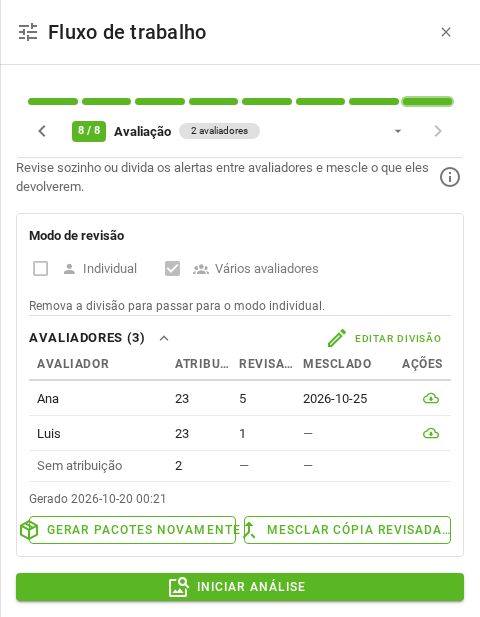

.. list-table::
    :header-rows: 1
    :widths: 20 80

    *   -   Coluna
        -   Descrição
    *   -   **Avaliador**
        -   O nome do avaliador. Uma última linha, **Sem atribuição**, conta os alertas que não foram para nenhum avaliador.
    *   -   **Atribuídos**
        -   O número de alertas que o avaliador tem.
    *   -   Coluna **Revisados**
        -   Quantos deles estão revisados no *seu* projeto (por você ou mesclados a partir do avaliador).
    *   -   **Mesclado**
        -   A data em que a cópia revisada dele foi mesclada pela última vez, ou um traço.

O ícone de nuvem de cada linha baixa o pacote desse avaliador depois que ele é gerado.

Alterar ou remover a divisão
""""""""""""""""""""""""""""

**Editar divisão** (no lugar de **Dividir alertas…**) reabre a janela como **Editar a divisão**:

-   **Dividir novamente** redistribui os alertas com os novos nomes ou a nova quantidade. É uma nova divisão: as revisões já mescladas continuam, mas os pacotes já enviados para a divisão antiga não podem mais ser mesclados (a janela avisa: **Os pacotes já enviados para esta divisão não poderão mais ser mesclados.**).
-   **Remover a divisão** apaga todas as atribuições. As revisões continuam.

.. attention::

    Executar `Integrar e vetorizar <defo-integrate-replace_>`_ de novo sobre o mesmo conjunto o substitui: as revisões e a divisão dele são descartadas, e as cópias revisadas do conjunto antigo não podem mais ser mescladas.

.. _defo-evaluation-packages:

Pacotes de revisão
^^^^^^^^^^^^^^^^^^

Selecione **Gerar pacotes**. O app gera um arquivo .zip por avaliador na pasta do conjunto de alertas (o botão mostra "Gerando 1 / 2…"). Cada pacote contém:

-   os alertas do conjunto com as atribuições;
-   o questionário;
-   a AOI;
-   a lista de cenas de satélite já encontradas;
-   os alertas anteriores aos quais os alertas do conjunto podem ser vinculados (veja `Alertas anteriores <defo-analysis-earlier_>`_), tal como estão quando os pacotes são gerados; e
-   o modelo de relatório, quando um modelo personalizado foi escolhido.

Quando ficam prontos, "Gerado (data e hora)" aparece abaixo da tabela e o ícone de nuvem de cada linha passa a ser um download.

Para compartilhar os pacotes:

1.  Baixe o pacote de cada avaliador e envie-o para ele (por e-mail, num drive compartilhado…).
2.  O avaliador copia o pacote para a sua pasta do SEPAL e o importa com **Importar** na janela `Projeto <defo-project-import_>`_.

O pacote abre como uma cópia de revisão na Análise, filtrada para os alertas do avaliador, com as etapas de configuração bloqueadas.

Um pacote precisa da forma da AOI. Até que ela seja carregada, a etapa diz **Os pacotes aguardam a geometria da AOI: abra a etapa AOI para carregá-la.**

Se o `questionário <defo-questionnaire_>`_ mudar depois de os pacotes serem gerados, os ícones de nuvem ficam âmbar ("Gerado antes de o questionário mudar: gere os pacotes novamente."). Selecione **Gerar pacotes novamente** e envie os novos.

.. _defo-evaluation-return:

O que o avaliador faz
^^^^^^^^^^^^^^^^^^^^^

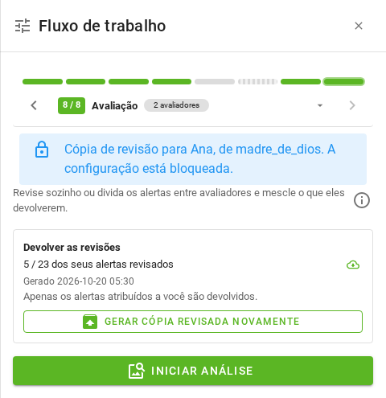

Numa cópia de revisão, a etapa **Avaliação** mostra **Devolver as revisões** no lugar da tabela: quantos dos alertas do avaliador estão revisados ("5 / 23 dos seus alertas revisados") e **Gerar cópia revisada**.

O avaliador:

1.  revisa os seus alertas na `Análise <defo-analysis_>`_;
2.  seleciona **Gerar cópia revisada** e depois a baixa com o ícone de nuvem (um arquivo .zip terminado em ``__reviewed.zip``); e
3.  envia a cópia de volta para o criador do projeto.

Só são devolvidos os alertas atribuídos ao avaliador que ele revisou, com os vínculos a alertas anteriores que ele marcou. Uma cópia revisada contém as revisões do momento em que foi gerada: depois de revisar mais alertas, selecione **Gerar cópia revisada novamente**. O avaliador pode enviar cópias quantas vezes for necessário. Quando uma cópia mais recente é mesclada, os alertas mesclados antes e revisados de outra forma desde então aparecem como conflitos: escolha **Usar as dele** para ficar com as revisões mais recentes do avaliador.

.. _defo-evaluation-merge:

Mesclar uma cópia revisada
^^^^^^^^^^^^^^^^^^^^^^^^^^

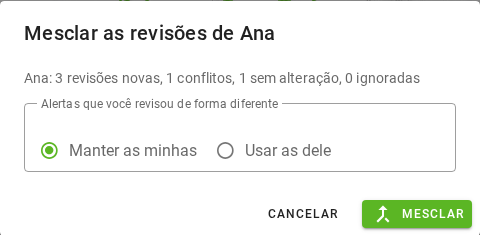

Para mesclar uma cópia revisada:

1.  Copie a cópia revisada para a sua pasta do SEPAL.
2.  Selecione **Mesclar cópia revisada…** e escolha-a em **Cópia revisada (.zip)**. Escolha uma cópia por vez.
3.  Leia a prévia, que traz o nome do avaliador no título e aparece antes de qualquer alteração (veja a tabela abaixo).
4.  Quando há conflitos, escolha em **Alertas que você revisou de forma diferente**: **Manter as minhas** (o padrão) ou **Usar as dele**.
5.  Selecione **Mesclar**.

.. list-table::
    :header-rows: 1
    :widths: 20 80

    *   -   Contagem
        -   Descrição
    *   -   revisões novas
        -   Alertas que o avaliador revisou e que não estão revisados no seu projeto. Eles são incorporados.
    *   -   conflitos
        -   Alertas que também foram revisados no seu projeto (por você ou numa mesclagem anterior), de outra forma. Um vínculo diferente a um alerta anterior conta como diferença.
    *   -   sem alteração
        -   Alertas cuja revisão é igual dos dois lados.
    *   -   ignoradas
        -   Alertas que não estão atribuídos a este avaliador. Eles nunca são incorporados.

Com o agrupamento ativado, cada contagem também dá o seu número de grupos ("3 revisões novas (1 grupo)"). Um grupo é mesclado inteiro: quando um dos seus alertas está em conflito, o grupo inteiro é um conflito.

Depois da mesclagem, os alertas do conjunto são atualizados, uma mensagem diz "N revisões de (avaliador) mescladas." e a coluna **Mesclado** mostra a data.

A prévia também pode avisar que "O questionário mudou desde a criação dos pacotes; as respostas são mescladas pela chave da pergunta.", ou listar as colunas que ignora. Se o alerta aberto na Análise estiver entre os mesclados, ele é recarregado.

.. tip::

    Na `Análise <defo-analysis_>`_, o filtro pode mostrar os alertas de um avaliador (ou os sem atribuição) pelo atributo **Avaliador**.

Mensagens comuns
^^^^^^^^^^^^^^^^

"Esta cópia é do conjunto …; torne-o o conjunto ativo para mesclar."
    Escolha antes esse conjunto no seletor de conjuntos da Análise ou da Visão geral.

"O conjunto foi executado novamente depois que esta cópia foi criada." ou "Esta cópia foi criada para uma divisão anterior."
    A cópia não corresponde mais aos alertas do conjunto. Ela não pode ser mesclada.

"Este zip é um pacote de revisão, não uma cópia revisada."
    Escolha o arquivo que o avaliador devolveu.

"Este retorno quebraria um grupo de alertas, então nada foi mesclado. Escolha Manter as minhas ou peça ao avaliador que atualize o aplicativo e envie a revisão novamente."
    Incorporar as revisões do avaliador dividiria um grupo salvo no seu projeto. Escolha **Manter as minhas** ou peça uma cópia revisada gerada com um app atualizado.

"Uma cópia de revisão não pode mesclar cópias revisadas; abra o projeto do criador."
    Faça a mesclagem no projeto original.

"Este conjunto tem um atributo chamado 'evaluator'; renomeie essa camada de atributos e execute o conjunto novamente."
    A tabela de alertas do conjunto já tem uma coluna ``evaluator``, vinda de uma camada de atributos, então ele não pode ser dividido. Em `Integrar e vetorizar <defo-integrate-attributes_>`_, dê outro nome a essa camada e execute o conjunto de novo (isso substitui o conjunto e as revisões dele).

"Os alertas deste conjunto têm avaliadores atribuídos, mas o projeto não tem registro de divisão. Remova a divisão para recomeçar."
    Uma divisão foi gravada nos alertas, mas não no projeto (por exemplo, porque o projeto foi fechado naquele momento). Abra **Editar divisão**, selecione **Remover a divisão** e divida de novo.

"Este conjunto de alertas foi regravado enquanto a divisão era feita, então nada foi alterado. Tente novamente."
    Uma revisão foi salva ou uma cópia foi mesclada ao mesmo tempo. Divida de novo.

"Este conjunto de alertas está sendo executado novamente em Integrar e vetorizar. Tente novamente quando terminar." (ao dividir)
    Espere a execução terminar.

"Não há alertas para atribuir." (ao dividir)
    Talvez todos os alertas já estejam revisados: marque **Incluir os alertas já revisados**.

.. _defo-analysis:

Análise
-------

.. labels-ok: Google; Esri; Enter

Use a tela de Análise para revisar os alertas do conjunto ativo, um de cada vez. Para cada alerta:

1.  Compare uma imagem de satélite de *antes* e uma de *depois*.
2.  Dê um veredito.
3.  Responda às perguntas do projeto.
4.  Salve.

O polígono do alerta também pode ser redesenhado, à mão ou com dois modelos de detecção automática, e os arquivos do alerta podem ser exportados.

Abrir a tela
^^^^^^^^^^^^

A tela abre com o conjunto de alertas ativo, a partir de qualquer um destes pontos:

-   **Iniciar análise**, no fim da etapa `Avaliação <defo-evaluation_>`_;
-   **Análise**, na barra lateral esquerda; ou
-   **Revisar alertas** na `Visão geral <defo-overview_>`_, ou o botão **Revisar** de um alerta clicado no mapa principal (veja `Ver os alertas no mapa <defo-integrate-map_>`_).

Ela precisa de um conjunto de alertas: até que `Integrar e vetorizar <defo-integrate_>`_ tenha gerado um, o contador mostra "Nenhum conjunto de alertas carregado". Um conjunto abre no alerta que estava em revisão quando a tela foi deixada pela última vez (a posição é salva com o projeto).

**Fluxo de trabalho**, no canto superior esquerdo, volta às etapas do fluxo de trabalho. A barra lateral esquerda continua utilizável nesta tela: um clique em um mapa a recolhe quando ela está expandida e não fixada, e uma barra fixada e expandida desloca a tela para a direita dela em vez de cobrir os mapas.

A tela
^^^^^^

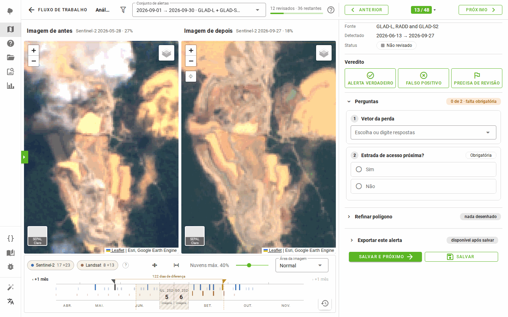

.. list-table::
    :header-rows: 1
    :widths: 20 80

    *   -   Parte
        -   Conteúdo
    *   -   Barra superior
        -   O filtro, o conjunto de alertas, o progresso da revisão, a ajuda e a navegação.
    *   -   Os dois mapas
        -   A imagem de *antes* à esquerda, a de *depois* à direita. Eles se movem juntos: desloque ou aproxime um e o outro acompanha.
    *   -   A linha do tempo
        -   Abaixo dos mapas: todas as imagens da área do alerta, num único eixo de datas. Os dois controles dela escolhem a imagem de antes e a de depois.
    *   -   O painel de revisão
        -   À direita: o que a tabela de alertas diz sobre o alerta, o veredito, as perguntas, as ferramentas de desenho, os alertas anteriores próximos e, por fim, um rodapé fixo na parte de baixo, com a seção de exportação e os botões de salvar. Só esse painel tem rolagem.

O ícone de ajuda na barra superior abre **Sobre a análise**, um resumo curto desta subseção.

.. _defo-analysis-topbar:

A barra superior
^^^^^^^^^^^^^^^^

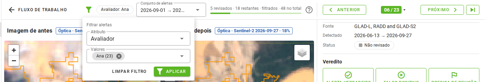

Da esquerda para a direita:

.. list-table::
    :header-rows: 1
    :widths: 25 75

    *   -   Controle
        -   Descrição
    *   -   Funil
        -   Abre o filtro (veja abaixo). Enquanto um filtro está ativo, o funil fica preenchido e uma etiqueta o identifica (por exemplo "Avaliador: Ana"). O X da etiqueta remove o filtro.
    *   -   **Conjunto de alertas**
        -   O conjunto em revisão: "período · fontes · N alertas · N revisados", do mais recente para o mais antigo. Escolher outro conjunto o torna o conjunto ativo do projeto, também para as outras etapas e para a Visão geral.
    *   -   Progresso
        -   "12 revisados · 36 restantes" sobre uma barra.
    *   -   **Anterior** / **Próximo**
        -   O alerta anterior ou o próximo na ordem do conjunto. Eles param no primeiro e no último alerta.
    *   -   Contador
        -   O número do alerta no conjunto ("13 / 48"). Selecione-o para abrir **Ir para o número do alerta**: digite um número e selecione **Ir**, ou pressione **Enter**.
    *   -   Ícone **Próximo alerta não revisado**
        -   Vai para o próximo alerta sem veredito, recomeçando do início depois do último. Fica desativado quando não resta nenhum outro alerta a revisar.

Quando o alerta na tela tem alterações não salvas, toda forma de ir para outro alerta pergunta antes (veja `Salvar a revisão <defo-analysis-save_>`_).

A ordem dos alertas é a **Ordem** escolhida em `Integrar e vetorizar <defo-integrate-options_>`_.

Filtrar os alertas
""""""""""""""""""

O filtro mantém os valores de um atributo e esconde os outros alertas da navegação. Para filtrar os alertas:

1.  Selecione o funil para abrir **Filtrar alertas**.
2.  Em **Atributo**, escolha o que filtrar. A lista oferece **Avaliador** (quando o conjunto está `dividido <defo-evaluation-split_>`_), **Status**, **Tipo** (quando o conjunto tem `alertas de crescimento <defo-integrate-growth_>`_: escolha **Crescimento** para revisá-los juntos), cada pergunta do questionário e, depois, as outras colunas do conjunto que têm entre 2 e 50 valores diferentes, como as colunas de uma `camada de atributos <defo-integrate-attributes_>`_. Se o conjunto não tiver nenhuma, o menu diz "Nenhum atributo para filtrar".
3.  Em **Valores**, selecione um ou mais valores, cada um com o seu número de alertas (por exemplo "Ana (24)"). Um alerta corresponde ao filtro quando tem qualquer um deles. As células vazias aparecem como **Não atribuído** para o avaliador e **(vazio)** para as outras colunas.
4.  Selecione **Aplicar**.

**Limpar filtro** remove o filtro.

Com um filtro ativo:

-   **Anterior**, **Próximo** e o ícone **Próximo alerta não revisado** só percorrem os alertas que correspondem ao filtro;
-   o contador conta as correspondências ("06 / 24"), ou mostra "– / 24" enquanto o alerta na tela não é uma delas, e a linha de progresso termina com "filtrados · 48 no total";
-   o menu de salto continua recebendo o número do alerta no conjunto inteiro, mas recusa um alerta que o filtro esconde ("O alerta 12 não está no filtro atual"); e
-   quando nada corresponde, o contador diz "Nenhum alerta corresponde a este filtro".

Quando um filtro é aplicado, a tela vai para o alerta que está na tela, se ele corresponder; senão, para a primeira correspondência não revisada; senão, para a primeira correspondência. Os alertas mantêm os seus números: um filtro nunca os renumera.

O filtro vale até ser limpo ou até que outro conjunto de alertas seja escolhido. Ele não é salvo com o projeto. Uma `cópia de revisão <defo-evaluation-return_>`_ já abre filtrada para os alertas do avaliador.

Os mapas
^^^^^^^^

Os dois mapas se centralizam no alerta quando ele abre. Uma caixa amarela tracejada marca a extensão do alerta.

.. list-table::
    :header-rows: 1
    :widths: 20 25 55

    *   -   Controle
        -   Local
        -   Descrição
    *   -   **Camadas**
        -   Canto superior direito de cada mapa
        -   As camadas do mapa, em três seções. Selecione uma camada para mostrá-la só naquele mapa.
    *   -   **Mapa base**
        -   Canto inferior esquerdo de cada mapa
        -   Passe o mouse sobre a miniatura para escolher o mapa base: Google, Esri (os dois de satélite), **SEPAL Claro** ou **SEPAL Escuro**. A escolha vale para os dois mapas. O padrão acompanha o tema do app: **SEPAL Claro**, ou **SEPAL Escuro** no tema escuro. Trocar o tema troca um pelo outro; um mapa base de satélite permanece.
    *   -   **Aproximar do alerta**
        -   Canto superior esquerdo do mapa de depois
        -   Leva os dois mapas de volta ao alerta.
    *   -   Barra de escala
        -   Canto inferior esquerdo de cada mapa, abaixo da miniatura do mapa base
        -   A escala do mapa, em metros ou quilômetros.

O menu **Camadas** lista:

.. list-table::
    :header-rows: 1
    :widths: 25 75

    *   -   Seção
        -   Camadas
    *   -   **Imagens**
        -   *True Color* (ligada) e *False Color* (infravermelho próximo, vermelho e verde; desligada): a imagem escolhida para aquele mapa.
    *   -   **Alertas**
        -   *Original alert*: o contorno do polígono do alerta gerado em `Integrar e vetorizar <defo-integrate_>`_ e dos outros alertas do grupo dele (veja `Alertas próximos <defo-analysis-nearby_>`_), ligada por padrão e escondida durante o desenho. *All alerts*: os pixels de alerta do conjunto inteiro, semitransparentes (desligada). *Alert BB*: o retângulo envolvente do alerta. *Defo Layer*: o polígono salvo para o alerta (veja `Refinar o polígono <defo-analysis-refine_>`_). *Alertas anteriores* (veja `Alertas anteriores <defo-analysis-earlier_>`_). *Nearby alerts*, só quando os alertas próximos são revisados juntos.
    *   -   **Camadas adicionais**
        -   As `camadas adicionais <defo-layers_>`_ marcadas com **Mostrar na Análise**, desligadas.

Um mapa mostra "Não foi possível carregar as imagens" quando os blocos da imagem dele não carregam.

.. _defo-analysis-timeline:

Escolher as imagens: a linha do tempo
^^^^^^^^^^^^^^^^^^^^^^^^^^^^^^^^^^^^^

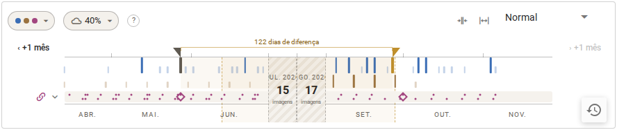

A linha do tempo mostra todas as imagens que cobrem o alerta, desde cerca de dois meses antes da primeira detecção do alerta até dois meses depois da última. Cada coleção tem a sua própria faixa:

-   os traços do *Sentinel-2* em cima;
-   o *Landsat* no meio; e
-   o *Planet* (o mosaico mensal NICFI), como uma barra ao longo do seu mês, embaixo, só quando a sua conta do GEE tem acesso ao NICFI.

Um traço esmaecido, de meia altura, é uma imagem acima do limite de nuvens. A faixa dourada é a *janela do alerta*: as datas em que o alerta foi detectado. Num `alerta de crescimento <defo-integrate-growth_>`_, uma faixa cinza atrás dela marca as datas de detecção de cada alerta anterior ao qual ele está vinculado: escolha uma imagem de antes tirada depois do desmatamento anterior para ver só a perda nova.

Dois controles acima da trilha escolhem as imagens: o da esquerda, a imagem de antes; o da direita, a de depois. O colchete entre eles diz quantos dias as separam ("49 dias de diferença") ou avisa "a mesma imagem dos dois lados".

Para mover um controle, use um destes métodos:

-   Arraste um controle e solte-o sobre a imagem escolhida. O controle de antes não pode ultrapassar o de depois.
-   Clique num traço: o controle adequado mais próximo vai até ele. As imagens acima do limite de nuvens não podem ser selecionadas.
-   Pelo teclado: pressione **Tab** para chegar a um controle, percorra as datas com as setas esquerda e direita, salte para a primeira ou a última imagem com **Home** e **End**, e escolha com **Enter**.

Quando um alerta abre, o app escolhe a imagem mais próxima *antes* da janela do alerta e a imagem mais próxima *depois* dela, entre as imagens abaixo do limite de nuvens. Ele nunca escolhe uma imagem dentro da janela do alerta (ela mostraria só parte do desmatamento) nem um mosaico Planet, mas os dois podem ser escolhidos à mão. Um lado sem nenhuma imagem abaixo do limite de nuvens fica "não definido". Um alerta revisado abre com as imagens com que foi salvo. Se uma delas não estiver mais disponível, o título do mapa diz "Imagem salva indisponível; escolhida automaticamente".

O título de cada mapa indica a sua imagem: "Imagem de antes · Sentinel-2 2026-07-28 · 3%" (coleção, data, cobertura de nuvens). Quando a outra coleção tem uma imagem do mesmo dia, um botão no título ("⇄ Landsat") troca para ela.

A barra de ferramentas acima da trilha:

.. labels-ok: Tab; Home; End

.. list-table::
    :header-rows: 1
    :widths: 25 55 20

    *   -   Controle
        -   Descrição
        -   Padrão
    *   -   Etiquetas *Planet*, *Sentinel-2*, *Landsat*
        -   Mostram ou escondem uma coleção. Cada etiqueta conta as imagens da coleção na vista e, depois ("+7"), as que estão acima do limite de nuvens. A etiqueta Planet só aparece quando a sua conta do GEE tem acesso ao NICFI.
        -   Todas ligadas.
    *   -   Botão **?**
        -   Mostra ou esconde uma legenda da linha do tempo.
        -   Oculta.
    *   -   **Recolher a janela do alerta**
        -   Recolhe os meses que ficam inteiramente dentro da janela do alerta em blocos que indicam o seu número de imagens. Selecione um bloco para expandir o mês; selecione o nome de um mês no eixo para recolhê-lo. Num alerta longo, os meses recolhidos ocupam menos da metade da trilha, para que os meses antes e depois da janela mantenham o seu espaço. Quando eles ficam estreitos demais para serem lidos, os meses recolhidos de cada semestre formam um único bloco ("Jan – Jun 2024"), com o ano no eixo logo abaixo; selecione-o para dividi-lo em um bloco por mês.
        -   Recolhida quando um alerta abre.
    *   -   **Expandir todos os meses**
        -   Expande todos os meses.
        -
    *   -   **Nuvens máx.**
        -   O limite de nuvens, de 0 a 100 %, em passos de 5. As imagens acima dele ficam esmaecidas e nunca são escolhidas automaticamente. Os mosaicos Planet não têm valor de nebulosidade, então o limite nunca os esconde.
        -   40 %.
    *   -   **Área da imagem**
        -   Até onde as imagens se estendem ao redor do alerta: **Normal**, **Grande** ou **Muito grande** (100 m, 1 km ou 2,5 km ao redor). Áreas maiores demoram mais para carregar e exportar. Salvar a revisão salva a área: o alerta volta a abrir com ela, e os arquivos e o GIF dele são feitos com ela. Um alerta nunca salvo abre em **Normal**.
        -   **Normal**.
    *   -   **+1 mês** (à esquerda e à direita da trilha)
        -   Acrescenta um mês antes ou depois da vista. O da direita para no mês atual.
        -

As imagens vêm de um índice das imagens sobre a área do projeto, guardado em disco e atualizado depois de 24 horas. Enquanto ele carrega, a barra de ferramentas diz "Carregando o índice de imagens…"; um índice com mais de um dia mostra "Índice de (data)". Se uma atualização falha, o índice na tela continua funcionando, e **Tentar novamente** tenta de novo.

.. _defo-analysis-panel:

O painel de revisão
^^^^^^^^^^^^^^^^^^^

O topo do painel mostra o que a tabela de alertas diz:

.. list-table::
    :header-rows: 1
    :widths: 20 80

    *   -   Linha
        -   Descrição
    *   -   **Fonte**
        -   As fontes que detectaram o alerta.
    *   -   **Detectado**
        -   A primeira e a última data de detecção.
    *   -   Linha **Status**
        -   O status de revisão, com a sua cor: **Não revisado**, **Revisado: confirmado**, **Revisado: falso positivo** ou **Revisado: precisa de revisão**.
    *   -   **Grupo**
        -   Para um alerta revisado com alertas próximos: "grupo de 4". Oculta nos outros casos.
    *   -   **Tipo**
        -   Se o alerta cresce a partir de uma perda anterior (veja `Crescimento de perdas anteriores <defo-integrate-growth_>`_): **Crescimento** (uma etiqueta roxa), **Crescimento · abaixo da área mínima** ou **Nova · abaixo da área mínima** (um alerta pequeno cujos vínculos foram todos removidos). Oculta para um alerta novo.
    *   -   **Histórico**
        -   Para um alerta vinculado a uma perda anterior: os alertas do seu histórico e a área que eles confirmam, por exemplo "3 alertas · 2,1 ha confirmados desde ago. 2026 (+0,3 ha não revisados)". A área é contada uma única vez onde as formas se sobrepõem. Oculta quando o alerta não tem histórico.

Se o conjunto ativo estiver desatualizado ou com arquivos faltando, uma linha laranja acima avisa, como na `Visão geral <defo-overview_>`_. A revisão continua possível.

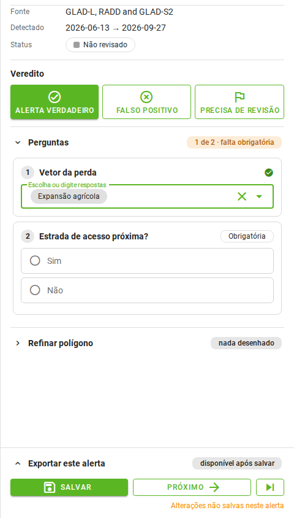

Veredito
""""""""

Em **Veredito**, selecione um destes:

.. list-table::
    :header-rows: 1
    :widths: 20 30 50

    *   -   Botão
        -   Status gravado
        -   Quando usar
    *   -   **Alerta verdadeiro**
        -   **Revisado: confirmado**
        -   As imagens mostram perda florestal onde está o alerta.
    *   -   **Falso positivo**
        -   **Revisado: falso positivo**
        -   Elas não mostram perda florestal: nuvens, sombras, uma mudança sazonal…
    *   -   **Precisa de revisão**
        -   **Revisado: precisa de revisão**
        -   Ainda não é possível decidir, ou o alerta precisa de uma segunda olhada.

Um alerta não revisado abre sem veredito: nada é escolhido automaticamente. Um alerta revisado abre com o veredito e as respostas salvos.

Perguntas
"""""""""

A seção **Perguntas** traz as perguntas do `questionário <defo-questionnaire_>`_, na ordem definida e numeradas. Depois que um veredito é escolhido, ela mostra só as perguntas feitas para esse veredito. O indicador da seção conta as respostas ("1 de 2 respondidas") e fica laranja quando uma pergunta obrigatória está sem resposta ("1 de 2 · falta obrigatória").

-   Uma pergunta de uma resposta mostra as opções como blocos: selecione um.
-   Uma pergunta de várias respostas as mostra como etiquetas: selecione cada uma que se aplica.
-   Uma pergunta que permite respostas digitadas é uma lista que também aceita digitação (**Escolha ou digite respostas**).

Sem nenhuma pergunta no projeto, a seção diz "Este projeto não faz perguntas: adicione-as na etapa Questionário."; quando o veredito escolhido não tem perguntas, "Nenhuma pergunta é feita para este veredito."

Uma marca **Obrigatória** indica uma pergunta que precisa ser respondida antes de salvar. A seção começa aberta ou fechada conforme a opção **Mostrar as perguntas expandidas na Análise** do questionário. Ela se abre sozinha quando o veredito escolhido faz uma pergunta obrigatória ainda sem resposta, e quando um salvamento é recusado por esse motivo.

.. _defo-analysis-refine:

Refinar o polígono
""""""""""""""""""

O polígono do alerta vem dos pixels de alerta. Em **Refinar polígono**, desenhe em vez disso a área que de fato foi perdida. O polígono salvo é guardado com a revisão, aparece como *Defo Layer* nos mapas, e a área dele passa a ser a área do alerta. O indicador da seção mostra "nada desenhado" ou, por exemplo, "2 formas · 1,3 ha".

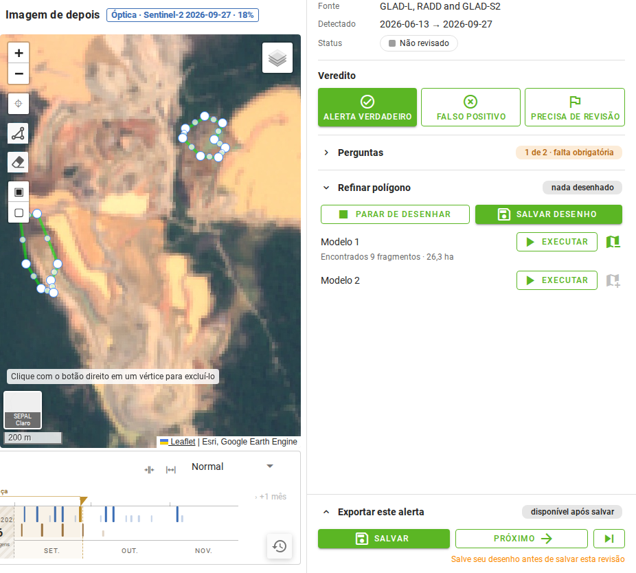

Para refinar o polígono:

1.  Selecione **Começar a desenhar**. Os dois mapas passam para o modo de desenho, a caixa do alerta some e o polígono salvo (se houver) vira o desenho, em azul. **Parar de desenhar** toma o lugar do botão.
2.  Edite o desenho em qualquer um dos mapas; o outro acompanha:

    -   O botão de polígono, no canto superior esquerdo, desenha uma nova forma: clique nos vértices e depois no primeiro para fechá-la.
    -   Arraste um vértice para movê-lo, clique no pequeno marcador no meio de um lado para acrescentar um vértice e clique com o botão direito num vértice para excluí-lo. Uma edição que faria uma forma cruzar a si mesma é desfeita.
    -   O botão de lixeira exclui a próxima forma clicada. As ações dele **Selecionar área** (arraste uma caixa ao redor das formas a excluir) e **Limpar tudo** pedem confirmação antes ("Excluir 2 formas?", **Cancelar** / **Excluir**), com as formas em questão em vermelho. Pressione **Esc** para cancelar.
    -   **Preencher buracos** remove os buracos da forma selecionada, ou de todas as formas quando nenhuma está selecionada. **Remover buraco**: clique dentro de um buraco para removê-lo; pressione **Esc** ou selecione o botão de novo para parar.

3.  Selecione **Salvar desenho**. O desenho passa a ser o polígono do alerta. Um desenho sem nenhuma forma remove o polígono.
4.  Selecione **Parar de desenhar** para sair do modo de desenho. Se o desenho tiver alterações não salvas com **Salvar desenho**, a janela **Descartar o desenho não salvo?** pergunta antes: **Continuar desenhando**, **Salvar e parar** ou **Descartar alterações**.

.. important::

    **Salvar desenho** não salva a revisão: selecione **Salvar** em seguida. Enquanto o desenho não for salvo, o rodapé diz "Salve seu desenho antes de salvar esta revisão" e a revisão não pode ser salva.

Os dois modelos
###############

Abaixo dos botões de desenho, duas redes neurais convolucionais (CNNs) podem encontrar a perda nas imagens de antes e depois que estão na tela: **Modelo 1** ("Modelo menor e mais rápido") e **Modelo 2** ("Modelo maior, porém mais lento").

Para usar um modelo:

1.  Selecione **Executar** na linha de um modelo. O app baixa as duas imagens (a área definida em **Área da imagem**) e executa o modelo. Isso demora um pouco; a execução aparece na lista de tarefas.
2.  Leia o resultado na linha (por exemplo "Encontrados 3 fragmentos · 2,1 ha"). Os fragmentos menores que o **Tamanho mínimo do agrupamento** do conjunto ficam de fora. Quando o modelo não encontra nada, aparece em vez disso um ícone de aviso vermelho ("O modelo não encontrou polígonos de perda florestal").
3.  Selecione o ícone de mapa com um sinal de mais (**Adicionar ao mapa**) para acrescentar os fragmentos ao desenho (isso ativa o modo de desenho, se necessário): verde-limão para o **Modelo 1**, roxo para o **Modelo 2**. O ícone passa então a ter um sinal de menos (**Remover do mapa**), que os retira de novo.
4.  Edite o resultado como qualquer desenho e selecione **Salvar desenho**.

Escolher outras imagens ou outra **Área da imagem** descarta os resultados dos modelos: execute-os de novo. Se outro alerta for aberto enquanto um modelo está rodando, o resultado dele não é adicionado ("O modelo terminou depois que você passou para outro alerta: a predição não foi adicionada.").

.. _defo-analysis-earlier:

Alertas anteriores
""""""""""""""""""

Esta seção aparece quando o período do conjunto ativo tem períodos anteriores com conjuntos de alertas. Ela lista a perda anterior perto do alerta: os alertas de períodos anteriores revisados como **Revisado: confirmado** ou **Revisado: precisa de revisão**, dentro da distância definida em **Num raio de**, em metros (100 m por padrão, de 10 m a 50 km), mais todos os alertas vinculados a este, por mais longe que estejam. Use-a para verificar se um alerta dá continuidade a um desmatamento já reportado e para vinculá-lo a esse desmatamento.

Os alertas são agrupados por período, do mais recente para o mais antigo. Cada linha mostra:

-   uma barra na cor do período;
-   uma caixa, marcada quando o alerta está vinculado a este;
-   o número e a área do alerta anterior ("#12 · 3,4 ha") e o status dele; e
-   a relação dele com este alerta: "encosta" (vinculado por `Integrar e vetorizar <defo-integrate-growth_>`_), "encosta · não vinculado" (o vínculo foi removido) ou a distância ("40 m").

Selecione o número de um alerta para aproximar os dois mapas dele.

Para vincular ou desvincular um alerta, marque ou desmarque a caixa dele. A alteração faz parte da revisão: o rodapé diz "Alterações não salvas neste alerta", e **Salvar** a salva com o veredito. Marcar um alerta de um período anterior torna este alerta um alerta de crescimento, mesmo que não encoste nele.

Um alerta de crescimento menor que o **Tamanho mínimo do agrupamento** só está no conjunto por causa do seu vínculo. Desmarcar o último vínculo dele pergunta antes (**Desvincular do alerta anterior?**): por exemplo "O alerta #14 tem 0,2 ha, abaixo do mínimo de 0,5 ha. Ele só é um alerta porque está vinculado a #12." Selecione **Desvincular** para desmarcar o vínculo: o alerta continua no conjunto como **Nova · abaixo da área mínima**.

Algumas linhas não têm caixa:

-   "por meio de #12": o alerta faz parte do histórico por meio de outro vínculo (aqui, o alerta 12). Desmarcar a caixa do alerta 12 também o remove.
-   "o conjunto anterior foi executado de novo": o conjunto do alerta anterior foi gerado de novo em `Integrar e vetorizar <defo-integrate-replace_>`_, então o vínculo não aponta mais para o mesmo alerta. A linha fica acinzentada, não é contada no histórico, e o vínculo é descartado na próxima vez que este alerta for salvo.

Um alerta vinculado que depois foi revisado como falso positivo continua marcado, com "agora falso positivo". Ele fica acinzentado e fora do histórico; desmarque a caixa dele para remover o vínculo.

Ligue **Mostrar nos mapas** para contornar os alertas listados nos dois mapas. A cor é a do período, e uma pequena legenda lista os períodos exibidos, com "contínua: confirmado · tracejada: precisa de revisão · grossa: vinculado". O interruptor começa ligado para um alerta de crescimento; nos outros alertas, ele mantém a sua última escolha. Quando a lista cobre vários períodos, o menu **Períodos** esconde alguns deles. O indicador mostra "desativado", "nenhum a menos de 100 m" ou, por exemplo, "4 a menos de 100 m · vínculos: 1".

Numa `cópia de revisão <defo-evaluation-return_>`_, a lista vem de um instantâneo dos alertas anteriores tirado quando os pacotes foram gerados: a seção diz "Alertas anteriores em (data)", ou "Nenhum alerta anterior nesta cópia" para um pacote gerado por uma versão mais antiga do app.

.. _defo-analysis-nearby:

Alertas próximos
""""""""""""""""

Esta seção só aparece quando **Revisar juntos os alertas próximos** está marcado em `Avaliação <defo-evaluation-group_>`_. Um mesmo desmatamento muitas vezes gera vários alertas pequenos lado a lado. Revise-os juntos: um único veredito, um único conjunto de respostas, um único par de imagens e um único polígono para todos eles.

A seção lista os alertas dentro da distância definida em **Avaliação**, medida de borda a borda a partir do alerta na tela: primeiro os marcados, depois os outros mais próximos, no máximo 50 ("mais 12 no raio, não listados"). Cada linha mostra:

-   uma caixa, marcada quando o alerta faz parte do próximo salvamento;
-   o número do alerta (selecione-o para aproximar os dois mapas dele), a primeira data de detecção e a área dele;
-   a distância dele ("40 m"), ou "neste grupo";
-   "grupo nº 12" quando ele pertence a outro grupo;
-   o status dele; e
-   num conjunto dividido, "atribuído a Ana", acinzentado e sem caixa, para um alerta de outro avaliador.

A lista oferece os alertas não revisados e os alertas revisados num grupo. Os alertas revisados antes de o agrupamento ser ativado só são oferecidos com **Incluir os alertas já revisados**.

Os alertas listados são contornados nos dois mapas (camada *Nearby alerts*). Clique num mapa perto de um contorno para marcar ou desmarcar esse alerta. **Selecionar todos** marca todos os alertas listados e **Limpar** os desmarca. O indicador mostra "3 selecionados", "5 a menos de 300 m" ou "nenhum a menos de 300 m". Quando um alerta marcado fica fora das imagens, uma linha diz "Alguns alertas selecionados estão fora da área da imagem: escolha uma área maior na linha do tempo."

Para revisar um grupo:

1.  Marque os alertas que mostram o mesmo desmatamento.
2.  Dê o veredito, responda às perguntas, escolha as imagens e desenhe o polígono como para um único alerta.
3.  Selecione **Salvar**, que passa a dizer "Salvar para 4 alertas".

Quando o salvamento altera outras revisões, a janela **Salvar este grupo?** as lista antes, por exemplo:

-   "#15 (Revisado: confirmado): sua revisão é substituída";
-   "#16 (Revisado: confirmado): sai do grupo nº 9" ou "junta-se ao grupo nº 9" (um grupo inteiro se junta quando o alerta principal dele é marcado); e
-   "#17 (Não revisado): sai do grupo e volta a não revisado" (um alerta deste grupo deixado desmarcado).

Selecione **Salvar** ou **Cancelar**.

Todos os alertas do grupo recebem o mesmo veredito, as mesmas respostas, as mesmas imagens e os mesmos vínculos a alertas anteriores. O alerta na tela quando o grupo é salvo pela primeira vez é o alerta *principal* dele: ele guarda o polígono desenhado. Quando o grupo tem um desenho, os outros alertas recebem uma área de 0, para que a perda seja contada uma única vez.

Um alerta de um grupo salvo abre com o aviso "Revisado em um grupo de 4 (alerta principal #12)", e a linha **Grupo** do painel diz "grupo de 4". A camada *Original alert* contorna o grupo inteiro. Num alerta que não é o principal, **Remover do grupo** o tira do grupo: confirme com **Remover**. O alerta volta a não revisado.

Um grupo precisa de um único avaliador: "Estes alertas estão atribuídos a avaliadores diferentes: um grupo precisa de um só." Numa cópia de revisão, só os seus próprios alertas podem entrar: "Alguns destes alertas não estão atribuídos a você."

.. _defo-analysis-save:

Salvar a revisão
^^^^^^^^^^^^^^^^

A *barra inferior* fica fixa na parte de baixo do painel: a seção **Exportar este alerta**, depois os botões, depois uma linha de estado.

.. list-table::
    :header-rows: 1
    :widths: 25 75

    *   -   Botão
        -   Descrição
    *   -   **Salvar**
        -   Salva a revisão e permanece no alerta. Com alertas próximos marcados, ele diz "Salvar para 4 alertas".
    *   -   **Próximo**
        -   Abre o próximo alerta (a próxima correspondência, com um filtro ativo).
    *   -   Ícone **Próximo alerta não revisado**
        -   Abre o próximo alerta sem veredito, como na barra superior.

O botão preenchido mostra o próximo passo: **Salvar** enquanto o alerta tem alterações não salvas ou nenhuma revisão salva, **Próximo** depois que a revisão é salva.

Com alterações não salvas, **Próximo**, o ícone e os botões **Anterior**, **Próximo**, **Ir** e o ícone da barra superior perguntam antes. Os botões dão lugar a "Este alerta tem alterações não salvas": **Descartar** apaga as alterações e avança, **Ficar** mantém você no alerta.

A linha de estado diz "Alterações não salvas neste alerta", "Salve seu desenho antes de salvar esta revisão" ou "Salvo às 14:32".

Um salvamento grava no conjunto de alertas:

-   o veredito, como status do alerta;
-   as respostas às perguntas feitas para esse veredito (as outras ficam vazias);
-   as imagens de antes e depois escolhidas, para que o alerta reabra com elas;
-   o polígono salvo em **Refinar polígono**, com a área dele como área do alerta;
-   os alertas anteriores marcados em `Alertas anteriores <defo-analysis-earlier_>`_, como os vínculos do alerta;
-   com alertas próximos marcados, o grupo (veja `Alertas próximos <defo-analysis-nearby_>`_); e
-   os nomes das áreas administrativas sob o alerta, a partir dos limites FAO GAUL 2015 no GEE (isso leva alguns segundos).

As revisões aparecem na hora na barra de progresso, no seletor de conjuntos e na `Visão geral <defo-overview_>`_. Uma revisão pode mudar a qualquer momento: abra o alerta, altere-a e salve de novo.

Exportar o alerta
^^^^^^^^^^^^^^^^^

**Exportar este alerta**, no topo da barra inferior, gera os arquivos do alerta depois que ele é salvo: um arquivo .zip com o GeoPackage e as imagens, um relatório Word e, para um alerta verdadeiro, um GIF animado. Veja `Um alerta, a partir da Análise <defo-export-alert_>`_.

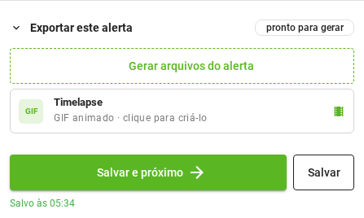

Teclado
^^^^^^^

A tela não tem atalhos de teclado globais. As teclas que funcionam:

.. labels-ok: Esc; ←; →; ?

.. list-table::
    :header-rows: 1
    :widths: 30 20 50

    *   -   Tecla
        -   Local
        -   Ação
    *   -   **Tab**, **←** **→**, **Home**, **End**, **Enter**
        -   Controles da linha do tempo
        -   Chegar a um controle, movê-lo pelas datas, saltar para a primeira ou a última imagem, escolher a imagem.
    *   -   **Enter**
        -   Menu de salto
        -   O mesmo que **Ir**.
    *   -   **Esc**
        -   Mapas
        -   Cancela **Selecionar área** ou uma confirmação de exclusão; interrompe **Remover buraco**.

Mensagens comuns
^^^^^^^^^^^^^^^^

"Responda em "Veredito" antes de salvar."
    Escolha primeiro um veredito.

"Responda “(pergunta)” antes de salvar."
    Uma pergunta obrigatória está sem resposta; a seção **Perguntas** se abre nela.

"Um falso positivo não pode ter um polígono de desmatamento desenhado: exclua o polígono ou mude a resposta."
    Remova o polígono em **Refinar polígono** (um desenho vazio e depois **Salvar desenho**) ou escolha outro veredito.

"Salve seu desenho antes de salvar esta revisão."
    Selecione **Salvar desenho**, ou pare de desenhar e descarte as alterações.

"Este conjunto de alertas foi reconstruído enquanto você o revisava, então os alertas na tela estão desatualizados e esta revisão não foi salva."
    O conjunto foi executado de novo em `Integrar e vetorizar <defo-integrate_>`_. Revise os alertas reconstruídos.

"O conjunto de alertas ativo mudou durante o salvamento, então esta revisão não foi salva." ou "Estes alertas pertencem a um conjunto de alertas diferente do ativo, então não foram salvos nele."
    Outro conjunto passou a ser o ativo nesse meio-tempo. Abra o alerta de novo e salve.

"Salvo, mas você alterou este alerta enquanto ele era salvo: salve novamente para guardar essas alterações."
    Salve de novo.

"As imagens de antes e depois deste alerta não estão ambas prontas, então o modelo não tem sobre o que ser executado."
    Escolha as duas imagens e espere os dois mapas terminarem de exibi-las.

"Nenhuma imagem cobre este alerta nesta janela."
    Acrescente meses com **+1 mês** ou aumente **Nuvens máx.**

"Todas as imagens desta janela estão em coleções que você desativou."
    Ligue de novo a etiqueta de uma coleção.

"Não foi possível exibir a imagem de antes: …" ou "Não foi possível exibir a imagem de depois: …"
    Escolha a imagem de novo, ou outra.

.. _defo-overview:

Visão geral
-----------

A Visão geral resume um conjunto de alertas: quantos alertas ele tem, quantos estão revisados e quanta perda foi confirmada, onde e quando. Ela também grava os alertas do conjunto num GeoPackage ou numa tabela CSV. Os números acompanham as revisões à medida que são salvas.

Abrir a Visão geral
^^^^^^^^^^^^^^^^^^^

Selecione **Visão geral** na barra lateral esquerda. Ela abre como uma janela grande sobre o mapa; feche-a com o X. Ela mostra o conjunto de alertas ativo ou, quando o projeto não tem nenhum, "Ainda não há nenhum conjunto de alertas. Execute Integrar e vetorizar para gerar um."

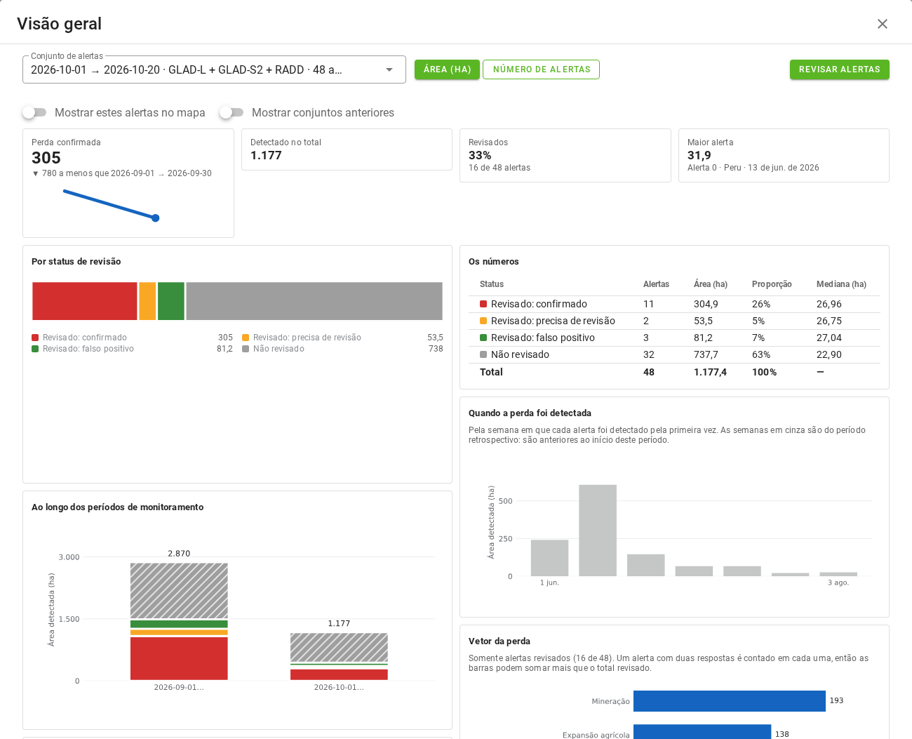

O cabeçalho
^^^^^^^^^^^

.. list-table::
    :header-rows: 1
    :widths: 25 55 20

    *   -   Controle
        -   Descrição
        -   Padrão
    *   -   **Conjunto de alertas**
        -   O conjunto resumido. Escolher outro o torna o conjunto ativo do projeto, como na `Análise <defo-analysis-topbar_>`_.
        -   O conjunto ativo.
    *   -   **Área (ha)** / **Número de alertas**
        -   Se todos os números da página contam hectares ou alertas.
        -   **Área (ha)**.
    *   -   **Revisar alertas**
        -   Fecha a Visão geral e abre a `Análise <defo-analysis_>`_ neste conjunto. Fica desativado quando o conjunto não tem alertas.
        -
    *   -   **Mostrar estes alertas no mapa**
        -   Desenha os alertas do conjunto no mapa principal, coloridos pelo status, como em `Integrar e vetorizar <defo-integrate-map_>`_.
        -   Desligado.
    *   -   **Mostrar conjuntos anteriores**
        -   Desenha no mapa principal os alertas dos conjuntos de períodos anteriores. Só aparece quando há conjuntos anteriores.
        -   Desligado.

Os dois interruptores de mapa só aparecem quando o conjunto tem alertas. Ligar um deles fecha a Visão geral, para mostrar o mapa.

Se o conjunto estiver desatualizado ou com arquivos faltando, uma linha laranja avisa ("Este conjunto foi gerado a partir de entradas que mudaram desde então…" ou "Os arquivos deste conjunto estão faltando na pasta do projeto…"). Os números continuam mostrando o que o conjunto contém. Execute `Integrar e vetorizar <defo-integrate-outdated_>`_ de novo para reconstruí-lo, o que descarta as revisões dele.

Os números principais
^^^^^^^^^^^^^^^^^^^^^

.. list-table::
    :header-rows: 1
    :widths: 25 75

    *   -   Bloco
        -   Conteúdo
    *   -   **Perda confirmada**
        -   A área (ou o número) dos alertas revisados como **Revisado: confirmado**. Quando há um período anterior, compara com ele, na medida da página ("▼ 780 a menos que 2026-09-01 → 2026-09-30" ou "▲ … a mais que …"), e desenha uma pequena linha ao longo dos períodos.
    *   -   **Detectado no total**
        -   A área (ou o número) de todos os alertas do conjunto, qualquer que seja o status.
    *   -   **Revisados**
        -   A proporção de alertas que têm veredito, e "16 de 48 alertas". Conta sempre alertas.
    *   -   **Maior alerta**
        -   A área do maior alerta, o número dele, o país (depois de revisado) e a data. Conta sempre hectares. O número é a linha do alerta no conjunto, que corresponde ao número do contador da Análise menos um.

.. _defo-overview-figures:

Os gráficos
^^^^^^^^^^^

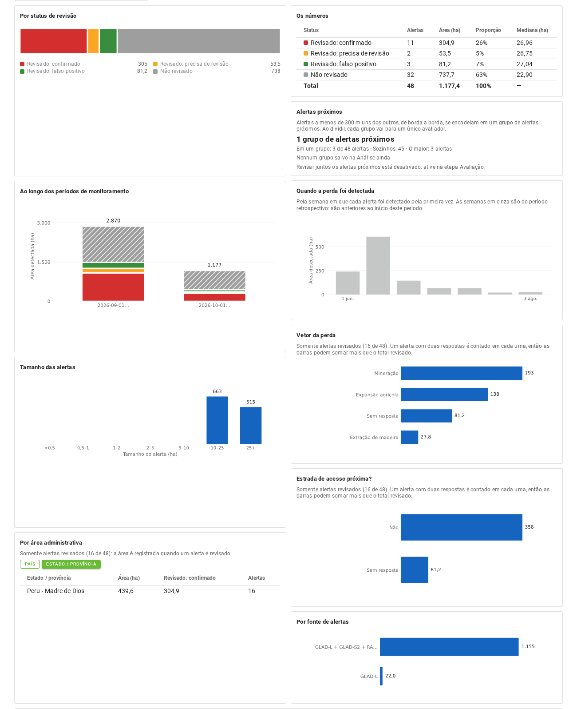

Coluna da esquerda:

.. list-table::
    :header-rows: 1
    :widths: 25 75

    *   -   Cartão
        -   Conteúdo
    *   -   **Por status de revisão**
        -   Uma barra dividida por status e o valor de cada status.
    *   -   **Ao longo dos períodos de monitoramento**
        -   Uma coluna por período de monitoramento do projeto, dividida por status, a partir do conjunto de alertas mais recente de cada um. Um período ainda em revisão mostra a parte não revisada hachurada. Com um único período, diz "Este projeto tem um único período de monitoramento. Adicione um segundo e a tendência aparecerá aqui."
    *   -   **Tamanho das alertas**
        -   Os alertas por tamanho: menos de 0,5 ha, 0,5–1 ha, 1–2 ha, 2–5 ha, 5–10 ha, 10–25 ha e 25 ha ou mais.
    *   -   **Por área administrativa**
        -   Os alertas revisados por área administrativa, até oito áreas, começando pela maior perda confirmada: a **Área (ha)** deles, os hectares **Revisado: confirmado** e o número de **Alertas**. Dois botões acima da tabela definem o nível: **País**, ou **Estado / província**, o primeiro nível abaixo do país, mostrado com o seu país ("Peru › Madre de Dios"). Só alertas revisados, já que as áreas são registradas (a partir dos limites FAO GAUL) quando um alerta é salvo; um alerta sem área registrada é contado como **Não registrado**. Um alerta que cruza uma fronteira aparece com todas as áreas em que se encontra, separadas por vírgulas.

Coluna da direita:

.. list-table::
    :header-rows: 1
    :widths: 25 75

    *   -   Cartão
        -   Conteúdo
    *   -   **Os números**
        -   Uma tabela: por status, o número de alertas, a área deles, a proporção na medida da página e o tamanho mediano dos alertas, com uma linha **Total**.
    *   -   **Histórico de desmatamentos que crescem**
        -   Só quando o conjunto tem `alertas de crescimento <defo-integrate-growth_>`_ (veja abaixo).
    *   -   **Alertas próximos**
        -   Como os alertas do conjunto se reúnem em grupos de alertas próximos (veja abaixo).
    *   -   **Quando a perda foi detectada**
        -   Os alertas pela semana em que foram detectados pela primeira vez. As semanas em cinza são semanas da busca retroativa: ficam antes do início do período (veja `O que os períodos anteriores já reportaram <defo-integrate-earlier_>`_).
    *   -   Um cartão por pergunta
        -   As respostas dadas a cada `pergunta <defo-questionnaire_>`_, só para alertas revisados: as cinco mais frequentes e depois **Outros** e **Sem resposta**. Um alerta com duas respostas conta em cada uma.
    *   -   **Por fonte de alertas**
        -   Os alertas pela combinação de fontes que os detectou.

Quando um gráfico não pode ser desenhado, o cartão dele diz "Não foi possível desenhar esta figura; os números estão abaixo." e os lista.

.. _defo-overview-growth:

Desmatamentos que crescem
"""""""""""""""""""""""""

O cartão **Histórico de desmatamentos que crescem** acompanha os desmatamentos que os alertas de crescimento deste conjunto estendem. O título dele dá os alertas de crescimento do conjunto e a área deles ("3 alertas de crescimento · 4,2 ha", ou só o número com **Número de alertas**). A linha abaixo os divide ("Crescimento: 2 · Abaixo da área mínima: 1") e diz quantos estão revisados.

A tabela dele lista os históricos que incluem um alerta deste conjunto, da maior área confirmada para a menor:

.. list-table::
    :header-rows: 1
    :widths: 25 75

    *   -   Coluna
        -   Conteúdo
    *   -   **Períodos de monitoramento**
        -   O primeiro e o último período do histórico.
    *   -   **Alertas**
        -   O número de alertas do histórico, somando todos os períodos.
    *   -   **Confirmados (ha)**
        -   A área dos alertas do histórico revisados como **Revisado: confirmado** ou **Revisado: precisa de revisão**, contada uma única vez onde as formas deles se sobrepõem.
    *   -   **Acrescentado por este conjunto (ha)**
        -   A área dos alertas deste conjunto no histórico, sem os falsos positivos.
    *   -   **Revisar**
        -   Fecha a Visão geral e abre na `Análise <defo-analysis_>`_ o alerta deste conjunto que faz parte do histórico.

Alertas próximos
""""""""""""""""

O cartão **Alertas próximos** mostra como os alertas do conjunto se encadeiam em grupos: os alertas dentro da distância de **Revisar juntos os alertas próximos** (veja `Avaliação <defo-evaluation-group_>`_), de borda a borda, formam um único grupo. Ao dividir, cada grupo vai para um único avaliador.

-   O título conta os grupos ("6 grupos de alertas próximos") ou diz "Nenhum alerta a menos de 300 m de outro".
-   A linha abaixo dele diz, por exemplo, "Em um grupo: 20 de 48 alertas · Sozinhos: 28 · O maior: 5 alertas".
-   A última linha conta os grupos salvos na Análise ("2 grupos salvos na Análise (7 alertas)") ou diz "Nenhum grupo salvo na Análise ainda".

Quando o agrupamento está desativado, o cartão usa a distância do projeto e acrescenta "Revisar juntos os alertas próximos está desativado: ative na etapa Avaliação."

Exportar o conjunto
^^^^^^^^^^^^^^^^^^^

O cartão **Exportar alertas**, no fim da página, grava os alertas do conjunto num arquivo para um sistema de informação geográfica (SIG) ou uma planilha. Veja `O conjunto inteiro, a partir da Visão geral <defo-export-set_>`_.

Mensagens comuns
^^^^^^^^^^^^^^^^

"Ainda não há nenhum conjunto de alertas. Execute Integrar e vetorizar para gerar um."
    O projeto não tem nenhum conjunto: execute `Integrar e vetorizar <defo-integrate_>`_.

"Este conjunto não tem alertas."
    O conjunto foi gerado, mas não encontrou nenhum alerta; não há gráficos.

"Não foi possível ler os alertas deste conjunto: …"
    Os arquivos do conjunto estão danificados ou faltando. Execute `Integrar e vetorizar <defo-integrate_>`_ de novo.

"Nenhum alerta revisado respondeu a isto ainda." ou "Nenhum alerta foi revisado ainda, então nenhuma área administrativa está registrada."
    Revise alertas na `Análise <defo-analysis_>`_ para preencher esses cartões.

.. _defo-export:

Exportação
----------

O app exporta alertas de duas formas:

-   os arquivos de um alerta revisado, a partir da tela de Análise; e
-   os alertas de um conjunto inteiro, a partir da Visão geral.

Todo arquivo é gravado na pasta do conjunto de alertas dentro do projeto (``periods/<start>_<end>/sets/<set>/``, veja `Projeto <defo-project_>`_), então também pode ser encontrado lá depois, no navegador de arquivos do SEPAL.

.. _defo-export-alert:

Um alerta, a partir da Análise
^^^^^^^^^^^^^^^^^^^^^^^^^^^^^^

A seção **Exportar este alerta** fica no topo da barra inferior do painel de revisão da `Análise <defo-analysis-save_>`_. Ela trabalha sobre o alerta que está na tela, depois que a revisão dele é salva: o indicador dela mostra "disponível após salvar", depois "pronto para gerar" e, por fim, "3 arquivos prontos".

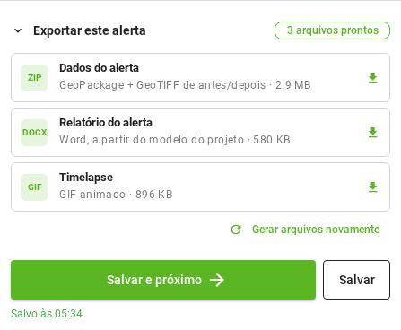

.. list-table::
    :header-rows: 1
    :widths: 25 75

    *   -   Bloco
        -   Descrição
    *   -   **Gerar arquivos**
        -   Gera os dados e o relatório do alerta a partir da revisão salva ("Gera os arquivos acima a partir da revisão salva"). Fica desativado até que a revisão na tela seja salva: mostra então "Salve este alerta primeiro", ou "Salve suas alterações primeiro" quando há alterações não salvas. Um alerta revisado aberto com as imagens com que foi salvo fica pronto na hora. Roda na lista de tarefas ("Gerando arquivos…") e demora um pouco: baixa as imagens de antes e depois.
    *   -   **Dados do alerta**
        -   Baixa um arquivo .zip: o GeoPackage do alerta, as imagens de antes e depois num único GeoTIFF e, para um alerta verdadeiro, o GIF.
    *   -   **Relatório do alerta**
        -   Baixa o relatório Word do alerta.
    *   -   **Gerar arquivos novamente**
        -   Gera os arquivos de novo (por exemplo, depois que a revisão mudou).
    *   -   **Timelapse**
        -   Cria e baixa um GIF animado do alerta (veja abaixo). Para um alerta não salvo como alerta verdadeiro, ele diz "Apenas alertas verdadeiros".

Os arquivos levam o número da linha do alerta no conjunto (o número do contador menos um):

.. list-table::
    :header-rows: 1
    :widths: 40 60

    *   -   Arquivo
        -   Conteúdo
    *   -   ``alert_<n>.gpkg``
        -   O alerta como uma única feição, com os atributos e as respostas (as respostas no idioma atual do app). A geometria é o polígono desenhado em `Refinar o polígono <defo-analysis-refine_>`_ ou, se não houver, o retângulo envolvente do alerta.
    *   -   ``alert_<n>_<before>_<after>.tif``
        -   As imagens de antes e depois, recortadas pela **Área da imagem**. As duas partes de data indicam a coleção de cada imagem (``s`` Sentinel-2, ``l`` Landsat, ``p`` Planet) e a data.
    *   -   ``alert_<n>_<before>_<after>.gif``
        -   O timelapse, quando criado, com o mesmo nome do GeoTIFF.
    *   -   ``alert_<n>.zip``
        -   O GeoPackage, o GeoTIFF e, para um alerta verdadeiro, o GIF.
    *   -   ``alert_<n>.docx``
        -   O relatório Word.

Para um alerta de um grupo (veja `Alertas próximos <defo-analysis-nearby_>`_), os arquivos descrevem o grupo inteiro: o GeoPackage contém uma única feição com a área somada do grupo, a primeira e a última data de detecção, as fontes, ``group_size`` (o número de alertas) e ``group_alerts`` (os números deles, por exemplo "12, 15, 16"), e o GIF contorna todos os alertas do grupo.

Os links dos blocos valem para a revisão que está na tela. Escolher outras imagens, salvar o alerta de novo ou mudar o modelo de relatório os esconde: gere os arquivos de novo.

O relatório
"""""""""""

O relatório é gerado a partir do modelo Word do projeto, escolhido na etapa `Questionário <defo-questionnaire-template_>`_, ou a partir do modelo padrão do app quando o projeto não tem nenhum. Os marcadores do modelo são preenchidos com os atributos, as respostas e as imagens do alerta. Veja a lista em `O modelo de relatório <defo-questionnaire-template_>`_.

O timelapse
"""""""""""

O bloco **Timelapse** cria um GIF animado que percorre as imagens da área do alerta, de antes para depois, com o contorno do alerta por cima. Cada quadro dura 2 segundos e traz a coleção e a data. Os quadros de antes e de depois também indicam o lado ("Antes · Sentinel-2 2026-07-28").

Ele só é oferecido para um alerta verdadeiro: o bloco fica ativo quando o alerta está salvo como **Revisado: confirmado** e as imagens na tela são aquelas com que ele foi salvo. Caso contrário, ele diz "Salve-o como alerta verdadeiro, com as imagens na tela, para criá-lo".

Os quadros são:

-   as imagens de antes e depois escolhidas na revisão; e
-   até duas imagens anteriores à imagem de antes e duas posteriores à imagem de depois, encontradas num intervalo de 12 meses, abaixo do limite de **Nuvens máx.** da linha do tempo e nunca um mosaico Planet.

O GIF é salvo junto dos outros arquivos e, quando os arquivos do alerta são gerados, incluído no arquivo .zip.

.. _defo-export-set:

O conjunto inteiro, a partir da Visão geral
^^^^^^^^^^^^^^^^^^^^^^^^^^^^^^^^^^^^^^^^^^^

O cartão **Exportar alertas**, no fim da `Visão geral <defo-overview_>`_, grava os alertas do conjunto exibido num único arquivo. A linha de cima resume os alertas que a etiqueta de **Alertas** escolhida grava, com as fontes e as datas do conjunto (por exemplo "11 alertas · 304,9 ha · GLAD-L + GLAD-S2 + RADD · 2026-10-01 – 2026-10-20" para **Confirmados**). A etiqueta de pasta ao lado copia o caminho da pasta quando selecionada.

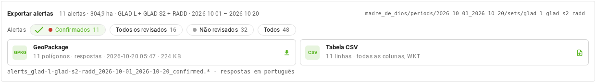

Para exportar o conjunto:

1.  Escolha os alertas a gravar com as etiquetas de **Alertas**: **Confirmados**, **Todos os revisados**, **Não revisados** ou **Todos**. Cada etiqueta mostra o seu número de alertas; uma etiqueta sem nenhum fica desativada. **Confirmados** vem selecionada quando o conjunto tem alertas confirmados; caso contrário, **Todos**.
2.  Selecione um bloco de formato para gravar o arquivo. Ele mostra "Gravando 11 alertas…" enquanto trabalha, e a lista de tarefas mostra **Exportando alertas**.
3.  Selecione de novo o bloco, que agora é um link de download com a hora em que foi gravado, para baixar o arquivo.

.. list-table::
    :header-rows: 1
    :widths: 25 75

    *   -   Bloco
        -   Conteúdo
    *   -   **GeoPackage**
        -   Um polígono por alerta, com os atributos e as respostas. A geometria é o polígono do alerta gerado em `Integrar e vetorizar <defo-integrate_>`_, não o desenhado na Análise.
    *   -   **Tabela CSV**
        -   Uma linha por alerta com todas as colunas, com as geometrias escritas como texto bem conhecido (WKT, do inglês *well-known text*), incluindo o polígono desenhado na Análise.

Os dois arquivos acrescentam três colunas sobre o `crescimento <defo-integrate-growth_>`_:

-   ``kind``: ``new``, ``growth``, ``growth_small`` ou ``new_small`` (veja **Tipo** em `O painel de revisão <defo-analysis-panel_>`_);
-   ``grows_from``: os vínculos do alerta, separados por ";", cada um escrito como *conjunto*\ ``#``\ *número do alerta*\ ``@``\ *execução desse conjunto*; e
-   ``history_area_ha``: a área confirmada do histórico do alerta, 0 para um alerta sem histórico.

O nome do arquivo é formado pelas fontes do conjunto, pelo período e pelos alertas escolhidos (por exemplo ``alerts_glad-l-glad-s2-radd_2026-08-01_2026-09-30_confirmed.gpkg``): ``_reviewed`` para **Todos os revisados**, ``_unreviewed`` para **Não revisados** e nenhum sufixo para **Todos**. A última linha do cartão mostra o nome. As respostas são gravadas no idioma atual do app.

Quando revisões são salvas depois que um arquivo foi gravado, o bloco dele diz **Revisões alteradas desde então**, com um botão **Atualizar**. Selecione-o para gravar o arquivo de novo.

Mensagens comuns
^^^^^^^^^^^^^^^^

"As imagens de antes e depois deste alerta não estão ambas prontas, então os arquivos não podem ser gerados."
    Escolha as duas imagens na linha do tempo e espere os dois mapas terminarem de exibi-las.

"Nenhum conjunto de alertas está ativo, então não há onde salvar os arquivos do alerta no projeto. Execute primeiro Integrar e vetorizar."
    Execute `Integrar e vetorizar <defo-integrate_>`_.

"O modelo de relatório … não existe mais. Escolha-o novamente na etapa Questionário, ou limpe o campo para usar o modelo padrão."
    O modelo do projeto foi movido ou apagado: veja `O modelo de relatório <defo-questionnaire-template_>`_.

"Os arquivos do alerta estão prontos, mas não foi possível criar o GIF, então o zip não contém o GIF."
    Tente o bloco **Timelapse** sozinho.

"As imagens de antes e depois são a mesma imagem, então o GIF não mostraria nenhuma mudança."
    Escolha duas imagens diferentes na linha do tempo.

"Menos de duas imagens puderam ser renderizadas para este alerta, então nenhum GIF foi criado."
    Escolha outras imagens de antes e depois e tente de novo.

"Os arquivos do alerta terminaram de ser gerados depois que você passou para outro alerta: não foram oferecidos para download aqui."
    Volte ao alerta: os arquivos estão na pasta do conjunto.

.. _defo-use-case:

Caso de uso: revisão de alertas em Madre de Dios, Peru
------------------------------------------------------

.. labels-ok: Admin level 1; Select AOI; Cor verdadeira

Este caso de uso acompanha uma pequena equipe de monitoramento florestal ao longo de duas rodadas mensais no departamento de Madre de Dios, na Amazônia peruana, na fronteira com o Brasil e a Bolívia. O garimpo de ouro e o avanço da agricultura pressionam a floresta da região, por isso a equipe quer saber, todo mês, onde houve perda florestal e por quê.

A equipe tem:

-   uma coordenadora, que configura o projeto e revisa alertas; e
-   dois avaliadores, Ana e Luis, que revisam a sua parte dos alertas nas suas próprias contas do SEPAL.

.. note::

    Os valores deste caso de uso vêm do projeto de demonstração usado nas capturas de tela deste artigo. Os vereditos e as respostas mostram como o app registra uma revisão; são exemplos, não uma avaliação verificada da floresta de Madre de Dios.

Configurar o projeto
^^^^^^^^^^^^^^^^^^^^

A coordenadora configura o projeto assim:

1.  **Projeto**: no app, ela seleciona **Novo projeto** e o chama de ``madre_de_dios`` (veja `Criar um projeto <defo-project-create_>`_).
2.  **AOI**: na etapa `AOI <defo-aoi_>`_, ela escolhe **Admin level 1**, depois Peru e depois "Madre De Dios" (com a grafia da lista), e seleciona **Select AOI**. A área é salva como ``PER_Madre_De_Dios``. Um departamento inteiro é uma área grande: todas as etapas seguintes demoram mais do que para um distrito.

A rodada de setembro
^^^^^^^^^^^^^^^^^^^^

Período
"""""""

Em `Período de monitoramento <defo-period_>`_, a coordenadora:

1.  seleciona **Novo período**;
2.  define as datas de 2026-09-01 a 2026-09-30;
3.  digita 90 em **Busca retroativa (dias)** (o primeiro período de um projeto novo começa em 0); e
4.  seleciona **Adicionar período**.

A janela de busca vai de 2026-06-03 a 2026-09-30, então os agrupamentos que começaram entre junho e agosto, e os alertas que as fontes publicaram com atraso, também são encontrados. Como é o primeiro período, ele não tem nenhum conjunto anterior: todos os alertas da sua janela de busca são mantidos.

Alertas
"""""""

Em `Fontes de alertas <defo-alerts_>`_, a coordenadora adiciona as três fontes predefinidas: **GLAD-L (Landsat, 30 m)**, **RADD (Sentinel-1, 10 m)** e **GLAD-S2 (Sentinel-2, 10 m)**, cada uma com **Adicionar aos novos períodos** deixado marcado, para que os próximos períodos comecem com elas. Cada uma cobre a AOI inteira. Abaixo do RADD, o app avisa que ele só detecta em floresta tropical úmida primária: no resto do departamento, só o GLAD-L e o GLAD-S2 podem reportar alertas. Depois, o botão **Baixar** de cada linha baixa as três fontes na janela de busca.

Harmonizar
""""""""""

Em `Harmonizar <defo-harmonize_>`_, a coordenadora:

1.  mantém a grade sugerida, a zona UTM do departamento (``EPSG:32719``) a 10 m, e seleciona **Salvar grade**. A grade tem 41425 × 38561 pixels, cerca de 12,8 GB por fonte antes da compactação, então o app avisa que os downloads vão demorar;
2.  adiciona uma máscara para que só contem os alertas em floresta: **Adicionar máscara**, a imagem Hansen Global Forest Change ``UMD/hansen/global_forest_change_2025_v1_13``, banda ``treecover2000``, chamada ``forest_2000``, modo **Manter**; e
3.  seleciona o **Alinhar** da máscara e, quando a máscara mostra "Pronta", **Harmonizar** na linha de cada fonte, que harmoniza as três fontes.

O download e a harmonização levaram cerca de 15 minutos. A máscara e cada fonte mostram então "Pronta": o GLAD-L com 2362718 pixels de alerta, o RADD com 1508527 e o GLAD-S2 com 1462458.

Integrar e vetorizar
""""""""""""""""""""

Em `Integrar e vetorizar <defo-integrate_>`_, a coordenadora:

-   mantém as três fontes e **Incluir alertas prováveis (não confirmados)** ligado;
-   define o **Tamanho mínimo do agrupamento** em 1 ha e a **Ordem** como **Agrupamentos maiores primeiro**; e
-   marca **Limitar o número de agrupamentos**, com **Número máximo de agrupamentos** igual a 48: a equipe consegue revisar cerca de 48 alertas por mês, então começa pelos maiores.

A execução gera o conjunto de alertas "2026-09-01 → 2026-09-30 · GLAD-L + GLAD-S2 + RADD", com 48 alertas, de 383,18 ha a 27,84 ha: 2870 ha no total.

Os agrupamentos além do limite ficam guardados como não analisáveis. O período seguinte só volta a considerá-los se a busca retroativa dele alcançar setembro e ele usar as mesmas fontes. A busca retroativa de 90 dias de outubro alcança (veja `O que os períodos anteriores já reportaram <defo-integrate-earlier_>`_).

Camadas adicionais
""""""""""""""""""

Com o conjunto de alertas gerado, **Preparar a revisão** é liberado. Para avaliar os alertas sobre uma imagem recente, a coordenadora adiciona uma `camada adicional <defo-layers_>`_: uma imagem Sentinel-2 do **Earth Engine** de 27 de setembro de 2026 (bloco 19LDF, a leste de Puerto Maldonado), desenhada como **Composição RGB** em **Cor verdadeira** (B4, B3, B2), **Mín.** 0 e **Máx.** 3000, chamada ``Sentinel-2 2026-09-27``, e **Mostrar na Análise** marcado.

.. note::

    Um mosaico mensal Planet NICFI cobriria o departamento inteiro, mas a conta usada neste artigo não tem acesso ao NICFI. É por isso que a linha do tempo da Análise nas capturas de tela abaixo não tem a etiqueta *Planet*.

Revisar sozinha e depois em equipe
^^^^^^^^^^^^^^^^^^^^^^^^^^^^^^^^^^

Primeiras revisões
""""""""""""""""""

Antes de dividir o trabalho, a coordenadora abre a `Análise <defo-analysis_>`_ e revisa os dois maiores alertas:

-   o alerta 1 (383,18 ha) como **Alerta verdadeiro**, com o vetor da perda **Mineração**; e
-   o alerta 2 (146,97 ha) como **Falso positivo**.

Dividir os alertas
""""""""""""""""""

Em `Avaliação <defo-evaluation_>`_, a coordenadora marca **Vários avaliadores**, seleciona **Dividir alertas…**, escolhe **Nomes**, digita Ana e Luis e seleciona **Dividir**. Os alertas são distribuídos alternadamente: Ana e Luis recebem 23 cada um, e os dois alertas já revisados ficam **Sem atribuição**.

Antes dos pacotes
"""""""""""""""""

A coordenadora continua revisando no projeto original depois de definida a divisão:

-   o alerta 3 como **Alerta verdadeiro**, com **Expansão agrícola**;
-   o alerta 4 como **Precisa de revisão**, com **Extração de madeira**; e
-   o alerta 5 como **Alerta verdadeiro**, com **Mineração**.

Esses vereditos vão nos pacotes, então os avaliadores os veem; os alertas 3 e 5 estão entre os de Ana. Em seguida, a coordenadora seleciona **Gerar pacotes** e envia a cada avaliador o seu arquivo .zip.

A cópia de revisão de Ana
"""""""""""""""""""""""""

Ana copia o pacote para a sua pasta do SEPAL e o importa com **Importar** na janela `Projeto <defo-project-import_>`_. Ele abre como o projeto ``madre-de-dios__e01-ana``, na tela de Análise, já filtrado para os alertas dela ("Avaliador: Ana").

Ana os percorre com **Salvar** e **Próximo**:

-   a barra superior mostra "5 revisados · 18 restantes · filtrados · 48 no total" (as duas revisões da coordenadora nos alertas dela e três dela própria);
-   o contador numera os alertas dela de 1 a 23; e
-   o terceiro alerta dela, por exemplo, é salvo como **Alerta verdadeiro**, com **Mineração**: a imagem de depois mostra solo nu e arenoso, com uma lagoa esverdeada na borda da floresta, que lembra as cavas deixadas pelo garimpo de ouro aluvial.

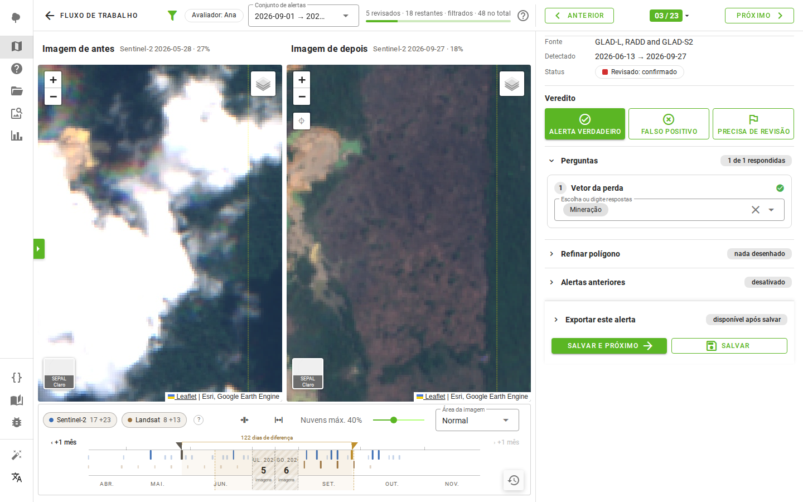

Quando termina por ora, Ana seleciona **Gerar cópia revisada** na etapa `Avaliação <defo-evaluation-return_>`_ ("5 / 23 dos seus alertas revisados") e devolve o arquivo ``__reviewed.zip``.

Mesclar as revisões de Ana
""""""""""""""""""""""""""

A coordenadora copia o arquivo para a pasta do SEPAL, seleciona **Mesclar cópia revisada…** e o escolhe. A prévia diz "Ana: 3 revisões novas, 1 conflitos, 1 sem alteração, 0 ignoradas":

-   a revisão sem alteração é a do alerta 3, que Ana deixou como a coordenadora a salvou; e
-   o conflito é o alerta 5: a coordenadora o tinha confirmado como garimpo, enquanto Ana o marcou como falso positivo.

A coordenadora mantém o veredito original com **Manter as minhas** e pretende rever esse alerta com Ana. Depois de **Mesclar**, a tabela de avaliadores mostra Ana com cinco dos seus 23 alertas revisados e a data da mesclagem (veja `Mesclar uma cópia revisada <defo-evaluation-merge_>`_).

Acrescentar uma pergunta
^^^^^^^^^^^^^^^^^^^^^^^^

A equipe também quer registrar se cada área desmatada tem uma estrada de acesso por perto. Na etapa `Questionário <defo-questionnaire_>`_, depois do **Vetor da perda** padrão, a coordenadora acrescenta uma segunda pergunta:

1.  **Adicionar pergunta**;
2.  "Estrada de acesso próxima?";
3.  **Uma resposta**, com as opções Sim e Não;
4.  **Obrigatória** ligado; e
5.  feita só para **Alerta verdadeiro** e **Precisa de revisão**.

Como o questionário mudou depois que os pacotes foram gerados, os ícones de nuvem deles em `Avaliação <defo-evaluation-packages_>`_ ficam âmbar. Os pacotes já enviados continuam podendo ser mesclados, pela chave da pergunta. Para que a nova pergunta chegue aos avaliadores, a coordenadora seleciona **Gerar pacotes novamente** e envia os novos.

A partir daí, um alerta verdadeiro ou um alerta que precisa de revisão recebe as duas respostas (um falso positivo não recebe nenhuma: as duas perguntas só são feitas para os outros dois vereditos). O alerta 10, por exemplo, é salvo como **Alerta verdadeiro**, com **Expansão agrícola** como vetor da perda e "Não" para a estrada de acesso. O status dele mostra **Revisado: confirmado**, e a seção **Perguntas** mostra "2 de 2 respondidas".

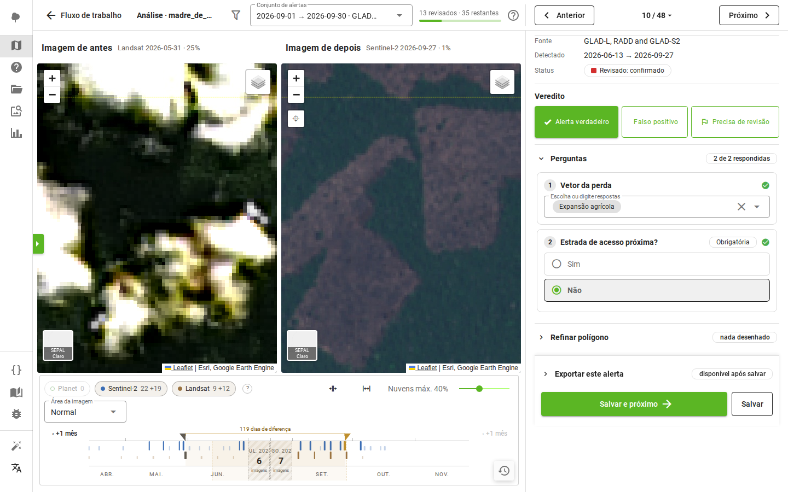

De volta ao fluxo de trabalho, **Mostrar estes alertas no mapa**, em `Integrar e vetorizar <defo-integrate-map_>`_, desenha o conjunto sobre o departamento. Nesse zoom, cada alerta é um ponto colorido pelo status de revisão:

-   cinza para **Não revisado**;
-   vermelho para **Revisado: confirmado**;
-   verde para **Revisado: falso positivo**; e
-   âmbar para **Revisado: precisa de revisão**.

Com 13 dos 48 alertas revisados, a maioria dos pontos ainda está cinza. A maior parte dos alertas fica no sul do departamento.

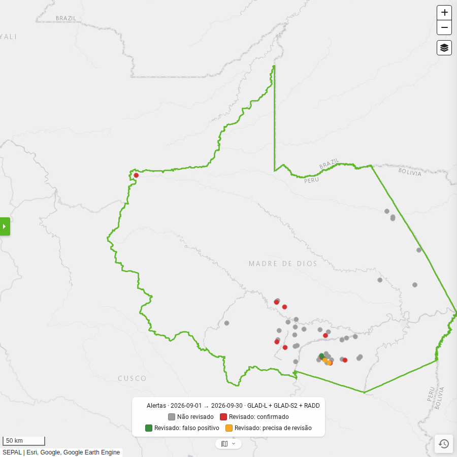

A rodada de outubro
^^^^^^^^^^^^^^^^^^^

No início da rodada seguinte, a coordenadora seleciona **Novo período** em `Período de monitoramento <defo-period-add_>`_. A janela já vem preenchida: de 2026-10-01 (o dia seguinte ao fim de setembro) até hoje, com os 90 dias de busca retroativa usados da última vez. A coordenadora define o fim em 2026-10-20, o dia desta rodada. **Adicionar período** o torna o período ativo, com as escolhas de máscara do período de setembro e as três fontes marcadas com **Adicionar aos novos períodos**.

Depois:

-   o **Baixar** de cada linha, em `Alertas <defo-alerts_>`_, baixa as três fontes para a nova janela, e o **Harmonizar** de cada linha, em `Harmonizar <defo-harmonize_>`_, as harmoniza; a grade e a máscara já estão prontas.
-   Em `Integrar e vetorizar <defo-integrate_>`_, a coordenadora usa as mesmas configurações de setembro (1 ha, os 48 maiores alertas). Antes de agrupar os pixels em alertas, a execução remove todos os pixels dentro dos 48 alertas de setembro, para que nada seja reportado duas vezes. O novo conjunto volta a ter 48 alertas, somando 1177 ha. Nenhum deles encosta num alerta confirmado em setembro, então a execução não vincula nenhum a perdas anteriores (veja `Crescimento de perdas anteriores <defo-integrate-growth_>`_).

A equipe os revisa como em setembro; até agora, 16 foram revisados, 11 deles como alertas verdadeiros. Com **Mostrar estes alertas no mapa** e **Mostrar conjuntos anteriores** ligados, o mapa mostra os alertas de outubro ao lado dos de setembro, desenhados em cores mais claras. Os alertas de outubro ficam nas mesmas partes do departamento que os de setembro.

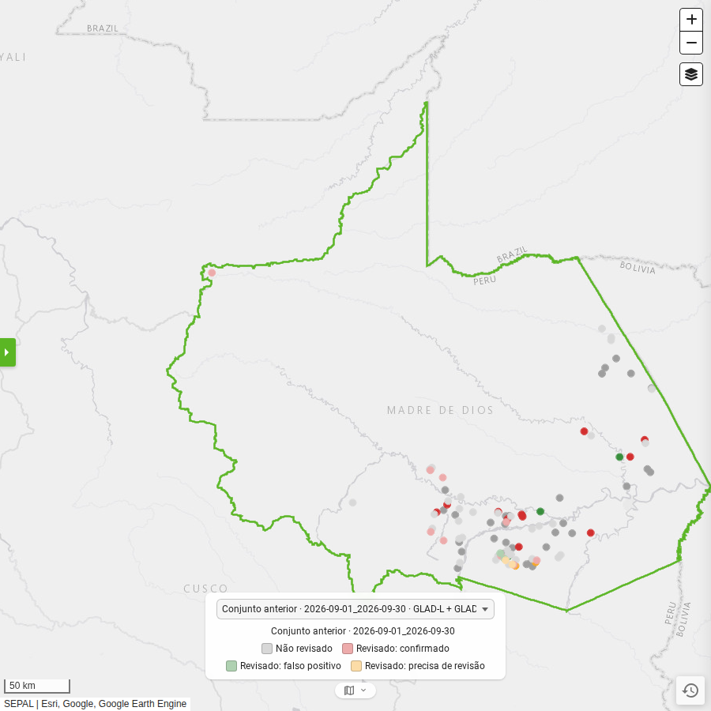

Ler os números
^^^^^^^^^^^^^^

A `Visão geral <defo-overview_>`_ resume o conjunto de outubro. Em **Área (ha)**:

-   **Perda confirmada**: 305 ha, com "▼ 780 a menos que 2026-09-01 → 2026-09-30";
-   **Detectado no total**: 1177 ha;
-   **Revisados**: 33 %, "16 de 48 alertas"; e
-   **Maior alerta**: 31,9 ha, o "Alerta 0" do cartão. A Visão geral numera os alertas a partir de 0, na ordem do conjunto; o contador da Análise começa em 1, então este é o primeiro alerta lá.

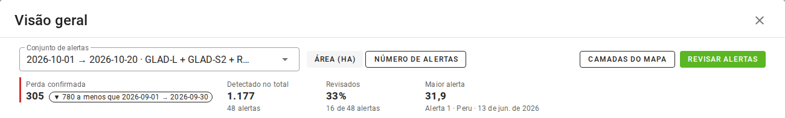

.. important::

    A comparação exige cuidado. **Perda confirmada** conta só os alertas revisados como alertas verdadeiros, e só um terço dos alertas de outubro está revisado; o número de setembro também cobre só os alertas de setembro revisados até agora. A seta indica que, por enquanto, há menos perda *confirmada*, não que se perdeu menos floresta: o número cresce à medida que a equipe continua revisando.

**Ao longo dos períodos de monitoramento** mostra os dois períodos lado a lado, com a parte ainda em revisão hachurada (2870 ha detectados em setembro, 1177 ha em outubro).

Mais abaixo:

-   o cartão da pergunta sobre o vetor da perda divide a área revisada por resposta (em outubro: Mineração em primeiro lugar, depois Expansão agrícola); e
-   o cartão da nova pergunta a divide pelas suas respostas (em outubro: tudo "Não", 358 ha, com 81,2 ha em "Sem resposta").

Veja todos os cartões em `Os gráficos <defo-overview-figures_>`_.

Compartilhar os resultados
^^^^^^^^^^^^^^^^^^^^^^^^^^

O conjunto inteiro
""""""""""""""""""

No fim da Visão geral, o cartão **Exportar alertas** grava o conjunto de outubro num arquivo. A coordenadora escolhe **Confirmados** (11 alertas, 304,9 ha) e seleciona o bloco **GeoPackage**. O arquivo ``alerts_glad-l-glad-s2-radd_2026-10-01_2026-10-20_confirmed.gpkg`` contém um polígono por alerta confirmado, com os atributos e as duas respostas, pronto para um SIG. O bloco **Tabela CSV** grava os mesmos alertas como uma tabela para planilha. Veja `O conjunto inteiro, a partir da Visão geral <defo-export-set_>`_.

Um alerta
"""""""""

Para relatar um alerta isoladamente, a coordenadora o abre na Análise, salva-o e seleciona **Gerar arquivos**, em **Exportar este alerta**. O resultado é um arquivo .zip com o GeoPackage do alerta e as imagens de antes e depois, e um relatório Word gerado a partir do modelo do projeto. Para um alerta verdadeiro, o bloco **Timelapse** também cria um GIF animado das imagens, de antes para depois. Veja `Um alerta, a partir da Análise <defo-export-alert_>`_.

Todos os arquivos também ficam guardados na pasta do conjunto de alertas dentro do projeto, em ``periods/2026-10-01_2026-10-20/sets/glad-l-glad-s2-radd/``.

O mês seguinte
^^^^^^^^^^^^^^

Para a próxima rodada, a equipe pretende:

-   selecionar **Novo período** de novo: as datas dão continuidade à série, e a busca retroativa traz de volta os agrupamentos deixados de lado por serem pequenos demais no mês anterior, de modo que um desmatamento que cresce devagar vira alerta ao atingir 1 ha, sem que nenhum pixel seja reportado duas vezes;
-   revisar os alertas de outubro antes da próxima execução: um alerta confirmado até lá pode virar a perda anterior a partir da qual os alertas de novembro crescem, e um desmatamento que continua crescendo mostra o seu histórico na Análise e na Visão geral;
-   conferir o questionário antes de dividir: uma pergunta acrescentada depois de os pacotes serem gerados exige **Gerar pacotes novamente**;
-   revisar também os alertas ainda **Não revisado** dos conjuntos anteriores, já que a comparação da Visão geral só é tão completa quanto as revisões por trás dela; e
-   usar **Duplicar** na janela `Projeto <defo-project-duplicate_>`_ para monitorar uma área vizinha com as mesmas fontes, máscara e camadas.
